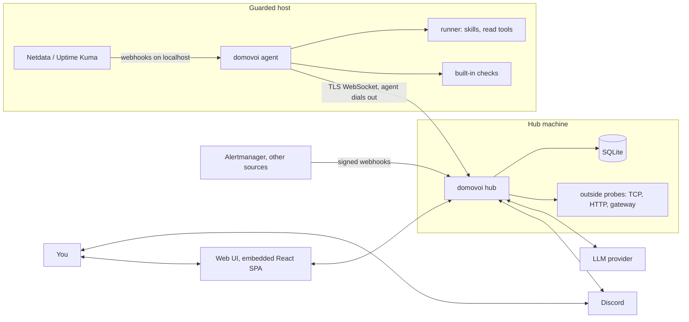
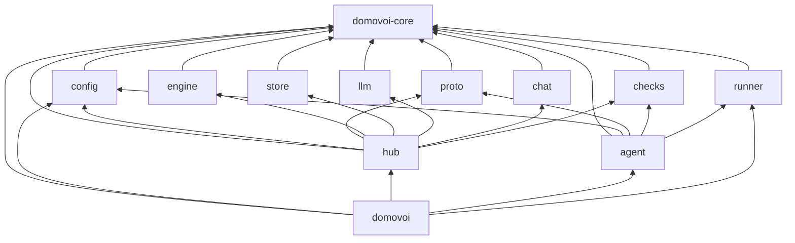
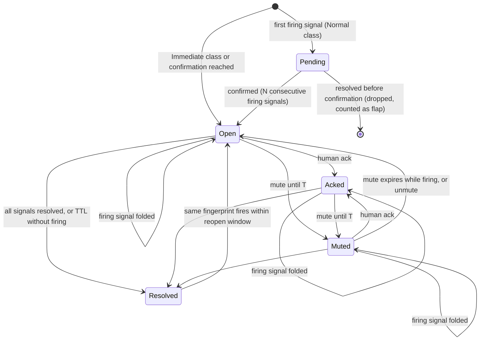
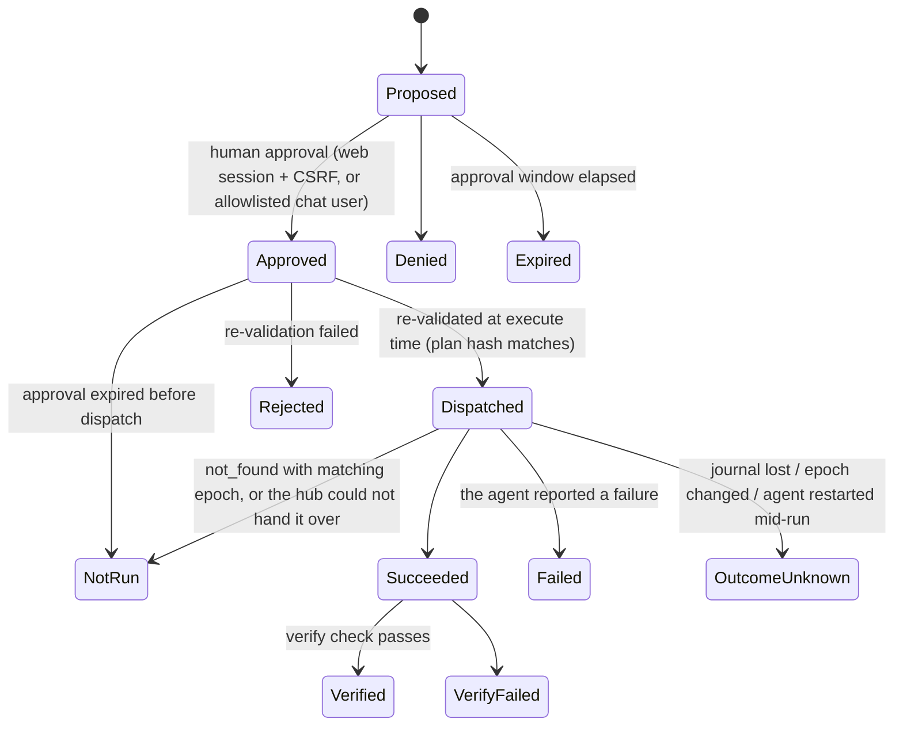
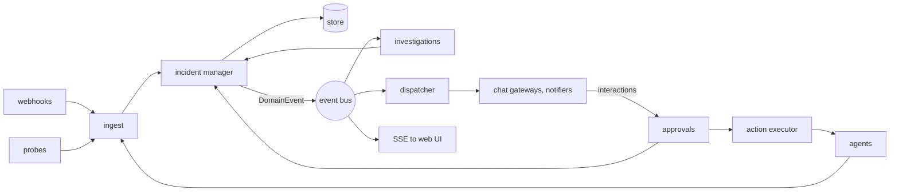

# Domovoi architecture

Status: accepted for v0.1. Anything marked **Rule** or **Invariant** can only change through an ADR in [`docs/adr`](docs/adr). The rules in §4 are enforced by `cargo xtask arch-check`; the invariants in §15 are enforced by tests named in that section.

---

## 1. What Domovoi is

Domovoi watches self-hosted servers, triages problems with an LLM, talks to you in chat, and only changes anything after a human approves it. It is **one binary with two roles**:

- **hub**: web UI and API, chat gateways, alert correlation, AI triage, approvals, audit log, SQLite database.
- **agent**: runs on every guarded host. Runs built-in checks, executes skills (user scripts) and read tools, and dials out to the hub.

The recommended deployment puts the hub on a different machine from the hosts it guards. Single-box mode runs both roles in one process.

## 2. Principles

1. **The LLM proposes; deterministic code decides.** Model output is data. It never becomes a command line, a config change or an approval.
2. **One execution path.** Every process spawned on a host is spawned by `domovoi-runner` inside an agent, from a manifest, with argv only.
3. **Ports and adapters.** Domain and application logic depend on traits defined in `domovoi-core`, never on I/O libraries.
4. **Fail open for alerts, fail closed for actions.** If triage fails, the alert still goes out. If validation is uncertain, the action does not run.
5. **Boring and small.** SQLite, one binary, no broker, no external services required.
6. **Deterministic tests.** Every component can run against fakes and a fake clock.

## 3. System context

## 4. Workspace layout and dependency rules

| Crate | Role | May depend on (internal, normal deps) |
| --- | --- | --- |
| `domovoi-core` | Domain types, state machines, ports (traits). Pure. Includes the `policy_store` module: rule and version types, the policy repository port, and shadow decision records. | none |
| `domovoi-config` | Typed hub and agent config, loading, validation, secret indirection | core |
| `domovoi-proto` | Hub ↔ agent wire messages, envelope, versioning | core |
| `domovoi-engine` | Application services: correlation, incident manager, notification policy, triage orchestration, approvals, digest, and the `policy_shadow` module that records shadow decisions for Execution steps in a sweep (it enforces nothing) | core |
| `domovoi-store` | SQLite adapter for the repository ports. Policy tables: `policy_versions`, `policy_rules`, `policy_acknowledgements`, `policy_shadow_decisions`, `policy_shadow_state` | core |
| `domovoi-llm` | LLM provider adapters: Anthropic, OpenAI-compatible, CLI | core |
| `domovoi-chat` | Chat gateway and notifier adapters: Discord, generic webhook | core |
| `domovoi-checks` | Built-in checks. Feature `host` (agent-side host checks), feature `net` (network probes, also used by the hub) | core |
| `domovoi-runner` | The only crate that spawns processes: skill manifests, argument validation, sandboxed execution | core |
| `domovoi-agent` | Agent runtime: hub link, check scheduler, request handling, spool | core, config, proto, checks, runner |
| `domovoi-hub` | Hub runtime: HTTP API, auth, SPA serving, webhook ingest, agent server, wiring of engine with adapters. `PolicyService` is the use-case service for the policy draft, versions, preview, simulation and shadow reads (ADR 0026); it is planned and not yet present in the code | core, config, proto, engine, store, llm, chat, checks |
| `domovoi-testkit` | Fakes for every port, a fake clock, fixtures, the crash-injecting store, snapshots and invariants. **Dev-dependency only.** | core, proto |
| `domovoi` | The binary and CLI. Composition root: selects mode, wires hub and agent, injects the process executor | core, config, hub, agent, runner |
| `xtask` | Developer tasks: `arch-check`, `openapi`, `ci`; the checker is also a library the engine's and the hub's gate tests call. **Dev-dependency only.** | none (not part of the product) |

**Rules**

- **R1 Dependency direction.** Internal normal dependencies must match the table above. Adapters never depend on other adapters. Nothing depends on `domovoi` or `xtask` except the engine's and the hub's gate tests through `[dev-dependencies]` (R5 keeps `xtask` dev-only).
- **R2 Pure inner layers.** `domovoi-core` and `domovoi-proto` do no I/O and do not depend on `tokio`, `sqlx`, `reqwest`, `axum`, `hyper`, `serenity`, `poise`, `bollard` or `rustls`. `domovoi-engine` may depend on `tokio` for tasks, channels and timers only; it must not use `tokio::net`, `tokio::fs`, `tokio::process`, `std::fs`, `std::net` or `std::process`. Allowed external dependencies for these crates are listed in `xtask/src/arch/rules.rs`.
- **R3 Process spawning.** Only `domovoi-runner` (and `xtask`) may construct `std::process::Command` or `tokio::process::Command`. Enforced by `clippy::disallowed_methods` and a source scan.
- **R4 No shell.** No code may invoke `sh -c`, `bash -c` or `/bin/sh`. Commands are argv vectors built from validated parameters.
- **R5 Testkit and xtask are dev-only.** `domovoi-testkit` and `xtask` may appear only under `[dev-dependencies]`.
- **R6 Composition roots.** `domovoi-hub` wires hub-side adapters, `domovoi-agent` wires agent-side ones, `domovoi` chooses the mode and injects cross-cutting services. No other crate constructs another crate's concrete adapter.
- **R7 Lints.** Every crate uses `[lints] workspace = true`. `unsafe_code` is forbidden. Library code may not use `unwrap`, `panic!`, `todo!`, `unimplemented!` or `dbg!`. CI treats warnings as errors.
- **R8 File size.** Non-test Rust source files stay at or below 500 lines. Split modules instead.
- **R9 Errors.** Libraries define `thiserror` error enums. `anyhow` is allowed only in `domovoi` and `xtask`.
- **R10 Docs.** Every public item is documented (`missing_docs`). Every crate root has a `//!` doc stating its role.
- **R11 Dependencies.** All versions are declared once in `[workspace.dependencies]`. New dependencies must pass `cargo deny` (license allowlist, advisories, no `openssl-sys`; TLS is rustls only so musl static builds work).
- **R12 Generated artifacts.** `web/src/api/openapi.json` and `web/src/api/schema.d.ts` are generated and committed. CI fails if they are stale.
- **R13 Migrations.** Files under `crates/domovoi-store/migrations` are append-only once merged.
- **R14 Wire formats.** Protocol messages and the OpenAPI document are covered by snapshot tests. A breaking protocol change bumps the protocol major version.
- **Hub module edges** (ADR 0026). `MOD-1`: transports (`api`, `auth::interactions`, `ingest`) do not import each other. `MOD-2`: `services` imports no transport and not `runtime` or `router`. `MOD-3`: a new top-level hub module is a transport, the services or an unzoned support module. `MOD-4`: a transport names neither `ActionHandle` nor `OperationHandle`. `CALLER-1`: a `Caller` is built only by the session extractor and by the chat authorizer, once each.

## 5. Domain model (`domovoi-core`)

All identifiers are newtypes over UUIDv7 (time-ordered) unless noted. Timestamps are `jiff::Timestamp` (UTC); civil time and time zones use `jiff` with an IANA zone from config.

### 5.1 Hosts and agents

- `HostId`, `AgentId`. A host has a `name` (slug, `^[a-z0-9][a-z0-9-]{0,62}$`), a `kind` (`Local`, `Remote`, or `External` for hosts known only from webhooks, which have no agent), labels, and at most one enrolled agent.
- `AgentIdentity`: agent id, ed25519 public key, agent version, enrolled-at.

### 5.2 Signals and fingerprints

- `Signal`: one observation from a check, a webhook or a probe.
  - `source: SourceKind` (`BuiltIn`, `Webhook { kind }`, `Probe`, `Agent`)
  - `host: HostId`, `check: CheckKey` (dotted, e.g. `container.restart_loop`), `target: Option<TargetKey>` (e.g. `plex`, `/dev/sdc`)
  - `status: Firing | Resolved`, `severity: Info | Warning | Critical`
  - `summary: String`, `evidence: Evidence` (ordered key → value map, values are strings, numbers or booleans), `observed_at`
  - `class: Normal | Immediate` (immediate skips confirmation runs, e.g. power loss)
- `Fingerprint = hash(host, check, target)`. **Volatile values (counts, IDs, timestamps, measurements) are never part of a fingerprint.** They live in evidence.

### 5.3 Incidents

- `Incident`: id, fingerprint, host, check, target, title, status, severity (max of open signals), `verdict: Option<Verdict>`, opened/resolved timestamps, `notify: NotifyState` (last sent, reminder due, thread reference per gateway), `history: EntityHistory` (bounded series of a tracked value, e.g. reallocated sectors).
- `Verdict`: `ActionNeeded`, `Monitor`, `Expected`, `Fixed`.
- **Recurrence folding:** a firing signal for an open or recently resolved incident with the same fingerprint updates that incident (thread reply) instead of creating a new one.
- **Delta checks:** for monotonic counters, a check emits a signal only when the value increases beyond its acked baseline. The incident's `history` records each value.

### 5.4 Acks, maintenance and baselines

- `AckRule`: matches incidents by host, check, target pattern and an evidence predicate; has a note and an optional expiry. Matching incidents keep their status but do not notify.
- `MaintenanceWindow`: host + time range; suppresses notifications, keeps signals.
- `Baseline`: expected containers, systemd units and listening ports per host, each with `criticality: Critical | Warning`. Learned only from managed containers (compose or Portainer labels); containers with auto-remove are never learned; entries absent for N days expire.

### 5.5 Triage

- `TriageRequest`: incident snapshot, context bundle (recent signals, what changed, similar past incidents, relevant host notes), budget.
- `TriageReport`: `headline` (≤ 120 chars), `summary`, `cause`, `evidence: Vec<EvidenceRef>` (≤ 3 shown on the card), `verdict`, `next_step`, `manual_steps: Vec<String>` (at most 5 steps of at most 200 chars each, what a person does by hand), `proposals: Vec<ActionProposal>`.
- `ReadTool`: a **closed enum** of read-only tools (`DockerPs`, `DockerLogs`, `DockerInspect`, `DockerEvents`, `HostOverview`, `Journal`, `ListeningPorts`, `SmartReport`, `IncidentHistory`, `NotesSearch`, `RunReadSkill`). There is no variant that approves, executes a write skill, or changes state.

### 5.6 Skills and actions

- **Capability contracts are hub-owned.** `domovoi_core::capability` compiles in one `CapabilityContract` per known capability: the eight read tools an agent executes, the two the hub answers itself (`incident.history`, `notes.search`), and the `skill.<name>` family, whose contract is built per host from the skill's manifest and the hub's raise-only floor. An agent reports implementation facts only — its catalogue ids and versions, its `hello.skills` summaries — and nothing it sends can create a contract or set an effect class.
- `SkillManifest`: `name`, `description`, `risk: Read | Write | Destructive`, `entry`, `params: Vec<ParamSpec>`, `timeout`, `run_as`, `hosts`, `applies_to: Vec<CheckKey>`, optional `verify`, optional `revert` + `confirm_window`, `max_output`.
- `ParamSpec`: `name`, `kind: String { pattern, max_len } | Integer { min, max } | Boolean | Enum { values }`, `description`.
- `ActionRequest` state machine:

- `PlanHash` has two families in one type. **v1** is `hash(skill name, manifest hash, host, canonical args)`; it is the legacy family and is kept for an action created before v2 existed. **v2** is `hash` over a length-prefixed encoding of the capability contract id and version, the implementation (manifest hash plus the entry script's SHA-256), the canonical target (host, enrolled agent key fingerprint, check and optional target), the canonical arguments and the execution id (`=` action id at M1). The domain lines `plan:v1` and `plan:v2` keep them apart. A stored action's family comes from `plan_hash_v2`: `NULL` means v1. `ActionRequest::approval_plan` is the only selector. Approval binds to that hash; dispatch recomputes it in the action's own family from one authenticated session snapshot (session identity, enrolled agent, journal epoch and announced skills), and the writer refuses a replacement session before recording the dispatch. A journal epoch alone is not a connection identity. The hub sends the always-v1 local-check hash in `run_skill`, which is a different value and never the approval binding.
- `Principal`: `Human(UserId)` or `System(component)`. Only `Human` can approve. The value that carries an approval, `HumanApproval`, may be constructed only in `crates/domovoi-hub/src/auth/`: by the web session layer (session + CSRF verified) and by the chat interaction authorizer (platform user ID on the allowlist). The engine consumes an `Authorization`, a wrapper with private internals whose only constructors are `Authorization::human` (hub auth, testkit) and `Authorization::policy` (a future policy layer, testkit); the policy case is refused in this milestone. `xtask arch-check` fails if any authorization constructor appears outside its allowed prefix. That check is a line-based text scan, not a compiler seal.
- There is exactly one execution boundary and one read boundary. A run is dispatched only by `execute(AuthorizedExecution)` in the engine's action-writer module, which is the only caller of `AgentLink::start_skill`; `AuthorizedExecution` has one crate-private constructor, `of`, is called at exactly one site, and is never stored. The engine's subsystems never hold a link: `ActionDeps` carries five capability objects (`0023`: `AvailabilityProbe`, `HostObservation`, `JournalStatus`, `HandoffRunner`, `CheckRerun`) that the hub composes once from its link at its runtime boundary, `Evidence` takes an `EvidenceCaps` and a `Clock`, and `HostCatalog` takes one `HostObservation`; a capability object cannot start a skill it cannot name, nor read a host it cannot name, so for the subsystems the boundary is a type, not a scanned list. A host's tool output is read only by `Evidence::collect_evidence`, which serves the model, the Operator, the triage context and the hub's profile collection; it asks for the host's availability first and only then checks the read's enablement, so an unavailable host always answers as such, it keeps the whole ask inside the request's deadline - the availability check races that deadline on the `Clock` port, and the read is bounded by the `HostRead` deadline contract, which the hub's link meets for its network wait and for the store lookups of its `NotConnected` fallback, releasing its registered request however the call ends - and it returns the agent's output unchanged. Host metadata is read separately through `AgentAdmin`, and verification re-runs a declared check with `run_check`. No hub transport names, holds or takes the link: `AgentServer::link()` is reachable only inside the hub crate, the runtime composition root is its one caller outside `agent_server`, the capability registry reads the agent's own words through its own narrow view (ADR 0024), and the only route to the raw link in a test is the hub's non-default `test-support` feature - absent from default and release builds, enabled by the hub's and the binary's dev-dependencies for their test and development builds, and by anyone who asks for it by name (`--features test-support` or `--all-features`). `cargo xtask arch-check` enforces all of this with rules `EXEC-1` to `EXEC-4` over the core, engine, hub, store and binary sources: the scan parses the sources (`syn`, `0023`) rather than reading lines, every boundary operation may appear only at its exact count in its exact files, `EXEC-4`'s naming exceptions are named file by file, and a file is test-only only when Cargo's test targets or `#[cfg(test)]` wiring reach it and no production module does, never by its name, and Rust that production code loads from outside `crates/` through `#[path]` or `include!` is scanned or refused. The gate tests `single_execution_boundary` and `transports_do_not_name_the_agent_link` assert the same shape from inside the engine and the hub by calling the very checker the tool runs: a call or an accessor split across lines, a renamed import or an operation hidden in a macro is seen or refused, code inside comments and string literals never counts, a line of code after a block comment on the same line still counts, type aliases of the server type are resolved, and what the scan does not resolve is listed in 0023 (glob re-exports, generated code). Like every rule in that check, none of this is a compiler seal; the value is that the ordinary way to add a second path, or for a transport to take the link, fails `arch-check` or a gate test.

### 5.7 Output models

- `Card`: the rendered-independent shape of every incident message: `badge` (verdict or severity), `host`, `headline`, up to 3 `bullets`, `next_step`, `buttons: Vec<CardButton>`, `details` (full reasoning, posted in the thread).
- `Digest`: one per day for all hosts. A host with nothing changed collapses to one line; others list changes since the previous digest, trends with projections (e.g. days until a pool is full) and `DigestFact`s contributed by checks and skills. Open incidents and advisories follow.
- `Advisory`: a low-priority hygiene finding (stale image, stack without a source copy, missing heartbeat, secret marked exposed). Advisories appear in the digest and never notify on their own.
- `Note`: markdown runbook text per host or global, searchable by triage.

### 5.8 Operations

- An **operation** is one durable piece of work on hosts, kind `investigate`, with a goal, a cycle counter, budgets, pinned subjects (host, check, optional target) and incident links. It is made of **steps**, which are immutable: a kind (`reasoning_turn`, `evidence_request`, `assessment`, `plan`, `policy_decision`, `approval`, `execution`, `verification`, `notification`, `question`, `note`), a phase, a cycle, a dense ordinal within the operation and an intent that never changes.
- **Edges** (`depends_on`, `caused_by`, `verifies`, `retry_of`, `answers`) point from a later step to an earlier step of the same operation. The ordinal rule makes the graph acyclic, and the store refuses an edge that points forward.
- A step's outcome is the only execution state: `pending`, `running`, `succeeded`, `failed`, `refused`, `not_run`, `unavailable`, `outcome_unknown`, `skipped` or `cancelled`. An **execution** is an Execution step with one `executions` row (host, contract, plan hash, approval, dispatch facts); its execution id is the step id.
- The operation status (`queued`, `running`, `waiting_approval`, `waiting_user`, `waiting_agent`, `waiting_timer`, `paused`, `succeeded`, `failed`, `escalated`, `cancelled`) is derived from open steps and the pause state by a pure function and stored only as a cache of that derivation. `paused` carries one reason: `budget`, `outcome_unknown`, `global_pause` or `error`.
- Executions run only `skill.<name>` contracts, against pinned targets. Every execution waits for an approval by a human (ADR 0025); no policy evaluation exists yet.
- Every change is one `UnitOfWork` commit. `build_trace` gives a frozen, read-only view (schema version 1) that carries no output, intent or plan hash.

## 6. Ports

All ports are `async_trait` traits in `domovoi-core::ports`, object-safe, `Send + Sync`.

| Port | Purpose | Implemented by | Used by |
| --- | --- | --- | --- |
| `Clock` | Current time, sleeping | engine (system), testkit (fake) | engine, agent, hub |
| `IncidentRepo`, `SignalRepo`, `ActionRepo`, `HostRepo`, `NoteRepo`, `BaselineRepo`, `AckRepo` | Persistence | store, testkit | engine, hub |
| `AuditLog` | Append-only audit events | store, testkit | engine, hub |
| `UnitOfWork`, `VersionedRead`, `JournalRead`, `EffectRead` | Commit state writes, journal, audit and effects atomically; read aggregates with their version, the journal and the effect outbox | store, testkit | engine, hub (being adopted) |
| `LlmProvider` | One model turn with tools; returns text or tool calls and token usage | llm, testkit (scripted) | engine |
| `ChatGateway` | Post or update a card, reply in a thread, receive interactions and messages | chat, testkit (recording) | engine, hub |
| `Notifier` | One-way message (digest, alert) | chat, testkit | engine |
| `AgentLink` | Hub side of an agent connection: send a tool or skill request, receive results and signals | hub (WebSocket and in-memory), testkit | engine |
| `CapabilityRegistry` | Read-only availability of one contract on one host, its effective effect class, enablement and the offered skills; never evaluates policy or approves | hub (the capability registry), testkit (fake) | engine, hub |
| `ProcessExecutor` | Run an argv with limits | runner, testkit | checks (command-backed checks), llm (CLI provider), agent |
| `HostFs` | Read files under a host root (`/proc`, `/sys`, logs) | checks (real), testkit (fixture tree) | checks |
| `Redactor` | Remove secrets from text | engine (pattern based), testkit | engine, runner, chat |
| `OperationRepo` | Read operations: one consistent snapshot, lists, executions, and the work that is dispatched or waiting; no write method | store, testkit | engine, hub |
| `OperationWrite` | Write an operation's state inside one `UnitOfWork` commit: operation, steps, edges, executions and incident links | store, testkit | engine |
| `EffectCancel` | Cancel the pending effects of one operation, and only of that operation | store, testkit | engine |

Effect claims on `EffectQueue` are scoped to one aggregate: a claim names the operation whose effects it may take, and an empty scope claims nothing (ADR 0025).

## 7. Runtime architecture

### 7.1 Hub

The hub is a set of tokio tasks connected by channels:

- **Web server** (`axum`): REST API, SSE, SPA, webhook ingest.
- **Use-case layer** (`crate::services`): the commands a person can give, independent of where they gave them. The HTTP handlers and the chat interactions authenticate and parse, build a `Caller` (the proof that an authenticated person asked, and from which surface), call one service method and render the answer; they do not import each other. A service holds the decision and the write: acknowledge, mute, ask, approve and deny an action or a step, cancel, pause, resume and answer an operation, a host's status and the digest. It never builds an approval itself: `auth/approval.rs` turns a `Caller` into one (ADR 0026).
- **Agent server**: TLS WebSocket listener, enrollment, handshake, one task per connected agent.
- **Incident manager**: the **single writer** for incident state. Everything that changes an incident (signals, acks, triage results, action results, timers) is a command on its `mpsc` channel. Each command is one atomic commit through the unit of work: the signal, the incident row, its timeline entries and the mirrored journal rows land together or not at all. Every incident write names the version it read; a version conflict reloads the incident and decides once more, and a second conflict fails the command. It publishes events on a `broadcast` bus only after the commit succeeded. Until the old table is retired, timeline entries are written to `incident_events` and mirrored into the `journal` by the store, inside the same commit.
- **Triage workers**: a bounded pool (default 2) that takes triage jobs, enforces budgets and rate caps, and sends the `TriageReport` back to the incident manager.
- **Dispatcher**: subscribes to domain events and delivers cards, thread replies and resolutions to chat gateways and notifiers, applying quiet hours and re-notify rules.
- **Scheduler**: digest, quiet-hours release, re-notify, TTL resolution, approval expiry, heartbeat ping, retention, backup.
- **Action executor**: dispatches approved actions to agents, records results, runs verification.
- **Capability registry**: the one place the hub combines its compiled contracts, the agent's walked catalogue and `hello.skills`, the host's own status words, per-host enablement, the raise-only skill floors and the agent's ceiling summary into one availability answer per `(host, contract)` (ADR 0024). It replaces the per-host link wrapper: the engine asks the registry through the `CapabilityRegistry` port, and enablement is enforced at the execution and read boundaries. It evaluates no policy, approves nothing and dispatches nothing.
- **Operation service**: runs operations (§5.8) when `[orchestration] enabled` is true, which is the default; with `false` it is not started. One writer task commits every change through the unit of work, admits at most `max_running` operations at once, and dispatches Execution steps through the operation dispatch site (§12).
- **Investigations**: the only automatic triage path. With `[orchestration] enabled = true` (the default) and `[triage] enabled = true`, a `TriageRequested` event starts an Investigate operation; there is no triage queue and no in-memory retry list. With `[orchestration] enabled = false` nothing consumes `TriageRequested`: incidents are not triaged automatically, the card goes out untriaged (INV-11), `POST /api/v1/incidents/{id}/triage` answers 503, and follow-up questions and chat still work through the triage service, which now serves only those and the investigation pipeline. One cycle is four durable effects, each a thin wrapper over the triage code: `build_context` (repeat cache, admission gate, context bundle), `call_model` (provider chain, tool loop and report, in one reasoning turn), `draft_summary` (the proposal checks, then assessment, plan, Execution and Notification steps, and the retry a skipped or failed turn earns) and `notify` (the card and timeline entry). The report, the hourly and monthly caps, the per-run budgets, the fallback chain and the host scoping of tools are those the queue had, held by snapshots frozen from it before its removal. Each model proposal that passes the checks becomes an Approval and Execution step pair bound to a v2 plan hash, never a legacy action row; the rest are listed in the report. A restart resumes from the effects in the store. An investigation closes itself when no step is open and its notification succeeded. Nothing creates a legacy action any more; follow-up answers are plain text.

### 7.2 Agent

- **Hub link**: connect, authenticate, reconnect with exponential backoff and jitter, heartbeats every 10 s.
- **Check scheduler**: runs each enabled check on its cadence, turns results into signals, applies the local baseline.
- **Request handler**: serves `RunTool` and `RunSkill` requests. Every request is re-validated against the agent's local manifests and local policy before the runner sees it.
- **Spool**: an append-only JSONL file (size-capped) that buffers signals while the hub is unreachable and replays them on reconnect.

### 7.3 Single-box mode

`domovoi hub run --with-local-agent agent.toml` runs both roles in one process. The hub and the agent talk through an in-memory `AgentLink` pair that carries the same protocol messages as the WebSocket transport, so there is still one code path.

## 8. Hub ↔ agent protocol (`domovoi-proto`)

- **Transport:** WebSocket over TLS. The hub generates a self-signed certificate on first start (`rcgen`) and stores it. The agent pins the certificate's SHA-256 fingerprint at enrollment.
- **Enrollment:** `domovoi hub token create <host>` creates a single-use token (random 32 bytes, stored hashed, 15-minute expiry). `domovoi agent enroll --hub <url> --token <token>` generates an ed25519 key pair, sends the public key with the token, receives the hub certificate fingerprint and its `AgentId`.
- **Handshake:** the agent connects and sends `Hello`; the hub replies with a random `Challenge`; the agent returns the challenge signed with its key; the hub verifies against the enrolled public key and replies `Welcome`. Revoked agents are rejected.
- **Envelope:** `{"v": <major>, "id": "<uuidv7>", "kind": "<message kind>", "payload": {...}}`, JSON text frames. Requests carry `id`; responses carry `reply_to`.
- **Versioning:** `PROTOCOL_VERSION = (major, minor)`. The hub accepts agents with the same major and a minor at most one behind. Unknown fields are ignored; unknown kinds get an `Unsupported` reply.

| Direction | Kind | Purpose |
| --- | --- | --- |
| agent → hub | `hello` | agent id, version, host facts, capabilities, manifest catalog (names + hashes) |
| hub → agent | `challenge`, `welcome`, `reject` | handshake |
| both | `ping`, `pong` | liveness |
| agent → hub | `signals` | batch of signals (from checks or relayed local webhooks) |
| agent → hub | `digest_facts` | facts for the daily digest |
| hub → agent | `run_tool` | a read tool request with typed arguments and a deadline |
| hub → agent | `run_skill` | action id, skill name, args, plan hash, deadline |
| agent → hub | `tool_result`, `skill_result` | exit status, redacted output (capped), duration |
| hub → agent | `config_update` | check schedules, thresholds and the container runtime switch managed from the hub |
| both | `error`, `unsupported` | structured errors |

## 9. Persistence (`domovoi-store`)

- SQLite in WAL mode via `sqlx` with runtime-checked queries; every query is covered by an integration test against a temporary database.
- Migrations are embedded with `sqlx::migrate!` and run at start-up after an automatic `VACUUM INTO` backup. A binary ignores applied migrations it does not know.
- Timestamps are stored as `INTEGER` unix milliseconds UTC; IDs as `TEXT`.
- Tables (v0.1): `hosts`, `agents`, `enrollment_tokens`, `signals`, `incidents`, `incident_signals`, `incident_events` (timeline), `actions`, `audit_log`, `ack_rules`, `maintenance_windows`, `baselines`, `notes` + `notes_fts` (FTS5), `incidents_fts`, `triage_cache`, `llm_usage`, `digests`, `advisories`, `users`, `sessions`, `settings`, `journal`, `effects`, `schema_compat`, `audit_anchor`.
- `incidents` and `notes` carry an optimistic `version` column: a write names the version it read, and a mismatch rolls the whole transaction back.
- `incident_events` is still the timeline every reader uses, and the store also writes a mirrored `journal` row (`incident.timeline`) for each new entry in the same commit; rows written before that dual-write are not mirrored yet.
- `journal` is the operational record in commit order, `effects` is the work outbox and `schema_compat` records the lowest binary version that can read the schema.
- Every commit is flushed to disk (`synchronous=FULL`), one write connection serialises writers, and start-up runs `PRAGMA quick_check`; a failed check refuses to open the database.
- `audit_log` is append-only: a trigger rejects `UPDATE` and `DELETE`. From this release its rows also carry `prev_hash` and `hash`: the store hashes each event (canonical JSON, SHA-256) inside the transaction that inserts it, and the first chained row links to one `audit_anchor` row that commits to the legacy history. `domovoi audit verify` checks both parts, and `domovoi audit head` prints the newest hash to keep elsewhere. The chain detects edits, mid-chain deletions and rows inserted by tools that do not compute the chain; it cannot detect a full rewrite of the database that recomputes every hash, or deletion of the newest rows unless the head hash was recorded elsewhere.
- The operation tables are added by migration `0012_operations.sql` (ADR 0025): `operations`, `operation_incidents`, `steps`, `step_edges` and `executions`. No existing table changes. Triggers refuse any update to a step's identity columns (its intent included) and any edge that does not point to an earlier step of the same operation. The tables stay empty while `[orchestration]` is disabled.
- Retention: signals 30 days, transcripts 90 days, incidents and audit kept. A nightly `VACUUM INTO` backup goes to a configurable path.

## 10. HTTP API and web UI

- **Two listeners:** `web` (HTTP, default `127.0.0.1:7420`, intended to sit behind a reverse proxy) and `agent` (TLS WebSocket, default `0.0.0.0:7421`).
- **Routes:** `/api/v1/*` JSON API, `/api/v1/events` SSE, `/hooks/{source}` signed webhooks, `/healthz`, `/metrics`, everything else serves the SPA (with `index.html` fallback).
- **Auth:** one admin account (argon2id). No default password: the first start prints a one-time setup URL. Session cookie: `HttpOnly`, `SameSite=Strict`, `Secure` when served over HTTPS. Every unsafe method requires the `X-CSRF-Token` header matching the session's synchronizer token. Login is rate-limited.
- **OpenAPI:** handlers are annotated with `utoipa`; `cargo xtask openapi` writes `web/src/api/openapi.json`; `npm run gen:api` turns it into `schema.d.ts`; the SPA calls the API only through a typed `openapi-fetch` client in `web/src/api`.
- **SPA:** React + TypeScript + Vite in `web/`, built to `web/dist`, embedded with `rust-embed` behind the `embed-ui` feature. Security headers: strict CSP (`default-src 'self'`), `X-Content-Type-Options`, `Referrer-Policy`, `frame-ancestors 'none'`.
- **Web structure:** `src/app` (router, providers), `src/api` (generated types, client, CSRF), `src/features/<feature>` (pages, components, hooks), `src/components` (shared UI). ESLint forbids `fetch` outside `src/api`.
- **Operations:** `GET /api/v1/operations` (filters: status, incident, host, kind), `GET /api/v1/operations/{id}` (the operation, its trace and its executions), `GET /api/v1/operations/{id}/trace` (the frozen trace schema, with `as_of_seq`), `GET /api/v1/operations/{id}/steps/{step}`, and `POST /api/v1/operations/{id}/steps/{step}/approve` and `.../deny`. Reads report the journal position read before the data. Without `[orchestration] enabled` the list is empty and the others answer 503. Actions created by the old path stay in `GET /api/v1/actions` with `legacy: true`, draining until they expire or finish; nothing is converted or invented for them.
- **Capability inventory:** `GET /api/v1/hosts/{name}/capabilities` returns one row per contract the hub knows, with its state, its catalogue state, its effect class, its execution path and the two agent labels (`root_agent`, `runner_installed`), plus the ids the agent reported that no contract describes. The `/capabilities` page renders it read-only: it enables, disables and approves nothing, and an `available` row is never a promise that a run will proceed.

## 11. LLM and triage

- `LlmProvider` exposes one turn: messages + tool definitions in, assistant text or tool calls + usage out. Adapters: Anthropic Messages API, OpenAI-compatible Chat Completions (covers Ollama, LM Studio, OpenRouter), and a **CLI provider** that runs a locally installed coding-agent CLI in print mode through an injected `ProcessExecutor` with a fixed argv template.
- **Tools** are the `ReadTool` enum (§5.5). The engine executes `Docker*`, `HostOverview`, `Journal`, `ListeningPorts`, `SmartReport` and `RunReadSkill` through `AgentLink`; `IncidentHistory` and `NotesSearch` against the store.
- **Budgets:** per run (tool calls, tokens, wall time), per hour (runs), per month (spend). Over a cap, the incident is posted without triage and marked "triage skipped".
- **Output:** the final turn must be a JSON object matching `TriageReport`; one repair retry, then fall back to a raw card.
- **Repeat cache:** a resolved incident with the same fingerprint and equivalent evidence within 7 days reuses the previous report without a model call.
- **Fallback chain:** primary provider → secondary provider → raw card. Repeated provider failures raise a `triage_degraded` advisory and one notice.
- **Redaction:** the `Redactor` runs on every tool output before it enters a prompt, and on every report before it leaves the hub.

## 12. Skills and actions

- Manifests live on the agent host in `skills/<name>/skill.toml`. The hub only ever sees names, hashes and metadata.
- Parameters are validated against `ParamSpec` and passed as separate argv elements and as `DOMOVOI_PARAM_<NAME>` environment variables. The entry is executed directly, never through a shell.
- Execution: dedicated user (`run_as`), cleared environment plus an allowlist, working directory inside the skill folder, own process group killed on timeout, stdout and stderr capped at `max_output`, output redacted.
- Write and destructive actions follow the `ActionRequest` state machine (§5.6). Destructive skills also need a typed confirmation in the web UI and can never be approved from a chat button.
- Every transition is one atomic commit of the action row, its `audit_log` entry and its journal entry: who proposed, who approved, plan hash, argv, exit code, output hash, duration and the verification result. An audit failure fails the transition, so the store never holds a status without the entry that explains it.
- **Enablement and availability are different questions, and both are the hub's.** `host.<name>.skills` switches a skill off for one host; the switch is enforced at the two boundaries the engine owns, `collect_evidence` and `execute`, which refuse a disabled skill with the same sentence. `Availability` answers "would the hub offer this here", from the compiled contracts, the agent's own list and the host's words; it is a report about missing pieces, never an authorization decision. `HostAvailability` is only the agent's connection state, and the two names are never interchanged.

- **Operations have a second dispatch site.** While the legacy action executor exists, the operation service dispatches its Execution steps through its own path in `operations/`. `xtask arch-check` (rule `EXEC-2`) allows exactly these: `hand_off` and `await_handoff_result` once each in `actions/execute.rs` and once each in `operations/execute.rs`; `OperationCommand::Dispatch` built once, in `operations/execute.rs`; `AuthorizedStep::of` and `execute::execute_step` once each, in `operations/effects/dispatch.rs`. The operation path names no agent link. The legacy executor, which only finishes actions that existed before the upgrade, and this second site stay until a later change removes them and their cards together (ADR 0025).

## 13. Chat and notifications

- `ChatGateway` maps `Card` to the platform's message format, creates one thread per incident, posts follow-ups in that thread and turns button presses and thread messages into `Interaction`s.
- Discord (v0.1): one channel, one thread per incident, buttons for Ack, Mute 1 h, Approve, Deny, Details. The chat adapter only translates platform events into `Interaction`s; the hub's interaction authorizer accepts them only from allowlisted user IDs. Approval buttons carry a single-use token that expires with the action. Thread messages from allowlisted users become follow-up questions to the triage agent (read tools only).
- `Notifier` adapters send one-way messages: Discord webhook and generic JSON webhook in v0.1. With no webhook configured, `DiscordGateway` is the Discord notifier too, so the same bot posts digests. The webhook or the bot carries them, never both, so a message is not posted twice. The bot does not replace cards: incidents held during quiet hours still get theirs when quiet hours end.
- Quiet hours hold non-critical notifications and release them as one batch when they end.

## 14. Configuration (`domovoi-config`)

- Settings come from four layers, lowest first: built-in defaults, values saved in the web UI (`settings` table), `hub.toml`, `DOMOVOI_*` environment variables. Each field records its source; fields set in a file or the environment are read-only in the UI.
- Bootstrap settings (`hub.data_dir`, `web.bind`, `agent_server.bind`) come only from the command line, file or environment. `hub.toml` is optional.
- `[orchestration]` (operations, §5.8) is read once at start-up, so a change needs a restart. `enabled` is `true` by default; `max_running`, `approval_ttl`, `question_timeout`, `agent_wait_limit`, `loop_guard_per_hour` and the `[orchestration.budgets]` table have defaults, and every present value is validated (positive limits, durations above zero, `approval_ttl` at most seven days).
- Secrets in files use `{ env = .. }` or `{ file = .. }`. Secrets entered in the UI are encrypted at rest with a key in `<data_dir>/secret.key`, are write-only through the API and are held as `secrecy::SecretString`.
- A settings change is validated as a whole, audited, and applied by an in-process restart of the hub runtime, with rollback to the last good settings if the restart fails.
- `domovoi check config <file>` validates without starting and reports every problem with its TOML path.
- Config structs derive `schemars::JsonSchema`; the reference documentation and the UI's field help are generated from them.

## 15. Security invariants

| ID | Invariant | Enforced by |
| --- | --- | --- |
| INV-1 | Only a `Human` principal can approve an action. No LLM tool, chat message text, MCP surface or operator can approve. | `ReadTool` closed enum; `HumanApproval::new` and every authorization constructor restricted by a textual `xtask arch-check` scan; `Authorization` has no public variant; gate tests in `domovoi-core/tests/gates.rs` and `domovoi-engine/tests/gates.rs` |
| INV-2 | Only `domovoi-runner` spawns processes; argv only; never a shell. | clippy `disallowed_methods`, `xtask arch-check` scan, runner tests |
| INV-3 | The agent re-validates every request against its local manifests and policy. The hub cannot push scripts. | agent request-handler tests |
| INV-4 | Approved actions are re-validated at dispatch: plan hash, manifest hash and param validation must still match. | engine action tests |
| INV-5 | Secrets never appear in logs, prompts, chat or API responses. | `SecretString`, redactor on all outbound text, redaction tests |
| INV-6 | Destructive actions are never auto-approved and never approvable from a chat button. | engine and chat gate tests |
| INV-7 | The audit log is append-only. | SQLite trigger + hash chain + store tests |
| INV-8 | Every unsafe HTTP method requires a valid session and CSRF token. | hub API tests |
| INV-9 | LLM output is never parsed into commands. Actions come only from `ActionProposal { skill, args }` validated against a manifest. | engine tests |
| INV-10 | Agent links are mutually authenticated; revoked agents are rejected. | protocol integration tests |
| INV-11 | Alerts are delivered even when triage fails. | engine fallback tests |
| INV-12 | Webhooks are rejected without a valid HMAC signature or token. | hub ingest tests |

A step is approved only by `POST /api/v1/operations/{id}/steps/{step}/approve`, behind a session and the CSRF token. The body names the whole stored v2 plan hash (a missing or malformed hash is a 400; there is no prefix binding for steps), and a destructive skill, or one whose risk is not known when the person approves, needs its name typed exactly before anything is written. The route builds its authorization with the web helper in `auth/` and hands it to the operation writer, which refuses a policy authorization, a different hash, an expired window and a second approval. No chat command can approve a step.

A step is authorized through `OperationHandle::authorize` from exactly two places: the web route (`PlanBinding::Full`, no token) and the chat button handler (`PlanBinding::Prefix` of 3 bytes, with the step's single-use chat token). A step's token is stored as a SHA-256 hash on its `executions` row, replaced by `rotate_chat_token`, checked before the plan binding and spent in the commit that approves the step. The step's risk is stored on the row at proposal, and `ExecutionRecord::authorize` itself refuses any channel other than a typed web confirmation when that risk is not read or write (unknown counts as destructive). The prefix is a staleness check; dispatch recomputes the v2 plan hash. INV-1 and INV-6 hold for operation steps unchanged: an Execution step runs only after an approval by a `Human` principal, recorded on its `executions` row. The operation writer offers no approval route, chat command or model tool, and a `policy` authorization is refused until a policy layer exists (ADR 0025). No code path issues a `PolicyPermit` yet: the permit issuer does not exist, and shadow decisions (ADR 0027) are records that authorize nothing.

## 16. Errors, logging and observability

- Library errors are typed (`thiserror`) and carry context; the binary reports them with `anyhow`.
- Logging uses `tracing`; human format by default, JSON with `--log-format json`. Secrets are `SecretString` and never logged.
- `/metrics` exposes Prometheus metrics: signals received, incidents by state, triage runs, tokens, spend, action outcomes, agent connections, notification failures.

## 17. Testing strategy

| Layer | What | Where |
| --- | --- | --- |
| Unit | Pure logic, state machines, validation, rendering | `#[cfg(test)]` modules next to the code |
| Property | Fingerprint stability, state machine invariants, param validation | `proptest` in core, engine, runner |
| Snapshot | Cards, digests, protocol JSON, OpenAPI document | `insta` |
| Integration | Store against temp SQLite; HTTP API via `tower::ServiceExt::oneshot`; agent ↔ hub over a real TLS WebSocket on localhost; webhook fixtures | `tests/` of each crate, cross-role tests in `crates/domovoi/tests` |
| Gates | Invariants INV-1…INV-12 as named tests that must never be deleted | `tests/gates.rs` per crate |
| Crash sweep | Every incident and action write, crashed before and after every commit, on the in-memory store and on SQLite: the surviving state is the committed prefix, the journal, audit and timeline invariants hold before and after recovery, and the services work again (`CrashingStore` in `domovoi-testkit::crash`) | `crates/domovoi-engine/tests/crash`; the hub runs the same files on SQLite |
| Upgrade flow | The committed N-1 database opens at the current schema, the services operate on it, new writes are chained and journaled, audit verification passes and the invariants hold after a restart | `crates/domovoi-hub/tests/hub/upgrade_flow.rs` |
| Drills | Scripted incidents with a recorded model run; scored on detection, discrimination, action choice and restraint | `crates/domovoi-engine/tests/drills` (v0.1 minimal) |
| Web | Components and hooks with Vitest and Testing Library | `web/src/**/*.test.tsx` |
| End to end | `domovoi selftest` pushes a fake critical through triage and a recording gateway | CLI test |

All time-dependent logic takes a `Clock`; tests use the fake clock from `domovoi-testkit` and never sleep.

## 18. Budgets

- Hub idle RSS ≤ 80 MB with the embedded UI; agent idle RSS ≤ 20 MB.
- Check cycle on a typical host ≤ 2 s of CPU per 5 minutes.
- Triage concurrency 2, default per-run budget 15 tool calls and 90 s.

## 19. Not in v0.1, and where it plugs in

| Later feature | Plugs in at |
| --- | --- |
| Telegram, Matrix gateways | new adapters of `ChatGateway` in `domovoi-chat` |
| ntfy, Gotify, email notifiers | new `Notifier` adapters |
| MCP server and client | new adapter crate depending on core; MCP never gets an approve tool (INV-1) |
| Standing policies and autonomy | engine service producing `Principal::System` actions limited to reversible write skills (INV-6) |
| Operator mode | agent-side capability behind its own manifest and plan approval |
| Router, UPS, Home Assistant sources | new probe and source adapters |
