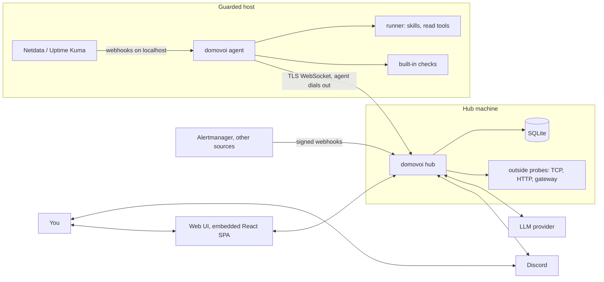
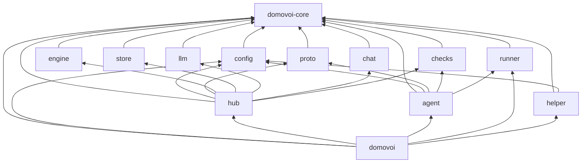
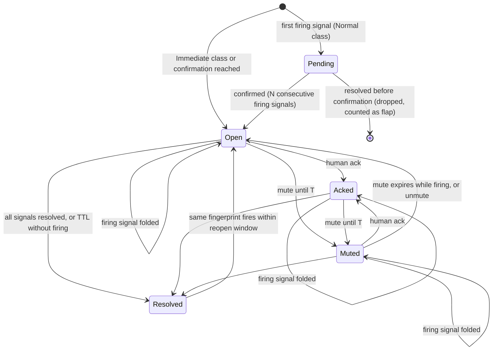
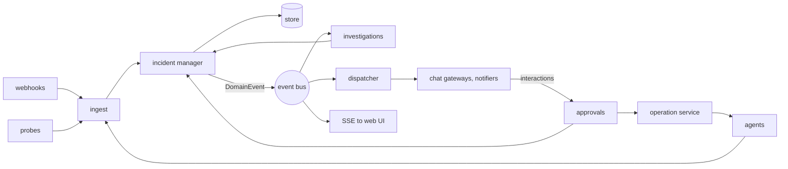

# Domovoi architecture

Status: accepted. Anything marked **Rule** or **Invariant** can only change through an ADR in [`docs/adr`](docs/adr). The rules in §4 are enforced by `cargo xtask arch-check`; the invariants in §15 are enforced by tests named in that section.

---

## 1. What Domovoi is

Domovoi watches self-hosted servers, triages problems with an LLM, talks to you in chat, and only changes anything after a human approves it. It is **one binary with two roles**:

- **hub**: web UI and API, chat gateways, alert correlation, AI triage, approvals, audit log, SQLite database.
- **agent**: runs on every guarded host. Runs built-in checks, executes skills (user scripts) and read tools, and dials out to the hub.

The recommended deployment puts the hub on a different machine from the hosts it guards. Single-box mode runs both roles in one process.

## 2. Principles

1. **The LLM proposes; deterministic code decides.** Model output is data. It never becomes a command line, a config change or an approval.
2. **One execution path.** Every process spawned on a host is spawned by `domovoi-runner` inside an agent, from a manifest, with argv only.
3. **Ports and adapters.** Domain and application logic depend on traits defined in `domovoi-core`, never on I/O libraries.
4. **Fail open for alerts, fail closed for actions.** If triage fails, the alert still goes out. If validation is uncertain, the action does not run.
5. **Boring and small.** SQLite, one binary, no broker, no external services required.
6. **Deterministic tests.** Every component can run against fakes and a fake clock.

## 3. System context

## 4. Workspace layout and dependency rules

| Crate | Role | May depend on (internal, normal deps) |
| --- | --- | --- |
| `domovoi-core` | Domain types, state machines, ports (traits). Pure. Includes the `policy_store` module: rule and version types, the policy repository port, and shadow decision records. | none |
| `domovoi-config` | Typed hub and agent config, loading, validation, secret indirection | core |
| `domovoi-proto` | Hub ↔ agent wire messages, envelope, versioning | core |
| `domovoi-engine` | Application services: correlation, incident manager, notification policy, triage orchestration, approvals, digest, and the `policy_shadow` module that records shadow decisions for Execution steps in a sweep (it enforces nothing) | core |
| `domovoi-store` | SQLite adapter for the repository ports. Policy tables: `policy_versions`, `policy_rules`, `policy_acknowledgements`, `policy_shadow_decisions`, `policy_shadow_state` | core |
| `domovoi-llm` | LLM provider adapters: Anthropic, OpenAI-compatible, CLI | core |
| `domovoi-chat` | Chat gateway and notifier adapters: Discord, generic webhook | core |
| `domovoi-checks` | Built-in checks. Feature `host` (agent-side host checks), feature `net` (network probes, also used by the hub) | core |
| `domovoi-runner` | The only crate that spawns processes: skill manifests, argument validation, sandboxed execution. Its `serve` module also hosts the runner side of the skill-runner socket (one request per connection, run, cancel) | core |
| `domovoi-helper` | The root helper: socket adoption and serving, the start checks, the repair command, the host inspection adapter, the isolation self-test and the safety attestation (key, state, route observation). It runs only `ip`, `smartctl`, `dmesg` and `ss`, through the `ProcessExecutor` port, and reads Docker through a read-only Engine client (external dependencies `bollard` and `futures`, ADR 0036) | core, config |
| `domovoi-agent` | Agent runtime: hub link, check scheduler, request handling, spool, and the client of the skill-runner socket with the route that picks local or runner execution | core, config, proto, checks, runner |
| `domovoi-hub` | Hub runtime: HTTP API, auth, SPA serving, webhook ingest, agent server, wiring of engine with adapters. `PolicyService` is the use-case service for the policy draft, versions, preview, simulation and shadow reads (ADR 0026) | core, config, proto, engine, store, llm, chat, checks |
| `domovoi-testkit` | Fakes for every port, a fake clock, fixtures, the crash-injecting store, snapshots and invariants. **Dev-dependency only.** | core, proto |
| `domovoi` | The binary and CLI. Composition root: selects mode, wires hub and agent, injects the process executor, and wires `skill-runner serve` from the runner library and the helper's adoption and probe | core, config, hub, agent, runner, helper |
| `xtask` | Developer tasks: `arch-check`, `openapi`, `docs-config`, `docs-links`, `ci`; the checker is also a library the engine's and the hub's gate tests call. **Dev-dependency only.** | none (not part of the product) |

**Rules**

- **R1 Dependency direction.** Internal normal dependencies must match the table above. Adapters never depend on other adapters. Nothing depends on `domovoi` or `xtask` except the engine's and the hub's gate tests through `[dev-dependencies]` (R5 keeps `xtask` dev-only).
- **R2 Pure inner layers.** `domovoi-core` and `domovoi-proto` do no I/O and do not depend on `tokio`, `sqlx`, `reqwest`, `axum`, `hyper`, `serenity`, `poise`, `bollard` or `rustls`. `domovoi-engine` may depend on `tokio` for tasks, channels and timers only; it must not use `tokio::net`, `tokio::fs`, `tokio::process`, `std::fs`, `std::net` or `std::process`. Allowed external dependencies for these crates are listed in `xtask/src/arch/rules.rs`.
- **R3 Process spawning.** Only `domovoi-runner` (and `xtask`) may construct `std::process::Command` or `tokio::process::Command`. Enforced by `clippy::disallowed_methods` and a source scan.
- **R4 No shell.** No code may invoke `sh -c`, `bash -c` or `/bin/sh`. Commands are argv vectors built from validated parameters.
- **R5 Testkit and xtask are dev-only.** `domovoi-testkit` and `xtask` may appear only under `[dev-dependencies]`.
- **R6 Composition roots.** `domovoi-hub` wires hub-side adapters, `domovoi-agent` wires agent-side ones, `domovoi` chooses the mode and injects cross-cutting services. No other crate constructs another crate's concrete adapter.
- **R7 Lints.** Every crate uses `[lints] workspace = true`. `unsafe_code` is forbidden. Library code may not use `unwrap`, `panic!`, `todo!`, `unimplemented!` or `dbg!`. CI treats warnings as errors.
- **R8 File size.** Non-test Rust source files stay at or below 500 lines. Split modules instead.
- **R9 Errors.** Libraries define `thiserror` error enums. `anyhow` is allowed only in `domovoi` and `xtask`.
- **R10 Docs.** Every public item is documented (`missing_docs`). Every crate root has a `//!` doc stating its role.
- **R11 Dependencies.** All versions are declared once in `[workspace.dependencies]`. New dependencies must pass `cargo deny` (license allowlist, advisories, no `openssl-sys`; TLS is rustls only so musl static builds work).
- **R12 Generated artifacts.** `web/src/api/openapi.json` and `web/src/api/schema.d.ts` are generated and committed. CI fails if they are stale.
- **R13 Migrations.** Files under `crates/domovoi-store/migrations` are append-only once merged. The baseline `0001_init.sql` is the schema's first version (ADR 0039).
- **R14 Wire formats.** Protocol messages and the OpenAPI document are covered by snapshot tests. A breaking protocol change bumps the protocol major version.
- **Hub module edges** (ADR 0026). `MOD-1`: transports (`api`, `auth::interactions`, `ingest`) do not import each other. `MOD-2`: `services` imports no transport and not `runtime` or `router`. `MOD-3`: a new top-level hub module is a transport, the services or an unzoned support module. `MOD-4`: a transport names neither `OperationHandle` nor `PackageHandle`. `CALLER-1`: a `Caller` is built only by the session extractor and by the chat authorizer, once each.

## 5. Domain model (`domovoi-core`)

All identifiers are newtypes over UUIDv7 (time-ordered) unless noted. Timestamps are `jiff::Timestamp` (UTC); civil time and time zones use `jiff` with an IANA zone from config.

### 5.1 Hosts and agents

- `HostId`, `AgentId`. A host has a `name` (slug, `^[a-z0-9][a-z0-9-]{0,62}$`), a `kind` (`Local`, `Remote`, or `External` for hosts known only from webhooks, which have no agent), labels, and at most one enrolled agent.
- `AgentIdentity`: agent id, ed25519 public key, agent version, enrolled-at.

### 5.2 Signals and fingerprints

- `Signal`: one observation from a check, a webhook or a probe.
  - `source: SourceKind` (`BuiltIn`, `Webhook { kind }`, `Probe`, `Agent`)
  - `host: HostId`, `check: CheckKey` (dotted, e.g. `container.restart_loop`), `target: Option<TargetKey>` (e.g. `plex`, `/dev/sdc`)
  - `status: Firing | Resolved`, `severity: Info | Warning | Critical`
  - `summary: String`, `evidence: Evidence` (ordered key → value map, values are strings, numbers or booleans), `observed_at`
  - `class: Normal | Immediate` (immediate skips confirmation runs, e.g. power loss)
- `Fingerprint = hash(host, check, target)`. **Volatile values (counts, IDs, timestamps, measurements) are never part of a fingerprint.** They live in evidence.

### 5.3 Incidents

- `Incident`: id, fingerprint, host, check, target, title, status, severity (max of open signals), `verdict: Option<Verdict>`, opened/resolved timestamps, `notify: NotifyState` (last sent, reminder due, thread reference per gateway), `history: EntityHistory` (bounded series of a tracked value, e.g. reallocated sectors).
- `Verdict`: `ActionNeeded`, `Monitor`, `Expected`, `Fixed`.
- **Recurrence folding:** a firing signal for an open or recently resolved incident with the same fingerprint updates that incident (thread reply) instead of creating a new one.
- **Delta checks:** for monotonic counters, a check emits a signal only when the value increases beyond its acked baseline. The incident's `history` records each value.

### 5.4 Acks, maintenance and baselines

- `AckRule`: matches incidents by host, check, target pattern and an evidence predicate; has a note and an optional expiry. Matching incidents keep their status but do not notify.
- `MaintenanceWindow`: host + time range; suppresses notifications, keeps signals.
- `Baseline`: expected containers, systemd units and listening ports per host, each with `criticality: Critical | Warning`. Learned only from managed containers (compose or Portainer labels); containers with auto-remove are never learned; entries absent for N days expire.

### 5.5 Triage

- `TriageRequest`: incident snapshot, the layered context (items from context sources in six layers: incident, host, evidence, experience, knowledge, capabilities), budget. Each item carries a status (known, unknown, stale or disputed) and where it came from.
- `TriageReport`: `headline` (≤ 120 chars), `summary`, `cause`, `evidence: Vec<EvidenceRef>` (≤ 3 shown on the card), `verdict`, `next_step`, `manual_steps: Vec<String>` (at most 5 steps of at most 200 chars each, what a person does by hand), `proposals: Vec<ActionProposal>`.
- `ReadTool`: a **closed enum** of read-only tools (`DockerPs`, `DockerLogs`, `DockerInspect`, `DockerEvents`, `HostOverview`, `Journal`, `ListeningPorts`, `SmartReport`, `IncidentHistory`, `NotesSearch`, `RunReadSkill`). There is no variant that approves, executes a write skill, or changes state. `ReadTool` stays closed and is the argument enum of the `request_evidence` meta-tool.
- `MetaTool` (ADR 0040): the **closed enum of what the model is offered**, seven names in a fixed order: `list_capabilities`, `describe_capability`, `request_evidence`, `search_experience`, `propose_plan`, `ask_user`, `finish`. It has no variant that approves, authorizes, runs a skill or dispatches. `ToolSet` picks the subset for a conversation: `Investigate { questions }` offers all seven (six without `ask_user`), `Read` offers the four read meta-tools to follow-up questions and chat. `search_experience` takes only a query and searches past operations of the conversation's own host. A name outside the offered set is answered `unknown tool` and changes nothing.
- `PlanInput`: the steps `propose_plan` takes, at most three, each naming a capability, string arguments, an optional host and target by name, a reason and an optional `retry_of`. The report's `proposals` are those steps after the plan validator accepted them; nothing the model writes is an identity, a fingerprint or a plan hash.

### 5.6 Skills and executions

- **Capability contracts are hub-owned.** `domovoi_core::capability` compiles in one `CapabilityContract` per known capability: the eight read tools an agent executes, the two the hub answers itself (`incident.history`, `notes.search`), the helper-backed `unit.restart` and `firewall.block_source` families, and the `skill.<name>` family, whose contract is built per host from the skill's manifest and the hub's raise-only floor. An agent reports implementation facts only (its catalogue ids and versions, its `hello.skills` summaries); nothing it sends can create a contract or set an effect class.
- `SkillManifest`: `name`, `description`, `risk: Read | Write | Destructive`, `entry`, `params: Vec<ParamSpec>`, `timeout`, `run_as`, `hosts`, `applies_to: Vec<CheckKey>`, optional `verify`, optional `revert` + `confirm_window`, `max_output`.
- `ParamSpec`: `name`, `kind: String { pattern, max_len } | Integer { min, max } | Boolean | Enum { values }`, `description`.
- An **execution** (§5.8) is the only thing that changes a host. Its `ExecutionState` is derived from its row and its step's outcome and is never stored: `proposed`, `awaiting_approval`, `authorized`, `dispatched`, then one of `succeeded`, `failed`, `outcome_unknown`, `not_run`, `refused`, `unavailable`, `skipped` or `cancelled`. `outcome_unknown` is never turned into a success or a failure; a person settles it, or the agent's journal answers it when the host reconnects.
- `PlanHash::compute` is the plan hash an approval binds: a hash over a length-prefixed encoding of the capability contract id and version, the implementation (manifest hash plus the entry script's SHA-256), the canonical target (host, enrolled agent key fingerprint, check and optional target), the canonical arguments and the execution id. Approval binds to that hash; dispatch recomputes it from one authenticated session snapshot (session identity, enrolled agent, journal epoch and announced skills), and the writer refuses a replacement session before recording the dispatch. A journal epoch alone is not a connection identity. `PlanHash::agent_check` is a different value: the hash over skill name, manifest hash, host and canonical arguments that the hub sends in `run_skill` and the agent recomputes from its own copy of the skill. It is a local integrity check and never the approval binding. The domain lines `plan:v2` and `plan:v1` keep the two apart. The helper-backed capabilities, packages and containment have their own domains (`plan:capability-v1`, `plan:package-v1`, `plan:package-job-v1`, `plan:containment-v1`), so an approval of one family cannot be replayed as another.
- `Principal`: `Human(UserId)` or `System(component)`. Only `Human` can approve. The value that carries an approval, `HumanApproval`, may be constructed only in `crates/domovoi-hub/src/auth/`: by the web session layer (session + CSRF verified) and by the chat interaction authorizer (platform user ID on the allowlist). The engine consumes an `Authorization`, a wrapper with private internals whose only constructors are `Authorization::human` (hub auth, testkit) and `Authorization::policy` (the hub's permit issuer, ADR 0037, and testkit). `xtask arch-check` fails if any authorization constructor appears outside its allowed prefix. That check is a line-based text scan, not a compiler seal.
- There is one execution boundary and one read boundary (ADR 0022, 0023). A skill is dispatched only by `execute_step(AuthorizedStep)` in the operation service; the helper-backed capabilities, packages and containment have the same shape (`execute_unit_restart`, `execute_package`, `execute_containment_step`). Each authorized value has one crate-private constructor called at one site and is never stored. The engine's subsystems never hold a link: they receive capability objects (`AvailabilityProbe`, `HostObservation`, `JournalStatus`, `HandoffRunner`, `CheckRerun`, `HostRead`, `PackageRelay`, `UnitRelay`, `ContainRelay`) that the hub composes once from its link at its runtime boundary, so a capability object cannot start a skill it cannot name, nor read a host it cannot name. A host's tool output is read only by `Evidence::collect_evidence`, which serves the model, the Operator, the context and the hub's profile collection; it asks for the host's availability first, keeps the whole ask inside the request's deadline on the `Clock` port and returns the agent's output unchanged. Host metadata is read through `AgentAdmin`, and verification re-runs a declared check with `run_check`. No hub transport names, holds or takes the link: `AgentServer::link()` is reachable only inside the hub crate, the runtime composition root is its one caller outside `agent_server`, and the only route to the raw link in a test is the hub's non-default `test-support` feature, absent from default and release builds. `cargo xtask arch-check` enforces this with rules `EXEC-1` to `EXEC-4` over the core, engine, hub, store and binary sources: the scan parses the sources (`syn`) rather than reading lines, every boundary operation may appear only at its exact count in its exact files, and a file is test-only only when Cargo's test targets or `#[cfg(test)]` wiring reach it and no production module does. The gate tests `single_execution_boundary` and `transports_do_not_name_the_agent_link` assert the same shape from inside the engine and the hub by calling the very checker the tool runs. Like every rule in that check, none of this is a compiler seal; the value is that the ordinary way to add a second path fails `arch-check` or a gate test. What the scan does not resolve (glob re-exports, generated code) is listed in ADR 0023.

### 5.7 Output models

- `Card`: the rendered-independent shape of every incident message: `badge` (verdict or severity), `host`, `headline`, up to 3 `bullets`, `next_step`, `buttons: Vec<CardButton>`, `details` (full reasoning, posted in the thread).
- `Digest`: one per day for all hosts. A host with nothing changed collapses to one line; others list changes since the previous digest, trends with projections (e.g. days until a pool is full) and `DigestFact`s contributed by checks and skills. Open incidents and advisories follow.
- `Advisory`: a low-priority hygiene finding (stale image, stack without a source copy, missing heartbeat, secret marked exposed). Advisories appear in the digest and never notify on their own.
- `Note`: markdown runbook text per host or global, searchable by triage.

### 5.8 Operations

- An **operation** is one durable piece of work on hosts, kind `investigate`, with a goal, a cycle counter, budgets, pinned subjects (host, check, optional target) and incident links. It is made of **steps**, which are immutable: a kind (`reasoning_turn`, `evidence_request`, `assessment`, `plan`, `policy_decision`, `approval`, `execution`, `verification`, `notification`, `question`, `note`), a phase, a cycle, a dense ordinal within the operation and an intent that never changes.
- **Edges** (`depends_on`, `caused_by`, `verifies`, `retry_of`, `answers`) point from a later step to an earlier step of the same operation. The ordinal rule makes the graph acyclic, and the store refuses an edge that points forward.
- A step's outcome is the only execution state: `pending`, `running`, `succeeded`, `failed`, `refused`, `not_run`, `unavailable`, `outcome_unknown`, `skipped` or `cancelled`. An **execution** is an Execution step with one `executions` row (host, contract, plan hash, approval, dispatch facts); its execution id is the step id.
- The operation status (`queued`, `running`, `waiting_approval`, `waiting_user`, `waiting_agent`, `waiting_timer`, `paused`, `succeeded`, `failed`, `escalated`, `cancelled`) is derived from open steps and the pause state by a pure function and stored only as a cache of that derivation. `paused` carries one reason: `budget`, `outcome_unknown`, `global_pause` or `error`.
- Executions run `skill.<name>`, `unit.restart`, `firewall.block_source` and package contracts, against pinned targets. An execution runs after an approval by a human, or, for `unit.restart` and `firewall.block_source` only, after a policy permit that the hub's one permit issuer grants inside hard limits (ADR 0025, 0037, 0038).
- Every change is one `UnitOfWork` commit. `build_trace` gives a frozen, read-only view (schema version 1) that carries no output, intent or plan hash.

### 5.9 Knowledge

- `Fact`: a subject (`host:`, `container:`, `unit:` or `entity:` reference), a predicate from a closed list, a value, a source (`user`, `discovered`, `integration`, `inferred`, `imported`), a status (`current`, `stale`, `disputed`, `superseded`, `retracted`), observation and validity times, evidence and an optional superseded link. No numeric confidence.
- `Relation` links two subjects. `Entity` is a named thing facts can refer to.
- Each predicate has a staleness period; past it a fact reads as stale. Single-valued predicates from different sources become disputed until the owner asserts a value or the sources agree.
- Only the signed-in owner writes `user` facts. Inferred facts become `user` only when accepted.
- Safety-critical predicates (`management_path`, `trusted_cidr`) count only when current and owner-sourced; observation never revives a stale one.
- Retraction removes a fact from search and model context at once; the value is cleared after `retracted_facts_days`, and a tombstone stays.
- The knowledge service owns facts, relations and entities, and commits every change through the unit of work.

### 5.10 Experience

- A finished operation gets a **resolution summary**: append-only field revisions `(operation, field, revision, value, source, actor, created_at)` owned by the operation aggregate. `outcome`, `verified`, `subjects`, `contracts_executed` and `hosts` are code-owned; `problem`, `cause` and `fix` are drafted from the model's own committed report (`source = model`) and may be edited or confirmed by the owner (`source = user`).
- The terminal commit creates a `draft_resolution` effect; its handler computes the code fields from the stored snapshot and the narrative from the report, with no model call. A late result on a closed operation appends changed code fields only.
- The operation writer is the only writer. A user edit is one commit: revision, `operation.summary` journal row, `operation.summary_edited` audit row; neither names the value.
- A projection table (one row per operation) feeds an FTS5 index and host tables. A host-scoped read returns only operations whose host set is exactly that host; the global scope exists for the owner's search endpoint and the owner's global conversation only.
- Past operations reach a model only as `Origin::Historical` items under the label "historical evidence, not authorization". A past approval or success never satisfies a policy or authorizes a run.

### 5.11 Packages

- A **package artifact** is one owner-signed archive, `<name>-<version>.tar.zst`, with its detached signature file. The hub stores it under `<data_dir>/packages/` by SHA-256 digest, checks the signature against its owner keys (not revoked) and never opens the archive. The index and the signature text are in the database; the archive file is not in backups.
- An **install job** is one request (install or uninstall, one package and version, 1 to 16 hosts) with one **target** per host. A target has its attempt number, a fresh execution id, a per-host plan hash, a human approval with an expiry, its status, and, once dispatched, the transfer ids and the session and journal epoch it was sent under. The job's status is derived from its targets and never stored.
- Target statuses are `queued`, `transferring`, `dispatched`, `succeeded`, `failed`, `not_run`, `outcome_unknown` and `cancelled`; the last five are terminal. A host has at most one non-terminal target, enforced by a partial unique index.
- `host_packages` holds what each host last reported: one row per host and package name.
- Jobs are a separate aggregate with their own writer, not operation steps (ADR 0029). Their targets are settled the same way as an operation execution, by asking the agent's journal, without sharing the operation service's code.
- Each target runs one path: approval check, availability, snapshot, archive and signature transfers, a commit that records the dispatch before the request is sent, then one capability call and its settlement. `execute_package` is the only code that sends package bytes or starts a package capability.
- Plan hashes use their own domains, `plan:package-v1` per host and `plan:package-job-v1` per job, so a package approval cannot be replayed as a skill approval.

### 5.12 Helper attestation

The `attest` module of `domovoi-core` (ADR 0032) is the pure contract between the helper, the hub and the engine. It does no I/O.

- A **report** is a set of LF-terminated `key=value` lines in a fixed order. It is accepted only when it is already canonical: every line parses strictly and re-renders to identical text, so the bytes that were signed are the bytes that were checked. A **complete** report carries generation 1 or more, the two hashes and an empty `incomplete_reason`; an **incomplete** report has one minimal shape (generation 0, zero hashes, a non-empty token).
- Three domain-separated inputs: the signing bytes (`domovoi-safety-attest-v1`, then the report), the config hash and the route-state hash. The frozen vectors (`C1` to `C4`, `R1` to `R4` and the signed samples) live in `crates/domovoi-core/tests/attest/vectors/` and are never regenerated.
- A **safety identity** is the generation, the two hashes, the key fingerprint and the boot id. `ExpectedSafety` is the closed tagged value a containment request carries (`verified` with the identity, or `unverified` with one of nine reasons); the helper refuses a missing or malformed one.
- The **gate** is a pure function over a `TrustView` (the pin, the latest outcome with its verified state, the nonce issue time). Trust follows the latest outcome per host: a key mismatch, a validly signed incomplete report or a generation regression revokes the verified state and the next good report restores it. A report is fresh for 300 seconds from the nonce's issue time; a nonce lives 60 seconds; a confirmation of a management path stays current for 30 days.
- Decision functions (`covered`, `decide`, `confirmation_current`, `unprotected_paths`) take typed values and return typed decisions; no code outside this module judges coverage.

### 5.13 Containment

- **`firewall.block_source`** is a `Contain` capability on the helper path (ADR 0038). Its target kind is `NetworkSource`, with the identity `ipnet:{canonical}@host:{id}/{fingerprint}`; its arguments are six strings (`phase`, `source`, `ttl_s`, `block`, `prefix_len_v4`, `prefix_len_v6`). `firewall.list_blocks` is its read companion.
- The **pure core** (`domovoi_core::containment`) holds the canonical network type, the exclusion algorithm (both overlap directions, both families), the nft script templates, the stderr classifier and token table, the journal record types and the gate. The helper, the agent and the hub use the same functions, so they cannot drift.
- A **block** is one row of `containment_blocks`: the apply execution id, host, operation and step, canonical source, lifetime, plan hash, safety assurance (`verified` with the identity, or `unverified` with the reason and the paths not protected), the phase and its deadline. Phases are `queued`, `applying`, `applied`, `confirming`, `confirmed`, `rolling_back`, `rolled_back`, `expired`, `lost`, `not_run`, `failed` and `outcome_unknown`.
- Each phase is its own `run_capability` execution with its own execution id; all share one plan hash (`plan:containment-v1`, which excludes the phase and the execution id) and one authorization. Only the hub sends `confirm`, within 20 seconds of the apply result.
- `ContainCall` is a closed type (`Apply`, `Confirm`, `Rollback`, `List`); it has no script, key or free argument.

## 6. Ports

All ports are `async_trait` traits in `domovoi-core::ports`, object-safe, `Send + Sync`.

| Port | Purpose | Implemented by | Used by |
| --- | --- | --- | --- |
| `Clock` | Current time, sleeping | engine (system), testkit (fake) | engine, agent, hub |
| `IncidentRepo`, `SignalRepo`, `HostRepo`, `NoteRepo`, `BaselineRepo`, `AckRepo` | Persistence | store, testkit | engine, hub |
| `AuditLog` | Append-only audit events | store, testkit | engine, hub |
| `UnitOfWork`, `VersionedRead`, `JournalRead`, `EffectRead` | Commit state writes, journal, audit and effects atomically; read aggregates with their version, the journal and the effect outbox | store, testkit | engine, hub |
| `LlmProvider` | One model turn with tools; returns text or tool calls and token usage. Takes an `AnswerSink` that receives the text and tool phases of the turn as they are written | llm, testkit (scripted) | engine |
| `AnswerSink` | Hook passed to `LlmProvider`: receives the answer text and the read-tool phases while a turn is written, so an Operator answer can stream | llm, testkit (recording) | engine |
| `ChatModel` (engine trait) | One Operator answer for a conversation turn; writes through an `AnswerSink` | hub (triage handle), engine (disabled model) | engine |
| `LivePublisher` | Publishes the ephemeral `live.*` events of an answer being written. Lossy: never blocks the writer, and nothing is replayed | hub (live bus), testkit (recording) | engine |
| `ChatGateway` | Post or update a card, reply in a thread, receive interactions and messages | chat, testkit (recording) | engine, hub |
| `Notifier` | One-way message (digest, alert) | chat, testkit | engine |
| `AgentLink` | Hub side of an agent connection: send a tool or skill request, receive results and signals | hub (WebSocket and in-memory), testkit | engine |
| `ContextSource` | Read-only context items with provenance and status (what was read, where it came from, whether it is known or unknown); later sources (knowledge, experience) register through `TriageDeps.extra_context` | engine (`EvidenceSource`), testkit (fake) | engine |
| `CapabilityRegistry` | Read-only availability of one contract on one host, its effective effect class, enablement and the offered skills; never evaluates policy or approves | hub (the capability registry), testkit (fake) | engine, hub |
| `ProcessExecutor` | Run an argv with limits | runner, testkit | checks (command-backed checks), llm (CLI provider), agent |
| `HostFs` | Read files under a host root (`/proc`, `/sys`, logs) | checks (real), testkit (fixture tree) | checks |
| `Redactor` | Remove secrets from text | engine (pattern based), testkit | engine, runner, chat |
| `OperationRepo` | Read operations: one consistent snapshot, lists, executions, and the work that is dispatched or waiting; no write method | store, testkit | engine, hub |
| `OperationWrite` | Write an operation's state inside one `UnitOfWork` commit: operation, steps, edges, executions and incident links | store, testkit | engine |
| `EffectCancel` | Cancel the pending effects of one operation, and only of that operation | store, testkit | engine |
| `ExperienceRead` | Read resolution summaries, their revisions, host-scoped search and similar past operations; no write method (writes are `OperationWrite::SummaryField`) | store, testkit | engine, hub |
| `KnowledgeRead` | Read facts, relations and entities, and search live facts | store, testkit | engine |
| `AuditInspect` | Read audit rows with their chain fields, the anchor and verification | store, testkit | hub |
| `ManagementCoverage` | Whether a verified helper attestation covers a management path on a host | engine (`AttestedCoverage`, backed by `HelperTrustRead`), testkit | engine |
| `HelperTrustRead` | The trust view the pure gate reads for a host: the pin, the latest outcome and its verified state, and whether the live session's helper is present | hub (store and live session), testkit | engine, hub |
| `HelperTrustRepo` | The store's read side of helper trust: the pin, the latest outcome with its verified state and the high-water row. Writes are `StateWrite::HelperTrust` in the unit of work | store, testkit | hub |
| `HelperRelay` | The one capability the hub's trust module holds over the link: ask for a signed report, read what the live session says about its helper, say whether the host is connected. It cannot send any other frame | hub (`runtime/caps.rs`), testkit | hub |

Effect claims on `EffectQueue` are scoped to one aggregate: a claim names the operation whose effects it may take, and an empty scope claims nothing (ADR 0025).

## 7. Runtime architecture

### 7.1 Hub

The hub is a set of tokio tasks connected by channels:

- **Web server** (`axum`): REST API, SSE, SPA, webhook ingest.
- **Use-case layer** (`crate::services`): the commands a person can give, independent of where they gave them. The HTTP handlers and the chat interactions authenticate and parse, build a `Caller` (the proof that an authenticated person asked, and from which surface), call one service method and render the answer; they do not import each other. A service holds the decision and the write: acknowledge, mute, ask, approve and deny a step, cancel, pause, resume and answer an operation, a host's status and the digest. It never builds an approval itself: `auth/approval.rs` turns a `Caller` into one (ADR 0026).
- **Agent server**: TLS WebSocket listener, enrollment, handshake, one task per connected agent.
- **Incident manager**: the **single writer** for incident state. Everything that changes an incident (signals, acks, triage results, execution results, timers) is a command on its `mpsc` channel. Each command is one atomic commit through the unit of work: the signal, the incident row, its timeline entries and the mirrored journal rows land together or not at all. Every incident write names the version it read; a version conflict reloads the incident and decides once more, and a second conflict fails the command. It publishes events on a `broadcast` bus only after the commit succeeded.  Timeline entries are written to `incident_events` and mirrored into the `journal` by the store, inside the same commit.
- **Dispatcher**: subscribes to domain events and delivers cards, thread replies and resolutions to chat gateways and notifiers, applying quiet hours and re-notify rules.
- **Scheduler**: digest, quiet-hours release, re-notify, TTL resolution, heartbeat ping, retention, backup. Approval windows are timers of the operation service.
- **Capability registry**: the one place the hub combines its compiled contracts, the agent's walked catalogue and `hello.skills`, the host's own status words, per-host enablement, the raise-only skill floors and the agent's ceiling summary into one availability answer per `(host, contract)` (ADR 0024). It replaces the per-host link wrapper: the engine asks the registry through the `CapabilityRegistry` port, and enablement is enforced at the execution and read boundaries. It evaluates no policy, approves nothing and dispatches nothing.
- **Operation service**: runs operations (§5.8) when `[orchestration] enabled` is true, which is the default; with `false` it is not started. One writer task commits every change through the unit of work, admits at most `max_running` operations at once, and dispatches Execution steps through the operation dispatch site (§12).
- **Install service**: the single writer of install jobs and their targets (§5.11), beside the operation service and sharing none of its code. It creates a job only when the plan hash the person approved matches a fresh plan. One worker relays to at most four hosts at once and commits every target change through the unit of work, with its audit and journal rows in the same transaction. It is the hub's host reconciler for dispatched targets, composed with the operation service's reconciler by a `CompositeReconciler`. It never enables anything, and the agent alone decides what it installs.
- **Helper trust** (`helper_trust`, ADR 0035): the hub's half of the helper attestation. Every 15 minutes, when a host connects or changes its helper status, and on an owner's re-check it issues a nonce (60 s, single use, one exchange per host at a time), asks the helper through `HelperRelay` and verifies the answer in one function that takes the pinned key. An accepted report, a rejection and a pin each commit through the unit of work together with the audit event. The module is support code reached only through `services::HelperTrust` (view, re-check, pin, unpin, fresh), every command of which takes a `&Caller`; chat cannot pin or unpin.
- **Containment driver**: the single writer of `containment_blocks`, beside the install service. It runs `apply`, then `confirm` within 20 seconds, rolls back or lets the kernel expire a block that was not confirmed, and settles each phase through the unit of work with its audit row in the same transaction. It never re-applies a block, never retries a phase after dispatch and reconciles in-flight blocks from the agent's journal when a host reconnects, in the same composite reconciler. `execute_containment` is the only caller of `ContainRelay`.
- **Conversation service**: the single writer of Operator conversations and their messages. Each question and its pending answer commit together; the answer runs in a background task and settles in one commit. Live answer events go to the `LivePublisher` port and are never journaled. At start-up, a pending answer becomes failed (`interrupted`).
- **Investigations**: the only automatic triage path. With `[orchestration] enabled = true` (the default) and `[triage] enabled = true`, a `TriageRequested` event starts an Investigate operation; there is no triage queue and no in-memory retry list. With `[orchestration] enabled = false` nothing consumes `TriageRequested`: incidents are not triaged automatically, the card goes out untriaged (INV-11), `POST /api/v1/incidents/{id}/triage` answers 503, and follow-up questions and chat still work through the triage service. One cycle is four durable effects, each a thin wrapper over the triage code: `build_context` (repeat cache, admission gate, context bundle), `call_model` (provider chain, tool loop and report, in one reasoning turn), `draft_summary` (the proposal checks, then assessment, plan, Execution and Notification steps, and the retry a skipped or failed turn earns) and `notify` (the card and timeline entry). Each plan step the model stages and the validator accepts, checked again when it is stored, becomes an Approval and Execution step pair bound to a v2 plan hash; the rest are listed in the report. The model's reads are recorded as evidence steps of the turn, and a question it asks is a Question step that keeps the investigation open until it is answered or times out. A restart resumes from the effects in the store. An investigation closes itself when no step is open and its notification succeeded. Follow-up answers are plain text and propose nothing.

### 7.2 Agent

- **Hub link**: connect, authenticate, reconnect with exponential backoff and jitter, heartbeats every 10 s.
- **Check scheduler**: runs each enabled check on its cadence, turns results into signals, applies the local baseline.
- **Request handler**: serves `RunTool` and `RunSkill` requests. Every request is re-validated against the agent's local manifests and local policy before the runner sees it.
- **Spool**: an append-only JSONL file (size-capped) that buffers signals while the hub is unreachable and replays them on reconnect.
- **Skill execution**: when the privilege boundary is in effect (euid not 0) a skill runs only through the skill runner, over its socket, as the `domovoi-skill` account. The agent has no local path for it: no runner, or a runner that is not `Ok`, means the skill is unavailable. An agent with euid 0 (the `SkillRoute::Legacy` variant of `domovoi-agent`'s skill route; the name marks the route that has no runner) has no privilege boundary to protect: it runs the skill itself, through the `ProcessExecutor` port, and its host is labelled "privilege boundary not in effect". Tools and checks keep the local executor everywhere. A **runner probe** asks `health` at start and every 60 seconds and reports `skill_runner_status`.
- **Helper probe**: at start and then every 60 seconds the agent connects to the helper socket, asks `health` and `groups`, and reports the result as `helper_status` (`Absent`, `Ok` with the enabled groups, or `Error` with a token). It sends nothing else and never falls back to running a privileged operation itself.
- **Read selection** (ADR 0036): when the privilege boundary is in effect the container checks and tools read Docker through the helper's `docker.read`, the SMART check and tool read through `smart.read`, the `journal` tool falls back to `kernel.read` when `journalctl --dmesg` cannot open the journal, and the listening-ports tool adds owning-process names from `net.read`; an owner-set `tcp://` Docker endpoint stays direct. Without the boundary every read keeps its direct path. The agent caches and rate-limits these reads itself; nothing falls back to a privileged operation in the agent.
- **Attestation relay**: on `attest_safety` the request handler passes the nonce to the helper's `safety.attest` and returns the helper's public key, report and signature as the bytes it received, without parsing them. A helper that cannot sign is relayed as an `error` whose code is its own token; an absent or unreachable helper is `helper_unavailable`.
- **Transfer receiver**: takes package archives and signatures in chunks from the hub, within the transfer limits in the [agent protocol reference](docs/book/src/reference/protocol.md#package-transfers).
- **Package service**: checks a package's signature against the owner's trusted keys, installs and removes it under `packages_dir`, and keeps the registry. It never enables or runs what it installs.

### 7.3 Single-box mode

`domovoi hub run --with-local-agent agent.toml` runs both roles in one process. The hub and the agent talk through an in-memory `AgentLink` pair that carries the same protocol messages as the WebSocket transport, so there is still one code path.

## 8. Hub ↔ agent protocol (`domovoi-proto`)

- **Transport:** WebSocket over TLS. The hub generates a self-signed certificate on first start (`rcgen`) and stores it. The agent pins the certificate's SHA-256 fingerprint at enrollment.
- **Enrollment:** `domovoi hub token create <host>` creates a single-use token (random 32 bytes, stored hashed, 15-minute expiry). `domovoi agent enroll --hub <url> --token <token>` generates an ed25519 key pair, sends the public key with the token, receives the hub certificate fingerprint and its `AgentId`.
- **Handshake:** the agent connects and sends `Hello`; the hub replies with a random `Challenge`; the agent returns the challenge signed with its key; the hub verifies against the enrolled public key and replies `Welcome`. Revoked agents are rejected.
- **Envelope:** `{"v": <major>, "id": "<uuidv7>", "kind": "<message kind>", "payload": {...}}`, JSON text frames. Requests carry `id`; responses carry `reply_to`.
- **Versioning:** `PROTOCOL_VERSION = (major, minor)`. The hub accepts an agent only when its major and minor are both equal to its own; patch releases do not enter into it. Unknown fields are ignored; unknown kinds get an `Unsupported` reply.

| Direction | Kind | Purpose |
| --- | --- | --- |
| agent → hub | `hello` | agent id, version, host facts, capabilities, manifest catalog (names + hashes) |
| hub → agent | `challenge`, `welcome`, `reject` | handshake |
| both | `ping`, `pong` | liveness |
| agent → hub | `signals` | batch of signals (from checks or relayed local webhooks) |
| agent → hub | `digest_facts` | facts for the daily digest |
| hub → agent | `run_tool` | a read tool request with typed arguments and a deadline |
| hub → agent | `run_skill` | execution id, skill name, args, plan hash, deadline |
| agent → hub | `tool_result`, `skill_result` | exit status, redacted output (capped), duration |
| hub → agent | `config_update` | check schedules, thresholds and the container runtime switch managed from the hub |
| hub → agent | `attest_safety` | a 32-byte nonce the helper must sign into a safety report |
| agent → hub | `safety_attestation` | the helper's public key, the report bytes and the signature, relayed unchanged; or an `error` carrying the helper's token |
| hub → agent | `transfer_begin`, `transfer_chunk`, `transfer_end` | package archive and signature transfers; the agent answers `transfer_end` with `transfer_result` |
| both | `error`, `unsupported` | structured errors |

Helper attestation (ADR 0032): the hub's nonce goes to the helper through the agent; the report comes back signed with the helper's key. The hub verifies it against the key the owner pinned, over exactly the received bytes, and never accepts an agent's description of the helper. `hello.helper_identity` and `agent_status.helper_identity` carry only the 32-byte public key; the hub computes the fingerprint itself. `expected_safety` on a containment request is a closed tagged value, required and strict.

## 9. Persistence (`domovoi-store`)

- SQLite in WAL mode via `sqlx` with runtime-checked queries; every query is covered by an integration test against a temporary database.
- The schema is one baseline migration, `0001_init.sql` (ADR 0039); every later change is a new numbered file. Migrations are embedded with `sqlx::migrate!` and run at start-up after an automatic `VACUUM INTO` backup. A binary ignores applied migrations it does not know and refuses a database whose `schema_compat` row names a newer reader version.
- Timestamps are stored as `INTEGER` unix milliseconds UTC; IDs as `TEXT`.
- Tables: `hosts`, `agents`, `enrollment_tokens`, `signals`, `incidents`, `incident_signals`, `incident_events` (timeline), `audit_log`, `audit_anchor`, `ack_rules`, `maintenance_windows`, `baselines`, `notes` + `notes_fts` (FTS5), `incidents_fts`, `triage_cache`, `llm_usage`, `llm_admission`, `metric_samples`, `advisories`, `users`, `sessions`, `settings`, `notify_state`, `journal`, `journal_floor`, `effects`, `schema_compat`, `conversations`, `messages`.
- Operations (ADR 0025): `operations`, `operation_incidents`, `steps`, `step_edges` and `executions`, with `execution_permits`, `execution_permit_rules` and `unknown_resolutions`. Triggers refuse any update to a step's identity columns (its intent included) and any edge that does not point to an earlier step of the same operation. The tables stay empty while `[orchestration]` is disabled.
- Policy (ADR 0027, 0037): `policy_versions`, `policy_rules`, `policy_acknowledgements`, `policy_shadow_decisions`, `policy_shadow_state`, `autonomy_state` and `rule_circuit_resets`. Triggers freeze a published version's rules.
- Knowledge: `facts`, `facts_fts` (FTS5 over live facts), `relations`, `entities`, `management_path_confirmations`.
- Experience: `resolution_summary_fields` (append-only), `operation_resolutions`, `operation_resolutions_fts` (FTS5), `operation_resolution_hosts`, `operation_resolution_subjects`.
- Packages (ADR 0029): `package_artifacts`, `install_jobs`, `install_job_targets` and `host_packages`.
- Helper trust and containment (ADR 0032, 0038): `helper_keys` (the key the owner pinned, one row per host), `helper_attestation` (the latest outcome per host, and the verified report with its identity only while the latest outcome is verified), `helper_high_water` (the highest accepted generation and hashes per host and key, written in the transaction that accepts a report) and `containment_blocks`. Outcome and reason values are validated in Rust, not by `CHECK`.
- `incidents` and `notes` carry an optimistic `version` column: a write names the version it read, and a mismatch rolls the whole transaction back.
- `incident_events` is the timeline every reader uses, and the store also writes a mirrored `journal` row (`incident.timeline`) for each new entry in the same commit.
- `journal` is the operational record in commit order, `effects` is the work outbox and `schema_compat` records the lowest binary version that can read the schema.
- Every commit is flushed to disk (`synchronous=FULL`), one write connection serialises writers, and start-up runs `PRAGMA quick_check`; a failed check refuses to open the database.
- `audit_log` (ADR 0041) is append-only: a trigger rejects `UPDATE` and `DELETE`. Every row carries `prev_hash` and `hash`: the store hashes each event (canonical JSON, SHA-256) inside the transaction that inserts it, and the first row links to one `audit_anchor` row that holds the install id; the chain starts at the first row. `domovoi audit verify` checks both parts, and `domovoi audit head` prints the newest hash to keep elsewhere. The chain detects edits, mid-chain deletions and rows inserted by tools that do not compute the chain; it cannot detect a full rewrite of the database that recomputes every hash, or deletion of the newest rows unless the head hash was recorded elsewhere.
- Retention is configured per kind of data under `[retention]` (signals, incident timeline, conversations, notifications, triage cache, resolved advisories, retracted facts); incidents, operations, resolution summaries and the audit log are kept. A nightly `VACUUM INTO` backup goes to a configurable path.

## 10. HTTP API and web UI

- **Two listeners:** `web` (HTTP, default `127.0.0.1:7420`, intended to sit behind a reverse proxy) and `agent` (TLS WebSocket, default `0.0.0.0:7421`).
- **Routes:** `/api/v1/*` JSON API, `/api/v1/events` SSE, `/hooks/{source}` signed webhooks, `/healthz`, `/metrics`, everything else serves the SPA (with `index.html` fallback).
- **Auth:** one admin account (argon2id). No default password: the first start prints a one-time setup URL. Session cookie: `HttpOnly`, `SameSite=Strict`, `Secure` when served over HTTPS. Every unsafe method requires the `X-CSRF-Token` header matching the session's synchronizer token. Login is rate-limited.
- **OpenAPI:** handlers are annotated with `utoipa`; `cargo xtask openapi` writes `web/src/api/openapi.json`; `npm run gen:api` turns it into `schema.d.ts`; the SPA calls the API only through a typed `openapi-fetch` client in `web/src/api`.
- **SPA:** React + TypeScript + Vite in `web/`, built to `web/dist`, embedded with `rust-embed` behind the `embed-ui` feature. Security headers: strict CSP (`default-src 'self'`), `X-Content-Type-Options`, `Referrer-Policy`, `frame-ancestors 'none'`.
- **Web structure:** `src/app` (router, providers), `src/api` (generated types, client, CSRF), `src/features/<feature>` (pages, components, hooks), `src/components` (shared UI). ESLint forbids `fetch` outside `src/api`.
- **Knowledge:** `/api/v1/knowledge` reads and writes facts, relations and entities, and lists management paths; see the [HTTP API reference](docs/book/src/reference/api.md#knowledge).
- **Operations:** `GET /api/v1/operations` (filters: status, incident, host, kind), `GET /api/v1/operations/{id}` (the operation, its trace and its executions), `GET /api/v1/operations/{id}/trace` (the frozen trace schema, with `as_of_seq`), `GET /api/v1/operations/{id}/steps/{step}`, and `POST /api/v1/operations/{id}/steps/{step}/approve` and `.../deny`. Reads report the journal position read before the data. Without `[orchestration] enabled` the list is empty and the others answer 503. Every route is in the OpenAPI document, and the [HTTP API reference](docs/book/src/reference/api.md#route-index) lists them all.
- **Experience:** `GET /api/v1/operations/{id}/summary`, `POST /api/v1/operations/{id}/summary/{field}` (narrative fields only), `GET /api/v1/operations/{id}/similar`, `GET /api/v1/incidents/{id}/similar-operations` and `GET /api/v1/experience/search` (one host by default; `scope=global` only on request). Operation rows carry a `resolution` brief.
- **Capability inventory:** `GET /api/v1/hosts/{name}/capabilities` returns one row per contract the hub knows, with its state, its catalogue state, its effect class, its execution path and the two agent labels (`root_agent`, `runner_installed`), plus the ids the agent reported that no contract describes. The `/capabilities` page renders it read-only: it enables, disables and approves nothing, and an `available` row is never a promise that a run will proceed.
- **Host ceiling:** `GET /api/v1/hosts/{name}/ceiling` returns what the host's agent reported as its unattended limits (`reported`, `not_reported` or `unreadable`). It is read-only and never written by the hub. The Capability Center at `/capabilities` groups the inventory, packages (import and install wizard), host limits and helper placeholders as tabs.
- **Overview:** `GET /api/v1/overview` (optional `host`) counts incidents, operations by state (running, waiting for approval, waiting for an answer, paused) and offline hosts, plus an `attention_total` that sums everything that waits for the owner; see the [HTTP API reference](docs/book/src/reference/api.md#overview).
- **Audit log:** `GET /api/v1/audit` lists entries with their chain fields and `GET /api/v1/audit/verification` checks the chain; both only read. See the [HTTP API reference](docs/book/src/reference/api.md#audit-log).

## 11. LLM and triage

- `LlmProvider` exposes one turn: messages + tool definitions in, assistant text or tool calls + usage out. Adapters: Anthropic Messages API, OpenAI-compatible Chat Completions (covers Ollama, LM Studio, OpenRouter), and a **CLI provider** that runs a locally installed coding-agent CLI in print mode through an injected `ProcessExecutor` with a fixed argv template.
- **Tools** are the `MetaTool` enum (§5.5): the model is offered the meta-tools of its `ToolSet`, and nothing else. Reads go through `request_evidence`, whose argument is a `ReadTool`; the engine executes `Docker*`, `HostOverview`, `Journal`, `ListeningPorts`, `SmartReport` and `RunReadSkill` through `AgentLink`, and `IncidentHistory` and `NotesSearch` against the store. `list_capabilities` and `describe_capability` read the hub's capability registry. `search_experience` reads resolution summaries of the incident's host and returns at most five, each under the label "historical evidence, not authorization". In an investigation each parsed read is recorded as an `EvidenceRequest` step in the commit that ends the turn, also when the turn fails; an unavailable or failed read is stored as such and the model is told the answer is unknown. `ask_user` ends the turn with a question to the person who runs the server, offered only where an answer can be given; the investigation resumes with the answer, or with a sentence saying none came in time.
- **Budgets:** per run (tool calls, tokens, wall time), per hour (runs), per month (spend). Over a cap, the incident is posted without triage and marked "triage skipped".
- **Output:** the final turn is a `finish` call or a JSON object matching `TriageReport` (the two give the same report); proposals are the steps staged with `propose_plan`, each checked by the plan validator (host and target from the pinned scope through `TargetResolver`, capability, arguments, availability, budget, history), and `DraftSummary` validates them once more when it stores them. One repair retry, then fall back to a raw card.
- **Repeat cache:** a resolved incident with the same fingerprint and equivalent evidence within 7 days reuses the previous report without a model call.
- **Context:** an aggregator asks the context sources, re-checks what they return, removes duplicates, and applies per-layer caps and a total cap. The total cap is a quarter of the per-call prompt cap, clamped. Unknown is shown as unknown, never as empty, and whatever was left out is named.
- **Fallback chain:** primary provider → secondary provider → raw card. One loop shared by triage, follow-up and chat. Repeated provider failures raise a `triage_degraded` advisory and one notice.
- **Redaction:** the `Redactor` runs on every tool output before it enters a prompt, also on every context item before it is cut, and on every report before it leaves the hub.

## 12. Skills and actions

- Manifests live on the agent host in `skills/<name>/skill.toml`. The hub only ever sees names, hashes and metadata.
- Packages are owner-signed archives of skills, installed under `packages_dir` beside the skill catalogue. Package skills are not added to the catalogue or `hello.skills`, and nothing runs them: the runner implements the `package` source but no request names it (ADR 0034).
- Parameters are validated against `ParamSpec` and passed as separate argv elements and as `DOMOVOI_PARAM_<NAME>` environment variables. The entry is executed directly, never through a shell.
- Execution: dedicated user (`run_as`), cleared environment plus an allowlist, working directory inside the skill folder, own process group killed on timeout, stdout and stderr capped at `max_output`, output redacted. Under the privilege boundary the user is always `domovoi-skill`, and a `run_as` naming anyone else is refused (`run_as_unsupported`).
- **The skill-runner socket** (`/run/domovoi-skill-runner.sock`, ADR 0034). One request per connection, a 4-byte big-endian length then JSON, versioned by `RUNNER_PROTOCOL`. The request is `health`, `probe` or `run`; a `run` carries the skill name and source, the implementation hash, the validated arguments and caps for time and output, and no path, environment or user. The reply is one buffered frame (`health`, `run`, `probe` or `refused` with a code), and the agent bounds, parses and re-redacts it. The agent keeps its write side open until it has read the reply; closing the connection earlier is the **cancel**: the runner kills the process group and exits without a reply. Every defined outcome exits 0, so a `failed` instance means a defect.
- Write and destructive skills run only as Execution steps (§5.8). Destructive skills also need a typed confirmation in the web UI and can never be approved from a chat button.
- Every transition is one atomic commit of the execution row, its `audit_log` entry and its journal entry: who proposed, who approved, plan hash, argv, exit code, output hash, duration and the verification result. An audit failure fails the transition, so the store never holds a status without the entry that explains it.
- **Enablement and availability are different questions, and both are the hub's.** `host.<name>.skills` switches a skill off for one host; the switch is enforced at the two boundaries the engine owns, `collect_evidence` and `execute`, which refuse a disabled skill with the same sentence. `Availability` answers "would the hub offer this here", from the compiled contracts, the agent's own list and the host's words; it is a report about missing pieces, never an authorization decision. `HostAvailability` is only the agent's connection state, and the two names are never interchanged.

- **One dispatch site.** A skill reaches an agent only through the operation service. `xtask arch-check` (rule `EXEC-2`, ADR 0022) allows exactly these: `hand_off` and `await_handoff_result` once each in `operations/execute.rs`; `OperationCommand::Dispatch` built once, in `operations/execute.rs`, and matched once, in `operations/writer/mod.rs`; `AuthorizedStep::of` and `execute::execute_step` once each, in `operations/effects/dispatch.rs`. The operation path names no agent link. The names `AuthorizedExecution` and `WriteCommand::Dispatch` are violations anywhere.

## 13. Chat and notifications

- `ChatGateway` maps `Card` to the platform's message format, creates one thread per incident, posts follow-ups in that thread and turns button presses and thread messages into `Interaction`s.
- Discord: one channel, one thread per incident, buttons for Ack, Mute 1 h, Approve, Deny, Details. The chat adapter only translates platform events into `Interaction`s; the hub's interaction authorizer accepts them only from allowlisted user IDs. Approval buttons carry a single-use token that expires with the step. Thread messages from allowlisted users become follow-up questions to the triage agent (read tools only).
- `Notifier` adapters send one-way messages: Discord webhook and generic JSON webhook. With no webhook configured, `DiscordGateway` is the Discord notifier too, so the same bot posts digests. The webhook or the bot carries them, never both, so a message is not posted twice. The bot does not replace cards: incidents held during quiet hours still get theirs when quiet hours end.
- Quiet hours hold non-critical notifications and release them as one batch when they end.

## 14. Configuration (`domovoi-config`)

- Settings come from four layers, lowest first: built-in defaults, values saved in the web UI (`settings` table), `hub.toml`, `DOMOVOI_*` environment variables. Each field records its source; fields set in a file or the environment are read-only in the UI.
- Bootstrap settings (`hub.data_dir`, `web.bind`, `agent_server.bind`) come only from the command line, file or environment. `hub.toml` is optional.
- `[orchestration]` (operations, §5.8) is read once at start-up, so a change needs a restart. `enabled` is `true` by default; `max_running`, `approval_ttl`, `question_timeout`, `agent_wait_limit`, `loop_guard_per_hour` and the `[orchestration.budgets]` table have defaults, and every present value is validated (positive limits, durations above zero, `approval_ttl` at most seven days).
- Secrets in files use `{ env = .. }` or `{ file = .. }`. Secrets entered in the UI are encrypted at rest with a key in `<data_dir>/secret.key`, are write-only through the API and are held as `secrecy::SecretString`.
- A settings change is validated as a whole, audited, and applied by an in-process restart of the hub runtime, with rollback to the last good settings if the restart fails.
- `domovoi check config <file>` validates without starting and reports every problem with its TOML path.
- The agent's `agent.toml` has `[agent] packages_dir` and an optional `[packages]` section (`allow_install`, `revoked`, `[[packages.trusted_keys]]`, `[packages.limits]`). Keys are read at agent start-up only. The section is absent by default, which disables package installs.
- The hub's `[packages]` section (`enabled`, `max_artifact_bytes`, `max_store_bytes`, `max_artifacts`, `approval_window`, `job_history_days`, `revoked`, `[[packages.owner_keys]]`) is validated at start-up, and every owner key must match its public key. `enabled` and `approval_window` are web settings that need the admin's password. `revoked` and the owner keys are read from the file only; the web UI cannot change them.
- Config structs derive `schemars::JsonSchema`; the reference documentation and the UI's field help are generated from them.

## 15. Security invariants

| ID | Invariant | Enforced by |
| --- | --- | --- |
| INV-1 | Only a `Human` principal can approve a step. No LLM tool, chat message text, MCP surface or operator can approve. A `PolicyPermit` is not an approval: only `HubPermitIssuer` (the hub's `policy` module) calls `PolicyPermit::issue` and `Authorization::policy`, only for `POLICY_DISPATCHABLE` contracts, and only after the guards of ADR 0037. | `MetaTool` closed enum (and `ReadTool` inside `request_evidence`); `HumanApproval::new` and every authorization constructor restricted by a textual `xtask arch-check` scan; `Authorization` has no public variant; gate tests in `domovoi-core/tests/gates.rs` and `domovoi-engine/tests/gates.rs` |
| INV-2 | Only `domovoi-runner` spawns processes; argv only; never a shell. | clippy `disallowed_methods`, `xtask arch-check` scan, runner tests |
| INV-3 | The agent re-validates every request against its local manifests and policy. The hub cannot push scripts. | agent request-handler tests |
| INV-4 | Approved executions are re-validated at dispatch: plan hash, manifest hash and param validation must still match. | engine operation tests |
| INV-5 | Secrets never appear in logs, prompts, chat or API responses. | `SecretString`, redactor on all outbound text, redaction tests |
| INV-6 | Destructive steps are never auto-approved and never approvable from a chat button. | engine and chat gate tests |
| INV-7 | The audit log is append-only. | SQLite trigger + hash chain + store tests |
| INV-8 | Every unsafe HTTP method requires a valid session and CSRF token. | hub API tests |
| INV-9 | LLM output is never parsed into commands. Executions come only from plan steps validated against the hub-owned contract and the skill manifest. | engine tests |
| INV-10 | Agent links are mutually authenticated; revoked agents are rejected. | protocol integration tests |
| INV-11 | Alerts are delivered even when triage fails. | engine fallback tests |
| INV-12 | Webhooks are rejected without a valid HMAC signature or token. | hub ingest tests |

Package invariants (agent side, covered by the agent's package tests): the hub cannot add, replace or remove trusted keys, and installing a package never enables or runs it.

Package invariants (hub side, covered by the hub's and engine's gate tests and by the `EXEC-2` cards for the package relay, ADR 0029):

- The hub cannot add, replace or remove a key an agent trusts. Its owner-key list is a convenience for refusing unusable packages, and `PackageCall` has no key field.
- Installing a package never enables or runs it.
- Every package install or uninstall is approved by a person: a session, the CSRF token, the account password and the package name typed again. No route accepts a client-supplied approval, and no chat command, model tool or background task creates a job.
- The hub never opens a package archive and runs no process for packages. It writes only under `<data_dir>/packages/`, with paths built from digests and fixed names.

Identity and helper invariants (ADR 0030, 0031 and 0033):

- The helper cannot be reached by the hub, by the skill runner or by a package. Only the uid of the `domovoi-agent` account is served, and the socket is `root:domovoi-agent 0660` at most.
- The helper's request type is a closed enum with no free-form string, `docker.write` named in `helper.toml` is ignored and reported, and it offers no `run_as`, `sudo`, `systemd-run` or command execution.
- The helper start check only reads. A wrong mode, owner or type on its directory, lock, key or state refuses start and reports each path; only the owner-confirmed local command `domovoi helper repair` changes a mode or owner, and nothing else can reach it.
- An agent that runs in a container reports `in_container`; the hub labels the host `container_agent` and refuses capabilities that need the helper or skill runner with `agent_in_container`.
- A host is labelled "privilege boundary not in effect" unless the agent runs as `domovoi-agent` with exactly the expected groups. A platform is never `Supported` while the published list is empty, and a check that was not run never counts as a pass.
- Rules (enforced by `cargo xtask arch-check`, defined in ADR 0033): `HELPER-1`, `HELPER-2`, `IDENT-1`, `ID-2`, `ID-3`, `UNIT-2` (docker clause), `UNIT-3` (helper unit), `UNIT-4`, `UNIT-5`, `UNIT-7`, `UNIT-8`, `UNIT-9`, `INSTALL-1`, `SELFTEST-1`.

Helper read operations (ADR 0036):

- The read requests are closed and typed: Docker probe, list, events, inspect and logs, SMART scan and report, kernel log and listening sockets, each with validated slots and no path, program, argument or Docker API path. No write verb exists, and the `docker.read`, `smart.read`, `kernel.read` and `net.read` groups are on by default and can be removed from `helper.toml`.
- The helper's Docker client makes five `GET` calls and nothing else; it spawns only `smartctl`, `dmesg` and `ss`, through the `ProcessExecutor` port, with fixed argument vectors, a device allowlist and output caps. The agent never holds the Docker socket under the boundary, and caching and rate limiting live in the agent because a helper process keeps no state.
- The helper unit carries the widened baseline (`PrivateDevices=no` with `DevicePolicy=closed`, four read-only `DeviceAllow=` lines, six capabilities); its minimum is measured by the privileged rows of `deploy/test/identities.sh` (ADR 0036).
- Rules: `READ-1` (`bollard` is named only in the checks' Docker source and the helper's `reads/docker/` module), `UNIT-3` as updated for the helper unit, and `HELPER-1` allowing the agent's `helper_client/` directory.

Skill runner invariants (ADR 0034):

- No skill runs as the control agent or as root under the boundary. `SkillRoute::Legacy`, the route that has no runner, is built only for euid 0 and in tests, and a failure to reach the runner never falls back to running the skill locally.
- The runner never switches users and never takes a path, environment or user from a request. It resolves the skill folder itself, recomputes the implementation hash, validates the arguments again and refuses `run_as` other than `domovoi-skill`.
- The runner refuses every request when its own groups or privileges are wrong. The reply is data from the less trusted account: the agent parses it strictly, re-redacts it and caps it, and its authority never depends on the reply being true.
- The socket mode (`root:domovoi-agent 0660`), the peer uid and the unit's mount mask are three separate layers; none replaces another.
- New rules (`cargo xtask arch-check`, ADR 0034): `UNIT-1` (the runner unit has no `InaccessiblePaths=` under a `TemporaryFileSystem=` parent), `UNIT-6` (no bind of a `.sock` and no bind of a `/run` child), `RUNNER-1` (the socket literal and `RunnerRequest` appear only in the protocol module of core, the agent's client, the runner's `serve` module, the binary's `skill_runner` command, testkit, tests and `deploy/`), `RUNNER-2` (the runner's `serve` module imports no helper client, no `domovoi_helper` item and no agent state). `UNIT-2` (account clauses), `UNIT-3` (runner directives) and `UNIT-5` (runner socket) also cover the runner units.

Helper attestation invariants (ADR 0032 and 0035):

- The helper key is read only by helper code: it is in a root-owned 0700 directory, the agent, the skill runner, a package and the hub never see it, and rotation or recovery deletes the old private key.
- Only a pinned key verifies a report. The signature is checked in one hub function that takes the pinned key; a report from any other key is a mismatch and the old pin stays.
- The hub never pins a key automatically. A pin needs a session, the CSRF token, the password again and the full fingerprint typed from the host; the hub computes every fingerprint from key bytes and never uses one the agent sent. Chat cannot pin or unpin.
- Trust follows the latest outcome for a host: there is no sticky mismatch flag. A different key, a signed incomplete report or a regressed generation revokes the verified state, and one later good report restores it.
- Freshness is measured from the nonce's issue time, a nonce is consumed only after the signature and the parse pass, and the high-water mark is written in the transaction that accepts the report.
- The helper refuses a containment request without a valid `expected_safety`. An unsigned token from an agent is a hint and unlocks nothing.
- Rules (gate tests in `domovoi-core` and `domovoi-hub`, defined in ADR 0035): `ATTEST-1` to `ATTEST-10`.

Containment invariants (ADR 0038):

- No model, chat command, background job or endpoint creates a block. A block comes from a person's approval of the step or from a policy permit on a verified host with passed drills; `AuthorizationKind::Policy` with an `unverified` assurance is never issued by the hub and is refused by the agent.
- The helper decides for every caller. It recomputes its exclusions, refuses overlap in both directions and both families, enforces its own maxima and the persisted hourly limit, and compares `expected_safety` with its own identity. `rollback` is the one operation that skips the safety, overlap and limit checks, because it only removes a block.
- Only the hub confirms. A block that is not confirmed within the kernel timeout of 30 seconds is gone, and an expired block is never re-applied automatically.
- The helper sends `nft` only the script templates of `domovoi_core::containment::templates`, on stdin, through the `ProcessExecutor` port. No template contains `destroy`, `flush ruleset`, a `ct` rule, a table other than the configured one, a zero timeout or an element without one.
- Only the self-test unit and the drill command create a network namespace; the long-lived helper never does.
- There is a single relay: `ContainRelay` has one caller, `execute_containment`.

A step is approved only by `POST /api/v1/operations/{id}/steps/{step}/approve`, behind a session and the CSRF token. The body names the whole stored v2 plan hash (a missing or malformed hash is a 400; there is no prefix binding for steps), and a destructive skill, or one whose risk is not known when the person approves, needs its name typed exactly before anything is written. The route builds its authorization with the web helper in `auth/` and hands it to the operation writer, which refuses a policy authorization, a different hash, an expired window and a second approval. No chat command can approve a step.

A step is authorized through `OperationHandle::authorize` from exactly two places: the web route (`PlanBinding::Full`, no token) and the chat button handler (`PlanBinding::Prefix` of 3 bytes, with the step's single-use chat token). A step's token is stored as a SHA-256 hash on its `executions` row, replaced by `rotate_chat_token`, checked before the plan binding and spent in the commit that approves the step. The step's risk is stored on the row at proposal, and `ExecutionRecord::authorize` itself refuses any channel other than a typed web confirmation when that risk is not read or write (unknown counts as destructive). The prefix is a staleness check; dispatch recomputes the v2 plan hash. INV-1 and INV-6 hold for operation steps unchanged: an Execution step runs only after an approval by a `Human` principal, recorded on its `executions` row. The operation writer offers no approval route, chat command or model tool, and a `policy` authorization is accepted only for a contract in `POLICY_DISPATCHABLE` (`unit.restart` and `firewall.block_source`), and only from the hub's permit issuer (ADR 0037). Shadow decisions (ADR 0027) are records that authorize nothing.

## 16. Errors, logging and observability

- Library errors are typed (`thiserror`) and carry context; the binary reports them with `anyhow`.
- Logging uses `tracing`; human format by default, JSON with `--log-format json`. Secrets are `SecretString` and never logged.
- `/metrics` exposes Prometheus metrics: signals received, incidents by state, triage runs, tokens, spend, execution outcomes, agent connections, notification failures.

## 17. Testing strategy

| Layer | What | Where |
| --- | --- | --- |
| Unit | Pure logic, state machines, validation, rendering | `#[cfg(test)]` modules next to the code |
| Property | Fingerprint stability, state machine invariants, param validation | `proptest` in core, engine, runner |
| Snapshot | Cards, digests, protocol JSON, OpenAPI document | `insta` |
| Integration | Store against temp SQLite; HTTP API via `tower::ServiceExt::oneshot`; agent ↔ hub over a real TLS WebSocket on localhost; webhook fixtures | `tests/` of each crate, cross-role tests in `crates/domovoi/tests` |
| Gates | Invariants INV-1…INV-12 as named tests that must never be deleted | `tests/gates.rs` per crate |
| Crash sweep | Every incident and operation write, crashed before and after every commit, on the in-memory store and on SQLite: the surviving state is the committed prefix, the journal, audit and timeline invariants hold before and after recovery, and the services work again (`CrashingStore` in `domovoi-testkit::crash`) | `crates/domovoi-engine/tests/crash`; the hub runs the same files on SQLite |
| Schema compatibility | A migration is backed up first and then applied; a database written by a newer build is refused; migrations the binary does not know are ignored | `crates/domovoi-store/tests/sqlite/{compat,migrations}.rs` |
| Drills | Scripted incidents with a recorded model run; scored on detection, discrimination, action choice and restraint | `crates/domovoi-engine/tests/drills` |
| Web | Components and hooks with Vitest and Testing Library | `web/src/**/*.test.tsx` |
| End to end | `domovoi selftest` pushes a fake critical through triage and a recording gateway | CLI test |

All time-dependent logic takes a `Clock`; tests use the fake clock from `domovoi-testkit` and never sleep.

## 18. Budgets

- Hub idle RSS ≤ 80 MB with the embedded UI; agent idle RSS ≤ 20 MB.
- Check cycle on a typical host ≤ 2 s of CPU per 5 minutes.
- Triage concurrency 2, default per-run budget 15 tool calls and 90 s.

## 19. Not built, and where it plugs in

| Later feature | Plugs in at |
| --- | --- |
| Telegram, Matrix gateways | new adapters of `ChatGateway` in `domovoi-chat` |
| ntfy, Gotify, email notifiers | new `Notifier` adapters |
| MCP server and client | new adapter crate depending on core; MCP never gets an approve tool (INV-1) |
| Unattended capabilities beyond `unit.restart` and `firewall.block_source` | a new entry in `POLICY_DISPATCHABLE`, which needs an ADR (INV-1, INV-6) |
| A write-capable Operator | agent-side capability behind its own manifest and plan approval |
| Router, UPS, Home Assistant sources | new probe and source adapters |
