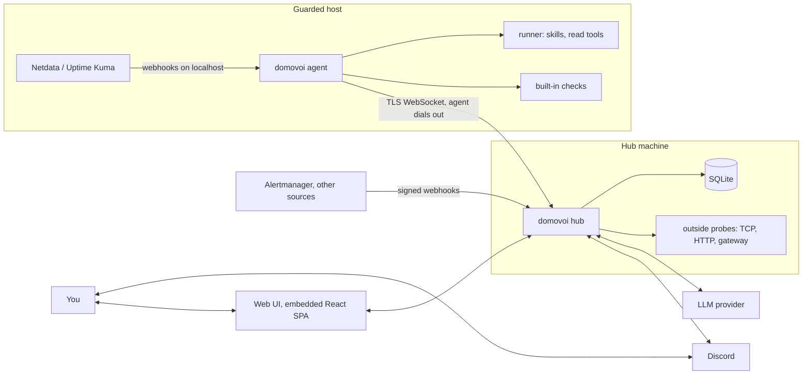
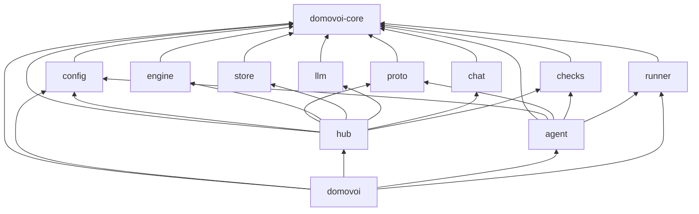
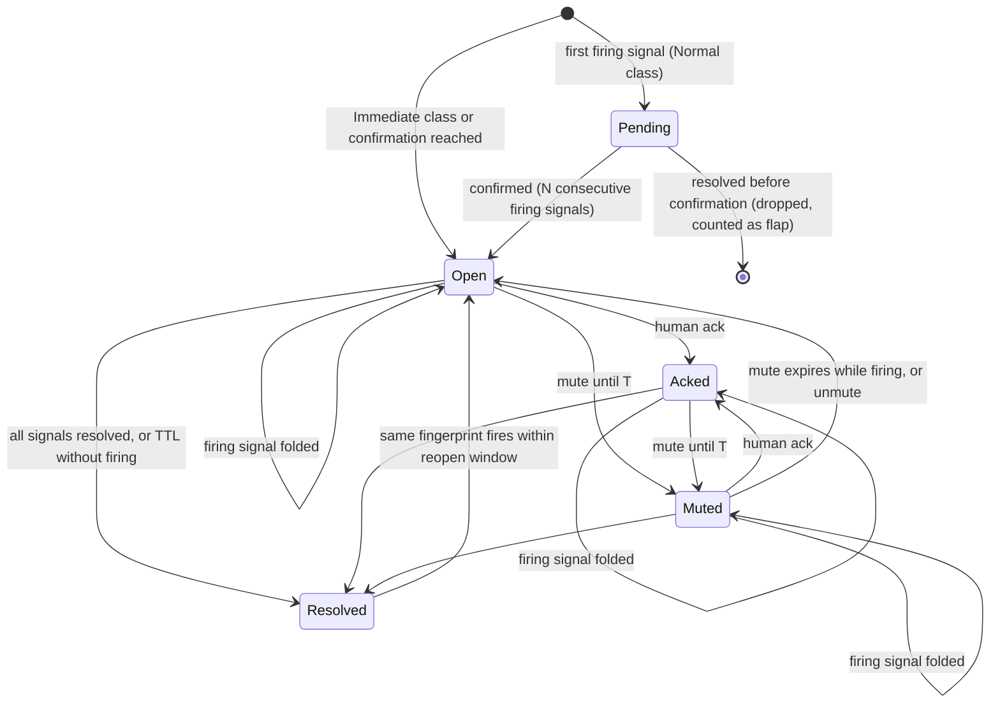
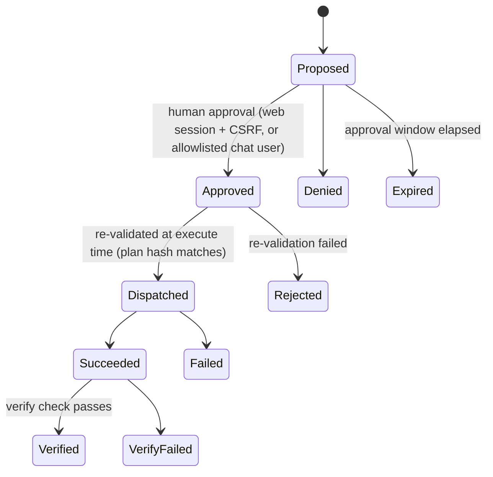
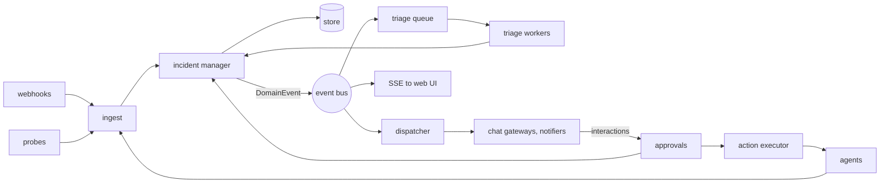

# Domovoi architecture

Status: accepted for v0.1. Anything marked **Rule** or **Invariant** can only change through an ADR in [`docs/adr`](docs/adr). The rules in §4 are enforced by `cargo xtask arch-check`; the invariants in §15 are enforced by tests named in that section.

---

## 1. What Domovoi is

Domovoi watches self-hosted servers, triages problems with an LLM, talks to you in chat, and only changes anything after a human approves it. It is **one binary with two roles**:

- **hub**: web UI and API, chat gateways, alert correlation, AI triage, approvals, audit log, SQLite database.
- **agent**: runs on every guarded host. Runs built-in checks, executes skills (user scripts) and read tools, and dials out to the hub.

The recommended deployment puts the hub on a different machine from the hosts it guards. Single-box mode runs both roles in one process.

## 2. Principles

1. **The LLM proposes; deterministic code decides.** Model output is data. It never becomes a command line, a config change or an approval.
2. **One execution path.** Every process spawned on a host is spawned by `domovoi-runner` inside an agent, from a manifest, with argv only.
3. **Ports and adapters.** Domain and application logic depend on traits defined in `domovoi-core`, never on I/O libraries.
4. **Fail open for alerts, fail closed for actions.** If triage fails, the alert still goes out. If validation is uncertain, the action does not run.
5. **Boring and small.** SQLite, one binary, no broker, no external services required.
6. **Deterministic tests.** Every component can run against fakes and a fake clock.

## 3. System context

## 4. Workspace layout and dependency rules

| Crate | Role | May depend on (internal, normal deps) |
| --- | --- | --- |
| `domovoi-core` | Domain types, state machines, ports (traits). Pure. | none |
| `domovoi-config` | Typed hub and agent config, loading, validation, secret indirection | core |
| `domovoi-proto` | Hub ↔ agent wire messages, envelope, versioning | core |
| `domovoi-engine` | Application services: correlation, incident manager, notification policy, triage orchestration, approvals, digest | core |
| `domovoi-store` | SQLite adapter for the repository ports | core |
| `domovoi-llm` | LLM provider adapters: Anthropic, OpenAI-compatible, CLI | core |
| `domovoi-chat` | Chat gateway and notifier adapters: Discord, generic webhook | core |
| `domovoi-checks` | Built-in checks. Feature `host` (agent-side host checks), feature `net` (network probes, also used by the hub) | core |
| `domovoi-runner` | The only crate that spawns processes: skill manifests, argument validation, sandboxed execution | core |
| `domovoi-agent` | Agent runtime: hub link, check scheduler, request handling, spool | core, config, proto, checks, runner |
| `domovoi-hub` | Hub runtime: HTTP API, auth, SPA serving, webhook ingest, agent server, wiring of engine with adapters | core, config, proto, engine, store, llm, chat, checks |
| `domovoi-testkit` | Fakes for every port, fake clock, fixtures. **Dev-dependency only.** | core, proto |
| `domovoi` | The binary and CLI. Composition root: selects mode, wires hub and agent, injects the process executor | core, config, hub, agent, runner |
| `xtask` | Developer tasks: `arch-check`, `openapi`, `ci` | none (not part of the product) |

**Rules**

- **R1 Dependency direction.** Internal normal dependencies must match the table above. Adapters never depend on other adapters. Nothing depends on `domovoi` or `xtask`.
- **R2 Pure inner layers.** `domovoi-core` and `domovoi-proto` do no I/O and do not depend on `tokio`, `sqlx`, `reqwest`, `axum`, `hyper`, `serenity`, `poise`, `bollard` or `rustls`. `domovoi-engine` may depend on `tokio` for tasks, channels and timers only; it must not use `tokio::net`, `tokio::fs`, `tokio::process`, `std::fs`, `std::net` or `std::process`. Allowed external dependencies for these crates are listed in `xtask/src/arch/rules.rs`.
- **R3 Process spawning.** Only `domovoi-runner` (and `xtask`) may construct `std::process::Command` or `tokio::process::Command`. Enforced by `clippy::disallowed_methods` and a source scan.
- **R4 No shell.** No code may invoke `sh -c`, `bash -c` or `/bin/sh`. Commands are argv vectors built from validated parameters.
- **R5 Testkit is dev-only.** `domovoi-testkit` may appear only under `[dev-dependencies]`.
- **R6 Composition roots.** `domovoi-hub` wires hub-side adapters, `domovoi-agent` wires agent-side ones, `domovoi` chooses the mode and injects cross-cutting services. No other crate constructs another crate's concrete adapter.
- **R7 Lints.** Every crate uses `[lints] workspace = true`. `unsafe_code` is forbidden. Library code may not use `unwrap`, `panic!`, `todo!`, `unimplemented!` or `dbg!`. CI treats warnings as errors.
- **R8 File size.** Non-test Rust source files stay at or below 500 lines. Split modules instead.
- **R9 Errors.** Libraries define `thiserror` error enums. `anyhow` is allowed only in `domovoi` and `xtask`.
- **R10 Docs.** Every public item is documented (`missing_docs`). Every crate root has a `//!` doc stating its role.
- **R11 Dependencies.** All versions are declared once in `[workspace.dependencies]`. New dependencies must pass `cargo deny` (license allowlist, advisories, no `openssl-sys`; TLS is rustls only so musl static builds work).
- **R12 Generated artifacts.** `web/src/api/openapi.json` and `web/src/api/schema.d.ts` are generated and committed. CI fails if they are stale.
- **R13 Migrations.** Files under `crates/domovoi-store/migrations` are append-only once merged.
- **R14 Wire formats.** Protocol messages and the OpenAPI document are covered by snapshot tests. A breaking protocol change bumps the protocol major version.

## 5. Domain model (`domovoi-core`)

All identifiers are newtypes over UUIDv7 (time-ordered) unless noted. Timestamps are `jiff::Timestamp` (UTC); civil time and time zones use `jiff` with an IANA zone from config.

### 5.1 Hosts and agents

- `HostId`, `AgentId`. A host has a `name` (slug, `^[a-z0-9][a-z0-9-]{0,62}$`), a `kind` (`Local`, `Remote`, or `External` for hosts known only from webhooks, which have no agent), labels, and at most one enrolled agent.
- `AgentIdentity`: agent id, ed25519 public key, agent version, enrolled-at.

### 5.2 Signals and fingerprints

- `Signal`: one observation from a check, a webhook or a probe.
  - `source: SourceKind` (`BuiltIn`, `Webhook { kind }`, `Probe`, `Agent`)
  - `host: HostId`, `check: CheckKey` (dotted, e.g. `container.restart_loop`), `target: Option<TargetKey>` (e.g. `plex`, `/dev/sdc`)
  - `status: Firing | Resolved`, `severity: Info | Warning | Critical`
  - `summary: String`, `evidence: Evidence` (ordered key → value map, values are strings or numbers), `observed_at`
  - `class: Normal | Immediate` (immediate skips confirmation runs, e.g. power loss)
- `Fingerprint = hash(host, check, target)`. **Volatile values (counts, IDs, timestamps, measurements) are never part of a fingerprint.** They live in evidence.

### 5.3 Incidents

- `Incident`: id, fingerprint, host, check, target, title, status, severity (max of open signals), `verdict: Option<Verdict>`, opened/resolved timestamps, `notify: NotifyState` (last sent, reminder due, thread reference per gateway), `history: EntityHistory` (bounded series of a tracked value, e.g. reallocated sectors).
- `Verdict`: `ActionNeeded`, `Monitor`, `Expected`, `Fixed`.
- **Recurrence folding:** a firing signal for an open or recently resolved incident with the same fingerprint updates that incident (thread reply) instead of creating a new one.
- **Delta checks:** for monotonic counters, a check emits a signal only when the value increases beyond its acked baseline. The incident's `history` records each value.

### 5.4 Acks, maintenance and baselines

- `AckRule`: matches incidents by host, check, target pattern and an evidence predicate; has a note and an optional expiry. Matching incidents keep their status but do not notify.
- `MaintenanceWindow`: host + time range; suppresses notifications, keeps signals.
- `Baseline`: expected containers, systemd units and listening ports per host, each with `criticality: Critical | Warning`. Learned only from managed containers (compose or Portainer labels); containers with auto-remove are never learned; entries absent for N days expire.

### 5.5 Triage

- `TriageRequest`: incident snapshot, context bundle (recent signals, what changed, similar past incidents, relevant host notes), budget.
- `TriageReport`: `headline` (≤ 120 chars), `summary`, `cause`, `evidence: Vec<EvidenceRef>` (≤ 3 shown on the card), `verdict`, `next_step`, `proposals: Vec<ActionProposal>`.
- `ReadTool`: a **closed enum** of read-only tools (`DockerPs`, `DockerLogs`, `DockerInspect`, `DockerEvents`, `HostOverview`, `Journal`, `ListeningPorts`, `SmartReport`, `IncidentHistory`, `NotesSearch`, `RunReadSkill`). There is no variant that approves, executes a write skill, or changes state.

### 5.6 Skills and actions

- `SkillManifest`: `name`, `description`, `risk: Read | Write | Destructive`, `entry`, `params: Vec<ParamSpec>`, `timeout`, `run_as`, `hosts`, `applies_to: Vec<CheckKey>`, optional `verify`, optional `revert` + `confirm_window`, `max_output`.
- `ParamSpec`: `name`, `kind: String { pattern, max_len } | Integer { min, max } | Boolean | Enum { values }`, `description`.
- `ActionRequest` state machine:

- `PlanHash = hash(skill name, manifest hash, host, canonical args)`. Approval binds to the plan hash; dispatch recomputes it.
- `Principal`: `Human(UserId)` or `System(component)`. Only `Human` can approve. The value that carries an approval, `HumanApproval`, may be constructed only in `crates/domovoi-hub/src/auth/`: by the web session layer (session + CSRF verified) and by the chat interaction authorizer (platform user ID on the allowlist). `xtask arch-check` fails if `HumanApproval::new` appears anywhere else.

### 5.7 Output models

- `Card`: the rendered-independent shape of every incident message: `badge` (verdict or severity), `host`, `headline`, up to 3 `bullets`, `next_step`, `buttons: Vec<CardButton>`, `details` (full reasoning, posted in the thread).
- `Digest`: one per day for all hosts. A host with nothing changed collapses to one line; others list changes since the previous digest, trends with projections (e.g. days until a pool is full) and `DigestFact`s contributed by checks and skills. Open incidents and advisories follow.
- `Advisory`: a low-priority hygiene finding (stale image, stack without a source copy, missing heartbeat, secret marked exposed). Advisories appear in the digest and never notify on their own.
- `Note`: markdown runbook text per host or global, searchable by triage.

## 6. Ports

All ports are `async_trait` traits in `domovoi-core::ports`, object-safe, `Send + Sync`.

| Port | Purpose | Implemented by | Used by |
| --- | --- | --- | --- |
| `Clock` | Current time, sleeping | engine (system), testkit (fake) | engine, agent, hub |
| `IncidentRepo`, `SignalRepo`, `ActionRepo`, `HostRepo`, `NoteRepo`, `BaselineRepo`, `AckRepo` | Persistence | store, testkit | engine, hub |
| `AuditLog` | Append-only audit events | store, testkit | engine, hub |
| `LlmProvider` | One model turn with tools; returns text or tool calls and token usage | llm, testkit (scripted) | engine |
| `ChatGateway` | Post or update a card, reply in a thread, receive interactions and messages | chat, testkit (recording) | engine, hub |
| `Notifier` | One-way message (digest, alert) | chat, testkit | engine |
| `AgentLink` | Hub side of an agent connection: send a tool or skill request, receive results and signals | hub (WebSocket and in-memory), testkit | engine |
| `ProcessExecutor` | Run an argv with limits | runner, testkit | checks (command-backed checks), llm (CLI provider), agent |
| `HostFs` | Read files under a host root (`/proc`, `/sys`, logs) | checks (real), testkit (fixture tree) | checks |
| `Redactor` | Remove secrets from text | engine (pattern based), testkit | engine, runner, chat |

## 7. Runtime architecture

### 7.1 Hub

The hub is a set of tokio tasks connected by channels:

- **Web server** (`axum`): REST API, SSE, SPA, webhook ingest.
- **Agent server**: TLS WebSocket listener, enrollment, handshake, one task per connected agent.
- **Incident manager**: the **single writer** for incident state. Everything that changes an incident (signals, acks, triage results, action results, timers) is a command on its `mpsc` channel. It persists, then publishes a `DomainEvent` on a `broadcast` bus.
- **Triage workers**: a bounded pool (default 2) that takes triage jobs, enforces budgets and rate caps, and sends the `TriageReport` back to the incident manager.
- **Dispatcher**: subscribes to domain events and delivers cards, thread replies and resolutions to chat gateways and notifiers, applying quiet hours and re-notify rules.
- **Scheduler**: digest, quiet-hours release, re-notify, TTL resolution, approval expiry, heartbeat ping, retention, backup.
- **Action executor**: dispatches approved actions to agents, records results, runs verification.

### 7.2 Agent

- **Hub link**: connect, authenticate, reconnect with exponential backoff and jitter, heartbeats every 10 s.
- **Check scheduler**: runs each enabled check on its cadence, turns results into signals, applies the local baseline.
- **Request handler**: serves `RunTool` and `RunSkill` requests. Every request is re-validated against the agent's local manifests and local policy before the runner sees it.
- **Spool**: an append-only JSONL file (size-capped) that buffers signals while the hub is unreachable and replays them on reconnect.

### 7.3 Single-box mode

`domovoi hub --with-local-agent` runs both roles in one process. The hub and the agent talk through an in-memory `AgentLink` pair that carries the same protocol messages as the WebSocket transport, so there is still one code path.

## 8. Hub ↔ agent protocol (`domovoi-proto`)

- **Transport:** WebSocket over TLS. The hub generates a self-signed certificate on first start (`rcgen`) and stores it. The agent pins the certificate's SHA-256 fingerprint at enrollment.
- **Enrollment:** `domovoi hub token create <host>` creates a single-use token (random 32 bytes, stored hashed, 15-minute expiry). `domovoi agent enroll --hub <url> --token <token>` generates an ed25519 key pair, sends the public key with the token, receives the hub certificate fingerprint and its `AgentId`.
- **Handshake:** the agent connects and sends `Hello`; the hub replies with a random `Challenge`; the agent returns the challenge signed with its key; the hub verifies against the enrolled public key and replies `Welcome`. Revoked agents are rejected.
- **Envelope:** `{"v": <major>, "id": "<uuidv7>", "kind": "<message kind>", "payload": {...}}`, JSON text frames. Requests carry `id`; responses carry `reply_to`.
- **Versioning:** `PROTOCOL_VERSION = (major, minor)`. The hub accepts agents with the same major and a minor at most one behind. Unknown fields are ignored; unknown kinds get an `Unsupported` reply.

| Direction | Kind | Purpose |
| --- | --- | --- |
| agent → hub | `hello` | agent id, version, host facts, capabilities, manifest catalog (names + hashes) |
| hub → agent | `challenge`, `welcome`, `reject` | handshake |
| both | `ping`, `pong` | liveness |
| agent → hub | `signals` | batch of signals (from checks or relayed local webhooks) |
| agent → hub | `digest_facts` | facts for the daily digest |
| hub → agent | `run_tool` | a read tool request with typed arguments and a deadline |
| hub → agent | `run_skill` | action id, skill name, args, plan hash, deadline |
| agent → hub | `tool_result`, `skill_result` | exit status, redacted output (capped), duration |
| hub → agent | `config_update` | check schedules and thresholds managed from the hub |
| both | `error`, `unsupported` | structured errors |

## 9. Persistence (`domovoi-store`)

- SQLite in WAL mode via `sqlx` with runtime-checked queries; every query is covered by an integration test against a temporary database.
- Migrations are embedded with `sqlx::migrate!` and run at start-up after an automatic `VACUUM INTO` backup.
- Timestamps are stored as `INTEGER` unix milliseconds UTC; IDs as `TEXT`.
- Tables (v0.1): `hosts`, `agents`, `enrollment_tokens`, `signals`, `incidents`, `incident_signals`, `incident_events` (timeline), `actions`, `audit_log`, `ack_rules`, `maintenance_windows`, `baselines`, `notes` + `notes_fts` (FTS5), `incidents_fts`, `triage_cache`, `llm_usage`, `digests`, `advisories`, `users`, `sessions`, `settings`.
- `audit_log` is append-only: a trigger rejects `UPDATE` and `DELETE`.
- Retention: signals 30 days, transcripts 90 days, incidents and audit kept. A nightly `VACUUM INTO` backup goes to a configurable path.

## 10. HTTP API and web UI

- **Two listeners:** `web` (HTTP, default `127.0.0.1:7420`, intended to sit behind a reverse proxy) and `agent` (TLS WebSocket, default `0.0.0.0:7421`).
- **Routes:** `/api/v1/*` JSON API, `/api/v1/events` SSE, `/hooks/{source}` signed webhooks, `/healthz`, `/metrics`, everything else serves the SPA (with `index.html` fallback).
- **Auth:** one admin account (argon2id). No default password: the first start prints a one-time setup URL. Session cookie: `HttpOnly`, `SameSite=Strict`, `Secure` when served over HTTPS. Every unsafe method requires the `X-CSRF-Token` header matching the session's synchronizer token. Login is rate-limited.
- **OpenAPI:** handlers are annotated with `utoipa`; `cargo xtask openapi` writes `web/src/api/openapi.json`; `npm run gen:api` turns it into `schema.d.ts`; the SPA calls the API only through a typed `openapi-fetch` client in `web/src/api`.
- **SPA:** React + TypeScript + Vite in `web/`, built to `web/dist`, embedded with `rust-embed` behind the `embed-ui` feature. Security headers: strict CSP (`default-src 'self'`), `X-Content-Type-Options`, `Referrer-Policy`, `frame-ancestors 'none'`.
- **Web structure:** `src/app` (router, providers), `src/api` (generated types, client, CSRF), `src/features/<feature>` (pages, components, hooks), `src/components` (shared UI). ESLint forbids `fetch` outside `src/api`.

## 11. LLM and triage

- `LlmProvider` exposes one turn: messages + tool definitions in, assistant text or tool calls + usage out. Adapters: Anthropic Messages API, OpenAI-compatible Chat Completions (covers Ollama, LM Studio, OpenRouter), and a **CLI provider** that runs a locally installed coding-agent CLI in print mode through an injected `ProcessExecutor` with a fixed argv template.
- **Tools** are the `ReadTool` enum (§5.5). The engine executes `Docker*`, `HostOverview`, `Journal`, `ListeningPorts`, `SmartReport` and `RunReadSkill` through `AgentLink`; `IncidentHistory` and `NotesSearch` against the store.
- **Budgets:** per run (tool calls, tokens, wall time), per hour (runs), per month (spend). Over a cap, the incident is posted without triage and marked "triage skipped".
- **Output:** the final turn must be a JSON object matching `TriageReport`; one repair retry, then fall back to a raw card.
- **Repeat cache:** a resolved incident with the same fingerprint and equivalent evidence within 7 days reuses the previous report without a model call.
- **Fallback chain:** primary provider → secondary provider → raw card. Repeated provider failures raise a `triage_degraded` advisory and one notice.
- **Redaction:** the `Redactor` runs on every tool output before it enters a prompt, and on every report before it leaves the hub.

## 12. Skills and actions

- Manifests live on the agent host in `skills/<name>/skill.toml`. The hub only ever sees names, hashes and metadata.
- Parameters are validated against `ParamSpec` and passed as separate argv elements and as `DOMOVOI_PARAM_<NAME>` environment variables. The entry is executed directly, never through a shell.
- Execution: dedicated user (`run_as`), cleared environment plus an allowlist, working directory inside the skill folder, own process group killed on timeout, stdout and stderr capped at `max_output`, output redacted.
- Write and destructive actions follow the `ActionRequest` state machine (§5.6). Destructive skills also need a typed confirmation in the web UI and can never be approved from a chat button.
- Every transition writes an `audit_log` entry: who proposed, who approved, plan hash, argv, exit code, output hash, duration, verification result.

## 13. Chat and notifications

- `ChatGateway` maps `Card` to the platform's message format, creates one thread per incident, posts follow-ups in that thread and turns button presses and thread messages into `Interaction`s.
- Discord (v0.1): one channel, one thread per incident, buttons for Ack, Mute 1 h, Approve, Deny, Details. The chat adapter only translates platform events into `Interaction`s; the hub's interaction authorizer accepts them only from allowlisted user IDs. Approval buttons carry a single-use token that expires with the action. Thread messages from allowlisted users become follow-up questions to the triage agent (read tools only).
- `Notifier` adapters send one-way messages: Discord webhook and generic JSON webhook in v0.1.
- Quiet hours hold non-critical notifications and release them as one batch when they end.

## 14. Configuration (`domovoi-config`)

- `hub.toml` and `agent.toml`, loaded from the path given on the command line, then overridden by `DOMOVOI_*` environment variables.
- Secrets are never inline: each secret field accepts `{ env = "NAME" }` or `{ file = "/path" }` and is held as `secrecy::SecretString`.
- `domovoi check config <file>` validates without starting and reports every problem with its TOML path.
- Config structs derive `schemars::JsonSchema`; the reference documentation is generated from them.

## 15. Security invariants

| ID | Invariant | Enforced by |
| --- | --- | --- |
| INV-1 | Only a `Human` principal can approve an action. No LLM tool, chat message text, MCP surface or operator can approve. | `ReadTool` closed enum; `HumanApproval::new` call sites restricted by `xtask arch-check`; gate tests in `domovoi-engine/tests/gates.rs` |
| INV-2 | Only `domovoi-runner` spawns processes; argv only; never a shell. | clippy `disallowed_methods`, `xtask arch-check` scan, runner tests |
| INV-3 | The agent re-validates every request against its local manifests and policy. The hub cannot push scripts. | agent request-handler tests |
| INV-4 | Approved actions are re-validated at dispatch: plan hash, manifest hash and param validation must still match. | engine action tests |
| INV-5 | Secrets never appear in logs, prompts, chat or API responses. | `SecretString`, redactor on all outbound text, redaction tests |
| INV-6 | Destructive actions are never auto-approved and never approvable from a chat button. | engine and chat gate tests |
| INV-7 | The audit log is append-only. | SQLite trigger + store test |
| INV-8 | Every unsafe HTTP method requires a valid session and CSRF token. | hub API tests |
| INV-9 | LLM output is never parsed into commands. Actions come only from `ActionProposal { skill, args }` validated against a manifest. | engine tests |
| INV-10 | Agent links are mutually authenticated; revoked agents are rejected. | protocol integration tests |
| INV-11 | Alerts are delivered even when triage fails. | engine fallback tests |
| INV-12 | Webhooks are rejected without a valid HMAC signature or token. | hub ingest tests |

## 16. Errors, logging and observability

- Library errors are typed (`thiserror`) and carry context; the binary reports them with `anyhow`.
- Logging uses `tracing`; human format by default, JSON with `--log-format json`. Secrets are `SecretString` and never logged.
- `/metrics` exposes Prometheus metrics: signals received, incidents by state, triage runs, tokens, spend, action outcomes, agent connections, notification failures.

## 17. Testing strategy

| Layer | What | Where |
| --- | --- | --- |
| Unit | Pure logic, state machines, validation, rendering | `#[cfg(test)]` modules next to the code |
| Property | Fingerprint stability, state machine invariants, param validation | `proptest` in core, engine, runner |
| Snapshot | Cards, digests, protocol JSON, OpenAPI document | `insta` |
| Integration | Store against temp SQLite; HTTP API via `tower::ServiceExt::oneshot`; agent ↔ hub over a real TLS WebSocket on localhost; webhook fixtures | `tests/` of each crate, cross-role tests in `crates/domovoi/tests` |
| Gates | Invariants INV-1…INV-12 as named tests that must never be deleted | `tests/gates.rs` per crate |
| Drills | Scripted incidents with a recorded model run; scored on detection, discrimination, action choice and restraint | `crates/domovoi-engine/tests/drills` (v0.1 minimal) |
| Web | Components and hooks with Vitest and Testing Library | `web/src/**/*.test.tsx` |
| End to end | `domovoi selftest` pushes a fake critical through triage and a recording gateway | CLI test |

All time-dependent logic takes a `Clock`; tests use the fake clock from `domovoi-testkit` and never sleep.

## 18. Budgets

- Hub idle RSS ≤ 80 MB with the embedded UI; agent idle RSS ≤ 20 MB.
- Check cycle on a typical host ≤ 2 s of CPU per 5 minutes.
- Triage concurrency 2, default per-run budget 15 tool calls and 90 s.

## 19. Not in v0.1, and where it plugs in

| Later feature | Plugs in at |
| --- | --- |
| Telegram, Matrix gateways | new adapters of `ChatGateway` in `domovoi-chat` |
| ntfy, Gotify, email notifiers | new `Notifier` adapters |
| MCP server and client | new adapter crate depending on core; MCP never gets an approve tool (INV-1) |
| Standing policies and autonomy | engine service producing `Principal::System` actions limited to reversible write skills (INV-6) |
| Operator mode | agent-side capability behind its own manifest and plan approval |
| Router, UPS, Home Assistant sources | new probe and source adapters |
