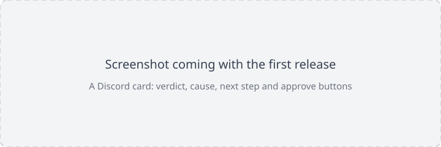
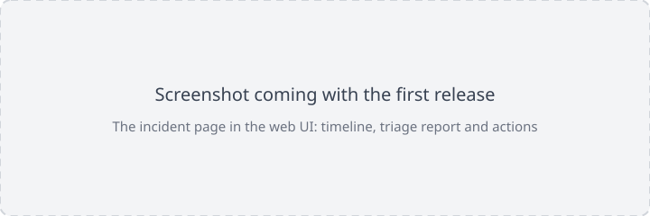
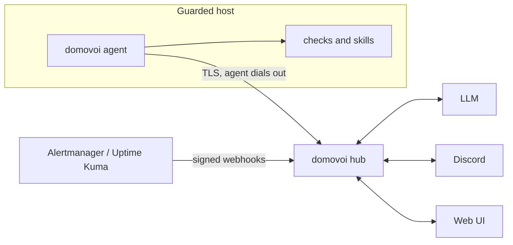

# Domovoi

**A self-hosted overseer for your servers.** Domovoi watches your hosts, triages problems with an LLM, talks to you in Discord threads, and only changes anything after you approve it.

Named after the Slavic household spirit that quietly keeps a home in order.

[](https://github.com/RoastSlav/domovoi/actions/workflows/ci.yml)
[](https://RoastSlav.github.io/domovoi)
[](#license)

> **Status: v0.1, before its first release.** Everything below works and is tested; expect rough edges until the first tagged release.

<p align="center">
  
  
</p>

## What it does

- **Watches** hosts with built-in checks (containers, systemd units, disks, memory, temperatures, SMART, kernel errors, SSH logins, power) and ingests alerts from tools you already run (Alertmanager, Uptime Kuma, generic webhooks).
- **Correlates** signals into incidents: one incident per problem, repeats folded into its thread, reminders instead of spam, quiet hours, and a daily digest that collapses healthy hosts into one line.
- **Triages** each incident with the LLM of your choice (Anthropic, any OpenAI-compatible API including Ollama, or a coding-agent CLI you are already logged into) using read-only tools on the host, and writes a short card: what happened, the likely cause, a verdict and one next step.
- **Talks** to you in Discord: a thread per incident, buttons to acknowledge, mute or approve, and follow-up questions answered in the thread.
- **Acts only with your approval:** fixes are your own scripts ("skills") with declared risk and validated parameters. The model can propose; only you can approve. Destructive actions need a typed confirmation in the web UI. A [starter pack](examples/skills) covers overviews, container and unit restarts, and journal cleanup.
- **Is set up in the browser:** no config file to write. A guided first run covers Discord, the model, the digest and your first host, and every setting can still come from files when you prefer config as code.
- **Runs off the box it guards:** the hub can live on another machine, so it notices when a host dies, and tells "host down" apart from "agent down" and "my own network is down".

## How it works



One binary, two roles: the **hub** (web UI, API, correlation, triage, approvals, SQLite) and the **agent** (checks, skills, read tools). Run both on one machine to start; move the hub to another machine when you want it to survive the host it watches. See [ARCHITECTURE.md](ARCHITECTURE.md).

## Safety model

1. The LLM only gets read-only tools. Log lines and alert text are treated as untrusted data.
2. Only an authenticated human can approve an action, from the web UI or from an allowlisted Discord account.
3. Actions are your skills: argv-only execution, validated parameters, no shell, re-validated on the host right before running.
4. Destructive skills require a typed confirmation in the web UI and can never be approved from chat.
5. Every proposal, approval and execution is recorded in an append-only audit log.

These are enforced by tests, by an architecture checker, and by scored triage drills that run realistic incidents (decoys, prompt injection, destructive-only fixes) through the real engine on every change.

## Quick start

On a Linux machine (x86_64 or arm64), install and start the hub, then open the setup link it prints:

```sh
curl -fsSL https://github.com/RoastSlav/domovoi/releases/latest/download/install.sh | sudo sh -s -- --role hub
sudo systemctl enable --now domovoi-hub
sudo journalctl -u domovoi-hub | grep -A1 setup
```

No config file is needed: the guided first run sets up Discord, a model and your first host. The [quick start](docs/book/src/quick-start.md) goes from here to a first triaged card in about ten minutes. To use Docker instead, or to run the agent in a container on a NAS, see the [install guides](docs/book/src/install/binary.md) and [`deploy/`](deploy).

## Documentation

- User docs: <https://RoastSlav.github.io/domovoi> (sources in [`docs/book`](docs/book)), starting with the [quick start](docs/book/src/quick-start.md) and the [security model](docs/book/src/security.md)
- Architecture: [ARCHITECTURE.md](ARCHITECTURE.md) and decision records in [`docs/adr`](docs/adr)

## Contributing

Contributions are welcome. Read [CONTRIBUTING.md](CONTRIBUTING.md) first; it explains the architecture rules CI enforces. Please report security issues privately as described in [SECURITY.md](SECURITY.md).

## License

Licensed under either of [Apache License, Version 2.0](LICENSE-APACHE) or [MIT license](LICENSE-MIT) at your option.

Unless you explicitly state otherwise, any contribution intentionally submitted for inclusion in Domovoi by you, as defined in the Apache-2.0 license, shall be dual licensed as above, without any additional terms or conditions.
