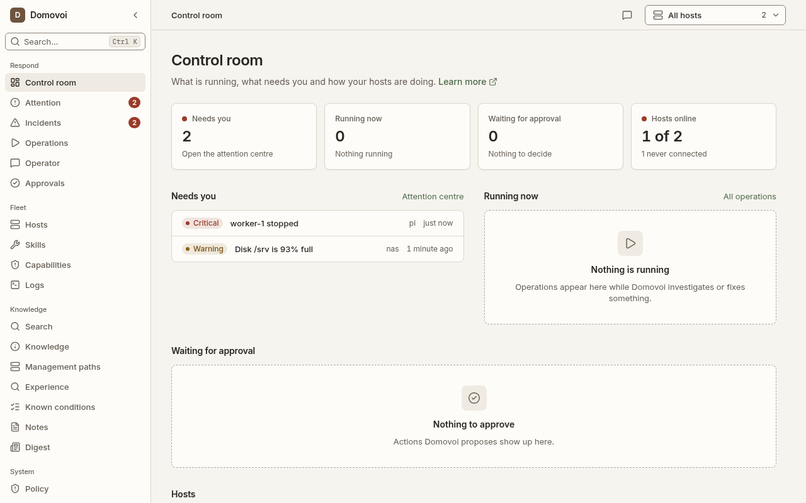
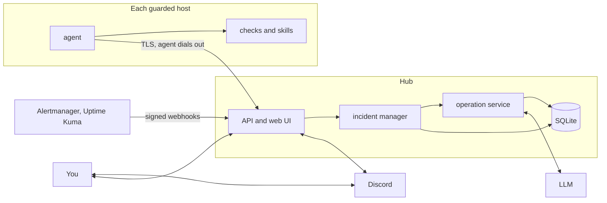
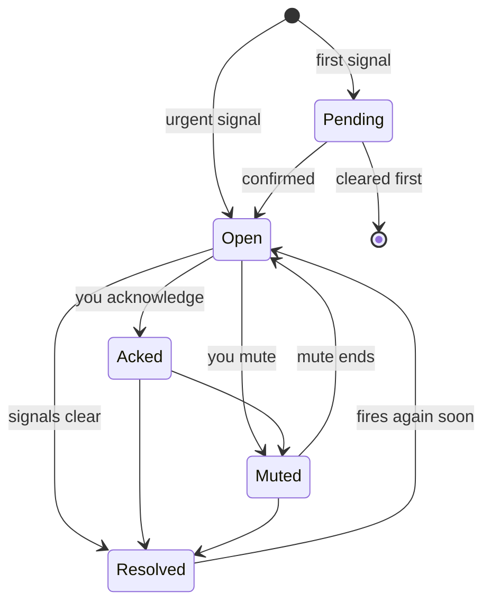
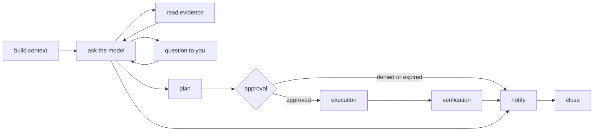

# Domovoi

**A self-hosted overseer for your servers.** It watches your hosts, works out what went wrong, tells you in plain language, and changes nothing until you say yes.

Named after the Slavic household spirit that quietly keeps a home in order.

[](https://github.com/RoastSlav/domovoi/actions/workflows/ci.yml)
[](https://RoastSlav.github.io/domovoi)
[](#license)

Domovoi has not had a tagged release yet. The documentation and the tests describe what is in the repository today.

<picture>
  <source media="(prefers-color-scheme: dark)" srcset="docs/assets/control-room-dark.png">
  
</picture>

## The problem

It is 3 a.m. and your phone says "disk almost full". It does not say which disk, what filled it, or whether it is safe to clean. You keep a few cron scripts and five dashboards, none of them maintained, and you would never let a chatbot loose on the box, because one wrong `rm -rf` ends the evening.

Domovoi sits in the middle. It watches, groups the noise into one incident per problem, asks a language model of your choice to read the evidence, and posts a short card in Discord: what happened, the likely cause and one next step. If a fix is possible, it shows you the exact plan. Nothing runs until you approve it.

## What it does for you

- **Watches your hosts and the alerts you already have.** Built-in checks cover containers, systemd units, disks, memory, temperatures, SMART, kernel errors, SSH logins and power. Alertmanager, Uptime Kuma and any signed webhook feed the same pipeline.
- **One incident per problem, not fifty alerts.** Repeats fold into the incident's thread. You get reminders instead of spam, quiet hours, and a daily digest that collapses healthy hosts into one line.
- **Investigates with read-only tools.** The model reads logs, container state and earlier incidents on the host, and writes the card. It cannot change anything, and it treats log lines and alert text as untrusted data.
- **Talks to you in Discord threads.** Acknowledge, mute, approve or deny with buttons, and ask follow-up questions in the thread. The same incident is in the web UI with its full timeline.
- **Runs your own scripts as safe "skills".** A skill is a folder with a manifest: a declared risk, validated parameters and a check to run afterwards. There are [eleven starter skills](examples/skills).
- **Lets you try automation before it acts.** A policy of rules can run in watch-only mode first, recording what it would have decided. Only restarting a service and blocking a network source can ever run without you, inside limits you set on each host.
- **Remembers.** Finished investigations become short summaries you can search, so a repeat problem starts with what fixed it last time. You can also record facts about your hosts for the model to use.
- **Answers questions about a host.** The Operator is a read-only chat for "what is using the disk on `nas`?", kept across restarts.
- **Keeps what you tell it to keep.** Retention is set per kind of data, and the audit log of who approved what is hash-chained so tampering shows.

## See it in action

**A container keeps crash-looping at night.** The `container.restart_loop` check fires and Domovoi opens one incident. The card in your channel reads:

```text
**[ACTION NEEDED] nas**
plex is crash-looping after the 1.41 image update
- restarts: 7 in 10 minutes
- last error: migration 42 failed
Next: Pin the previous image tag and restart.
```

The card also shows a plan: the skill `restart_container`, the host, the argument `container=plex` and a short plan code. You tap **Approve**. The hub checks that the plan is unchanged, the agent re-checks it against its own copy of the skill, runs it, and 30 seconds later runs the original check again. If the check passes, the incident resolves itself.

**A disk is filling.** The investigation reads the host's disk state and, with the read skill `disk_usage_top`, finds the largest directories, so the card says which one grew. Cleaning up is up to you: a skill that deletes anything is marked destructive and needs its name typed in the web UI before it runs.

**Uptime Kuma reports a service down.** One webhook line is all the setup:

```toml
[webhooks.kuma]
kind = "uptime_kuma"
auth = "bearer"
secret = { env = "DOMOVOI_KUMA_TOKEN" }
default_host = "nas"
```

A skill is as small. This is the whole manifest of the starter skill used above:

```toml
name = "restart_container"
description = "Restart one Docker container, then re-run the check that raised the incident."
risk = "write"
entry = "run"
timeout = "2m"
applies_to = ["container.expected_down", "container.unhealthy", "container.restart_loop"]
max_output_bytes = 8192

[[params]]
name = "container"
description = "The container's name"
kind = { type = "string", pattern = '^[A-Za-z0-9][A-Za-z0-9_.-]{0,127}$', max_len = 128 }

[verify]
recheck = true
delay = "30s"
```

## How it works

One binary, two roles. The **agent** runs on each host you guard: it runs the checks, reads what the hub asks for and runs approved skills. The **hub** holds everything shared: the web UI and API, the incident manager, the operation service, chat, the model calls and the SQLite database. Agents dial out to the hub, so a guarded host needs no open port.



An **incident** is one problem on one host, however many alerts it raises:



Each new incident starts an **operation**: a durable piece of work made of **steps**. A step is one immutable record (a model turn, a read from the host, a plan, a question to you, an approval, a run, a check afterwards). Steps are never edited, so the history reads in order and survives a restart.



An operation is queued, running, waiting for an approval, an answer, an agent or a timer, paused, or finished (succeeded, failed, escalated or cancelled). A budget that runs out pauses it. An **execution** that may have run but whose result was lost is shown as unknown and is never retried for you.

- **Agent:** runs checks on a schedule, serves the hub's read requests, runs approved skills and keeps signals on disk while the hub is away.
- **Hub:** correlates signals into incidents, runs investigations, delivers cards and holds the audit log.
- **Effect:** work that must happen later (a re-check, a card) is stored in the same commit as the change that asked for it, so a restart loses nothing.
- **Skill:** a script plus a manifest, run directly (never through a shell) as a separate unprivileged account in a sandbox.
- **Policy:** the rules that say what, if anything, may run without you.

## How it keeps you safe

Each of these is enforced in code and covered by a test or by the architecture checker. The [security model](docs/book/src/security.md) lists them with their tests.

- **Only a person approves.** The model's tools are a closed set with no approve tool, and nothing in a log, alert or chat message counts as an approval.
- **You approve exactly what runs.** An approval is bound to the plan by a hash. If the skill, the arguments, the host or its key change, the run is refused.
- **The model reads, it does not act.** It has read-only tools, bounded budgets and redacted input.
- **No shell, ever.** Fixes run as argument lists with validated parameters, and the agent re-checks them on the host right before they run.
- **Skills are sandboxed.** On a standard install they run as their own unprivileged account, apart from the agent and from the small root helper that does the few privileged reads.
- **Packages are signed.** The agent verifies them against keys the hub cannot change, a person approves each install with a password, and installing one never enables or runs it.
- **Destructive means typed.** A destructive step needs its name typed in the web UI and has no chat button.
- **Automation starts in watch-only mode.** A policy rule records what it would do until you publish it, and even then only a service restart or a network block can run unattended.
- **Agents dial out over TLS.** A revoked key can never reconnect.
- **Secrets stay secret.** They are never logged, shown in the API or put into prompts.
- **The audit log is tamper-evident.** Every row is hash-chained, and `domovoi audit verify` checks it.
- **Limits on every side.** Rate limits, a ceiling set on each host, sessions with CSRF tokens, a strict CSP, and your password again for risky settings.
- **It is tested.** Gate tests protect each invariant, an architecture checker forbids new paths around them, and scored drills (prompt injection, decoys, fixes that are only destructive) run on every change.

Domovoi does not protect you from a compromised root account on a host, from you approving something you did not read, or from a hub whose own machine is taken over in full. See [what is not protected](docs/book/src/security.md#what-is-not-protected).

## Quick start

On a Linux machine (x86-64 or 64-bit ARM), install the hub (the installer starts it and prints the setup link), then open that link:

```sh
curl -fsSL https://github.com/RoastSlav/domovoi/releases/latest/download/install.sh | sudo sh -s -- --role hub
```

No config file is needed. The guided first run sets up Discord, a model and your first host, and the [quick start](docs/book/src/quick-start.md) goes from there to a first triaged card in about ten minutes. For Docker, see [`deploy/compose`](deploy/compose); for the agent in a container, for example on a NAS, see the [container agent guide](docs/book/src/install/container-agent.md).

## Documentation

- User docs: <https://RoastSlav.github.io/domovoi> (sources in [`docs/book`](docs/book)), starting with the [quick start](docs/book/src/quick-start.md) and the [security model](docs/book/src/security.md)
- Architecture: [ARCHITECTURE.md](ARCHITECTURE.md) and the decision records in [`docs/adr`](docs/adr)

## Contributing

Contributions are welcome. Read [CONTRIBUTING.md](CONTRIBUTING.md) first; it explains the architecture rules CI enforces. [TESTING.md](TESTING.md) shows how to run the checks and the app locally. Please report security issues privately as described in [SECURITY.md](SECURITY.md).

## License

Domovoi is licensed under the [PolyForm Noncommercial License 1.0.0](LICENSE). Personal use is free: at home, in a homelab, for study, hobby projects and research, and by charities, schools, public research bodies, public safety and health bodies and government institutions.

### Who needs a commercial license

As an additional permission under the license, commercial use is free while **you and your company together earned less than €100,000 in the last twelve months**. There is no limit on hosts, users or monitored servers, and nothing in Domovoi counts or reports them.

A commercial license is needed when any of these is true:

- You and your company together earned €100,000 or more in the last twelve months.
- You offer Domovoi, or a product built on it, to other organisations as a hosted or managed service. This is the only case with no size limit, because that is reselling Domovoi itself.
- You need a signed license for a procurement, security or compliance review, at any size.

Crossing the threshold is not retroactive: a business that crosses it mid-year stays covered until the end of that calendar year, and everything done under the threshold stays licensed. Nor is there a trial, a phone-home check or an audit clause; the license is the whole mechanism.

Commercial licenses and questions about which side of the line you are on: <raikov0411@gmail.com>.

Contributions are accepted under the [contributor license agreement](docs/CLA.md), so that the maintainer can offer those commercial licenses.
