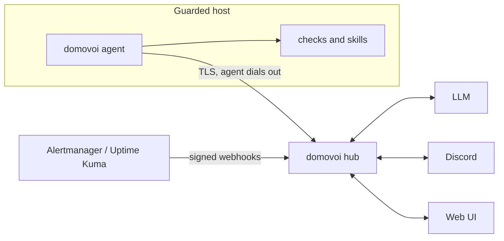

# Domovoi

**A self-hosted overseer for your servers.** Domovoi watches your hosts, triages problems with an LLM, talks to you in Discord threads, and only changes anything after you approve it.

Named after the Slavic household spirit that quietly keeps a home in order.

> **Status: pre-alpha.** The architecture and build plan are in place; v0.1 is being built prompt by prompt. Nothing here is ready to run in production yet.

## What it does

- **Watches** hosts with built-in checks (containers, systemd units, disks, memory, temperatures, SMART, kernel errors, SSH logins, power) and ingests alerts from tools you already run (Alertmanager, Uptime Kuma, generic webhooks).
- **Correlates** signals into incidents: one incident per problem, repeats folded into its thread, reminders instead of spam, quiet hours, and a daily digest that collapses healthy hosts into one line.
- **Triages** each incident with the LLM of your choice (Anthropic, any OpenAI-compatible API including Ollama, or a coding-agent CLI you are already logged into) using read-only tools on the host, and writes a short card: what happened, the likely cause, a verdict and one next step.
- **Talks** to you in Discord: a thread per incident, buttons to acknowledge, mute or approve, and follow-up questions answered in the thread.
- **Acts only with your approval:** fixes are your own scripts ("skills") with declared risk and validated parameters. The model can propose; only you can approve. Destructive actions need a typed confirmation in the web UI.
- **Runs off the box it guards:** the hub can live on another machine, so it notices when a host dies, and tells "host down" apart from "agent down" and "my own network is down".

## How it works

One binary, two roles: the **hub** (web UI, API, correlation, triage, approvals, SQLite) and the **agent** (checks, skills, read tools). Run both on one machine to start; move the hub to another machine when you want it to survive the host it watches. See [ARCHITECTURE.md](ARCHITECTURE.md).

## Safety model

1. The LLM only gets read-only tools. Log lines and alert text are treated as untrusted data.
2. Only an authenticated human can approve an action, from the web UI or from an allowlisted Discord account.
3. Actions are your skills: argv-only execution, validated parameters, no shell, re-validated on the host right before running.
4. Destructive skills require a typed confirmation in the web UI and can never be approved from chat.
5. Every proposal, approval and execution is recorded in an append-only audit log.

These are enforced by tests and by an architecture checker in CI, not just by convention.

## Quick start

Coming with v0.1. The plan: download a static binary or pull `ghcr.io/OWNER/domovoi`, run `domovoi hub run --with-local-agent`, open the setup link, connect Discord and an LLM, and you are watching your first host in about ten minutes.

## Documentation

- User docs: <https://OWNER.github.io/domovoi> (sources in [`docs/book`](docs/book))
- Architecture: [ARCHITECTURE.md](ARCHITECTURE.md) and decision records in [`docs/adr`](docs/adr)
- Build plan: [`docs/build-plan`](docs/build-plan)

## Contributing

Contributions are welcome. Read [CONTRIBUTING.md](CONTRIBUTING.md) first; it explains the architecture rules CI enforces and how the build plan works. Please report security issues privately as described in [SECURITY.md](SECURITY.md).

## License

Licensed under either of [Apache License, Version 2.0](LICENSE-APACHE) or [MIT license](LICENSE-MIT) at your option.

Unless you explicitly state otherwise, any contribution intentionally submitted for inclusion in Domovoi by you, as defined in the Apache-2.0 license, shall be dual licensed as above, without any additional terms or conditions.
