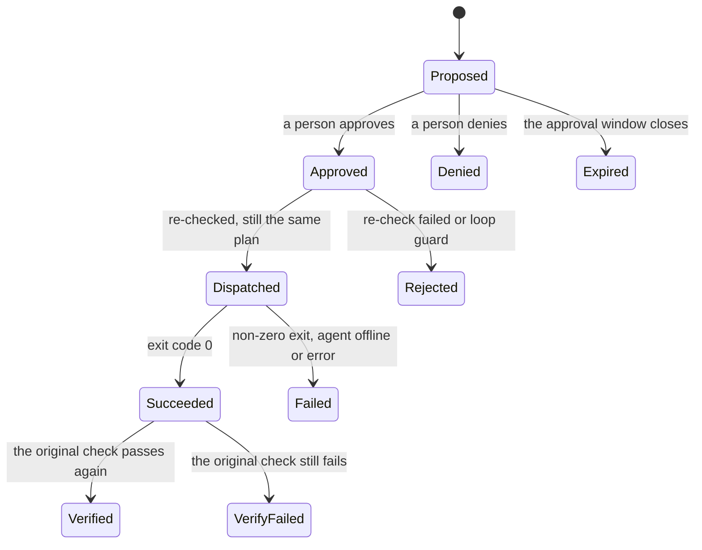

# Actions and approvals

Triage may suggest up to three actions for an incident, such as restarting a container. An action is a skill installed on the agent's host, together with the arguments to run it with. Nothing runs until a person approves it, and each step afterwards is checked again and written to the audit log.

## Lifecycle

- **Proposed:** triage suggested it. The card shows Approve and Deny buttons. Proposals stay open for one hour.
- **Approved:** a person said yes, and the action is run straight away.
- **Rejected:** something changed between approval and running, or the loop guard stopped it. The thread says why.
- **Dispatched:** it was sent to the agent.
- **Succeeded or Failed:** what the skill's run reported. Failures are posted in the incident's thread.
- **Verified or VerifyFailed:** whether the check that raised the incident passes again afterwards. A verified action marks the incident as fixed. A failed verification is posted in the thread.

## Safety rules

- **Only people approve.** An approval comes from a signed-in web session or an allowed chat user. The model, alert text, log lines and other automation can never approve an action. The model's read-only tools include nothing that can change an action.
- **Destructive actions need a typed confirmation on the web.** Skills marked `risk = "destructive"` can never be approved from a chat button.
- **Chat buttons work once.** Each proposal gets its own random token, and only its hash is stored. The token stops working after it is used, and once the action is denied or expired.
- **The plan is checked again before it runs.** The approval covers one plan: the skill, the exact manifest, the host and the arguments. Just before running, Domovoi fetches the skill from the agent again. If the skill is gone, its risk changed, its manifest changed or the arguments no longer fit its parameters, the action is rejected instead of run.
- **Nothing retries on its own.** A rejected or failed action stays that way. To try again, triage or a person proposes a new action, and someone approves it.
- **The loop guard limits repeat runs.** The same skill runs at most three times per host in any hour. A fourth approval is blocked, and the thread says so.
- **An offline agent fails the action.** If the agent is not connected, Domovoi waits up to five minutes before marking the action failed.
- **Runs are bounded.** The agent runs the skill directly, with no shell, as the skill's user and within the skill's timeout.
- **Results are verified.** A skill with a `verify` section is checked again after its delay. A write skill that applies to the incident's check is checked after 30 seconds.

## Audit trail

Every step adds an entry to the append-only audit log:

| Entry | Records |
| --- | --- |
| `action.proposed` | who proposed it, the arguments, when the approval window closes |
| `action.approved`, `action.denied` | the person and how they approved: web or chat user |
| `action.expired` | the approval window closed |
| `action.rejected`, `action.blocked` | why the action did not run |
| `action.dispatched` | the plan hash that matched |
| `action.succeeded`, `action.failed` | exit code, argv hash, output hash, duration, and the first 4 KiB of the output, with secrets removed |
| `action.verified`, `action.verify_failed` | what the check reported afterwards |

Every entry also names the incident, host, skill, risk and plan hash.
