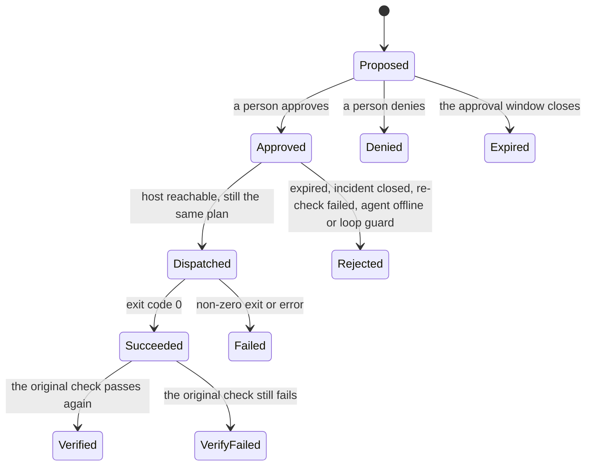

# Actions and approvals

Triage may suggest up to three actions for an incident, such as restarting a container. An action is a skill installed on the agent's host, together with the arguments to run it with. Nothing runs until a person approves it, and each step afterwards is checked again and written to the audit log.

## Lifecycle

- **Proposed:** triage suggested it. The card shows Approve and Deny buttons. Proposals stay open for one hour.
- **Approved:** a person said yes. It runs once its host's agent is reachable, and only if the approval and the incident still stand, so an approval made just before a restart waits for the host instead of failing.
- **Rejected:** something changed between approval and running, the incident was resolved or deleted, the agent never came back, or the loop guard stopped it. The thread says why.
- **Dispatched:** it was sent to the agent. If the hub loses the answer, the action stays here and its result is asked for when the agent authenticates again.
- **Succeeded or Failed:** what the skill's run reported. Failures are posted in the incident's thread.
- **Never ran:** the agent has no record of it. An approval that expired before it was sent also ends here, instead of being rejected.
- **Result unknown:** it was sent to the host and may have run. It stays unknown rather than becoming a success or a failure, and a person checks the host before running the work again.
- **Verified or VerifyFailed:** whether the check that raised the incident passes again afterwards. A verified action marks the incident as fixed. A failed verification is posted in the thread.

Restarting the hub loses nothing that a person already decided, and invents nothing: when Domovoi starts it reads the store and runs what is still marked **Approved**, so an approval made a moment before the restart still runs. An action that was **Dispatched** when the hub stopped is kept dispatched. Its answer went to a session that is gone, so when that host's agent authenticates again Domovoi asks the agent's action journal what became of it: a recorded result is committed, a run still going stays running, an action the agent has no record of is shown as never ran, and one the agent can no longer account for is shown as a result unknown. Uncertainty is shown as uncertainty and is never turned into a success or a failure; a person checks the host before running the work again. The loop guard keeps working across the restart: before the new session starts anything it reads back the dispatches the previous session wrote in the audit log, so runs that happened in the hour it is still in count against it, and a fourth approval of the same skill on the same host is stopped the way it would have been stopped without the restart. An approval whose host has not reconnected yet waits for it instead of being failed, up to thirty minutes, and is checked again just before dispatch: an approval whose window closed before it was sent is shown as never ran, and an incident that was deleted or resolved while Domovoi was down is rejected rather than run.

## In the web UI

An action looks the same on the incident's page and on the **Approvals** page: the skill, its risk (the info button beside it says what that risk level allows), its state, the host, the arguments it would run with, the plan code it will run (the info button beside it explains what that code covers), who suggested it, and, while it waits, the time left to decide. The countdown turns to a warning in the last ten minutes. On the incident's page the card also shows why triage proposed it, labelled as the model's reason: that sentence is not what you approve.

**Approve** always asks first, naming the skill, its arguments and the host; a destructive skill also needs its name typed. **Deny** is one click: nothing runs, and triage can propose the action again. After you approve, the card shows the action being sent and running, and a short message tells you how it ended, wherever on the page you are. An action that failed shows the reason; one that expired says that nobody decided in time and that nothing ran.

## What an approval covers

Each proposed action has a **plan hash**: a code shown on the card as `Plan a1b2c3d4`. It is computed from the skill's name, the version of its manifest, the host and the exact arguments. The approval request carries the code the card showed; if it no longer matches what is stored for the action, the approval is refused and nothing changes. A stale or substituted card therefore cannot approve a different plan.

The code does **not** cover the contents of the skill's entry script, and it does not name a resolved target on the host: it binds the host, not what the skill will find there. Stronger binding is planned. The runtime limits stay what they were: Domovoi recomputes the plan from the agent's current manifest just before running, the agent applies its own checks, and the audit log records what ran.

A Discord button has no room for the whole code, so it carries a short prefix of it. The button's single-use token is still what authenticates the press; the prefix only catches a card that has gone stale. A card too old to carry the prefix is refused and asks you to approve in the web UI. If an action's arguments are too long to show in chat, that action gets no Approve or Deny button there, only the link, because you must be able to read every argument before approving.

The **Approvals** page lists what is **Waiting for you**, the soonest to expire first, and, in a section that starts closed, what was **Recently decided** in the last 24 hours. It follows the host chosen in the top bar.

## Safety rules

- **Only people approve.** An approval comes from a signed-in web session or an allowed chat user. The model, alert text, log lines and other automation can never approve an action. The model's read-only tools include nothing that can change an action.
- **One decision per action.** Approving, denying and letting the window close are applied one at a time, in the order they arrive. If you press Approve and Deny together, only the first is applied and the other is refused with a message that the action already has an outcome; the card then shows the decision that was made. Expiry never overwrites a decision a person already made.
- **Destructive actions need a typed confirmation on the web.** Skills marked `risk = "destructive"` can never be approved from a chat button.
- **Chat buttons work once.** Each proposal gets its own random token, and only its hash is stored. The token stops working after it is used, and once the action is denied or expired.
- **The plan is checked again before it runs.** The approval covers one plan: the skill, the exact manifest, the host and the arguments. Just before running, Domovoi fetches the skill from the agent again. If the skill is gone, its risk changed, its manifest changed or the arguments no longer fit its parameters, the action is rejected instead of run.
- **Nothing retries on its own.** A rejected or failed action stays that way. To try again, triage or a person proposes a new action, and someone approves it.
- **The loop guard limits repeat runs.** The same skill runs at most three times per host in any hour. A fourth approval is blocked, and the thread says so.
- **An offline agent holds the action.** If the host's agent is not reachable, Domovoi waits for it for up to thirty minutes before rejecting the action with "agent offline"; an agent this hub rejected as incompatible is rejected at once. Waiting happens before the action takes a place in the catch-up pool, so one missing host does not keep another host's runs from starting.
- **Runs are bounded.** The agent runs the skill directly, with no shell, as the skill's user and within the skill's timeout.
- **Results are verified.** A skill with a `verify` section is checked again after its delay. A write skill that applies to the incident's check is checked after 30 seconds. The re-check is scheduled durably, in the same commit that records the run, so a hub restart between the run and the re-check does not skip it. A re-check that cannot reach the host is retried with growing delays, 30 seconds doubling up to one hour, five attempts in all, and is then recorded as verification failed with the reason that the re-check could not run.

## Audit trail

Every step adds an entry to the append-only audit log:

| Entry | Records |
| --- | --- |
| `action.proposed` | who proposed it, the arguments, when the approval window closes |
| `action.approved`, `action.denied` | the person and how they approved: web or chat user |
| `action.expired` | the approval window closed |
| `action.rejected`, `action.blocked` | why the action did not run |
| `action.dispatched` | the plan hash that matched |
| `action.succeeded`, `action.failed` | exit code, argv hash, output hash, duration, and the first 4 KiB of the output, with secrets removed |
| `action.verified`, `action.verify_failed` | what the check reported afterwards |

Every entry also names the incident, host, skill, risk and plan hash.
