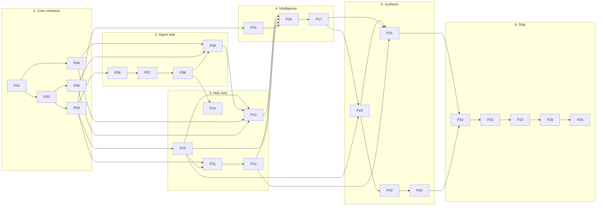

# Build plan: Domovoi v0.1

v0.1 is done when Domovoi can replace a homegrown cron-and-script monitor on two machines without losing anything: built-in checks, AI triage, Discord threads with buttons, human-approved actions, a daily digest, a web UI, and one-command installs. The work is split into 26 prompts. Each prompt is one branch, one pull request, and leaves `main` green.

## How to run a prompt

1. **Branch.** `git switch -c p07-host-checks-system` from an up-to-date `main`.
2. **Start a fresh coding-agent session** in the repository root. With Claude Code: start in plan mode, then give it the prompt file:

   ```text
   Read docs/build-plan/prompts/P07-host-checks-system.md and AGENTS.md, then plan the work.
   ```

   Review the plan. Push back if it touches crates outside the prompt's **Crates** line or skips listed tests.
3. **Execute.** Let the agent implement and iterate until `cargo xtask ci` (plus `--web` for UI prompts) passes.
4. **Open the PR.** Title in Conventional Commits form (`feat(checks): system host checks`). The description lists each acceptance criterion and how it is met.
5. **Review in a fresh session** with [`review-prompt.md`](review-prompt.md). It compares the diff with `ARCHITECTURE.md`, the prompt and the invariants, and returns blocking and non-blocking findings.
6. **Fix** blocking findings with [`fix-prompt.md`](fix-prompt.md), re-run CI, re-review if the fix was large.
7. **Merge** with squash. release-plz picks up the commit for the next release PR.

Never run two prompts in one branch. Never start a prompt whose **Depends on** prompts are not merged.

## Phases



| # | Prompt | Crates | Depends on | Size |
| --- | --- | --- | --- | --- |
| P01 | [Core model I: ids, signals, fingerprints, incidents](prompts/P01-core-signals-incidents.md) | core | none | M |
| P02 | [Core model II: skills, actions, triage, cards, digest](prompts/P02-core-skills-actions-outputs.md) | core | P01 | L |
| P03 | [Ports and testkit](prompts/P03-ports-and-testkit.md) | core, testkit | P02 | L |
| P04 | [Configuration](prompts/P04-configuration.md) | config | P01 | M |
| P05 | [Wire protocol](prompts/P05-protocol.md) | proto | P02 | M |
| P06 | [Runner: manifests and sandboxed execution](prompts/P06-runner.md) | runner | P03 | L |
| P07 | [Host checks I: system](prompts/P07-host-checks-system.md) | checks | P06 | L |
| P08 | [Host checks II: containers, units, SMART, security, probes](prompts/P08-host-checks-services.md) | checks | P07 | L |
| P09 | [Agent runtime](prompts/P09-agent-runtime.md) | agent | P04, P05, P08 | L |
| P10 | [Store](prompts/P10-store.md) | store | P03 | L |
| P11 | [Engine I: incident manager and correlation](prompts/P11-engine-incidents.md) | engine | P03, P10 | L |
| P12 | [Engine II: notification policy, cards, digest](prompts/P12-engine-notify-digest.md) | engine | P11 | L |
| P13 | [Hub agent server and links](prompts/P13-hub-agent-server.md) | hub, domovoi (tests) | P04, P05, P09, P10 | L |
| P14 | [Webhook ingest and local relay](prompts/P14-webhooks.md) | checks, hub, agent | P08, P13 | M |
| P15 | [LLM providers](prompts/P15-llm-providers.md) | llm | P03 | M |
| P16 | [Triage orchestrator](prompts/P16-triage.md) | engine | P10, P12, P13, P15 | L |
| P17 | [Actions and approvals](prompts/P17-actions-approvals.md) | engine | P16 | L |
| P18 | [HTTP API, auth, OpenAPI](prompts/P18-hub-api.md) | hub, xtask, web (generated) | P10, P17 | L |
| P19 | [Web UI I: shell, incidents, approvals](prompts/P19-web-incidents.md) | web, hub | P18 | L |
| P20 | [Web UI II: hosts, skills, notes, settings](prompts/P20-web-admin.md) | web, hub | P19 | M |
| P21 | [Discord gateway and notifier](prompts/P21-discord.md) | chat, hub | P12, P17, P18 | L |
| P22 | [Hub runtime assembly and schedulers](prompts/P22-hub-runtime.md) | hub | P20, P21 | M |
| P23 | [CLI, single-box mode, metrics, selftest](prompts/P23-cli.md) | domovoi | P22 | M |
| P24 | [Packaging and deployment](prompts/P24-packaging.md) | deploy, docker, CI | P23 | M |
| P25 | [Starter skills, drills, documentation](prompts/P25-skills-drills-docs.md) | examples, engine tests, docs | P24 | M |
| P26 | [Parity verification and v0.1.0 release](prompts/P26-parity-release.md) | all | P25 | M |

P04, P05 and P15 can run in parallel with their siblings once their dependencies merge. Everything else is sequential.

## Gates on every pull request

| Gate | Command | Catches |
| --- | --- | --- |
| Format | `cargo fmt --all --check` | style drift |
| Lint | `cargo clippy --workspace --all-targets -- -D warnings` | unwrap/panic in libraries, process spawning outside the runner, unused code |
| Tests | `cargo nextest run --workspace` + doctests | behaviour regressions, invariant gates |
| Architecture | `cargo xtask arch-check --base origin/main` | forbidden crate edges, I/O in pure crates, shell use, approval call sites, file size, manifest hygiene, edited migrations, rule changes without an ADR |
| Supply chain | `cargo deny check` | licenses, advisories, OpenSSL, unknown sources |
| MSRV | `cargo check` on the `rust-version` toolchain | accidental use of newer Rust |
| Web | `npm run lint && npm run typecheck && npm test && npm run build` | UI regressions, `fetch` outside `src/api` |
| Generated API | `cargo xtask openapi --check` + `npm run gen:api` + `git diff --exit-code` | frontend and backend drift (from P18) |
| Workflows | `actionlint` | broken GitHub Actions |
| Review | [`review-prompt.md`](review-prompt.md) in a fresh session | design drift the tools cannot see |

## Definition of done (every prompt)

- Every item under **Tests required** has a named, passing test.
- Every item under **Acceptance criteria** is demonstrably met; the PR says how.
- `cargo xtask ci` passes locally; CI is green.
- No new `#[allow]` attributes, no edited migrations, no hand-edited generated files.
- New public items are documented; book pages named in the prompt are updated.
- Nothing from **Out of scope** was implemented.

## After v0.1

These get their own prompts once v0.1 has shipped and been used for a few weeks:

- **v0.2:** Telegram and Matrix gateways; ntfy, Gotify and email notifiers; open items register; owner awareness and "Was this you?" buttons; verdict-to-rule acks; entity history escalation; container-mode agent for Unraid, TrueNAS and Synology; Podman; MCP client.
- **v0.3:** mutual mode; host, agent and network triangulation with router and Home Assistant sources; Wake-on-LAN and smart-plug recovery; agent-side reflexes; flight recorder; supervised reboots; commit-confirm for lockout-risk skills; boot grace and post-boot checks; Grafana deep links.
- **v0.4:** MCP server; Ollama prompt profile; signed skill packs; security sentinel; off-box integrity baseline; incident timeline export.
- **v0.5:** standing policies with shadow mode; undo; operator mode (Claude Code or Codex headless with plan approval); fix-to-skill.
