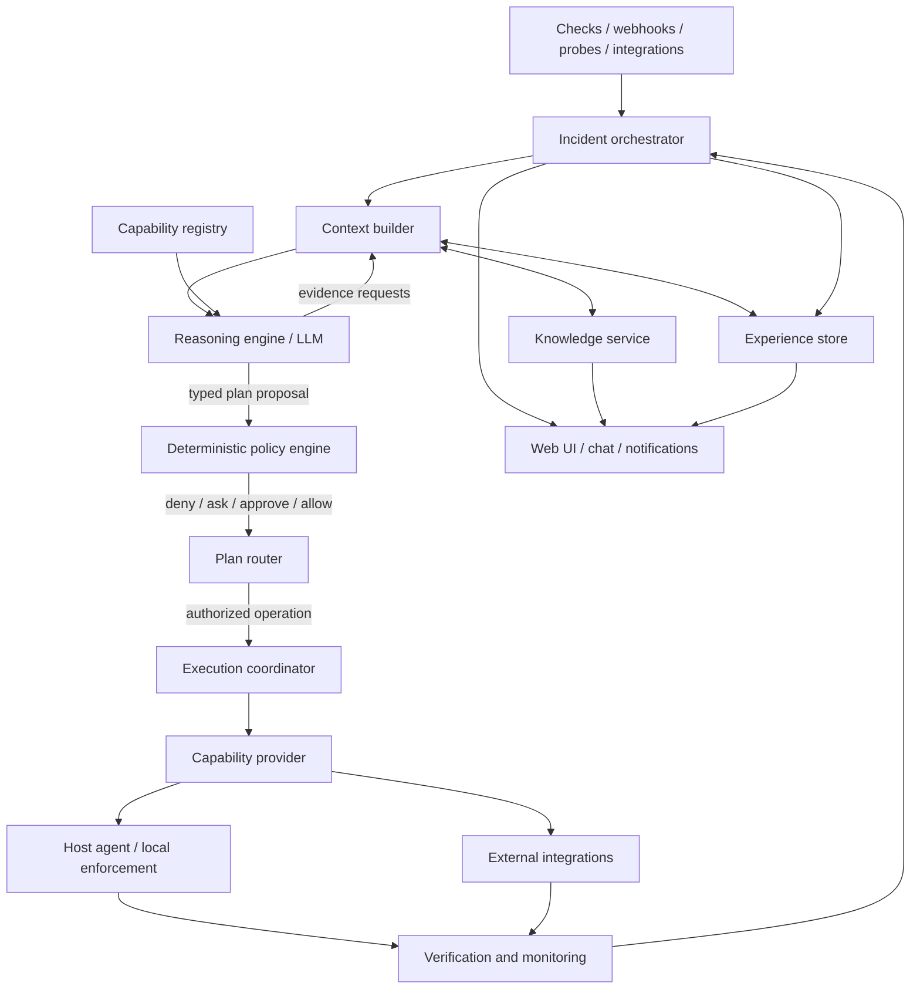

# 02 — Target architecture

## Component model

## Responsibilities and boundaries

| Component | Owns | Must not own |
|---|---|---|
| **Incident orchestrator** | Durable incident work state, phase transitions, deadlines, budgets, retries/loops, interruption and resume. | Diagnosis, permission decisions or direct host execution. |
| **Context builder** | Selects relevant evidence, knowledge, capabilities and history; tracks missing/failed/stale data. | Inventing facts or making policy decisions. |
| **Reasoning engine** | Hypotheses, interpretation, evidence requests, plan proposals and concise explanations. | Authorization, raw database access, arbitrary shell or direct state mutation. |
| **Capability registry** | Describes available operations, providers, schemas, scopes, prerequisites, risk, verification and version. | Deciding whether a requested operation is allowed in the current context. |
| **Policy engine** | Deterministic authorization decision using owner policy and current context. | Learning or changing permissions from model output/history. |
| **Execution coordinator** | Validated dispatch, idempotency, operation state, timeouts, result capture and rollback/expiry coordination. | Bypassing the policy engine or provider-specific validation. |
| **Capability provider** | Implements an operation using its specific host/API mechanism. | Granting its own authority or broadening its scope. |
| **Host agent** | Local discovery, local manifest/policy revalidation, bounded execution, emergency policy enforcement and local audit buffer. | Trusting a hub/model authorization flag without validating its own contract. |
| **Verification service** | Checks postconditions and monitors for regression over a defined window. | Treating process exit code as proof of recovery. |
| **Knowledge service** | Structured facts, entities, relationships, provenance, lifecycle and search. | Storing permissions or silently converting inference into confirmed fact. |
| **Experience service** | Append-only operational events and searchable summaries of what happened. | Becoming the source of current environment truth or permissions. |

## Core interaction rule

The reasoner communicates through typed requests and responses. The engine validates every request before collecting evidence or executing an operation. The model never receives raw access to SQL, process spawning, privileged APIs or arbitrary filesystems.

A capability request should carry at least: capability ID/version, target host/entity, typed arguments, intended effect, relevant evidence references, deadline and a correlation ID. The policy decision and execution receipt are separate records.

## Hub and agents

- The **hub** is the canonical coordinator and persistent store for incidents, policies, structured knowledge and experience.
- Each **agent** exposes the host capabilities it can safely provide, validates host-scoped operations locally and reports results/evidence.
- Capabilities may also be provided by hub-side or external integration adapters (for example, a router API); they must declare their enforcement point and security boundary.
- Agents may cache a signed, versioned subset of policy and emergency authorizations. Cache scope, expiry, revocation and reconciliation are explicit; an agent does not invent new policy while offline.
- When a host disconnects, the orchestrator records that the operation is unavailable or uncertain. It must not treat missing responses as success.

## Durable state and concurrency

Persist the incident work item and each phase transition. It must be possible to stop the hub, restart it and resume from the latest durable state without repeating a non-idempotent action blindly.

Use explicit state owners/single-writer patterns for aggregates where concurrent decisions could race, as the current project already does for incidents and actions. Use optimistic store guards where appropriate. Notifications and UI updates should be derived from committed state transitions, not emitted before a write succeeds.

## Resilience and budgets

Every incident run has limits for wall time, model turns, evidence requests, capability calls, tokens/cost, plan steps and repeated cycles. Budgets are shared across the incident session, not reset merely because a new model turn begins. Exceeding a budget results in a clear escalation or pause, never an unbounded loop.

Context is layered: concise incident summary first; relevant evidence and knowledge next; detailed logs/documents retrieved on demand. Do not place an entire host profile, graph or event history in every prompt.

## Product interaction surfaces

The UI and conversational Operator are entry points into the same application services; neither owns a parallel execution engine.

- **Control Room:** summarizes environment state, attention and active operations.
- **Operations:** durable work records independent of incident records.
- **Incidents:** detected abnormal conditions, with links to one or more operations.
- **Operator:** a global side panel and full workspace that may create an operation or answer an informational question.
- **Capability Center:** catalog, install, enable, configure and update providers/capabilities; authorization remains separate.
- **Knowledge and policy interfaces:** allow users to inspect/correct facts and define/simulate deterministic policy.
- **Orchestration visualization:** renders durable operation events/relationships; it is a view of the orchestrator, not a source of execution truth.

The UI can change layout, view state and presentation profile, but all consequential actions call the same authorized domain/application services used by other entry points. A user closing a panel or navigating away does not stop durable work.

## Extension path

Add capabilities through providers/adapters behind the common contract. Preserve current `ReadTool`, skill and action behavior during migration by wrapping them as legacy providers first. Avoid coupling orchestration or policy to Docker, systemd, a particular firewall, or one script format.
