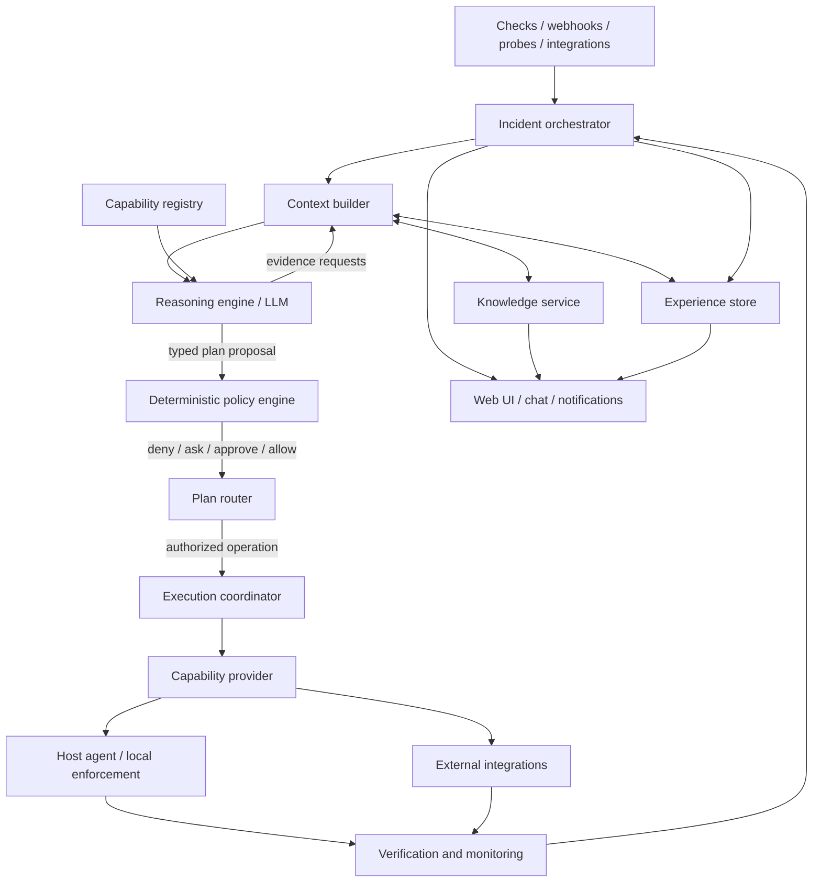

# 02 — Target architecture

## Component model

> **Implementation direction.** The technical form of this architecture (aggregates, one transactional unit of work, effect runner, crate placement) is in [`docs/rework/04-target-architecture.md`](../rework/04-target-architecture.md) and decisions RW-03, RW-04, RW-07 and RW-08. This document stays at product level.

## Responsibilities and boundaries

| Component | Owns | Must not own |
|---|---|---|
| **Incident orchestrator** | Durable work state of an **Operation** (an aggregate distinct from the incident): coarse status, typed immutable steps, deadlines, budgets, retries/loops, interruption and resume. The incident remains the detected condition. | Diagnosis, permission decisions or direct host execution. |
| **Context builder** | Selects relevant evidence, knowledge, capabilities and history; tracks missing/failed/stale data. | Inventing facts or making policy decisions. |
| **Reasoning engine** | Hypotheses, interpretation, evidence requests, plan proposals and concise explanations. | Authorization, raw database access, arbitrary shell or direct state mutation. |
| **Capability registry** | Holds hub-owned typed contracts (schema, effect class, risk, reversibility, verification, version) joined with the availability that agents and providers advertise. | Deciding whether a requested operation is allowed in the current context; letting a provider define its own risk or authority. |
| **Policy engine** | Deterministic authorization decision using owner policy and current context. | Learning or changing permissions from model output/history. |
| **Execution coordinator** | Validated dispatch, idempotency, operation state, timeouts, result capture and rollback/expiry coordination. | Bypassing the policy engine or provider-specific validation. |
| **Capability provider** | Implements an operation using its specific host/API mechanism. | Granting its own authority or broadening its scope. |
| **Host agent** | The control agent runs as the unprivileged OS user `domovoi-agent`; skills and packages run through a skill runner as a separate identity, `domovoi-skill` (owner decision D-29, RW-39). Local discovery, local manifest revalidation, bounded execution, the host-local unattended ceiling, a mutation rate limiter for every mutating execution (owner decision D-27), an action journal for idempotency and reconciliation, and a local audit buffer. | Trusting a hub/model authorization flag without validating its own contract and ceiling. |
| **Verification service** | Checks postconditions and monitors for regression over a defined window. | Treating process exit code as proof of recovery. |
| **Knowledge service** | Structured facts, entities, relationships, provenance, lifecycle and search. | Storing permissions or silently converting inference into confirmed fact. |
| **Experience service** | The append-only journal of typed operational events, plus a searchable resolution summary per operation. There is no separate experience event store (owner decision D-02, RW-15, RW-25). | Becoming the source of current environment truth or permissions. |

## Core interaction rule

The reasoner communicates through typed requests and responses. The engine validates every request before collecting evidence or executing an operation. The model never receives raw access to SQL, process spawning, privileged APIs or arbitrary filesystems.

A capability request should carry at least: capability ID/version, target host/entity, typed arguments, intended effect, relevant evidence references, deadline and a correlation ID. The policy decision and execution receipt are separate records.

## Hub and agents

- The **hub** is the canonical coordinator and persistent store for incidents, policies, structured knowledge and experience.
- Each **agent** exposes the host capabilities it can safely provide, validates host-scoped operations locally and reports results/evidence.
- Capabilities may also be provided by hub-side or external integration adapters (for example, a router API); they must declare their enforcement point and security boundary.
- The agent enforces a **host-local unattended ceiling**: owner-controlled configuration on the host that lists which capabilities may run without a human, on which explicit targets, how often and with which argument limits. The hub cannot modify or widen it, the UI shows it read-only, and hub policy can only narrow it (owner decision D-03, RW-12). The ceiling (`agent.toml`, enforced by the agent) covers the exact capability id, explicit targets, maximum rate and declared constrainable arguments; no entry means no policy-authorized execution (owner decision D-18). The mandatory management-path exclusions and the containment TTL and maximum-active hard maxima are not agent-enforced: they live in the root-owned `[safety]` section of `helper.toml` and are enforced by the helper for every caller, which also owns the active-count accounting. An agent entry may add optional, stricter-only `max_ttl` and `max_active` for unattended runs (the stricter value applies; an agent value above the helper's is capped with a warning) (RW-12, RW-37, `docs/rework/04 §8.3`). The ceiling is an enforcement limit, not a signature: a hub permit is not a cryptographic proof of owner approval. `authorization_kind` is a hub label; a compromised hub can label a request `human` and bypass the ceiling (accepted v1 limitation). It is still limited by the agent's local catalogue, manifest, argument and `allow_risk` checks and by the mutation rate limiter, which applies to all mutating executions (owner decision D-27).
- Owner-signed policy bundles and approvals, and cached offline emergency permits, are DEFERRED past v1: they need owner key custody and a replay and revocation design (`docs/rework/06` "Deferred and after-v1"). Until then an agent does not invent or cache new policy while offline.
- **Three identities (owner decision D-29, RW-39).** The control agent runs as `domovoi-agent`. Skills and packages run only through a socket-activated skill runner as `domovoi-skill`, which has no access to the helper socket, the skill-runner socket, the agent's state or key, or any of `/etc/domovoi` other than the read-only `skills/` tree, and sees package files read-only; they never run as root or as `domovoi-agent`. Privileged host operations (Docker, systemd control, nftables, SMART, kernel messages, listening sockets with their owning process) go only through one root-owned helper (`domovoi helper serve`), socket-activated and installed and updated only by the owner-controlled OS install path. Five layers stay distinct: (1) package isolation, (2) root-operation allowlisting (the helper allowlist in root-owned `/etc/domovoi/helper.toml` bounds which privileged operations and targets exist; it is not execution authorization), (3) agent-side authorization (plan hash, `allow_risk`, ceiling, rate limiter), (4) helper-enforced safety (operation groups, canonical targets, protected resources, management-path exclusions, containment TTL and active-count hard maxima, argument validation, timeouts and output caps, a helper-side mutation limit; the helper does not verify approval or policy, and it computes and signs its own effective safety report, which the agent relays unchanged and the hub verifies against the exact public key the owner pinned, RW-37) and (5) residual risk: a compromised control agent can call the helper directly within layers 2 and 4; owner-signed approvals are DEFERRED. The peer-uid check is one layer only; the real isolation is that skills never run as the uid the helper accepts. An agent still running as root is labelled "privilege boundary not in effect" and gets no unattended execution. The skill runner's filesystem view masks the whole `/etc/domovoi`, `/var/lib` and `/run` trees and re-exposes only `/etc/domovoi/skills` and `/var/lib/domovoi-packages` read-only, so every installed skill and package is visible to it (known limitation; per-package narrowing is R-9 research). Platforms without the skill runner (R-9) run without skills rather than running skills as the control agent; the agent reports the runner's state as `skill_runner_status` (`absent | unsupported{reason} | error{reason} | ok{version}`), and anything but `ok` makes every skill unavailable. Skills whose `run_as` is not `domovoi-skill` are an open owner question (O-30; recommended `Unavailable(run_as_unsupported)`).
- **Version match (owner decision D-20, RW-17, RW-42).** Hub and agent speak the same protocol major.minor or not at all. The check happens only after the agent has proven its identity; there is no support window, no previous-minor adapter, no legacy execution path and no application-release floor (a release number is not a compatibility dimension). Same-protocol patch releases are compatible. A mismatched agent is rejected with the existing `Incompatible` reason, and its host is shown as `Incompatible` (upgrade required, history kept), not as offline; the state is persisted on the agent record and survives a hub restart, and after a hub upgrade a host that has not reconnected shows "expected incompatible". An incompatible agent idles instead of reconnecting (agents older than the F3 release restart-loop under systemd until upgraded). Exactly one protocol bump is planned before v1 (1.1 → 1.2 in M1); F3 changes no wire format and later milestones use capabilities over the frozen 1.2 wire. Upgrades are coordinated: hub first, then each agent through the install procedure. The agent never updates itself (DEFERRED, not planned; see `docs/rework/06` "Deferred and after-v1"). A revoked-build list is DEFERRED and distinct from protocol compatibility.
- When a host disconnects, the orchestrator records that the operation is unavailable or uncertain. It must not treat missing responses as success.

## Durable state and concurrency

Persist the incident work item and each phase transition. It must be possible to stop the hub, restart it and resume from the latest durable state without repeating a non-idempotent action blindly.

Use explicit state owners/single-writer patterns for aggregates where concurrent decisions could race, as the current project already does for incidents and actions. A state change, its journal entries, its audit record and any new pending side effects commit in **one transaction** (owner decision D-02, RW-03); a transition whose audit record cannot be written does not happen. Use optimistic store guards where appropriate. Notifications and UI updates should be derived from committed state transitions, not emitted before a write succeeds. Notification delivery is at-least-once: after a crash window a duplicate is possible, remote idempotency is used where the platform offers it, and the product never claims exactly-once (RW-35).

## Resilience and budgets

Every incident run has limits for wall time, model turns, evidence requests, capability calls, tokens/cost, plan steps and repeated cycles. Budgets are shared across the incident session, not reset merely because a new model turn begins. Exceeding a budget results in a clear escalation or pause, never an unbounded loop.

Context is layered: concise incident summary first; relevant evidence and knowledge next; detailed logs/documents retrieved on demand. Do not place an entire host profile, graph or event history in every prompt.

## Product interaction surfaces

The UI and conversational Operator are entry points into the same application services; neither owns a parallel execution engine.

- **Control Room:** summarizes environment state, attention and active operations.
- **Operations:** durable work records independent of incident records.
- **Incidents:** detected abnormal conditions, with links to one or more operations.
- **Operator:** a global side panel and full workspace that may create an operation or answer an informational question.
- **Capability Center:** catalog, install, enable, configure and update providers/capabilities; authorization remains separate.
- **Knowledge and policy interfaces:** allow users to inspect/correct facts and define/simulate deterministic policy.
- **Orchestration visualization:** renders durable operation events/relationships; it is a view of the orchestrator, not a source of execution truth.

The UI can change layout, view state and presentation profile, but all consequential actions call the same authorized domain/application services used by other entry points. A user closing a panel or navigating away does not stop durable work.

## Extension path

Add capabilities through providers/adapters behind the common hub-owned contract. Preserve current `ReadTool`, skill and action behavior during migration by wrapping them first; existing action records stay as they are and are shown as legacy (RW-32). Avoid coupling orchestration or policy to Docker, systemd, a particular firewall, or one script format. Capability packages can be installed from the UI, but only as signed packages that the agent verifies against locally trusted keys (the first-party release key plus keys the owner installed on that host); the hub merely relays them and cannot add keys (owner decisions D-11, D-16, RW-26). Owner-signed packages arrive by manual import. Packages install into `packages_dir` and run through the skill runner as `domovoi-skill`, never as the control agent. Third-party registries are DEFERRED.
