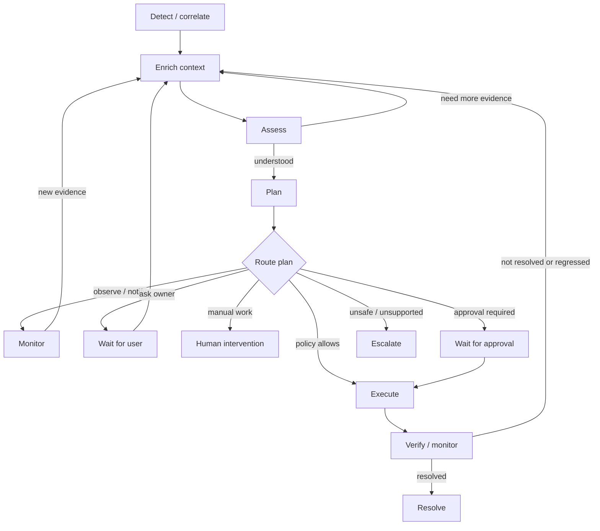

# 04 — Phase-based incident orchestration

## Principle

An incident is a durable operational task, not a single LLM prompt. The orchestrator owns lifecycle and state; the reasoner handles interpretation and proposes next steps. Phases are responsibilities and contracts, not a rigid linear workflow. The engine may complete simple phases without an LLM call, and paths may loop or branch.

## Lifecycle

## Phase contracts

| Phase | Responsibility | Output / exit condition |
|---|---|---|
| **Detect** | Receive checks, probes, webhooks and integration signals; correlate duplicates and update/create incident. | Durable incident identity, initial signal set and source metadata. |
| **Enrich** | Collect relevant host, service, network and dependency evidence; retrieve knowledge and past experience. | Context bundle with evidence references, timestamps, source, freshness and collection status. |
| **Assess** | Build hypotheses; distinguish established facts, inferences, unknowns and contradictory evidence. | Structured assessment and optional requests for additional evidence. |
| **Plan** | Propose one or more possible next steps, including observation, more investigation, notification, question, manual steps, approval, authorized action, verification or escalation. | Typed plan proposal with rationale, target, expected effect, preconditions and postconditions. |
| **Authorize / route** | Apply deterministic policy to each proposed operation and choose the route. | Allowed, denied, approval required, ask user, manual intervention or escalation. |
| **Execute** | Dispatch only authorized operations through the capability provider. | Execution receipt, bounded output, status, timing and side-effect record. |
| **Verify / monitor** | Check whether the original condition is gone and whether dependent services remain healthy. | Verified, verification failed, inconclusive or regression detected. |
| **Resolve / escalate** | Close the incident only when the condition is demonstrably resolved; otherwise continue or escalate. | Terminal state or a new bounded cycle. |

A phase may return `complete`, `needs_evidence`, `waiting`, `failed`, `not_applicable` or `escalate`. Store these states explicitly; do not treat missing output as a successful phase.

## Context model

Do not create one universal questionnaire or giant prompt. Build context in layers:

1. **Common incident context:** incident/host identity, triggering signal, severity, time, recent changes and current work state.
2. **Domain context:** relevant Docker, storage, network, security, database or application details.
3. **Knowledge context:** applicable facts, constraints, dependencies, preferences and recovery paths.
4. **Experience context:** similar incidents, prior plans, failures and successful verification evidence.
5. **Action-specific context:** only facts needed to evaluate a specific operation (for example, trusted management addresses before firewall changes).

Every requested field/evidence item should have a state: `available`, `unknown`, `unavailable`, `failed`, `stale` or `not_applicable`. Missing data is not equivalent to `false`. Include source and observed time. Distinguish user-confirmed, automatically observed and inferred information.

## Dynamic evidence requests

The reasoner may request further evidence at any assessment stage. The engine validates that the requested capability is read-only/appropriate, in scope and within collection/time/token budgets. Deduplicate repeated requests and retain references so the same expensive query is not run without reason.

A request should identify what is needed and why, not dictate an arbitrary shell command. The engine maps it to an allowed capability and supplies a concise result or a structured failure.

## Planning and routing

A plan may contain several independent steps and multiple routes. For example: notify the owner immediately, collect more logs, then request approval for a service restart; or execute an owner-authorized temporary IP block and still ask the owner to review the broader exposure.

The plan is a proposal, not authorization. The policy engine evaluates each consequential operation separately. One denied step must not silently authorize another. Plans should state dependencies and ordering explicitly.

## Repeated cycles and no blind retries

- Verification failure returns to assessment with the failed operation and its output as evidence.
- A failed or uncertain operation is recorded and not blindly repeated.
- A revised plan must explain what changed and why the next attempt is different.
- Re-evaluate policy and preconditions before every new operation.
- Apply per-incident/per-capability cycle and rate limits.
- Support delayed verification and observation windows for transient conditions.
- If evidence, budget or confidence is insufficient, pause, ask the owner or escalate.

## Durable experience timeline

Record phase transitions and meaningful events with timestamp, actor/component, incident, input/output reference, evidence references, decision/rationale, policy result, operation identity and outcome. Preserve enough to reconstruct the lifecycle without persisting secrets or unlimited raw logs.

## Example: a fix reveals a second problem

A Plex container is unhealthy. Domovoi inspects logs and dependencies, then proposes or performs an owner-authorized Plex restart. The restart command succeeds, but the application health check still fails. Domovoi records that failure as new evidence, returns to assessment, notices database-connection errors, checks the database service and its recent history, then proposes a separate database restart. If that operation is not covered by autonomous policy, it asks for approval. After the database restart it verifies both the database and Plex, watches for regression, and resolves only when the original Plex condition is healthy.

The important behavior is not the Plex-specific sequence: it is **failed postcondition → new evidence → revised diagnosis → new authorization decision → verification**. No blind retry and no assumption that a successful process exit means the incident is fixed.

## LLM efficiency

An LLM conversation may span multiple phase transitions when useful; phase boundaries do not require one model call each. Use concise summaries and on-demand detail. Enforce incident-wide limits for turns, tokens, tool calls, time, cost and execution cycles.
