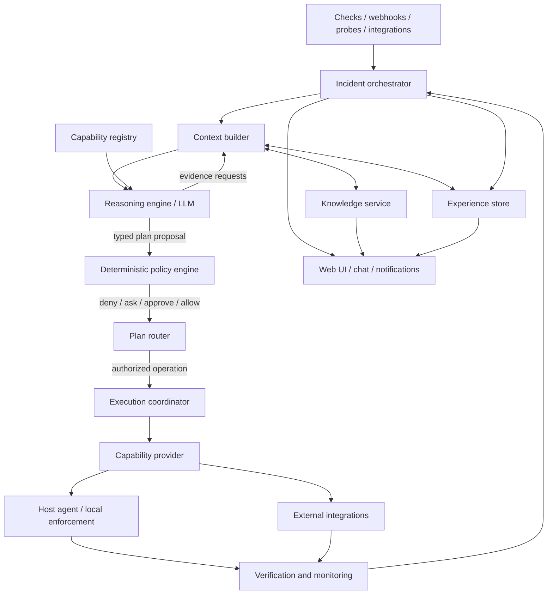
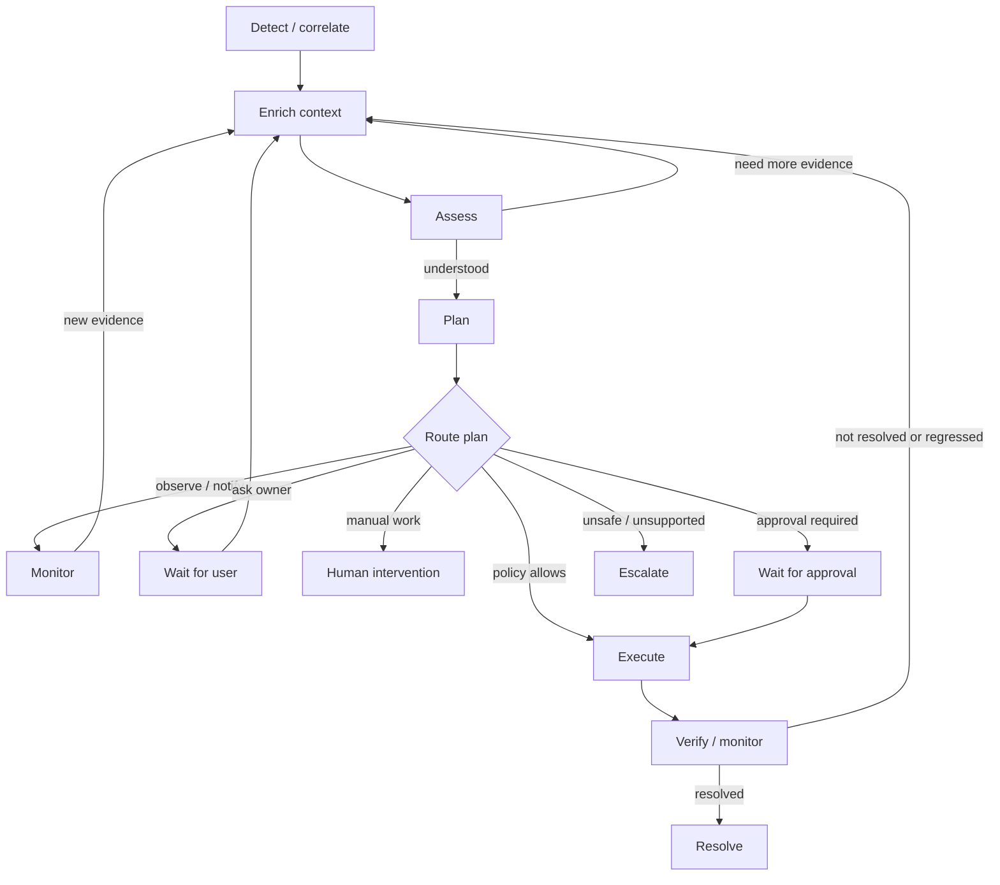

# Domovoi — Combined Target Architecture and Product Design

This is a convenience reading copy. The individual numbered files remain the canonical editable documents.


---

# 00 — Vision and scope

## Product vision

Domovoi should evolve from a monitoring and human-approved remediation tool into a **self-hosted, context-aware operations agent** that can investigate unfamiliar incidents, choose among available capabilities, and take owner-authorized actions within explicit safety boundaries.

It should not become a giant collection of hardcoded repair scripts, nor an unrestricted AI shell. Its intelligence should be able to reason about situations that were not anticipated in advance; its actual powers must remain explicit, typed, bounded and enforced outside the model.

## The target experience

When something happens, Domovoi should:

1. Detect and correlate the event into an incident.
2. Gather relevant evidence from the affected host, related services, infrastructure and its persistent knowledge.
3. Form and test hypotheses, explicitly separating facts from assumptions and unknowns.
4. Request more evidence when needed instead of guessing or receiving one enormous context dump.
5. Construct a plan suited to the actual situation from capabilities that are available on the relevant hosts.
6. Evaluate every proposed operation against owner-defined policy.
7. Either observe, notify, ask a question, request human approval, execute an authorized operation, or escalate.
8. Verify the underlying problem, not merely whether a command returned exit code zero.
9. Continue investigation and re-plan when a fix fails or the issue returns, within bounded budgets.
10. Record what happened and offer useful knowledge to retain, without silently changing permissions.

## User experience and control plane

The web UI is a first-class control plane, not only a dashboard. It must expose the real work Domovoi performs: phases, evidence, capability calls, policy evaluation, execution, verification and history. The detailed view is the design baseline; users can choose Standard, Essential or Custom presentation without changing system behavior or hiding the underlying audit record.

The Operator is available both as a global side panel and a dedicated full workspace. Operations are a first-class concept separate from incidents: an incident is a detected abnormal condition; an operation is work Domovoi performs and may exist without an incident.

The user interface should be information-dense, technically transparent and enjoyable to use, while explaining terminology in context for people new to self-hosting. The current visual identity is a valued reference, but existing page layouts are not constraints. New layouts must be designed from the target product's information hierarchy and real-estate requirements.

## Product properties

- **Adaptive:** reasons from current evidence and available capabilities; playbooks accelerate common cases but do not define the only possible paths.
- **Extensible:** new host tools, scripts, service integrations and infrastructure providers can expose capabilities through a common contract.
- **Context-aware:** understands host purpose, dependencies, operational constraints, preferences and recovery paths.
- **Progressively autonomous:** can move from observe/propose to bounded remediation and narrowly scoped protective actions when the owner explicitly grants them.
- **Verifiable:** actions have preconditions, bounded effects, postconditions and, where possible, rollback or expiry.
- **Auditable:** the incident timeline explains what Domovoi knew, asked, decided, attempted and verified.
- **Self-hosted and operable:** prefer a small number of dependable components and avoid requiring an external database or message broker without measured need.

## Scope

### In scope

- General server and self-hosted infrastructure operations.
- Linux host operations as the initial target, with capabilities that can later be supplied by routers, NAS appliances, hypervisors, cloud APIs or other integrations.
- Multi-host relationships and dependencies.
- Monitoring, diagnosis, service recovery, resource and storage operations, network diagnosis and defensive security response.
- Owner-defined per-host and per-capability autonomy.
- Long-lived environment knowledge and operational experience.

### Not assumed to be in scope

- Unrestricted root shell or arbitrary model-generated scripts.
- Automatic data deletion, destructive cleanup or irreversible changes.
- Replacing all existing monitoring tools.
- A mandatory graph database, vector database, workflow engine or external broker.
- A fixed workflow for every incident category.
- Autonomous modification of Domovoi's own security policy, permissions, skills or installed code.

## UI design test

A user should be able to inspect exactly what Domovoi is doing and why, while choosing how much detail is expanded at once. A new user should understand the same page through clear labels and contextual explanations without losing access to technical detail.

## Design test

A design is on the right track when it answers **both** questions:

- Can the reasoner discover and investigate a situation that was not anticipated when Domovoi was built?
- Can deterministic code prove that every requested operation is available, correctly scoped, authorized and bounded before it affects a host?

If the first answer is no, the system is too workflow-bound. If the second is no, the system is too permissive.


---

# 01 — Principles and decisions

This is the compact decision ledger for the target product. Each choice includes the reason; examples are illustrative unless explicitly marked as requirements.

| ID | Status | Decision | Why |
|---|---|---|---|
| D-01 | Agreed direction | Build an **adaptive operations agent**, not a catalogue of predefined fixes. | Unforeseen incidents cannot all be encoded as scripts. The reasoner must investigate and compose responses from what is actually available. |
| D-02 | Agreed direction | Put a deterministic control plane between reasoning and execution. | Model output is probabilistic and untrusted; authorization, validation, dispatch and state transitions must be enforceable and testable. |
| D-03 | Agreed direction | Use a general **capability** abstraction; skills are one provider. | Native tools, scripts and service APIs expose different implementations of useful operations. The reasoner needs a consistent typed contract. |
| D-04 | Agreed direction | Playbooks are optional guidance, not mandatory workflows. | Known patterns benefit from reusable hints, but playbooks must not fence in novel investigations. |
| D-05 | Agreed direction | Orchestrate incidents through durable, resumable phases. | Separating detection, context, assessment, planning, authorization, execution and verification keeps work focused and recoverable. |
| D-06 | Agreed direction | Support multiple investigation and execution cycles. | A failed fix is new evidence. Re-diagnose and re-plan; never blindly retry. |
| D-07 | Agreed direction | Keep **knowledge**, **policy** and **experience** separate. | Facts about the environment, permission to act and records of past events answer different questions and must not substitute for one another. |
| D-08 | Agreed direction | Build editable structured environment knowledge alongside Markdown notes. | Notes are good for human runbooks; facts, dependencies, constraints and provenance need typed searchable records. |
| D-09 | Recommended default | Start with one SQLite database: relational tables, typed graph edges, JSON attributes and FTS5. | It fits the self-hosted single-hub footprint and avoids operating a second database before there is a measured need. |
| D-10 | Agreed direction | Make autonomy granular by host, capability/category and operation constraints; explicit deny wins. | A host-wide switch is too coarse: the NAS may allow a service restart but never file deletion. |
| D-11 | Agreed direction | Treat defensive security containment as a distinct autonomy class. | A fast protective action can also lock out the owner; scope, trusted access paths, expiry and recovery must be first-class. |
| D-12 | Agreed direction | Keep local agent enforcement; design offline autonomy deliberately. | A hub outage or compromise must not create a path around local validation. Only a narrow owner-authorized cached permit may work offline. |
| D-13 | Agreed direction | Suggest learnings; never infer permissions. | Repeated user behavior may indicate a preference, but cannot grant authority to automate it. |
| D-14 | Agreed direction | Make knowledge, policy and experience user-visible, editable and reviewable. | The user must be able to correct the system, understand decisions and revoke information or authority. |
| D-15 | Recommended default | Keep the hub database canonical; agents cache only the scoped data needed for local execution and explicitly permitted offline response. | One source of truth avoids conflicting edits while preserving narrowly bounded local operation. |
| D-16 | Agreed direction | Do not expose raw SQL, unrestricted shell, arbitrary filesystem writes or model-generated executables as capabilities. | Extensibility must add reviewed typed operations, not an alternate route around authorization and execution controls. |
| D-17 | Agreed direction | Capability selection is dynamic; authority is not. | The model can decide which available evidence/capabilities are relevant, but cannot invent capabilities or permissions. |
| D-18 | Agreed direction | Every consequential operation needs preconditions, explicit target/scope, bounded effects and meaningful postconditions. | An exit code alone does not prove the intended system state was achieved. |
| D-19 | Agreed direction | Build the smallest usable version of each foundation, then expand by provider and domain. | A complete graph ontology, universal workflow engine or huge integration catalogue would delay useful delivery and add unvalidated abstractions. |
| D-20 | Agreed direction | Make failure, uncertainty and partial completion visible. | Hiding unavailable evidence, ambiguous actions or failed rollback creates false confidence and unsafe retries. |
| D-21 | Agreed direction | Treat the web UI as the primary operational control plane, not merely a dashboard. | Users must be able to inspect operations and manage almost all product configuration in one coherent interface. |
| D-22 | Agreed direction | Design from a detailed information model first; allow users to choose a simpler presentation. | Technical transparency must not be sacrificed to make the UI appear simple. |
| D-23 | Agreed direction | Provide the Operator as both a global side panel and a full workspace over the same conversation/operation state. | Quick requests should be possible anywhere, while complex investigations need substantial room. |
| D-24 | Agreed direction | Make Operation a first-class concept separate from Incident. | A detected problem is not the same as work performed; user requests and scheduled work may have no incident. |
| D-25 | Agreed direction | Use a page-planning specification with priority and space requirements before layout implementation. | Important large visualizations (especially the orchestration graph) need deliberate real-estate allocation; page boundaries must follow content and workflows. |
| D-26 | Agreed direction | Preserve the valued current color identity and semantic status language, but do not preserve current layouts by default. | Visual continuity is desirable; existing layout decisions must not constrain a better target experience. |
| D-27 | Agreed direction | UI management is the default for supported configuration; external-only controls need a deliberate security/recovery reason. | Users should not need CLI/config edits for ordinary supported product management. |
| D-28 | Agreed direction | Policy simulation uses the same deterministic policy evaluator as real authorization. | “What would Domovoi have been allowed to do?” must be reliable enough to guide permission design, without causing side effects. |

## Target security properties

These are product-level properties to preserve through whatever implementation is chosen; they are not a demand to keep the current mechanism unchanged.

1. The model proposes and reasons; deterministic code authorizes and executes.
2. No arbitrary model-generated shell, SQL or executable code runs on a host.
3. Every provider and operation is typed, scoped, validated and bounded.
4. Agents validate operations locally, including target, arguments, policy version and expiry where applicable.
5. Notification and diagnosis failures should not suppress the original alert; uncertainty about a mutation must fail closed.
6. Logs, alerts, command output, webhook bodies and remote API content are untrusted input.
7. Secrets are redacted from model context, logs, chat, UI and audit payloads; credentials are scoped and rotatable.
8. Consequential state transitions and actions are traceable; audit history is tamper-resistant.
9. Destructive and irreversible actions remain denied by default and require a deliberately designed exception path, not generic autonomy.
10. Budgets, timeouts, rate limits, output limits, cancellation and recovery are part of capability contracts.

## Existing behavior versus target behavior

The current code uses authenticated human approval for mutating skills and has a separate local risk allowlist. That is a fact about the current implementation, not a permanent product limitation. The target adds explicit owner-created autonomous authorization alongside human approval. It must not fake a human approval or route around existing checks: implement a separate, typed policy decision and local execution gate, with migration and tests that prove the replacement is at least as safe.

## Decision recording

For a significant new design, record: context, decision, why, alternatives, consequences, security impact, migration, observability and tests. Use an ADR or the relevant feature specification as convenient. Existing ADR status labels do not make a decision immutable; validate old claims against code, tests and current product intent.


## UI and terminology rules

- Use a consistent product vocabulary across UI, chat, notifications and book; explain precise technical terms rather than hiding them.
- Detailed is the reference presentation. Standard/Essential are alternate displays over the same data and authority model.
- Assign independent display priority (P0–P3) and space requirement (Dominant/Large/Medium/Compact/Contextual) to every significant page element.
- Use page, subpage, tab, section, expansion, inspector, drawer and dialog based on workflow and space—not convenience or component availability.
- The current UI overhaul is a reference for visual identity and current functionality, not a target layout mandate.


---

# 02 — Target architecture

## Component model



## Responsibilities and boundaries

| Component | Owns | Must not own |
|---|---|---|
| **Incident orchestrator** | Durable incident work state, phase transitions, deadlines, budgets, retries/loops, interruption and resume. | Diagnosis, permission decisions or direct host execution. |
| **Context builder** | Selects relevant evidence, knowledge, capabilities and history; tracks missing/failed/stale data. | Inventing facts or making policy decisions. |
| **Reasoning engine** | Hypotheses, interpretation, evidence requests, plan proposals and concise explanations. | Authorization, raw database access, arbitrary shell or direct state mutation. |
| **Capability registry** | Describes available operations, providers, schemas, scopes, prerequisites, risk, verification and version. | Deciding whether a requested operation is allowed in the current context. |
| **Policy engine** | Deterministic authorization decision using owner policy and current context. | Learning or changing permissions from model output/history. |
| **Execution coordinator** | Validated dispatch, idempotency, operation state, timeouts, result capture and rollback/expiry coordination. | Bypassing the policy engine or provider-specific validation. |
| **Capability provider** | Implements an operation using its specific host/API mechanism. | Granting its own authority or broadening its scope. |
| **Host agent** | Local discovery, local manifest/policy revalidation, bounded execution, emergency policy enforcement and local audit buffer. | Trusting a hub/model authorization flag without validating its own contract. |
| **Verification service** | Checks postconditions and monitors for regression over a defined window. | Treating process exit code as proof of recovery. |
| **Knowledge service** | Structured facts, entities, relationships, provenance, lifecycle and search. | Storing permissions or silently converting inference into confirmed fact. |
| **Experience service** | Append-only operational events and searchable summaries of what happened. | Becoming the source of current environment truth or permissions. |

## Core interaction rule

The reasoner communicates through typed requests and responses. The engine validates every request before collecting evidence or executing an operation. The model never receives raw access to SQL, process spawning, privileged APIs or arbitrary filesystems.

A capability request should carry at least: capability ID/version, target host/entity, typed arguments, intended effect, relevant evidence references, deadline and a correlation ID. The policy decision and execution receipt are separate records.

## Hub and agents

- The **hub** is the canonical coordinator and persistent store for incidents, policies, structured knowledge and experience.
- Each **agent** exposes the host capabilities it can safely provide, validates host-scoped operations locally and reports results/evidence.
- Capabilities may also be provided by hub-side or external integration adapters (for example, a router API); they must declare their enforcement point and security boundary.
- Agents may cache a signed, versioned subset of policy and emergency authorizations. Cache scope, expiry, revocation and reconciliation are explicit; an agent does not invent new policy while offline.
- When a host disconnects, the orchestrator records that the operation is unavailable or uncertain. It must not treat missing responses as success.

## Durable state and concurrency

Persist the incident work item and each phase transition. It must be possible to stop the hub, restart it and resume from the latest durable state without repeating a non-idempotent action blindly.

Use explicit state owners/single-writer patterns for aggregates where concurrent decisions could race, as the current project already does for incidents and actions. Use optimistic store guards where appropriate. Notifications and UI updates should be derived from committed state transitions, not emitted before a write succeeds.

## Resilience and budgets

Every incident run has limits for wall time, model turns, evidence requests, capability calls, tokens/cost, plan steps and repeated cycles. Budgets are shared across the incident session, not reset merely because a new model turn begins. Exceeding a budget results in a clear escalation or pause, never an unbounded loop.

Context is layered: concise incident summary first; relevant evidence and knowledge next; detailed logs/documents retrieved on demand. Do not place an entire host profile, graph or event history in every prompt.

## Product interaction surfaces

The UI and conversational Operator are entry points into the same application services; neither owns a parallel execution engine.

- **Control Room:** summarizes environment state, attention and active operations.
- **Operations:** durable work records independent of incident records.
- **Incidents:** detected abnormal conditions, with links to one or more operations.
- **Operator:** a global side panel and full workspace that may create an operation or answer an informational question.
- **Capability Center:** catalog, install, enable, configure and update providers/capabilities; authorization remains separate.
- **Knowledge and policy interfaces:** allow users to inspect/correct facts and define/simulate deterministic policy.
- **Orchestration visualization:** renders durable operation events/relationships; it is a view of the orchestrator, not a source of execution truth.

The UI can change layout, view state and presentation profile, but all consequential actions call the same authorized domain/application services used by other entry points. A user closing a panel or navigating away does not stop durable work.

## Extension path

Add capabilities through providers/adapters behind the common contract. Preserve current `ReadTool`, skill and action behavior during migration by wrapping them as legacy providers first. Avoid coupling orchestration or policy to Docker, systemd, a particular firewall, or one script format.


---

# 03 — Capability model

## Definition

A **capability** is a named, versioned, typed operation that a provider can perform within a declared scope. It may read information, change state, contain a threat or verify a condition.

A capability is not the same thing as a skill:

- **Capability:** the logical operation and its contract (for example, restart one named service).
- **Provider:** the implementation that can fulfil the contract (local Linux agent, skill, Docker adapter, router integration, hypervisor API).
- **Skill:** one existing provider format: a locally installed program with a manifest and validated arguments.
- **Playbook:** optional reusable advice about how to investigate or sequence capabilities. It is not the only permitted way to solve an incident.
- **Check:** an observation that can produce a signal; it may also provide evidence to the context builder.

## Why this abstraction

If the model sees only a hardcoded set of tools, new integrations require changes to the reasoning contract. If it sees unrestricted commands, the safety model collapses. A capability registry gives it discoverable options while keeping implementation and authority outside the model.

## Capability descriptor — conceptual contract

The eventual schema should contain:

| Field | Purpose |
|---|---|
| `id`, `version` | Stable identity and contract version. |
| `name`, `description`, `examples` | Clear human/model explanation of the operation and appropriate use. |
| `provider`, `provider_version` | Which adapter implements it. |
| `scope` | Host, service, container, network, router or other target scope. |
| `input_schema` | Typed arguments, required values, bounds, enums and validation rules. |
| `effect` | Read, mutate, contain, verify or other explicitly named operation class. |
| `risk` | Impact classification independent of whether it is a script or native tool. |
| `preconditions` | Conditions that must be established before execution. |
| `constraints` | Resource limits, allowed targets, rate limits, TTL, management-path exclusions. |
| `reversible` / `rollback` | Whether and how the effect can be undone. |
| `verification` | Postconditions and how to test them. |
| `availability` | Host/platform prerequisites, connectivity and provider state. |
| `timeout`, `output_limit` | Bounded execution and result size. |
| `required_authority` | Policy category/permission needed; never an authority grant itself. |
| `manifest_hash` or equivalent | Bind an approved/authorized plan to the exact provider contract. |

This is a conceptual contract, not a final serialized schema. Avoid requiring every provider to implement fields that are genuinely not applicable; represent not-applicable explicitly rather than guessing.

## Discovery and invocation

1. Providers register a validated descriptor with the hub or agent registry.
2. Agent handshake reports local capabilities and versions, not just script filenames.
3. Hub builds a scoped catalogue for the incident: only capabilities that exist for the target and whose basic prerequisites are met.
4. Reasoner may ask to inspect a capability's schema or request an operation using typed arguments.
5. Engine checks the schema, scope, freshness, budget and current policy before dispatch.
6. Provider and agent validate again at the enforcement point.
7. Result returns as structured outcome plus bounded, redacted evidence.

Capability discovery must not expose secrets or imply permission. **Available does not mean authorized.** A capability may be visible to the model while policy still denies its execution.

## Capability families

Initial broad groups (examples, not a closed list):

- **Host observation:** processes, memory, disk, filesystems, temperatures, journal, listening sockets, service state.
- **Application/container operations:** inspect, logs, restart, health checks, queue state, deployment metadata.
- **Storage:** pool/device health, mount state, backup state, free space, scrub/sync status; destructive storage operations require strict treatment.
- **Network:** routes, DNS, gateway reachability, connection state, firewall inspection and narrowly scoped firewall changes.
- **Security:** authentication events, suspicious-source analysis, temporary blocks, isolation and exposure restriction.
- **Platform integrations:** router, hypervisor, NAS, reverse proxy, DNS, certificate manager, monitoring systems.
- **Verification:** application health, HTTP/TCP probes, service readiness, dependency state, expected postconditions.

Do not model every log line or metric as a capability. Capabilities are operations. Observations are typed evidence returned by operations/checks.

## Skills and generated extensions

- Existing skills should be wrapped as a capability provider first; keep their local manifest, argv-only execution and agent-side validation.
- Native read tools should be exposed through the same discovery surface over time, rather than remaining a separate privileged pathway.
- Integrations should register capabilities with explicit ownership, target scope and authentication boundaries.
- The model may draft a new skill/provider definition as a **proposal**. It must not install, enable or grant authority to that extension itself.
- A proposed extension needs human review, static validation, sandboxed tests, manifest/hash review, provider installation and an explicit policy decision before use.

## Missing capabilities

If the needed operation does not exist on the relevant host or through an integration, the reasoner should say so, explain which part of the response is blocked, and propose a typed capability/provider extension. It must not pretend that an unavailable action exists or fall back to arbitrary shell execution. The proposed extension follows the review, test, install and explicit-policy path above.

## Playbooks

Playbooks are advisory assets that can describe known diagnostic patterns, useful evidence requests, safe sequencing and verification ideas. The orchestrator and policy engine remain in control. The reasoner may depart from a playbook when evidence requires it, but it may not bypass capability validation or policy.

## Open design items

Finalize capability schema, version negotiation, discovery refresh, provider lifecycle, third-party integration trust, and how generated capability drafts are reviewed. See [`09-open-questions.md`](09-open-questions.md).


---

# 04 — Phase-based incident orchestration

## Principle

An incident is a durable operational task, not a single LLM prompt. The orchestrator owns lifecycle and state; the reasoner handles interpretation and proposes next steps. Phases are responsibilities and contracts, not a rigid linear workflow. The engine may complete simple phases without an LLM call, and paths may loop or branch.

## Lifecycle



## Phase contracts

| Phase | Responsibility | Output / exit condition |
|---|---|---|
| **Detect** | Receive checks, probes, webhooks and integration signals; correlate duplicates and update/create incident. | Durable incident identity, initial signal set and source metadata. |
| **Enrich** | Collect relevant host, service, network and dependency evidence; retrieve knowledge and past experience. | Context bundle with evidence references, timestamps, source, freshness and collection status. |
| **Assess** | Build hypotheses; distinguish established facts, inferences, unknowns and contradictory evidence. | Structured assessment and optional requests for additional evidence. |
| **Plan** | Propose one or more possible next steps, including observation, more investigation, notification, question, manual steps, approval, authorized action, verification or escalation. | Typed plan proposal with rationale, target, expected effect, preconditions and postconditions. |
| **Authorize / route** | Apply deterministic policy to each proposed operation and choose the route. | Allowed, denied, approval required, ask user, manual intervention or escalation. |
| **Execute** | Dispatch only authorized operations through the capability provider. | Execution receipt, bounded output, status, timing and side-effect record. |
| **Verify / monitor** | Check whether the original condition is gone and whether dependent services remain healthy. | Verified, verification failed, inconclusive or regression detected. |
| **Resolve / escalate** | Close the incident only when the condition is demonstrably resolved; otherwise continue or escalate. | Terminal state or a new bounded cycle. |

A phase may return `complete`, `needs_evidence`, `waiting`, `failed`, `not_applicable` or `escalate`. Store these states explicitly; do not treat missing output as a successful phase.

## Context model

Do not create one universal questionnaire or giant prompt. Build context in layers:

1. **Common incident context:** incident/host identity, triggering signal, severity, time, recent changes and current work state.
2. **Domain context:** relevant Docker, storage, network, security, database or application details.
3. **Knowledge context:** applicable facts, constraints, dependencies, preferences and recovery paths.
4. **Experience context:** similar incidents, prior plans, failures and successful verification evidence.
5. **Action-specific context:** only facts needed to evaluate a specific operation (for example, trusted management addresses before firewall changes).

Every requested field/evidence item should have a state: `available`, `unknown`, `unavailable`, `failed`, `stale` or `not_applicable`. Missing data is not equivalent to `false`. Include source and observed time. Distinguish user-confirmed, automatically observed and inferred information.

## Dynamic evidence requests

The reasoner may request further evidence at any assessment stage. The engine validates that the requested capability is read-only/appropriate, in scope and within collection/time/token budgets. Deduplicate repeated requests and retain references so the same expensive query is not run without reason.

A request should identify what is needed and why, not dictate an arbitrary shell command. The engine maps it to an allowed capability and supplies a concise result or a structured failure.

## Planning and routing

A plan may contain several independent steps and multiple routes. For example: notify the owner immediately, collect more logs, then request approval for a service restart; or execute an owner-authorized temporary IP block and still ask the owner to review the broader exposure.

The plan is a proposal, not authorization. The policy engine evaluates each consequential operation separately. One denied step must not silently authorize another. Plans should state dependencies and ordering explicitly.

## Repeated cycles and no blind retries

- Verification failure returns to assessment with the failed operation and its output as evidence.
- A failed or uncertain operation is recorded and not blindly repeated.
- A revised plan must explain what changed and why the next attempt is different.
- Re-evaluate policy and preconditions before every new operation.
- Apply per-incident/per-capability cycle and rate limits.
- Support delayed verification and observation windows for transient conditions.
- If evidence, budget or confidence is insufficient, pause, ask the owner or escalate.

## Durable experience timeline

Record phase transitions and meaningful events with timestamp, actor/component, incident, input/output reference, evidence references, decision/rationale, policy result, operation identity and outcome. Preserve enough to reconstruct the lifecycle without persisting secrets or unlimited raw logs.

## Example: a fix reveals a second problem

A Plex container is unhealthy. Domovoi inspects logs and dependencies, then proposes or performs an owner-authorized Plex restart. The restart command succeeds, but the application health check still fails. Domovoi records that failure as new evidence, returns to assessment, notices database-connection errors, checks the database service and its recent history, then proposes a separate database restart. If that operation is not covered by autonomous policy, it asks for approval. After the database restart it verifies both the database and Plex, watches for regression, and resolves only when the original Plex condition is healthy.

The important behavior is not the Plex-specific sequence: it is **failed postcondition → new evidence → revised diagnosis → new authorization decision → verification**. No blind retry and no assumption that a successful process exit means the incident is fixed.

## LLM efficiency

An LLM conversation may span multiple phase transitions when useful; phase boundaries do not require one model call each. Use concise summaries and on-demand detail. Enforce incident-wide limits for turns, tokens, tool calls, time, cost and execution cycles.


---

# 05 — Autonomy and safety

## Autonomy model

Autonomy is a permission to perform a defined operation under defined conditions, not a global switch that makes the model trusted.

| Level | Meaning | Typical behavior |
|---|---|---|
| **L0 — Observe** | Read-only. | Detect, collect evidence, diagnose, report and monitor. |
| **L1 — Assisted** | The system can prepare plans, but a human authorizes changes. | Propose restart/configuration/security actions and wait for approval. |
| **L2 — Bounded autonomy** | Owner-authorized, low-risk and recoverable operations can run without per-action approval. | Restart an approved service, renew a certificate, clear a bounded queue, unload an unused model. |
| **L3 — Security autonomy** | Owner-authorized, narrowly scoped protective operations can run quickly. | Temporarily block a clearly identified external source or isolate a specific unhealthy/compromised workload. |

These are capability categories, not a single host-wide ranking. A host may allow L2 service recovery and L3 network containment while explicitly denying deletion and host reboot.

## Policy scope and precedence

**Agreed direction:** support global defaults, per-host defaults, capability/category rules and specific capability overrides. Explicit deny always wins.

**Recommended default precedence:**

1. Any applicable explicit deny → denied.
2. Most specific applicable rule → capability/operation override.
3. Category rule.
4. Host default.
5. Global default.
6. No matching grant → approval required or denied, according to the action class; never implicitly allow.

This precedence is a recommended starting point. The policy evaluator must be deterministic and produce an explainable decision record; record the final choice in the policy specification and tests.

Policy should constrain more than a risk label:

- Host and target scope (including allowed entities/paths/IP ranges).
- Operation and capability version.
- Preconditions and acceptable evidence freshness.
- Maximum effect, rate, frequency and concurrency.
- TTL/automatic expiry for temporary changes.
- Reversibility and rollback requirements.
- Trusted management networks, VPN paths and critical services.
- Allowed time windows or maintenance state where relevant.
- Whether the operation remains allowed when the hub is offline.

## Illustrative per-host policy profile

This example captures the intended granularity; it is **not** a default policy or an instruction to enable these permissions automatically.

| Scope | Automatically allowed | Approval required | Explicitly denied |
|---|---|---|---|
| **NAS** | Restart the Plex container/service; restart other specifically allowlisted application containers; temporary block of a clearly identified external source through an approved firewall provider. | Restart SSH; OS/package updates; host reboot; changes to storage layout. | Delete user files, media, backups or storage pools; destructive cleanup. |
| **AI host** | Restart Ollama; unload a model from memory when the target is known and the operation is safe. | Host reboot; GPU driver changes; model downloads or environment changes with broad impact. | Delete model files or user data. |

The exact capability names and constraints would be configured per environment. The example demonstrates that one machine can have high autonomy for selected operations while retaining explicit denials for data loss, and another can allow only a narrow subset of local AI operations.

## Knowledge is not authority

User preferences, environment facts, recurring fixes and LLM confidence do not grant permission. A statement such as “restarting Plex usually fixes this” may influence planning; only a separate explicit policy rule can authorize that restart automatically.

Learning and permission changes are separate user actions. An experience suggestion may say “you have approved this three times; consider allowing it automatically”, but must not apply the rule.

## Separate authorization types

Keep the current human approval path distinct from autonomous authorization. A future design should introduce a typed policy authorization/permit that records the owner-defined rule, policy version, relevant conditions and execution scope. Do not create a fake `HumanApproval` or allow model output to satisfy a human gate.

Every action should carry a decision trace: requested operation, relevant policy rule/version, decision, conditions evaluated, actor/principal, plan hash, execution outcome and verification. The UI must make clear whether a human approved it or a policy authorized it.

The current implementation is human-approval-only for mutations. Treat that as a migration starting point, not as a permanent design limit. The target adds a separate owner-policy authorization path; never fabricate a human approval. Replace the current gate only when a typed policy decision, local enforcement, audit, migration and failure tests are ready together.

## Offline emergency authorization

For security or protective operations that must work during hub disconnection, the agent may hold a small, signed, time-limited emergency policy cache. It must be:

- Explicitly created and authorized by the owner while connected.
- Narrow in host, capability, target and effect.
- Versioned, expiry-bound and revocable on reconnect.
- Unable to grant new capabilities or broaden existing scope.
- Audited locally in a tamper-evident spool and reconciled with the hub later.
- Safe under restart, clock uncertainty and duplicate execution.

When the cached permit is stale, expired or ambiguous, fail closed. This mechanism is not general offline autonomous reasoning with unrestricted powers.

## Security containment example: suspected SSH brute force

A safe flow is evidence-first and protects the management path:

1. Correlate authentication failures and identify source addresses, destinations, timing and whether any login succeeded.
2. Determine whether sources are external or internal; compare against explicitly trusted admin/VPN ranges and active management sessions.
3. Identify where SSH is exposed and which provider controls the relevant firewall (host firewall, router or cloud rule).
4. Choose the narrowest owner-authorized containment, preferably a temporary block of a specific external source with a TTL.
5. Enforce exclusions for trusted management addresses, VPN endpoints, loopback and critical infrastructure; cap the number and duration of simultaneous blocks.
6. Verify the block is active and that trusted management access still works.
7. Monitor for recurrence or displacement to other sources; report the outcome and expiry.

Do not reflexively stop SSH or apply a broad firewall policy: that can lock the owner out and may not contain the real source. If the enforcement point or trusted path cannot be established, ask the owner or escalate.

## Hard safety boundaries

- Destructive data operations (delete files, pools, backups, databases or user data) are denied by default and should remain human-only unless a separately reviewed product decision establishes otherwise.
- Policy/configuration changes, host reboot, updates, credential changes and broad network changes require explicit handling; they are not ordinary L2 actions.
- The model cannot modify its own policy, grant itself capabilities, approve its plan or disable audit.
- A capability must declare target, effect, prerequisites, rollback/expiry and verification. If it cannot be bounded, it is not eligible for autonomous execution.
- Agent-side validation is mandatory even after hub authorization.
- Unknown, stale, conflicting or unavailable safety-critical context means no autonomous execution.


---

# 06 — Knowledge and experience

## Keep three stores conceptually separate

| Store | Answers | Examples | Must not be used as |
|---|---|---|---|
| **Knowledge** | What is true or believed about this environment? | NAS mount location, service owner, app dependency, trusted VPN subnet, user preference, recovery path. | Permission to perform an operation. |
| **Policy** | What is Domovoi allowed to do, under which conditions? | Allow `restart_service` on `plex`; deny all file deletion; require approval for host reboot. | A fact about the environment or a historical observation. |
| **Experience** | What happened, what did Domovoi decide/do, and what was the outcome? | Incident timeline, evidence requests, plan attempts, approval/denial, execution, verification, operator correction. | A guaranteed current fact or an authorization grant. |

They inform one another but cannot be merged semantically. An observed fact may inform a policy proposal; a human must explicitly accept a policy change. An experience may suggest a knowledge update; it does not overwrite facts without provenance-aware validation.

## Knowledge categories

- **Environment facts:** host role, OS, mount points, service manager, storage pools, network interfaces, deployed applications.
- **Infrastructure relationships:** app depends on database; reverse proxy routes to service; container belongs to compose project; backup targets a separate device.
- **Operational constraints:** never interrupt a backup, keep VPN available, do not reboot during a migration.
- **User preferences:** preferred maintenance windows, notification style, known acceptable restarts.
- **Recovery information:** console access, alternate management route, backup/restore path, recovery commands/runbooks.
- **Historical decisions:** update rejected, migration deferred, incident accepted as expected.
- **Learned patterns:** recurring failure after a certain update, a known symptom/cause relationship (marked as inferred until confirmed).
- **Temporary state:** backup running, maintenance in progress, temporary IP block. Store as expiring operational state, not as durable environment truth.

## Entity and relationship model

Represent meaningful things as entities: host, service, container, database, filesystem, disk, storage pool, network, router, domain, integration, user-defined operational concept. Connect them with typed relationships such as `runs_on`, `depends_on`, `routes_to`, `stores_on`, `backs_up_to`, `exposed_through`, `managed_by` and `managed_from`.

Do not create graph nodes for every log line or metric. Those belong in event/measurement records; link only useful incidents, facts and experiences to relevant entities.

## Fact provenance and lifecycle

A fact/claim should carry, at minimum:

- Subject entity and typed predicate/value.
- Scope (global, host, entity or service).
- Source (user-confirmed, agent-discovered, integration-reported, inferred, imported).
- Confidence/verification status; never treat model confidence as calibrated probability.
- Observed/valid-from time and optional valid-until time.
- Last-verified time and freshness policy.
- Creator/updater and timestamps.
- Status (current, stale, disputed, superseded, retracted).
- Optional link to the fact it supersedes and supporting evidence/experience.

Missing or unreadable data remains `unknown`/`unavailable`; do not write false or empty values as confirmed facts. When sources conflict, preserve provenance and surface the conflict instead of silently selecting the newest text.

Lifecycle: discovered or supplied → validated → used in context → reverified/updated → superseded, expired or retracted. AI inference cannot become user-confirmed merely because it is repeated.

## Onboarding and discovery

Use two layers:

**Hub/environment onboarding:** overall infrastructure shape, host criticality, trusted networks and VPN, remote management paths, services that must never stop, backup locations, notification preferences and initial autonomy choices.

**Host onboarding:** host purpose and criticality, recovery access, storage layout, important services/dependencies, network exposure, backups, maintenance constraints and local restrictions.

Let discovery fill what it can from facts, checks and read capabilities. Ask the owner only about important unknowns or ambiguous discoveries. Permit “unknown / not sure”; do not force guesses. Store answers so the same question is not repeatedly asked. Allow later correction, deletion and scope changes.

## Knowledge proposals

At incident resolution or during a repeated pattern, Domovoi may propose a fact, relationship, preference or constraint to remember. Show the proposed statement, source/evidence, scope and confidence. User confirmation is required for preferences and operational constraints; automatically discovered facts may be saved with their unverified source and can later be corrected. No proposal can alter policy implicitly.

Deletion must remove the record from search indexes, graph edges, caches and retrieval paths. Audit may keep minimal deletion metadata but should not preserve deleted sensitive content.

## Notes remain useful

Keep freeform Markdown notes/runbooks. They are good for procedures and context that do not fit a structured fact. Allow notes to link to entities, incidents and capabilities. Do not replace notes with a brittle universal fact table.

## Management UI

Make knowledge a first-class, editable area:

- Search/browse by host, entity, category, source, status and freshness.
- Edit, confirm, dispute, supersede and delete records.
- View an entity's facts, relationships, notes, incidents, experiences and relevant policy.
- Provide a graph explorer for relationships and an experience explorer for timelines/cycles.
- Show provenance and confidence/status wherever a fact influences a diagnosis or action.

The UI should make it easy to fix incorrect knowledge; users should not need SQL or file edits.


---

# 07 — Storage and search

## Recommendation

**Use the existing SQLite store as the initial home for structured knowledge and experience. Model relationships as a graph, but do not introduce a separate graph database yet.**

This is a recommended default, not a permanent technology commitment.

## Why this fits Domovoi

- The current product already uses one embedded SQLite database, WAL mode, migrations and automatic backups.
- The deployment goal is self-hosted and operationally small; a second database creates backup, upgrade, monitoring, security and consistency work.
- Relational tables are appropriate for policies, actions, incidents and audit. Typed relationship tables plus recursive CTEs support useful graph traversals. JSON attributes handle genuinely variable metadata. FTS5 covers lexical search.
- The decision can be hidden behind repository/service ports. If real workload later demands a graph engine, the storage implementation can evolve without exposing a database-specific API to the model. SQLite supports recursive CTEs for graph/tree traversal, JSON functions for flexible attributes, and FTS5 for full-text search ([recursive CTEs](https://www.sqlite.org/lang_with.html), [JSON functions](https://www.sqlite.org/json1.html), [FTS5](https://www.sqlite.org/fts5.html)).

A pure document/NoSQL store is not automatically more flexible: it can make integrity, typed relationships, policy evaluation and transactional action state harder. Keep the stable/query-critical structure relational and use JSON only for genuinely variable properties.

## Logical data areas

Keep these as logically distinct modules even if they share one SQLite file:

1. **Operational state:** hosts, agents, incidents, signals, actions, approvals, policies, settings, audit and orchestration state.
2. **Knowledge graph:** entities, typed relationships and sourced facts/claims.
3. **Experience log:** append-only incident/phase/plan/operation/verification events and links to relevant entities/evidence.
4. **Documents:** existing Markdown notes/runbooks and their FTS index.
5. **Search structures:** ordinary indexes, FTS5 and (later, if justified) vector embeddings.

## Conceptual schema

Not final DDL; IDs, constraints, normalization and lifecycle fields require a later specification.

```sql
entities(
  id, kind, name, scope_type, scope_id,
  attributes_json, lifecycle, created_at, updated_at
)

relationships(
  id, source_entity_id, relation_type, target_entity_id,
  properties_json, source, verification_status,
  valid_from, valid_until, observed_at, last_verified_at
)

knowledge_facts(
  id, subject_entity_id, predicate, value_json,
  scope_type, scope_id, source_type, source_ref,
  confidence, status, valid_from, valid_until,
  observed_at, last_verified_at, supersedes_id,
  created_at, updated_at
)

experience_events(
  id, incident_id, event_type, phase, actor_type, actor_id,
  occurred_at, summary, payload_json, correlation_id
)

experience_links(
  event_id, entity_id, link_type
)
```

Use typed definitions/validation for entity kinds, relationship types and predicates. Do not create unconstrained EAV where every field is a free-form string. Keep stable/query-critical fields relational; put only variable optional properties in JSON. Store evidence references/hashes and bounded summaries rather than unlimited raw logs or secrets.

## Search strategy

Start with the simplest search that solves real user queries:

- Exact and filtered SQL search for host, type, status, source and dates.
- FTS5 for notes, titles, entity descriptions and experience summaries.
- Bounded recursive CTE traversal for relationships and small relevant subgraphs.
- Structured predicates for current facts, freshness and provenance.
- Later: local embeddings/vector similarity only when evaluation shows lexical/graph retrieval is insufficient.

Do not introduce a vector database just because the system is AI-powered. Do not introduce a dedicated graph database until measured multi-hop query complexity, scale, concurrency or required graph algorithms justify the operational cost.

## Retrieval contracts

Expose domain operations rather than raw database queries, for example:

- `search_knowledge(query, scope, filters)`
- `get_entity(entity_id)`
- `get_facts(entity_id, predicates, freshness)`
- `get_relationships(entity_id, relation_types, direction)`
- `traverse_graph(start_entity, relation_filter, max_depth, max_nodes)`
- `search_experience(query, scope, time_range)`
- `get_incident_experience(incident_id)`
- `get_notes(query, entity/host scope)`
- `propose_knowledge_change(...)`

Every traversal must be bounded by depth, node count, relationship filters and relevance. Context retrieval returns a compact, relevant subgraph; never serialize the whole graph into an LLM prompt. Mutation tools must be authenticated/authorized and schema-validated. The model can propose changes, but the service owns validation and confirmation workflow.

## Consistency and retention

- Hub is canonical for long-lived knowledge, policy and experience.
- Agent caches contain only the signed/versioned subset required for local enforcement or a permitted offline emergency action.
- Track policy/knowledge versions and reconcile cached data on reconnect.
- Keep experience events append-only for auditability, with explicit retention/redaction rules for sensitive payloads.
- Keep current facts mutable through superseding/retraction, not destructive overwrites that erase provenance.
- A deletion workflow must clean derived FTS/vector/cache data and prevent retrieval of the deleted content.

## Migration approach

1. Keep current relational operational tables unchanged initially.
2. Add a new knowledge repository/service alongside `NoteRepo`; do not overload the current `knowledge.rs` module that currently implements notes, baselines, acknowledgements and digest facts.
3. Add typed tables and indexes through append-only migrations.
4. Link existing hosts, skills, notes, incidents and signals to stable entity IDs incrementally.
5. Retain existing notes and `notes_fts`; add entity linkage without forcing Markdown into structured facts.
6. Add graph and semantic search only behind service interfaces.

## Reconsider a dedicated graph store only if

- Production queries require deep/many-hop traversal or graph algorithms that recursive SQL cannot serve efficiently.
- The knowledge graph grows beyond a practical embedded workload or needs independent scaling.
- Multiple services/clients need concurrent graph-native access.
- A graph query language materially simplifies maintenance and the operational trade-off is justified.

Until then, a SQLite-first hybrid model is simpler and sufficient for the target scale.


---

# 08 — Current-state gap analysis

> **Snapshot only:** verified code baseline `393694b` (UI overhaul merged). Existing architecture docs and ADRs may be outdated; they are navigation clues, not binding design authority.

## Current state vs target

## Baseline inspected

- Repository: [`RoastSlav/domovoi`](https://github.com/RoastSlav/domovoi)
- Branch: `main`
- Commit: [`393694b0d16ad722961748744226e80b8cbac518`](https://github.com/RoastSlav/domovoi/commit/393694b0d16ad722961748744226e80b8cbac518)
- Commit time: 2026-11-12 17:25:41 UTC
- Project status in README: v0.1, before first release.

This is a point-in-time inspection. Re-check the repository before using this document for implementation.

## Executive comparison

Domovoi already has a strong safety-oriented foundation: hub/agent separation, typed read tools, local skill manifests and revalidation, deterministic action lifecycle, incident/action single-writer patterns, SQLite, notes search and host profiles. The target may reuse, refactor or replace these foundations. The current design documents are not assumed to accurately describe all current behavior.

The largest missing pieces are: a general capability contract beyond skills/read-tool enums; durable multi-phase orchestration with dynamic evidence requests; owner-defined autonomous authorization; structured, provenance-aware environment knowledge and relationships; a first-class experience model across cycles; and UI/workflows for managing these systems.

## Feature-by-feature map

| Area | Current `main` | Target | Gap |
|---|---|---|---|
| Product role | Monitoring, LLM triage, chat notifications and human-approved skill execution. | Adaptive operations agent with bounded autonomy. | **Major product expansion**, while preserving the current monitoring loop. |
| Deployment | One Rust binary with hub and agent roles; agent dials out over mutually authenticated TLS WebSocket. | Same basic hub/agent split, with external capability providers as needed. | **Mostly reuse**; extend provider/protocol discovery. |
| Process safety | `domovoi-runner` is the only process spawner; argv-only, no shell; skills have typed manifests, limits and redaction. | Same invariant applies to legacy skills; general operations use typed capability providers. | **Preserve and generalize**, do not weaken. |
| Skill system | Local `skill.toml`; read/write/destructive risk; typed args; hosts/applies_to; timeout/output; optional verify/revert; hub per-host enabled state; agent local `allow_risk` and manifest/hash/arg revalidation. | Skills become one capability provider among native tools and integrations. | **Partial**: strong script execution boundary, but not a cross-provider capability catalogue. |
| Read tools | Closed `ReadTool` / `ReadToolCall` enum: Docker, host overview, journal, listening ports, SMART, incident history, notes search and read skills. | Discoverable typed observation and operation capabilities. | **Partial**: extensible only through code/schema changes; no general provider registry. |
| Discovery | Agent handshake shares host facts, check inventory and skill summaries/catalogue metadata. | Agent/provider announces typed operations, prerequisites, effects, verification, scope and version. | **Partial**: inventory exists, but capability semantics are incomplete. |
| Checks and signals | Built-in host/container/system/network/security checks; webhook and probe ingestion; incident correlation and deduplication. | Same detection layer feeds phase-based orchestration and richer context. | **Reuse**; likely add domain-specific checks and context sources incrementally. |
| Incident lifecycle | Durable incident state machine, signal history/timeline, confirmation, ack/mute/resolve/reopen, incident manager single writer. | Incident becomes durable work item with resumable phase/cycle state. | **Partial**: durable incident/timeline exists; orchestration phase state does not. |
| Triage | Bounded model conversation with read-only tools, token/tool/time budgets, prebuilt context, fallbacks and report schema. | Dynamic request/response investigation, structured hypotheses/uncertainty, phase outputs and loopable plans. | **Partial**: bounded tool-use foundation; context and conversation are still one triage-oriented workflow. |
| Context collection | Current context assembles incident snapshot, signals, recent changes, similar incidents, host profile note, notes and skill catalogue. | Layered, domain-specific context builder with explicit missing/unknown/unavailable/failed/stale statuses and on-demand evidence requests. | **Partial**: context assembly exists; generalized evidence model and dynamic requests are missing. |
| Action lifecycle | Proposed → human approved → dispatched → success/fail → verify; plan hash; manifest revalidation; audit; loop guard; action writer single task. No automatic retry. | Per-step authorization, policy permits, idempotency, resumable plans, re-plan after failure, postcondition and monitor windows. | **Partial**: robust approval/execution base; autonomy and multi-cycle plans are absent. |
| Autonomy | Human-only approvals; destructive typed confirmation; local risk allowlist is not an autonomous owner policy. | Granular per-host/category/capability policy; L2 and L3; offline emergency authorization. | **Missing**. Must add a separate owner-policy authorization path; the current human-only mechanism is a migration starting point, not the target. |
| Authorization invariants | `HumanApproval` construction restricted to auth code; `ReadTool` has no mutation/approval tool; agent revalidates every skill request. | Separate human approval and owner-granted autonomous permit types; deterministic policy evaluator. | **Preserve then extend via a deliberate authorization redesign**. Do not treat a `System` principal or allow-risk list as sufficient autonomy. |
| Knowledge — notes | Global/host Markdown notes; CRUD; tags; SQLite FTS5 search; triage can retrieve relevant notes. | Keep notes, link them to typed entities and structured knowledge. | **Present** for documents; add entity linkage and a structured store. |
| Knowledge — profiles | Hub collects host facts, overview, containers, listening ports, kernel messages and selected read-skill results; stores a generated host profile as a tagged note. | Editable, provenance-aware, structured facts with freshness/conflict lifecycle. | **Partial**: useful discovery/profile foundation, but stored as generated Markdown rather than a fact graph. |
| Knowledge — facts/graph | Host facts, baselines (containers/units/ports), digest facts, ack rules and maintenance windows exist as separate concepts/tables. No general entity/relationship/fact model found. | Typed entity graph and claim/fact records with source, confidence, validity and supersession. | **Missing as a general model**; reuse IDs and host/incident relationships where possible. |
| Experience | Incident events/timeline, actions, append-only audit, triage cache, prior incident search and follow-up context. | Explicit experience across phase transitions, hypotheses, evidence requests, plans, policies, actions, verification and learning. | **Partial**: core operational history exists; richer cross-cycle experience model and explorer are missing. |
| Persistence | SQLite + SQLx, WAL, append-only migrations, backups, FTS5 for notes/incidents. | Relational operational core + graph-shaped typed tables + experience events + lexical search; vector search optional later. | **Good fit already**; no reason to add a separate DB now. |
| UI | Hosts/profile, incidents/timelines, approvals, skills, notes, settings and service status. | Knowledge browser/entity detail/graph, experience explorer, autonomy policy editor and explainable policy outcomes. | **Partial / missing new views**. |
| Suggestions and learning | A design proposal in the existing docs describes deterministic suggestions from history (new skill, ack rule, check/threshold); verify whether any of it was implemented before relying on it. Suggestions should never silently change permissions. | Suggest knowledge improvements and possible policy changes without applying authority. | **Related foundation in design only**; preserve human review. |
| Workflows/playbooks | No general incident playbook runtime described as the core execution model. | Optional guidance that the reasoner can use or depart from. | **Not a blocker**; add later if recurring patterns demonstrate value. |

## Existing code anchors

These are starting points in the verified source tree, not prescribed future module boundaries. Future design work should inspect their current contents, tests and call sites before deciding what to retain:

| Concern | Current location |
|---|---|
| Enforced boundaries and security invariants | [`ARCHITECTURE.md`](https://github.com/RoastSlav/domovoi/blob/c367e54ecc348f534b32a5bef89146747625104d/ARCHITECTURE.md) |
| Skill manifest and usage | [`docs/book/src/guide/skills.md`](https://github.com/RoastSlav/domovoi/blob/c367e54ecc348f534b32a5bef89146747625104d/docs/book/src/guide/skills.md) |
| Action and approval lifecycle | [`docs/book/src/concepts/actions.md`](https://github.com/RoastSlav/domovoi/blob/c367e54ecc348f534b32a5bef89146747625104d/docs/book/src/concepts/actions.md) |
| Closed set of model read tools | [`crates/domovoi-core/src/triage/tool_schema.rs`](https://github.com/RoastSlav/domovoi/blob/c367e54ecc348f534b32a5bef89146747625104d/crates/domovoi-core/src/triage/tool_schema.rs) and [`tools.rs`](https://github.com/RoastSlav/domovoi/blob/c367e54ecc348f534b32a5bef89146747625104d/crates/domovoi-engine/src/triage/tools.rs) |
| Triage context assembly | [`crates/domovoi-engine/src/triage/context.rs`](https://github.com/RoastSlav/domovoi/blob/c367e54ecc348f534b32a5bef89146747625104d/crates/domovoi-engine/src/triage/context.rs) |
| Agent-side skill revalidation | [`crates/domovoi-agent/src/requests/skills.rs`](https://github.com/RoastSlav/domovoi/blob/c367e54ecc348f534b32a5bef89146747625104d/crates/domovoi-agent/src/requests/skills.rs) |
| Host profile collection/UI API | [`crates/domovoi-hub/src/profile/collect.rs`](https://github.com/RoastSlav/domovoi/blob/c367e54ecc348f534b32a5bef89146747625104d/crates/domovoi-hub/src/profile/collect.rs), [`api/profile.rs`](https://github.com/RoastSlav/domovoi/blob/c367e54ecc348f534b32a5bef89146747625104d/crates/domovoi-hub/src/api/profile.rs) |
| Notes CRUD and search | [`crates/domovoi-hub/src/api/notes.rs`](https://github.com/RoastSlav/domovoi/blob/c367e54ecc348f534b32a5bef89146747625104d/crates/domovoi-hub/src/api/notes.rs), [`crates/domovoi-store/src/fts.rs`](https://github.com/RoastSlav/domovoi/blob/c367e54ecc348f534b32a5bef89146747625104d/crates/domovoi-store/src/fts.rs) |
| Database schema | [`crates/domovoi-store/migrations/0001_init.sql`](https://github.com/RoastSlav/domovoi/blob/c367e54ecc348f534b32a5bef89146747625104d/crates/domovoi-store/migrations/0001_init.sql) |

## UI baseline — verified after the 2026-11-12 overhaul

The latest main commit merges PR [#111](https://github.com/RoastSlav/domovoi/pull/111), `feat(web): redesign the UI around what the operator needs to see and decide`, at `393694b0d16ad722961748744226e80b8cbac518`.

### What the overhaul currently provides

- A rewritten `web/DESIGN.md` and stronger semantic token system. The warm charcoal/sand dark theme, paper/ink light theme, moss accent and walnut brand mark are deliberate. Semantic tones cover danger, warning, success, pending, progress, info and neutral.
- A new app shell with grouped collapsible sidebar, top bar/breadcrumbs, host selector, live connection state, user/theme menu and Ctrl/Cmd+K command palette.
- Command palette results for pages, hosts, open incidents, settings sections and basic actions (theme, sidebar, logout). **This is a useful command palette foundation, not yet the complete cross-domain search** for operations, services, capabilities, knowledge and policies described by the target.
- A new Overview page with summary tiles, high-priority incidents, approvals waiting and hosts with problems.
- A denser incident list and detail page: severity stripes, responsive table/cards, triage summary, evidence, action groups, tools used, timeline and incident chat.
- A more usable Approvals page with compact waiting rows when the list is busy.
- A more information-rich Hosts page: cards/table, filters, health/fact overview, storage, containers, network/profile and SSH login details.
- Better settings rows, source labels, unsaved-change bar and safer field behavior.
- Shared UI components, design demos, tests for layout and component behavior, contrast/accessibility checks and a documented bundle budget.
- Browser checks reported by PR #111 at 375, 768 and 1440 px in both themes, with a busy sample fleet; PR validation reports 735 tests, axe checks, lint/typecheck/format/build and cargo fmt/clippy for the dev hub.

### Important current UI behavior and limits

| Area | Current implementation | Target direction |
|---|---|---|
| Navigation | Overview, Incidents, Approvals, Chat; Hosts, Skills, Logs; Known conditions, Notes, Digest; Settings. | Reorganize around Operations, Infrastructure, Capabilities, Knowledge, Policies and Integrations. Existing groupings are not binding. |
| Overview | Counts, attention list, approval list, problem hosts. | Configurable Control Room with active operation visibility, richer environment status, current work and attention center. |
| Incident detail | Human-readable triage result, evidence, proposed/running/earlier actions, tool-use summary, timeline and incident chat. | Keep incident as detected problem; link to one or more full Operations. Add graph/trace context without duplicating the entire operation workspace. |
| General Chat | Host-scoped read-only Q&A. Conversation is stored in `sessionStorage`, limited recent history sent to the hub; no mutating action interface. | Operator side panel + full workspace, durable conversations, task/operation creation and shared orchestration/policy/capability path. |
| Operations | No unified first-class Operations list/detail currently found in the web routes. Current `actions` are skill action records, not the full operation concept. | First-class Operations index and detail with dominant orchestration graph, history, plan, evidence, calls, policy, execution and verification. |
| Orchestration visualization | No live phase/branch/cycle graph currently found. Incident page has a timeline and tools-used summary. | Interactive graph with phases, branches, cycles, waits, parallel calls, node inspector and historical playback/list alternative. |
| Hosts | Current host detail tabs are Overview, Profile, Checks, Logs and SSH logins. | Redesign from scratch around Overview, Workloads, Capabilities, Monitoring, Network/Security, Knowledge/Dependencies and Activity (subject to prototypes). |
| Skills/capabilities | Per-host skill list; enable/disable; details open in a dialog; scripts/manifest are installed on agent. | Capability Center catalog, installed inventory, deployments, capability detail and guided installation to agents from the UI. Skills become one provider. |
| Knowledge | Markdown Notes, FTS search, host profiles, learned baselines, known-condition rules. | Structured entities/facts/relationships with provenance/freshness/confidence, graph explorer, editable experience and knowledge suggestions. |
| Policies/autonomy | Current skill risk/local allow-risk and human approval path; no complete granular owner policy UI or historical what-if simulator identified. | Granular policy editor/matrix and read-only historical/current/proposed policy simulation using the same evaluator as live execution. |
| Search | Ctrl/Cmd+K command palette covers a useful but limited set. Page-specific searches exist for incidents, hosts and notes. | Permission-filtered global search across all important entities and command actions, grouped by object type. |
| UI preferences | Light/dark/system theme, sidebar rail, cards/table view on Hosts and some saved URL filters. | Detailed/Standard/Essential/Custom presentation profiles, per-page density, customizable dashboards and graph preferences. |

### Current visual/design anchors to reuse selectively

- `web/DESIGN.md` is the current design rulebook; its principles include crisp/quiet/dense/precise presentation, a 4 px grid, semantic tone/color, contextual help, truthful loading/error/offline states, same-origin assets and short motion.
- `web/src/styles/tokens.css` contains palette and semantic tokens, spacing, radii, type, control sizes, layout sizes, layers and motion tokens.
- `web/src/design/tone.ts`, vocabulary files and `icons.tsx` define consistent statuses, terminology and icon names.
- `web/src/components/` contains reusable controls, dialogs, menus, tables, tabs, timelines, feedback, loading/error and chat building blocks.
- `web/src/dev/DesignPage.tsx` and the `/dev/design` page provide an interactive component/design-system catalogue.
- `web/src/test/` and feature tests cover accessibility, contrast, UI behavior and performance/guardrail contracts.

These are potential foundations, not a command to reuse existing page layout. A new orchestration canvas, policy simulator, capability deployment flow or Operator workspace should get components designed for its actual needs.

### UI gap summary

The current UI is now a credible v0.1 operator interface, but it is still centered on the existing incident/approval/host/skill model. The target UI is broader: it must manage durable operations, show the orchestration engine working, provide a full conversational Operator, install/manage capabilities, edit structured knowledge, configure granular autonomy and simulate policy outcomes. The main missing work is not cosmetic polish; it is new product surfaces and a new information architecture.

## Migration implications

- Do not replace working components wholesale without understanding their invariants and migration implications; the target may still justify substantial redesign where the current structure limits the product.
- Wrap existing read tools and skills as initial capability providers where useful; decide which manifest/protocol contracts should be generalized, versioned or replaced.
- Reuse incident timeline and audit data where it fits, while designing a complete orchestration experience/event model rather than forcing all history into the current timeline schema.
- Add structured knowledge and experience models; migrate or link notes, profiles, baselines and incident data where their semantics fit.
- Introduce autonomy only after its policy and authorization model, migration, UI, agent-side enforcement tests and failure drills are designed and validated together.
- Preserve a tested compatibility path during migration where useful. New autonomous permissions should default off until explicitly configured and validated.


---

# 09 — Open questions and recommended defaults

The high-level architecture is coherent enough to proceed. These questions are deliberately kept open so later design work does not silently invent answers.

## Priority 0 — resolve before implementing autonomous actions

| Question | Recommended default | Why it remains open |
|---|---|---|
| **Q0.1 What exactly is an autonomous authorization?** | A typed owner-policy decision distinct from human approval, bound to host, capability/version, target scope, conditions, limits, expiry and policy version. | The current implementation only authorizes mutations through human approval; the target must add a separate authority path without impersonating a person. |
| **Q0.2 What is the policy precedence?** | Explicit deny anywhere wins; otherwise most-specific rule wins (capability → category → host → global); no grant means approval-required or denied according to operation class. | Exact conflict behavior and default response still need to be specified and tested. |
| **Q0.3 Which operations qualify for L2 versus L3?** | L2 for reversible, low-blast-radius operations; L3 only for narrowly scoped protective containment with expiry and recovery safeguards. | Risk depends on target, host role, current state and recovery access, not only operation name. Need a reviewed initial catalogue with safe defaults. |
| **Q0.4 What can run offline?** | Only a small signed emergency permit cache, owner-authorized while connected, narrow, expiring and locally audited. | Need clock/expiry semantics, revocation, cache limits, restart behavior, duplicate suppression and reconciliation rules. |
| **Q0.5 How is management access protected during containment?** | Maintain owner-confirmed trusted networks/VPN/endpoints; require evidence of enforcement point; temporary scoped blocks; verify management reachability. | This is a safety-critical user/environment contract. The product must define what happens when trusted paths are unknown or stale. |
| **Q0.6 What is the trust model for external providers?** | Providers declare identity, ownership, target scope, auth source, contract version and effects; third-party integrations start read-only. | A capability registry becomes a security boundary. Registration, signing, secrets and upgrades need a clear model. |

## Priority 1 — resolve during detailed architecture design

| Question | Recommended default | Why it remains open |
|---|---|---|
| **Q1.1 What is the first capability schema?** | Stable ID/version, typed input/output, provider, scope, effect/risk, prerequisites, constraints, timeout, verification, rollback/TTL, permissions. | Need to choose exact type system, compatibility rules, error model and discovery refresh behavior. |
| **Q1.2 How are incidents resumed?** | Persist phase, cycle, outstanding evidence requests, plan IDs, operation states and deadlines; resume only after reconciling uncertain operations. | Need state machine details, idempotency keys, cancellation semantics and recovery after hub/agent restart. |
| **Q1.3 What is the incident/plan step budget?** | Configurable global and per-host defaults plus per-incident caps; conservative defaults; share budgets across cycles. | Exact numbers need measurement and adversarial drills. |
| **Q1.4 What is the knowledge ontology?** | Start with a small set of entities/relationships for hosts, services, containers, storage, network, integrations and dependencies; extend through versioned definitions. | Too much ontology is premature; too little becomes arbitrary JSON. Need first implementation scope. |
| **Q1.5 How are inferred facts confirmed or disputed?** | Preserve each source claim; user-confirmed facts have explicit provenance; conflicts are surfaced, not overwritten. | Need merge policy, trust ordering, expiry and UI workflow. |
| **Q1.6 What experience data is retained?** | Store event metadata, summaries, references and hashes; keep raw output only within existing bounded retention/redaction policy. | Need retention by event class, data deletion semantics and privacy controls. |
| **Q1.7 How are hub and agent knowledge synchronized?** | Hub canonical; agents cache only scoped policies and required local facts; version/expiry/reconcile on reconnect. | Need which facts are needed locally and how offline conflict/updates are handled. |
| **Q1.8 What does onboarding ask?** | Discover first, then ask only high-value unknowns about role, criticality, recovery, dependencies, backups, exposure and constraints. | Need minimal initial questionnaire versus progressive questions and the point at which autonomy can be configured. |
| **Q1.9 Which integrations come first?** | Start with native host/container/service/network operations, then add router/firewall integration for containment. | Capability model should be general, but implementation needs a small, testable provider set. |
| **Q1.10 How should a plan represent compensation/rollback?** | Every mutating step declares idempotency, postconditions, rollback or expiry, and uncertainty handling. | Some operations are not reversible; need a consistent model for compensating actions and partial failure. |

## Priority 2 — defer until real usage justifies it

| Question | Recommended default | Why defer |
|---|---|---|
| **Q2.1 Do we need vector search?** | No initially; evaluate FTS5 + structured filters + graph traversal first. | Embeddings add models, indexes, refresh and tuning complexity. |
| **Q2.2 Do we need a dedicated graph database?** | No initially; SQLite typed edges and recursive CTEs. | No measured graph scale/algorithm requirement yet. |
| **Q2.3 How sophisticated should the graph UI be?** | Start with entity detail and bounded relationship explorer; add visual graph layout later. | Correct editing/provenance is more important than a large graph visualization. |
| **Q2.4 Should generated skills be sandboxed and tested automatically?** | Yes eventually, but require human promotion and install; do not permit self-installation. | Need execution isolation and package provenance design. |
| **Q2.5 How far should cross-platform support go?** | Keep capability contracts platform-neutral where practical; implement Linux first. | Avoid abstracting for unvalidated platforms. |
| **Q2.6 Do we need a separate workflow/playbook engine?** | Not now; represent playbooks as optional guidance/data. | The phase orchestrator should be the canonical lifecycle owner. |

## Product-level questions to answer with usage, not speculation

- Which host/service profiles should be offered as starter policy templates?
- Which operations do users most often approve repeatedly and would genuinely benefit from L2?
- How much context/history is useful before it harms speed, model accuracy or privacy?
- Which containment signals are sufficiently trustworthy for a temporary automatic block?
- What should the UI show first: current facts, dependencies, incident history or policy explanation?

## UI decisions already agreed

These are no longer open questions:

- The Operator exists as both a global side panel and a dedicated full workspace over shared conversation/operation state.
- Operations are first-class work records and are not synonymous with incidents.
- The detailed information experience is the design baseline; users may select Standard, Essential or Custom presentation.
- The UI should expose the real orchestration flow, individual capability activity, evidence and policy decisions. Do not replace it with a simplified progress label.
- The current visual identity is a valued reference, but page layouts/navigation are not binding. Design new page structure from product needs.
- Every significant page element gets a display priority and screen-space requirement before layout is designed.
- The historical/current/proposed policy simulator calls the same deterministic evaluator as real operations, without executing anything.

## UI questions to resolve during page design

| Question | Recommended default | Why it remains open |
|---|---|---|
| How much of the active operation appears on the Control Room? | Show a compact active-operation list/preview; keep the full graph on operation detail. | A full graph may consume too much of the overview page and is not useful at miniature size. Prototype both. |
| Which host-detail views are tabs versus separate pages? | Tabs for peer host facets; separate pages for large service/workload or capability workspaces. | Need realistic data and navigation testing before final split. |
| Does Experience need a global explorer? | Start with operation history, incident history and audit links; add a cross-object experience explorer if usage shows a gap. | Avoid redundant history destinations. |
| What is the initial level of dashboard customization? | Reorder/hide/resize core widgets with one default layout and saved user layout. | Persisted layouts add implementation/state complexity; validate initial demand. |
| How should UI profiles customize detail? | Global profile plus per-page overrides. Detailed remains reference and default for implementation. | Exact persistence scope and defaults need UX tests. |
| Which global shortcuts are final? | Keep Ctrl/Cmd+K for search; use a conflict-checked shortcut for Operator, proposed Ctrl/Cmd+J. | Shortcut conflicts vary by browser/OS and must be user configurable. |
| What is the final navigation taxonomy? | Separate Operations, Incidents, Infrastructure, Capabilities, Knowledge and Policies. | Exact grouping should be validated with complete page inventory. |

## Decision rule

Do not block general architecture work on Priority 2 questions. Do not implement L2/L3 execution while Priority 0 questions remain unresolved. For Priority 1, specify only the parts required by the next vertical slice; keep the rest extensible.


---

# 10 — Capability and release roadmap

This roadmap is deliberately ambitious about the **capability universe** and conservative about what becomes autonomous. It is a product direction, not a date promise. Release labels describe quality and scope, not calendar deadlines.

## 1. Release strategy at a glance

| Milestone | Product outcome | Autonomy | Scope posture |
|---|---|---|---|
| **v0.1.0** | Reliable first public release of the current monitoring, triage, notification and human-approved skills product. | Observe + human-approved changes only. | Stabilize and document the existing product; do not delay it for the full target redesign. |
| **v0.2–v0.9** | Build the extensible foundations: capabilities, durable orchestration, knowledge, experience, policy, onboarding and provider integrations. | Human approval remains default; policy can run in shadow/dry-run. | Incremental vertical slices; no broad autonomous authority until gates pass. |
| **v1.0.0** | A genuinely adaptive self-hosted operations agent that dynamically investigates, plans, executes explicitly authorized low-risk repairs and verifies outcomes. | L2 for a reviewed operation set; first narrow L3 containment capability may ship only if safety prerequisites are met. | Complete end-to-end product for Linux + common homelab services, not every possible integration. |
| **v1.x** | Expand domain coverage, integrations, operational learning, security response and automation quality. | Grow L2/L3 by explicit capability and evidence, never by a global switch. | Add useful providers based on demand and tested contracts. |
| **v2+ / later** | Multi-site, large-scale, advanced automation and broad ecosystem. | Optional advanced autonomy with organization-grade controls. | Defer heavy infrastructure until real scale or users justify it. |

**Important release rule:** v0.1.0 should be a trustworthy release of what works today. Do not hold it hostage to building the v1 architecture. Conversely, v1.0.0 should not be declared merely because more screens and scripts exist; the adaptive investigation → policy → operation → verification loop must work end to end.

## 2. v0.1.0 — stabilize the current product

### Required product capabilities

- Hub and agent install, enrollment, authentication, reconnect and useful host-down versus agent-down reporting.
- Linux host facts and a usable host overview.
- Built-in monitoring for system resources, disk/SMART, kernel errors, power, containers, systemd units, ports and the existing security checks.
- External alert ingestion (Alertmanager, Uptime Kuma and generic signed webhooks) and hub-side network probes.
- Signal correlation, incident lifecycle, acknowledgements, mute/maintenance windows, history and notifications.
- LLM triage with supported provider configurations, bounded read-only tools, budgets, provider failure fallback and redaction.
- Human-visible incidents, host/profile information, notes, skill catalogue and approval history in the web UI.
- Host-local skill manifests, typed args, argv-only execution, time/output limits, local validation, manifest/plan validation, verification and audit.
- Manual approval for write/destructive skills; destructive confirmation remains explicit in the UI.
- Daily digest, advisories, health/metrics and useful error reporting.

### Required release engineering and operational quality

- Reproducible CI, tests for critical transitions and documented supported deployment modes.
- A clean first-run path, clear configuration and secret setup, safe enrollment and recovery instructions.
- Document backup, restore, migration, upgrade, downgrade/rollback expectations and how to recover a lost hub.
- Test hub restart, agent restart, offline host, reconnect, duplicate signals, expired actions, failed skill and failed verification.
- Verify API schema and UI stay in sync; migrations are tested from an empty DB and the previous release DB.
- Define supported Linux distributions/architectures and explicitly document unsupported platforms.
- Audit and redact outputs; avoid logging tokens, secrets, skill args containing secrets or raw credentials.
- No known critical security defect; dependency and container release pipeline checks pass.
- Document action risk and the fact that current mutating actions require human approval.

### UI scope for v0.1.0

The current main-branch UI overhaul is the intended v0.1 visual and usability baseline. For v0.1.0, prioritize correctness and completeness over introducing the entire v1 control plane:

- Finish and validate the current Overview, Incidents, Approvals, Hosts, Chat, Skills, Notes, Logs, Settings and onboarding flows.
- Keep the warm light/dark visual identity, semantic color-coded messages, accessibility, responsive layouts and documented component/design rules.
- Keep the current Ctrl/Cmd+K command palette and page/entity navigation foundation.
- Ensure every current mutating action has clear target/effect/approval/verification feedback and every page has truthful loading/empty/error/offline states.
- Add/retain browser-level tests for the real workflows, both themes and busy-data conditions.
- Do not block v0.1.0 on the new orchestration canvas, full Operations model, capability marketplace, policy simulator or full Operator.

### Small foundations that are worth including if they do not destabilize the release

- A capability inventory view derived from current read tools and skills (even if internally still backed by the existing types).
- Stable capability IDs/categories as metadata for later migration.
- Clear distinction between **unknown**, **unavailable**, **failed** and **not applicable** in host profiles where current UI can support it.
- Collect capability/provider version and host suitability metadata during agent registration.

### Explicitly not required for v0.1.0

- Autonomous mutation or security containment.
- A universal workflow/playbook engine.
- A full knowledge graph or dedicated graph database.
- Vector search, embeddings or a separate vector database.
- Dynamic LLM-created capabilities, self-installing skills or generated code execution.
- Kubernetes, Windows/macOS, cloud orchestration or full router management.
- Multi-user role-based access control beyond the current intended deployment model.

**Why:** v0.1.0 should prove that monitoring, triage, approval and a constrained execution primitive are dependable before increasing the intelligence or authority of the system.

## 3. v0.2–v0.9 — build the foundations for v1

These are not all separate releases; order by dependency and deliver in usable slices.

### 3.1 Capability platform

- Define capability descriptors: stable ID, version, provider, description, input/output schemas, target scope, effects/risk, prerequisites, supported platforms, timeout, rate limit, idempotency, verification, rollback/expiry and policy hooks.
- Wrap existing native read tools and skills as the first capability providers.
- Add provider discovery and capability catalogue snapshots; version compatibility and deprecation rules.
- Let the reasoner request capabilities dynamically from a bounded catalogue, not a hardcoded workflow list.
- Keep execution behind provider adapters and the deterministic policy/dispatch path.
- Support native operations, local scripts, service APIs, router APIs and remote provider capabilities as distinct provider types.
- Add provider health, availability state and per-capability last-seen status.

### 3.2 Durable incident orchestration

- Introduce persisted phases and cycles: Detect → Enrich → Assess → Plan → Authorize/Route → Execute → Verify/Monitor → Resolve/Escalate.
- Add typed, validated and budgeted evidence requests. The model can ask for relevant facts; the engine decides whether and how to collect them.
- Track evidence freshness and status: available, unknown, unavailable, failed, stale, not applicable.
- Save structured assessments, hypotheses, supporting/contradicting evidence and uncertainty.
- Allow plans to mix investigation, notification, user questions, human approvals, autonomous steps, monitoring and escalation.
- Resume an incident after hub restart; reconcile uncertain in-flight operations before any continuation.
- Support multiple reasoning/execution cycles, bounded retries of the overall investigation (not blind command retries), idempotency and cancellation.
- Use layered context; give the model summaries and evidence references, with on-demand details and hard budgets.

### 3.3 Knowledge and experience

- Keep existing Markdown notes as editable runbooks and add entity links.
- Add typed entities, relationships and claims/facts with provenance, confidence, scope, freshness, validity and supersession.
- Start entities with hosts, services, containers, storage, networks, routers, volumes, integrations, capabilities and users/owners.
- Add relationship types such as runs_on, depends_on, exposes, stores_data_on, reachable_through, protected_by, backed_up_to and managed_by.
- Add a structured experience stream for phase transitions, evidence requests, hypotheses, plans, policy outcomes, action attempts, verification, rollbacks and user decisions.
- Build entity detail pages, knowledge search/edit, provenance/conflict views and incident experience views.
- Keep knowledge, policy and experience as separate data models and APIs.
- Add deletion/correction/supersession semantics that also clean FTS, caches and future vector indexes.

### 3.4 Onboarding and environment model

- Hub onboarding: environment purpose, trust boundaries, criticality tiers, notification preferences, remote management access, VPN/trusted ranges and global constraints.
- Agent onboarding: host role, criticality, recovery route, storage, backups, important services, external exposure and maintenance windows.
- Discover first; ask only for high-value unknowns. Never block basic monitoring on unanswered optional questions.
- Support answers of unknown/not sure and record who confirmed each fact.
- Provide per-host profiles and reusable environment templates without silently granting autonomy.

### 3.5 Policy and autonomy foundations

- Introduce a deterministic policy evaluator and a human-readable explanation for every allow/deny/approval-required outcome.
- Rules at global, host, capability category and capability/operation scope; explicit deny wins.
- Model target constraints, source conditions, time windows, operation limits, TTL, rate limits, blast radius and required recovery path.
- Separate human approval from autonomous policy authorization.
- Provide shadow mode to show what would have happened without executing.
- Add policy test fixtures, simulation and an autonomy UI showing inherited versus explicit decisions.
- Make policy versioned, revocable and locally verifiable.

### 3.6 First safe automation

- Choose reversible low-impact operations with reliable postconditions (for example, restart one known service/container, reload a specific config, renew a certificate through a supported provider, unload an unused inference model).
- Add execution permits, idempotency keys, target revalidation, concurrency locks, operation budgets and postcondition checks.
- Add rollback or automatic expiry wherever possible.
- Use per-host opt-in; default to human approval; explicit deny for destructive operations.
- Run drills before granting autonomy to real hosts.

### 3.7 UI and interaction foundations

- Introduce the target UI vocabulary and canonical object routes for Incident, Operation, Host, Capability, Knowledge, Policy and Integration.
- Build the shared operation activity/event presentation model so graphs, timelines and chat can render the same durable state.
- Add the global Operator side panel and full workspace over the same conversation and operation state; do not create a chat-specific executor.
- Build a first Operations list/detail view with phase-level progress before the complete graph editor/visualizer.
- Add the capability catalog/installed inventory and a safe agent installation flow through the UI.
- Add structured Knowledge browser/detail and initial provenance editing.
- Add granular policy editor and read-only policy simulator, including historical scenario reconstruction.
- Add the first detailed/standard/essential presentation preferences and customizable Control Room widgets.
- Add a page design-spec and interaction/motion quality gate to implementation planning.

### 3.8 First provider expansion

- Improve Linux host and systemd provider coverage.
- Docker and Docker Compose lifecycle, logs, stats, inspect and controlled stack operations.
- Network diagnostics: DNS, gateway, TCP/HTTP, TLS expiry, routes and listeners.
- Backup systems and storage visibility (read/verify first; no broad delete operations).
- Optional read-first providers for reverse proxies, VPNs, monitoring systems and router/firewall APIs.

**Why this stage:** it establishes the common contracts, durable memory and policy machinery that make new capabilities additive instead of one-off LLM prompts and scripts.

## 4. v1.0.0 — target adaptive operator

v1.0.0 should ship when the end-to-end target loop is complete and production-safe for the supported platform set.

### v1.0 product requirements

1. **Discoverable capabilities:** agents and integrations advertise typed, versioned capabilities with availability, prerequisites, effects and safety metadata.
2. **Dynamic investigation:** the reasoner can ask for evidence beyond the initial context; the engine validates, budgets, executes and returns it.
3. **Durable orchestration:** phase/cycle state, requested evidence, plan steps, deadlines and outcomes survive restart and disconnection.
4. **Adaptive plans:** the model composes plans from available capabilities and can choose monitor, ask, escalate, human approval or autonomous execution.
5. **Deterministic authorization:** every mutation gets a policy decision independent of LLM reasoning; human and autonomous authority are distinct.
6. **Granular autonomy:** per host/category/capability/operation, with deny-wins, constraints, rate limits, expiry and transparent explanation.
7. **L2 operation set:** at least a practical set of low-risk, reversible operations can execute automatically on explicitly opted-in hosts.
8. **L3 security response:** a first narrowly scoped containment operation may be included only if trusted management paths, TTL, allowlists, enforcement-point verification and recovery drills all pass. Otherwise ship the policy/capability framework and keep L3 disabled until a later point release.
9. **Knowledge base:** persistent editable environment knowledge with provenance, relationships, freshness, conflict handling and onboarding.
10. **Experience model:** queryable record of investigations, plans, decisions, outcomes and verification; failed attempts inform re-planning.
11. **User control:** UI for capability availability, knowledge editing, policy configuration, autonomy status, incident timeline and action explanation.
12. **Operational resilience:** hub/agent restart, offline behavior, duplicate messages, uncertain action outcomes and rollback/expiry are tested.
13. **Safe extensibility:** new providers/capabilities can be added without adding special-case logic to the reasoner or bypassing the policy boundary.

### Initial supported capability set for v1.0

Prioritize a reliable built-in set rather than a large shallow integration catalogue:

- Linux: host inventory, CPU/memory/disk, processes, systemd, journal, filesystem/mounts, ports, network and package/update status.
- Docker/Compose: container and stack inventory, logs, events, health, resource usage, controlled restart/recreate actions with constraints and verification.
- Storage: disk/SMART, mount and filesystem state, available capacity, RAID/ZFS/SnapRAID/MergerFS awareness where provider support exists, backup job status and restore-test reporting.
- Network: DNS/TCP/HTTP/TLS probes, route/gateway and listener discovery; one chosen firewall provider for narrowly scoped protective action.
- Common services: reverse proxy/certificate status, database health as read-only initially, backup service status, VPN reachability.
- Notifications and external signals: webhook sources, alert correlation, chat and web UI.
- Local AI workloads: GPU/VRAM and inference endpoint health, loaded model state and safe unload/restart where supported.

### v1.0 UI commitments

- Operations is a first-class area separate from Incidents; user-requested and scheduled work appears even when no incident exists.
- The Operator works both as a global side panel and full workspace; both share conversations, context and operation state.
- Operation detail has an interactive orchestration visualization showing real phases, branches/cycles, capability calls, policy evaluations, execution, verification, waits and failures. A list/timeline alternative remains available.
- Users can inspect node inputs/outputs, evidence, source, timestamps, duration, errors, policy matches, model/provider usage and results, with secrets redacted.
- The Capability Center supports discovering, installing, enabling, configuring, updating and uninstalling supported capabilities on agents through a guided UI flow. Installation, enabled state and authorization remain separate.
- Policy management supports granular host/capability/operation permissions and historical/current/proposed simulation using the live evaluator without side effects.
- Knowledge UI supports entities, facts, relationships, provenance, freshness, notes and suggestions; permission/authority remains separate.
- Detailed is the design baseline; Standard, Essential and Custom presentation modes do not remove audit/authority data or change behavior.
- Major pages have approved page specifications covering P0–P3 priority, space class, content containment, interactions, live states, motion, responsive behavior and acceptance criteria.
- Cross-page workflows are browser-tested: incident → operation → capability → policy result; Operator → operation; capability install → enable → authorize; historical scenario → policy simulation → apply draft.

### v1.0 acceptance gates

- A novel incident can be investigated without a prewritten playbook, using only discoverable capabilities.
- Missing evidence is represented honestly; failed/unavailable sources are not interpreted as healthy.
- A plan cannot execute an operation that is absent, stale, out of scope or not authorized.
- A policy deny cannot be overridden by the LLM, a playbook, a learned preference or a historical success.
- A failed verification starts a new reasoning cycle with the failed attempt in context; it does not repeat the same action blindly.
- A hub restart or agent reconnect cannot duplicate a non-idempotent action.
- Offline operation is limited to explicitly pre-authorized and unexpired operations.
- Every operation has a traceable proposal/authorization/dispatch/result/verification sequence.
- Security containment cannot block configured management paths; if the trusted path is unknown, automatic containment is refused or narrowed to a safe alternative.
- Policy changes, knowledge changes and experience records are visibly distinct.
- Backup/restore and data migration tests pass for all persistent stores.
- A defined suite of realistic positive and negative incident drills passes.

## 5. Post-v1 capability expansion

The following are high-value directions, not v1.0 blockers. Prioritize using real incidents and user demand.

### v1.x — deepen core operations

- More Linux distributions and package managers.
- Podman, containerd, Kubernetes and lightweight k3s providers.
- Proxmox/Libvirt and NAS appliance integrations.
- Router/firewall integrations for OPNsense, pfSense, MikroTik, UniFi and OpenWrt.
- WireGuard/Tailscale status and controlled peer/key operations.
- DNS provider and reverse-proxy integrations for safe record/certificate/config operations.
- Backup systems (Restic, Borg, Kopia, PBS, rsync) with backup verification and restore workflows.
- Storage ecosystems (ZFS, Btrfs, mdraid, SnapRAID, MergerFS, LVM) with deeper scrub/snapshot/repair guidance.
- Application-aware profiles: Plex/Jellyfin, Arr stack, qBittorrent, Minecraft, game servers, databases, Git services, Home Assistant and common self-hosted apps.
- Maintenance windows, controlled updates, staged restarts and dependency-aware maintenance plans.
- More checks: SMART trends, pool degradation, certificate expiry, DNS drift, backup freshness, service dependency failures, container image drift and resource saturation.
- Experience search, recurring-incident analysis and user-approved knowledge suggestions.

### v1.x — operational intelligence

- Multi-host dependency and blast-radius reasoning.
- Change correlation: deployments, updates, config changes, DNS/firewall changes, host reboot and backup windows.
- Baselines for normal resource use, process/service behavior and network exposure.
- Trend forecasting for disk exhaustion, memory pressure, certificate expiry and capacity planning.
- Flap detection and adaptive check intervals with deterministic bounds.
- Incident clustering across hosts and shared dependencies.
- Planned maintenance impact analysis.
- Cost/usage tracking for LLM providers and local inference resources.
- Human feedback capture: correct cause, mark evidence irrelevant, approve/deny reason, confirm proposed fact.
- Improvement suggestions for missing checks, read capabilities and recurring remediations.

### v2+ — broader infrastructure and organization scale

- Multi-site hub federation or regional hubs.
- Multiple users, roles, teams, approval quorum and delegated ownership.
- Windows and macOS agents; BSD support if demanded.
- Cloud provider inventories and operations (AWS/Azure/GCP and smaller providers).
- Kubernetes cluster operations, node maintenance and workload autoscaling controls.
- Hypervisor, IPMI/Redfish and out-of-band management operations.
- Hardware/network-controller integrations and topology discovery.
- Multi-tenant isolation, SSO/OIDC/SAML, fine-grained RBAC and audit export.
- Policy-as-code, signed organization policy bundles and staged rollout.
- External provider SDK, plugin marketplace or signed capability packages.
- Optional remote execution relays for segmented networks.
- Advanced graph algorithms and dedicated graph backend if scale warrants it.
- Optional local embeddings/vector retrieval if measured semantic search gaps remain after lexical + graph retrieval.
- Advanced anomaly detection and user-trained environment baselines.
- Multi-agent collaboration with explicit task delegation and shared evidence contracts.
- Disaster recovery orchestration and tested failover workflows.

## 6. Capability investment priorities

A capability should be prioritized by user value, safety, frequency and provider readiness—not by how impressive it sounds.

| Priority | Domains | Rationale |
|---|---|---|
| **P0 — foundation** | Linux inventory, systemd, Docker/Compose, storage and network diagnostics, logs, incident handling, policy, verification | Covers the majority of single-server/homelab failures and provides reusable primitives. |
| **P1 — v1/v1.x high value** | Backups, router/firewall, VPN, reverse proxy/TLS, NAS/storage stacks, databases, media and local AI services | Extends operations to the infrastructure relationships that cause real incidents. |
| **P2 — later** | Kubernetes, hypervisors, broader cloud, Windows/macOS, advanced dev platforms, Home Assistant and niche appliances | Valuable, but increases provider and test matrix size. |
| **P3 — research/scale** | Multi-site federation, multi-tenant marketplace, graph algorithms, vector search, advanced multi-agent coordination | Adds operational complexity; build only when concrete usage demands it. |

## 7. Safety classification for roadmap features

- **Read:** observe, inspect, compare, test, query. Eligible for automatic use within read budgets and privacy scope.
- **Low-risk write:** restart/reload one known target, unload a model, renew a certificate through a validated provider. Eligible for L2 only with explicit per-operation policy and verification.
- **Protective/security:** temporary block, isolate, restrict exposure. L3 only with dedicated conditions, trusted-path protection, TTL, rate limits and recovery.
- **High-impact write:** upgrade, deploy, reconfigure network, rotate credentials, change storage topology. Human approval by default; may require staged plans and rollback.
- **Destructive:** delete data, format, prune, wipe, destroy volume, remove backup. Deny by default; never included in generic autonomy.

Risk is contextual. Restarting a disposable container is not the same as restarting a database during a migration. Capability metadata and policy must consider target, dependencies, environment state and recovery—not only a static label.

## 8. Delivery rules

- Ship capabilities as end-to-end slices: discover → explain → authorize → execute → verify → audit.
- Implement read-only observation before mutation for every new provider.
- Add capability-specific tests and at least one incident drill before enabling it in autonomy.
- Do not expose a capability for autonomy merely because a script exists or because the model has used it successfully with approval.
- Track operation idempotency, concurrency, timeout, cancellation, partial failure, uncertain result and compensation.
- Prefer an integration with a stable API over shelling out to fragile CLI parsing; keep CLI providers typed and bounded when no API exists.
- Do not add a database, broker, workflow engine or embedding service without a measured requirement.


---

# Roadmap moved

The previous staged evolution roadmap is superseded by [`10-capability-roadmap.md`](10-capability-roadmap.md). Use that file as the only release/capability roadmap. The superseded version is not retained to avoid conflicting milestone guidance.


---

# 11 — Capability catalogue and opportunity map

This is an intentionally broad inventory of things Domovoi could eventually observe, diagnose, explain or operate. It is not a v1.0 commitment. A listed item becomes a real capability only when there is a provider, typed contract, clear scope, policy, verification and tests.

**Priority shorthand:** `v0.1` = current release surface; `v1` = initial adaptive operator; `v1.x` = useful expansion; `later` = scale/niche/research. `R` = read, `W` = bounded write, `S` = security/protective, `D` = destructive/high-impact. A risk label is indicative; actual policy must consider context.

## 1. Generic Linux host operations

| Capability ideas | Typical class | Priority | Notes |
|---|---:|---|---|
| Host identity, OS, kernel, architecture, uptime, boot ID, CPU/memory inventory | R | v0.1 | Foundation for profiles and platform compatibility. |
| CPU, load, memory, swap, pressure stall information, process count | R | v0.1/v1 | Time-series and trend context later. |
| Process list, resource-heavy processes, process tree, open files/sockets | R | v0.1/v1 | Sensitive command-line arguments must be redacted. |
| Systemd unit list/status/show/dependencies/timers | R | v0.1/v1 | Include enabled, active, failed and restart history. |
| Journal and application logs; bounded query by unit/time/severity | R | v0.1/v1 | Prefer structured log providers; strict size/time limits. |
| Filesystem usage, inode usage, largest directories, mount table, mount options | R | v0.1/v1 | Directory scans must have path allowlists, depth and time caps. |
| Kernel messages, OOM events, hardware errors, reboot-required state | R | v0.1 | Current checks provide a base. |
| Network interfaces, addresses, routes, neighbors, DNS config and resolver status | R | v1 | Do not expose secrets from network config. |
| Listening sockets, connection counts, firewall state and packet counters | R | v0.1/v1 | Firewall changes are separate privileged capabilities. |
| Package inventory, repository status, pending updates, held packages | R | v1 | Cross-distribution providers. |
| Controlled package update, rollback and reboot orchestration | W | v1.x | Approval by default; maintenance windows and snapshot/backup prerequisites. |
| Time sync, NTP offset, clock drift, timezone | R/W | v1 | Time drift affects TLS and offline authorization. |
| Users, groups, sudoers summary, login sessions, SSH config summary | R | v1 | Never return password hashes or private keys. |
| Host reboot/shutdown | W | v1.x | Human approval; recovery path and dependency impact mandatory. |
| Agent self-diagnostics, version, config validation, queue/spool state | R | v0.1/v1 | Domovoi must be able to diagnose itself. |
| Agent upgrade/restart and hub upgrade/restart | W | v1.x | Staged, health-checked and recoverable. |

## 2. Service and workload management

| Capability ideas | Typical class | Priority | Notes |
|---|---:|---|---|
| Discover services and relationships (systemd, container, supervisor) | R | v0.1/v1 | Feed the entity graph. |
| Start, stop, restart or reload one named systemd unit | W | v1 | L2 only for opted-in, low-impact units; dependency-aware. |
| Inspect service dependencies and reverse dependants | R | v1 | Essential before planned restarts. |
| Compare service config fingerprints/mtime and known-good baseline | R | v1.x | Avoid storing secret config contents. |
| Validate service config before reload | R | v1.x | Use native validation commands with fixed argv. |
| Schedule service restart in maintenance window | W | v1.x | Delay/recheck incident state before dispatch. |
| Detect crash loops, restart storms and failed health checks | R | v0.1/v1 | Suppress destructive remediation loops. |
| Supervisor, cron and systemd timer inventory/status | R | v1 | Later support for other service managers. |

## 3. Containers and orchestration

| Capability ideas | Typical class | Priority | Notes |
|---|---:|---|---|
| Docker container list, inspect, logs, events, stats, health and restart history | R | v0.1 | Current foundation. |
| Docker Compose project/stack inventory and service dependencies | R | v1 | Link containers to projects and volumes. |
| Restart/recreate one selected container | W | v1 | Verify health and dependent services. |
| Start/stop a Compose service or restart a selected stack | W | v1.x | Approval initially; concurrency and downtime constraints. |
| Compose config validation and rendered diff | R | v1.x | Avoid exposing secrets in rendered config. |
| Image inventory, digest drift, outdated image and vulnerability metadata | R | v1.x | Scanning can be an external provider. |
| Pull image, redeploy service, rollback to previous digest | W | v1.x | Human approval by default, known-good image required for rollback. |
| Docker network/volume inventory and dangling-resource reporting | R | v1 | Never infer that unused means safe to delete. |
| Container isolation, pause, stop or network disconnect | S/W | v1.x | Security action with scope, TTL/recovery and owner policy. |
| Podman and containerd providers | R/W | v1.x | Reuse the container capability family. |
| Kubernetes cluster/node/pod/deployment/service/ingress inventory | R | later | Need cluster and namespace scope. |
| Kubernetes rollout status, restart deployment, scale replicas | W | later | Requires workload ownership and availability budgets. |
| Kubernetes network policy / isolate workload | S | later | Requires cluster-specific safety model. |
| k3s and lightweight cluster operations | R/W | v1.x/later | Follow Kubernetes provider contracts. |

## 4. Storage, filesystems and data protection

| Capability ideas | Typical class | Priority | Notes |
|---|---:|---|---|
| Block devices, SMART/NVMe health, wear, errors, temperature | R | v0.1 | Current SMART base; trend remaining life cautiously. |
| Mounts, filesystem type, capacity, inode and read-only state | R | v1 | Link path to device, pool and host. |
| RAID/ZFS/Btrfs/mdraid/LVM pool and volume health | R | v1.x | Provider-specific health states and supported repairs. |
| SnapRAID status, scrub age, sync state and parity health | R | v1.x | Homelab-specific, valuable as optional provider. |
| MergerFS pool composition, branch capacity and policy | R | v1.x | Detect uneven capacity and full branches. |
| Disk SMART short/long self-test scheduling | W | v1.x | Schedule carefully; avoid concurrent tests. |
| Scrub, resilver, balance, repair and pool expansion | W | later | High impact; approval, health prerequisites and recovery plan. |
| Snapshot inventory and snapshot creation | R/W | v1.x | Keep retention and storage capacity limits. |
| Backup job status, last success, duration, bytes and destination health | R | v1 | Include freshness and source/destination relationship. |
| Backup verification, repository check and sample restore test | R/W | v1.x | A verified restore is stronger than a successful backup exit code. |
| Restore a selected file/directory to an alternate path | W | v1.x | Avoid overwriting the live source by default. |
| Restore an entire host/service from backup | W | later | Guided human-approved disaster recovery. |
| Backup policy coverage and RPO/RTO compliance reporting | R | v1.x | Requires owner-provided importance and target objectives. |
| Safe cleanup candidates (cache/temp/log retention) | R | v1 | Report candidates first; never broad recursive deletion. |
| File deletion, volume destruction, formatting, backup pruning | D | later/deny-default | Never generic autonomy. Require explicit target and typed human confirmation. |

## 5. Network and connectivity

| Capability ideas | Typical class | Priority | Notes |
|---|---:|---|---|
| Ping/TCP/HTTP/HTTPS and gateway probes | R | v0.1 | Current checks/probes. |
| DNS lookup, resolver chain, authoritative response, reverse lookup | R | v1 | Check split DNS and local resolvers. |
| Route tracing, MTU/path diagnostics, packet loss and latency | R | v1.x | Bound output and collection time. |
| TLS certificate expiry, chain validity, hostname mismatch and issuer | R | v1 | Certificate context should link to endpoint and service. |
| Port exposure and listener changes versus baseline | R | v0.1/v1 | Current detection should evolve with asset context. |
| Network interface, bond, VLAN, bridge and virtual network inventory | R | v1.x | Include hypervisor/container relationships. |
| Reverse proxy route/health/config status (Nginx, Traefik, Caddy, NPM) | R | v1.x | Start read-only; config validation before reload. |
| Reload/restart reverse proxy after validated config | W | v1.x | Verify routes and management access. |
| VPN tunnel and peer health (WireGuard, Tailscale, OpenVPN) | R | v1.x | Know whether the tunnel is a management path. |
| Add/remove or rotate VPN peers/keys | W | later | Approval and identity/recovery model required. |
| Router inventory, WAN status, routes, DHCP, DNS and port forwards | R | v1.x | API provider for selected router vendor. |
| Temporary block of a confirmed external source IP | S | v1 limited | L3 candidate only with allowlists, TTL, rate limits and management-path protection. |
| Remove/restrict a port forward or WAN exposure | S/W | v1.x | Higher blast radius; stage and verify alternate access. |
| Firewall rule changes, network segmentation and VLAN changes | W/S | later | Human approval until robust simulation and rollback exist. |
| ISP/WAN outage diagnosis and failover status | R/W | later | Depends on router dual-WAN support. |
| Wi-Fi AP/controller health and client inventory | R | later | Ubiquiti/UniFi and other ecosystems. |

## 6. Defensive security

| Capability ideas | Typical class | Priority | Notes |
|---|---:|---|---|
| SSH auth failures, successful remote logins and brute-force trends | R | v0.1 | Existing check foundation. |
| Sudo/auth failures, new users/groups and privilege changes | R | v0.1/v1 | Distinguish normal admin work from suspicious access. |
| Fail2ban status, jail health and ban list | R | v0.1/v1 | Existing check foundation. |
| Unexpected listeners, new public ports and exposure drift | R | v0.1/v1 | Correlate with service owner and ingress path. |
| Package/image vulnerability findings | R | v1.x | Integrate scanners; explain exploitability carefully. |
| File integrity / critical config drift | R | v1.x | Hash important files; do not collect secrets. |
| Suspicious process, persistence, cron/service and startup change | R | v1.x | Heuristic findings require evidence and uncertainty labels. |
| Secret leak detection in logs/config/repository | R | v1.x | Never echo the secret value; show location and type. |
| Container privilege/capability/mount exposure audit | R | v1.x | Policy recommendations, not automatic hardening at first. |
| Temporary block offending external IP at host firewall | S | v1 limited | Must exclude trusted ranges, gateway, VPN and current management session. |
| Add temporary Fail2ban jail/ban with expiry | S | v1.x | Prefer native expiry and verify the rule. |
| Isolate one compromised container/network namespace | S | v1.x | Preserve forensic evidence and dependencies. |
| Disable compromised account or revoke session/token | S/W | later | Requires identity provider integration, owner controls and recovery. |
| Rotate exposed API key/certificate/credential | W/S | later | Secret handling and dependent service reload make this high impact. |
| Restrict WAN SSH to VPN/trusted IPs | S/W | later | Safe only with tested alternate management route. |
| Incident evidence collection and forensic snapshot | R/W | v1.x | Preserve bounded, integrity-protected artifacts. |
| Host isolation / quarantine | S | later | Emergency response with explicit break-glass recovery. |
| Automatic patch installation or vulnerability remediation | W | later | Separate detect, stage, approve, apply and verify. |

## 7. Updates, maintenance and lifecycle

| Capability ideas | Typical class | Priority | Notes |
|---|---:|---|---|
| Pending OS/package updates and security updates | R | v1 | Group by host/service and reboot need. |
| Container image update availability and changelog/release info | R | v1.x | Pin digest, don't blindly use latest. |
| Maintenance calendar and maintenance-window awareness | R/W | v1 | Avoid planned changes during backup or active workloads. |
| Pre-maintenance health and dependency check | R | v1 | Block/ask when prerequisites are unknown or unhealthy. |
| Create backup/snapshot before a supported update | W | v1.x | Verify backup is usable, not just scheduled. |
| Stage an update and show a diff/plan | W | v1.x | Human approval for applying. |
| Apply updates, restart affected services and verify | W | later/v1.x | Explicit host policy, rollback and outage budget. |
| Reboot coordination across dependent hosts | W | later | Respect quorum and criticality. |
| Certificate renew and service reload | W | v1.x | Good L2 candidate when provider is deterministic. |
| Log rotation and bounded cache cleanup | W | v1.x | Exact age/path/size constraints, never broad delete. |
| Retire/decommission host or service | W/D | later | Must preserve dependencies, secrets and backups. |

## 8. Databases, caches and stateful services

| Capability ideas | Typical class | Priority | Notes |
|---|---:|---|---|
| Database endpoint health, replication, connections, locks and storage | R | v1.x | Begin with health/observability. |
| PostgreSQL, MySQL/MariaDB, Redis, SQLite service diagnostics | R | v1.x | Separate read/query credentials from admin credentials. |
| Slow query and lock analysis with redaction | R | later | Query text may contain sensitive data. |
| Controlled service failover or replica promotion | W | later | Requires topology, quorum and recovery semantics. |
| Backup and restore validation for database | W | v1.x | Restore into isolated target by default. |
| Vacuum/compaction/maintenance operations | W | later | May affect latency and storage. |
| Cache flush or key eviction | W/D | later | Explicit namespaces and impact preview; no broad clear by default. |

## 9. Common self-hosted and homelab applications

These should be application profiles layered over generic capabilities. Do not create a different orchestration engine for each app.

| Application/domain | Read capabilities | Possible operations | Priority |
|---|---|---|---|
| Plex / Jellyfin / Emby | service health, libraries, transcode/session state, logs, disk access | restart service, refresh metadata/task queue | v1.x |
| Sonarr / Radarr / Lidarr / Readarr | API health, queue, download client, root paths, indexer health | retry/import/refresh queue actions, restart service | v1.x |
| Prowlarr / Bazarr / Overseerr | API health, indexer/subtitle/request status, logs | refresh indexers, retry metadata/subtitle task | later |
| qBittorrent / Transmission | queue, connection, tracker, disk and download path health | pause/resume selected job, restart service | v1.x |
| Minecraft / Vintage Story / Project Zomboid servers | process, player count, world save health, logs, version | announce, graceful save/stop/restart, backup world | v1.x |
| Home Assistant | API health, integrations, automations and logs | reload selected integration/automation, restart with approval | later |
| Nextcloud / Immich / photo/file services | health, background jobs, storage, database and queue | restart worker, requeue bounded task | later |
| Git forge / CI runners | runner health, queue, webhook delivery, disk | restart runner, drain queue, scale workers | later |
| Reverse proxy / DNS ad blocker | routes, upstream health, certs, DNS query errors | validated reload, temporary route disable | v1.x |
| Download/indexer/media stack as a dependency group | end-to-end data flow across services | investigate and repair the failing link in the chain | v1.x |

## 10. Local AI and GPU workloads

| Capability ideas | Typical class | Priority | Notes |
|---|---:|---|---|
| GPU inventory, driver, temperature, utilization, memory and power | R | v1 | NVIDIA first; abstract provider interface. |
| Inference server health (Ollama, llama.cpp server, vLLM, LM Studio) | R | v1.x | Endpoint health, loaded model and active requests. |
| Model inventory, model metadata and disk/VRAM footprint | R | v1.x | Do not expose private prompt content. |
| Active model/session/queue and saturation | R | v1.x | Context for overload and latency incidents. |
| Unload an unused model | W | v1 | Possible L2 candidate with active-session check. |
| Restart inference service | W | v1 | Possible L2 candidate with request drain and health check. |
| Change model/quantization/parallelism settings | W | later | High impact; human approval and benchmark verification. |
| Download/cache model | W | later | Disk capacity, provenance and checksum validation. |
| Delete models/cache | D | later/deny-default | Do not grant autonomy by default. |
| Schedule model loads based on demand | W | later | Avoid oscillation and ensure adequate VRAM. |
| Benchmark throughput/latency and recommend model placement | R | later | Keep recommendations separate from policy changes. |

## 11. Virtualization, hardware and power

| Capability ideas | Typical class | Priority | Notes |
|---|---:|---|---|
| Hypervisor and VM inventory, resource, state and host pressure | R | later |
| Start/stop/restart VM; snapshots and controlled migration | W | later | Respect service dependencies and storage. |
| Proxmox/Libvirt API integration | R/W | v1.x/later | Start read-only. |
| IPMI/Redfish power, temperature, fan, PSU and sensor health | R | later |
| Remote power cycle or reset | W | later | Break-glass only, explicit owner authorization. |
| UPS/NUT status, battery runtime, load and test | R | v1.x |
| Graceful shutdown on low runtime / power loss | W | v1.x | Policy plus dependency-aware shutdown order. |
| Smart PDU outlet status/control | R/W | later | Risk of cutting off networking or hub. |

## 12. External systems and integration providers

| Provider family | Useful capabilities | Priority |
|---|---|---|
| Alertmanager, Uptime Kuma, generic webhook | receive signals, correlate and enrich alert | v0.1 |
| Prometheus-compatible metrics | query metrics, compare baseline, collect alert evidence | v1.x |
| Grafana | dashboard/link context, alert state, annotation | later |
| Docker API / Compose | container and stack lifecycle | v0.1/v1 |
| systemd / D-Bus | service manager capabilities | v0.1/v1 |
| Nginx Proxy Manager, Nginx, Traefik, Caddy | routes, certs, upstream and validated reload | v1.x |
| OPNsense, pfSense, MikroTik, UniFi, OpenWrt | network topology, firewall, DHCP, DNS and containment | v1.x/later |
| WireGuard, Tailscale, OpenVPN | tunnel/peer health and scoped management | v1.x |
| Proxmox, Libvirt, TrueNAS, Synology, QNAP | host/VM/NAS/storage inventory and operations | later/v1.x |
| Restic, Borg, Kopia, Proxmox Backup Server | backup jobs, repository health, verification and restore | v1.x |
| GitHub / GitLab | CI run status, repository release, deploy metadata, issue/PR linkage | later |
| Cloud APIs | inventory, health, budget and selected operations | v2+ |
| Home Assistant | state and service health, selected home automation | later |
| Email/chat systems | notifications, interaction, user approvals/questions | v0.1/v1 |

## 13. Domovoi's own operations (self-observability)

- Hub health, memory/CPU/DB size, task queue, scheduler lag and request latency.
- Agent heartbeat, spool size, capability inventory drift and local policy version.
- LLM provider health, latency, token usage, budget and fallback frequency.
- Failed/redacted tool calls, context size, phase duration and cycle count.
- Database backup age, integrity-check status, migration version and restore test.
- Action queue, outstanding approvals, policy denials and expired permits.
- Notification delivery failure and webhook signature failure.
- Self-upgrade plan, config validation, rollback and post-upgrade self-test.
- Detect a misbehaving agent/provider and automatically disable its capability from discovery (not silently alter its owner policy).

## 14. Knowledge and experience capabilities

- Discover entities from agent inventory, provider APIs, configs and user onboarding.
- Propose facts and relationships with source, confidence, timestamp and freshness.
- Confirm, correct, reject, supersede, expire or delete facts.
- Explain why a fact is believed and show conflicting sources.
- Link service-to-host, container-to-volume, endpoint-to-certificate, service-to-database, backup-to-source, host-to-router and service-to-dependency.
- Search exact values, text, host scope, tags, incident history and graph relationships.
- Search experience by symptom, capability, host, time, policy decision, outcome and failed verification.
- Suggest reusable runbook notes, checks, capability gaps and onboarding questions.
- Import existing notes and profile data without silently elevating inferred data to user-confirmed knowledge.

## 15. Orchestration and user interaction capabilities

- Ask a focused user question when the missing answer changes risk or likely diagnosis.
- Request additional data from the relevant host/provider, with a clear reason and budget.
- Run parallel independent read operations; serialize conflicting mutations.
- Build a dependency-aware plan with explicit preconditions and postconditions.
- Pause a plan for approval, user input, maintenance window or external dependency.
- Resume without losing phase/cycle state; revalidate stale evidence and policy.
- Cancel, amend or reprioritize a plan when new evidence arrives.
- Verify immediate outcome and monitor for recurrence over a configured window.
- Escalate with the exact blocker and a safe manual recovery path.
- Notify via incident thread, digest, webhook and future chat providers.
- Render a human-readable explanation of what is known, uncertain, planned, authorized and completed.

## 16. Cloud and remote infrastructure

| Capability ideas | Typical class | Priority | Notes |
|---|---:|---:|---|
| Cloud account/project/region inventory and asset discovery | R | later | Read-only first; scope credentials to selected accounts. |
| VM, instance, disk, load balancer and network health | R | later | Link cloud resources to services and owners. |
| Cloud metrics, logs, events, audit events and service health | R | later | Add provider-specific evidence adapters. |
| Cloud budget, quota, usage and spend anomaly detection | R | later | Do not autonomously scale cost-bearing resources by default. |
| Start/stop/reboot a selected instance | W | later | Approval, dependency and cost controls. |
| Resize instance or managed database | W | later | High-impact operation with cost and downtime preview. |
| Manage security group / firewall ingress | S/W | later | Same trusted-path and temporary-rule safety model. |
| Object storage inventory, capacity and lifecycle policy status | R | later | Avoid collecting object contents. |
| Managed database health, backup, replica and failover status | R | later | Start with health and backup verification. |
| Cloud DNS and certificate state | R/W | later | Validate record ownership and TTL/propagation. |
| Cross-region backup and disaster-recovery tests | R/W | v2+ | Require explicit RPO/RTO and cost ceilings. |

## 17. Developer platforms and delivery pipelines

| Capability ideas | Typical class | Priority | Notes |
|---|---:|---|---|
| GitHub/GitLab repository, branch, release and deployment inventory | R | later |
| CI workflow status, queued jobs, failed steps and runner health | R | v1.x |
| Link incident start to recent commits, PRs, deployments and config changes | R | v1.x | Strong change-correlation source. |
| Re-run a failed workflow or selected safe CI job | W | later | Must distinguish idempotent tests from deployment workflows. |
| Drain/restart/scale a self-hosted runner | W | later | Preserve queued jobs and avoid interrupting active deployments. |
| Build image and compare digest/SBOM before deploy | R/W | later | Build is not the same as deployment authorization. |
| Deploy a selected version to a selected environment | W | later | Require environment policy, health checks and rollback. |
| Roll back deployment to last known-good version | W | later | Verify compatibility with schema/data migrations. |
| Detect config drift between Git and live host | R | v1.x |
| GitOps status and reconciliation health | R | later | Avoid fighting the controller by changing live resources directly. |
| Create issue/PR with incident evidence or a proposed fix | W | later | Human-visible draft first; never commit secrets or raw logs. |
| Release-note/changelog summaries and dependency risk summaries | R | later | Model-generated summaries must be sourced and reviewable. |

## 18. Identity, secrets and access infrastructure

| Capability ideas | Typical class | Priority | Notes |
|---|---:|---|---|
| Identity provider availability and authentication error diagnostics | R | later |
| User, group, role and session inventory (metadata only) | R | later | Never retrieve password hashes or session secrets. |
| Certificate authority, ACME account and certificate lifecycle status | R | v1.x |
| Secret manager health, secret version age and rotation status | R | later | Do not fetch secret values into model context. |
| Detect overbroad or expiring API tokens and SSH keys | R | later | Report fingerprint/owner/scope, not private material. |
| Revoke selected token or SSH key | S/W | later | High impact; require identity confirmation and recovery. |
| Rotate a service credential and update dependent services | W | later | Multi-step operation with staged rollback and secret-safe execution. |
| SSO/OIDC/SAML integration for Domovoi users | R/W | v2+ | Organization-scale access control. |
| Break-glass user and recovery access validation | R/W | later | Ensure emergency access remains available and audited. |

## 19. Smart home, IoT and edge devices

| Capability ideas | Typical class | Priority | Notes |
|---|---:|---|---|
| Home Assistant health, integration availability and automation errors | R | later |
| MQTT broker health, topic rates and client status | R | later | Topic payloads may contain personal data. |
| Zigbee/Z-Wave coordinator and device availability | R | later |
| Camera/NVR health, recording gaps and storage status | R | later | Strong privacy boundaries; avoid viewing or retaining streams by default. |
| NAS/IoT/smart plug/AP/UPS firmware and uptime inventory | R | later |
| Toggle a selected smart plug or restart a selected IoT device | W | later | Can cut power to networking or critical equipment; require dependency model. |
| Environmental sensor alerting (temperature, humidity, leak, smoke) | R | later | Sensor quality and alarm severity must be represented. |
| Automate energy-saving schedules or load shedding | W | later | Owner-defined safety and comfort constraints. |
| Smart lock, alarm and access-control operations | S/W | later/strictly constrained | High consequence; require explicit security and identity model. |

## 20. Messaging, observability and incident ecosystem

| Capability ideas | Typical class | Priority | Notes |
|---|---:|---|---|
| Prometheus metrics queries and time-window comparison | R | v1.x |
| Grafana dashboard/panel links and annotations | R/W | later |
| Loki, Elasticsearch/OpenSearch and journald log search | R | later | Query caps, tenant scope and secret redaction. |
| OpenTelemetry traces and service dependency evidence | R | later |
| Alert deduplication, enrichment, routing and silence status | R/W | v1.x |
| PagerDuty/Opsgenie incident status and on-call schedule | R/W | later |
| Status page updates and post-incident report drafts | W | later | Human approval for public communications. |
| Metrics/alert rule suggestions from repeated incidents | R/W | v1.x | Suggest only; user applies. |
| SLO/error-budget tracking and service-level health | R | later | Needs service ownership and SLO definitions. |
| Scheduled operational reports and weekly environment health summaries | R | v1.x |
| Multi-channel notifications and escalation policy | W | v1.x | Avoid duplicate/noisy notification loops. |

## 21. Data services, messaging and application queues

| Capability ideas | Typical class | Priority | Notes |
|---|---:|---|---|
| Queue depth, consumer lag and dead-letter inventory (RabbitMQ, Redis, Kafka, NATS) | R | later |
| Retry or requeue a selected failed message | W | later | Message replay may duplicate side effects. |
| Pause/resume a consumer or worker pool | W | later | Respect backpressure and maintenance state. |
| Object/file processing queues and stuck-job diagnosis | R | v1.x |
| Search index health, lag and disk usage | R | later |
| Reindex or rebuild a selected index | W | later | Capacity and downtime preview required. |
| Data pipeline freshness, schema drift and failed ETL jobs | R | later |
| Trigger a bounded pipeline rerun | W | later | Require idempotency and source watermark control. |

## 22. User-facing operational assistance

- Explain a host or service in plain language using verified knowledge, not guesses.
- Answer “what changed?”, “what depends on this?”, “what is exposed?”, “what is currently unsafe?” and “what happens if I restart it?” from current evidence.
- Show planned action impact before authorization: affected entities, dependencies, expected downtime, rollback and confidence gaps.
- Compare alternative remediation plans and explain why one is safer.
- Let the owner set maintenance intent conversationally, then present a structured confirmation before storing it.
- Turn a resolved incident into a human-editable runbook proposal.
- Produce a post-incident summary with timeline, hypotheses, evidence, actions, policy decisions, verification and follow-up items.
- Provide a “why did you not act?” explanation showing unavailable evidence, missing permissions, stale policy or safety gates.
- Support user correction of entity identity, dependency, criticality and fact provenance.
- Provide a clear emergency stop / pause-all-mutations control, separate from read-only monitoring.
- Provide a per-host capability test/self-check and a policy simulation (“what would Domovoi do if this happened now?”).

## 23. Capability quality checklist

Before adding a capability, specify:

1. Stable ID, version, provider and supported host/platform.
2. Plain-language purpose and when it is appropriate.
3. Typed inputs and outputs; strict target scoping.
4. Read/write/security/destructive effect and likely blast radius.
5. Required credentials, permissions, prerequisites and availability detection.
6. Time, output, concurrency and rate limits.
7. Idempotency and behavior when the result is unknown.
8. Precondition checks and postcondition verification.
9. Rollback, compensation or expiry strategy; explicitly say when none exists.
10. Policy dimensions and the default authorization level.
11. Audit fields, secret redaction and user-visible explanation.
12. Unit, integration, failure, restart, offline and negative-target tests.

A capability is not ready for autonomous use until this checklist is complete and its relevant incident drills pass.


---

# 12 — UI product principles and experience goals

**Status:** agreed product direction plus recommended design rules. This is a target specification, not a requirement to preserve the current page layout.

## 1. The UI is a product surface, not a status dashboard

Domovoi's web UI is its primary operational control plane. It must let a user:

- Understand the state of the environment and what Domovoi is doing.
- Inspect evidence, hypotheses, decisions, capability calls, policy evaluations and results.
- Initiate investigations and operations from the UI or Operator.
- Manage hosts, capabilities, policies, knowledge, integrations and settings.
- Review history and learn why something happened.
- Configure almost every supported product behavior without editing files or using a CLI.

The UI should feel like a polished, information-rich operations environment: fast, responsive, modern and pleasant to use. It must not resemble a generic SaaS admin template or hide the system's real behavior behind vague summaries.

## 2. Design from requirements, not from existing markup

The current UI overhaul is a useful reference for brand, design tokens, current functionality, component quality and implementation constraints. It is **not** the target layout and must not anchor new information architecture.

For future design work:

1. Start from the user's goals, the product model and the information that must be visible.
2. Decide page boundaries, priority and real-estate needs before choosing components or CSS.
3. Consider new layouts, navigation, visualizations and interaction patterns without assuming the current page structure is correct.
4. Reuse current components only when they genuinely fit the new interaction and information hierarchy.
5. Preserve valued visual identity deliberately; do not preserve layouts merely because they already exist.

This is intentional. Incrementally polishing an unsuitable page structure is not the goal.

## 3. Full transparency, configurable presentation

**Agreed direction:** full transparency, configurable presentation and progressive disclosure.

The detailed experience is the design baseline. It is not a hidden expert mode that must be discovered to access useful diagnostic information.

On operational pages, the detailed baseline exposes:

- Actual orchestration phases and transitions.
- Individual reasoning requests at the level of request/response metadata and structured conclusions.
- Capability calls, arguments, targets, prerequisites, results, errors and timings.
- Evidence, provenance, freshness, hypotheses and uncertainty.
- Policy evaluation, matched rules, constraints and authorization outcome.
- Operation plans, execution states, verification and monitoring.
- Model/provider metadata, latency, token usage and cost where available.
- Relevant history, audit records and links to related entities.

A user may choose to collapse, summarize or hide secondary information in their own presentation. The system must not omit underlying events from durable history merely because the current view is compact.

Do not expose hidden model chain-of-thought. Expose useful and auditable information instead: model request metadata, tool calls, evidence returned, structured hypotheses/conclusions, decisions, explanations, policy results and execution traces.

### Presentation profiles

Recommended starting profiles:

| Profile | Behavior | Intended use |
|---|---|---|
| **Detailed** | Full operational trace and technical metadata expanded where the page can support it. | Reference design; operators who want to know exactly what is happening. |
| **Standard** | Phase/step progress and key findings visible; low-level tool outputs and metadata are grouped but one click away. | Balanced everyday use. |
| **Essential** | Primary state, consequence and next action emphasized; technical detail remains accessible. | People who prefer a quieter surface. |
| **Custom** | Independent visibility/expanded-state preferences by page and information category. | Users who want a compact dashboard and detailed operations, or another combination. |

These profiles are display preferences only. They must never change authorization, tool availability, audit retention, execution behavior or security controls. A setting that affects authority belongs in the policy system, not the display profile.

## 4. Understandable terminology without dumbing down

The product should be approachable to someone new to self-hosting without concealing technical precision from an experienced operator.

Rules:

- Use consistent terms and explain unfamiliar concepts where they appear.
- Prefer a clear label plus a concise explanation over replacing a precise term with a vague euphemism.
- Keep domain-standard technical terms when they add precision: orchestration, capability, policy, verification, agent, host, container, TLS and so on.
- Explain terms contextually in page descriptions, inline hints, inspectors and the user guide. Do not force users through a glossary before they can operate the product.
- Never replace meaningful orchestration phases with a single generic “working” status in the detailed view.
- Keep the same term for the same concept across navigation, API-facing labels, chat, notifications and documentation.

### Product vocabulary

| Term | Meaning | Notes |
|---|---|---|
| **Host** | A machine or managed endpoint known to Domovoi. | The UI may explain it as “server or machine”; keep `host` in technical detail where accurate. |
| **Agent** | The local Domovoi process that reports from and executes permitted operations on a host. | Do not conflate a host with its agent. |
| **Service / workload** | An application, container, system service, database or other running component. | Show the concrete type when known. |
| **Incident** | A detected abnormal condition that needs investigation, monitoring or attention. | Existing project concept; not every user request creates an incident. |
| **Operation** | A durable unit of work Domovoi performs. It may be triggered by an incident, user request, schedule or automation. | The broad execution/history concept. The main page is **Operations**. |
| **Task** | A plain-language word for work Domovoi has been asked to do. | May be used in friendly copy; do not create a second backend abstraction unless needed. |
| **Operator** | The conversational interface for asking questions, initiating operations and following their progress. | Available as a global side panel and a full-page workspace. |
| **Capability** | A typed operation Domovoi can discover and invoke, such as inspect logs or restart a service. | Skills are one implementation/provider, not the whole capability model. |
| **Policy** | Owner-defined rules that decide what Domovoi may do and under which constraints. | Policy is configuration/authority; a permission is the result or grant. |
| **Knowledge** | Current or persistent information about the environment, with provenance and freshness. | Not the same as notes, history or policy. |
| **Experience** | Historical records of investigations, decisions, operations and outcomes. | Evidence of what happened, not automatically current truth or permission. |
| **Integration** | A connected external system or service that provides data or operations. | For example router API, monitoring system or notification channel. |

The exact navigation labels can evolve after page planning, but this vocabulary should remain coherent.

## 5. Information hierarchy: priority and space are separate

Every meaningful page element receives two independent classifications.

### Display priority

| Priority | Definition |
|---|---|
| **P0 — Essential** | Core to the page's purpose or urgent to a user's decision. Immediately visible in the detailed baseline. |
| **P1 — High** | Frequently used or important contextual information. Visible without navigating away; may share space with P0. |
| **P2 — Supporting** | Useful diagnostics, history or secondary actions. May be in a tab, secondary section or expandable group. |
| **P3 — On demand** | Rarely needed, verbose or low-frequency technical metadata. Available through an inspector, details drawer or advanced section. |

### Space requirement

| Size | Definition |
|---|---|
| **Dominant** | Needs a major share of the page to be usable, e.g. a complex orchestration graph. |
| **Large** | Needs substantial room, e.g. a detailed evidence table, history grid or rich editor. |
| **Medium** | A standard page section or side panel. |
| **Compact** | A small summary, status, toolbar or focused control. |
| **Contextual** | Appears only in response to selection/action: inspector, popover, dialog or side drawer. |

High priority does not imply large size. For example, “approval required” may be P0 but compact; the orchestration graph may be P0 and dominant. Page design must budget for both classifications.

## 6. Decide the right container, don't default to cards or tabs

Use the interaction and content to choose the presentation:

- **Dedicated page:** the content has a distinct purpose, several workflows or a dominant visualization.
- **Subpage:** a selected object needs a focused workspace of its own.
- **Tabs:** several peer views describe the same object, and users are likely to switch among them.
- **Sections:** related information belongs together and should be scanned as one page.
- **Expandable group:** information is useful but secondary on most visits; keep a clear count/status and preserve a discoverable entry point.
- **Inspector/drawer:** details must be examined without losing the user's current position or graph context.
- **Popover/menu:** a compact choice or small group of contextual actions.
- **Dialog:** a focused decision, destructive confirmation or short multi-step interaction. Do not put a large workflow in a modal merely to avoid page planning.

Tabs must not be used as a hiding place for P0 information. If the user needs two large areas simultaneously, use a split view, separate page or linked workspace instead.

## 7. The UI should be user-configurable, but not chaotic

Recommended customization:

- Detailed/Standard/Essential/Custom presentation profiles.
- Overview dashboard widgets can be added, removed, rearranged, resized and saved per user.
- Per-page preferences for density and default expanded sections.
- Persist filters, table columns, sort order and selected views where it helps repeat workflows.
- A user may reset to a strong default layout at any time.

Do not require the user to customize the UI before it becomes useful. Defaults must be carefully designed and coherent.

## 8. Control-plane principle

The UI should be the normal place to configure product behavior. If a supported setting can be safely changed in the UI, expose it there.

A control may remain outside ordinary UI management only for a deliberate security or recovery reason (for example initial root-of-trust establishment or recovery from a compromised hub). Even then, the UI should explain the reason and offer safe lifecycle actions where possible. Secret values and private key material may remain write-only/non-readable while still supporting set, replace, test, rotate or revoke actions.

## 9. Product quality is functional, not decorative

A beautiful screen that has stale state, lost context, confusing actions or flaky interactions is not a good UI.

Every important control must have predictable behavior and feedback. Every data view must distinguish loading, empty, failed, unavailable, stale, offline and partially available states. Live updates must not reorder or replace content in a way that loses user focus or an inspector selection.

The UI should feel dynamic because the product is genuinely active, not because it constantly animates. Motion must communicate state changes, direction, hierarchy or spatial relationships.

## 10. Design review questions

Before approving a page specification, answer:

1. What user question does this page answer?
2. What is P0, P1, P2 and P3 here?
3. What is dominant/large/medium/compact/contextual?
4. Is there enough screen area for every dominant item?
5. Should content be a page, subpage, tab, section, expansion or inspector—and why?
6. What can the user do here, and what happens after each action?
7. What changes live while the page is open?
8. What are all meaningful page states?
9. What must survive navigation, reload, collapse/expand and reconnect?
10. How does the same page work at different densities and viewport sizes?
11. What is the acceptance test for a correct, polished implementation?


---

# 13 — UI information architecture and navigation

**Status:** target proposal based on agreed product concepts. Page names and grouping are recommended defaults; page responsibilities are more important than the final labels.

## 1. Top-level model

The UI should organize around the user's work, not mirror internal Rust crates or service boundaries.

Recommended top-level navigation:

| Area | Main purpose | Primary entries |
|---|---|---|
| **Control Room** | Understand the environment and current attention needs. | Overview |
| **Operations** | See and manage all work Domovoi performs. | Operations, operation detail, operation history |
| **Incidents** | Understand problems detected in the environment. | Incident list, incident detail |
| **Infrastructure** | Understand and manage hosts and the things running on them. | Hosts, host detail, service/workload detail, topology |
| **Capabilities** | Discover, install, configure and manage what Domovoi can do. | Catalog, installed capabilities, deployment history, capability detail |
| **Knowledge** | Inspect and maintain what Domovoi knows about the environment. | Knowledge browser, graph explorer, notes, suggestions |
| **Policies & Autonomy** | Define authority and understand what Domovoi is allowed to do. | Policies, per-host policy, simulator, decision history |
| **Integrations** | Connect external systems and manage their providers. | Connected integrations, add integration, integration detail |
| **System** | Manage the hub and account-wide behavior. | Settings, models, notifications, audit, backups, updates, diagnostics |

Do not force the final sidebar to contain every possible subpage. Important detail views can be reached through the parent page, global search and contextual links. The hierarchy should be reviewed after full page specifications exist.

## 2. Global application shell

### Persistent shell elements

| Element | Priority | Space | Required behavior |
|---|---:|---:|---|
| Main navigation | P0 | Medium / collapsible | Clear grouping; active route; counts for attention states; keyboard and narrow-screen support. |
| Environment/host context | P0 | Compact | Makes it obvious whether the view covers all hosts or a specific host/environment. Contextual object pages can set it deliberately. |
| Live connection/system state | P1 | Compact | Truthful connection state with explanation and retry/status detail. |
| Global search / command palette | P1 | Contextual | Search destinations and objects; command actions are clearly separated from search results. |
| Operator launcher | P0 | Compact | Available from anywhere; opens the persistent side panel without losing current page state. |
| Notifications/attention center | P1 | Compact | Unread/urgent items, approvals, questions and completed operations; never rely only on toasts. |
| Account/user menu | P2 | Compact | Profile, preferences, theme and sign out. |

The shell may evolve from the current sidebar/topbar layout. Do not assume all actions must live in the top bar or that the current sidebar groups must remain.

### Global keyboard model

Recommended defaults:

- `Ctrl/Cmd+K`: global search and command palette (the current overhaul already uses this shortcut).
- `Ctrl/Cmd+J`: open/focus the Operator side panel.
- `Escape`: close the topmost overlay/panel; never cancel a running operation without a separate confirmation.
- `/` may focus the current page's search field only when focus is not already inside an editable control.
- Shortcuts must be discoverable and user-configurable where conflict is possible.

### Global context behavior

- A host/environment selector should be consistent across pages that support scoping.
- Opening a host-specific detail view may set the current context to that host; navigating away should follow a documented, predictable rule.
- Search results and deep links must preserve scope where needed.
- The Operator must state its current context (all hosts, selected host, selected incident/operation) and allow changing it explicitly.
- A contextual link should open the correct target and preserve a useful route back to the originating workflow.

## 3. Operator surfaces

The Operator is one product feature with two presentations over the same durable conversations and operation state.

### Global side panel

- Available from every signed-in page.
- Supports short questions, one-step requests, quick investigation starts and monitoring existing work.
- Has an explicit context selector: current page/object, selected host, all hosts or another chosen scope.
- Shows recent conversations and active operations without becoming a separate operations engine.
- Expands into the full Operator workspace while preserving conversation, message history, selected context and operation IDs.
- Collapsing the panel does not stop or detach work.

Recommended behavior: a non-modal, resizable panel on wide screens; a full-screen sheet/page-like panel on small screens. Initial width is a design choice to test; reserve enough space for real transcripts and operation cards.

### Full Operator workspace

- Dedicated route/area for long conversations, complex troubleshooting and user-guided tasks.
- Conversation and operation detail are linked, but they are not the same object.
- It can show a conversation transcript alongside the active operation graph, evidence and inspector.
- Users can move between conversation and operation views without losing either.
- Supports multiple conversations and long-lived operations.

## 4. Operations and incidents are separate first-class concepts

**Incident:** a detected abnormal condition.

**Operation:** work performed by Domovoi. An operation may be started by an incident, a user request, a schedule, a policy or another operation. Not all operations belong to an incident.

Relationships:

- One incident may have multiple operations (investigate, repair, monitor, follow-up).
- One operation may relate to one or more incidents, hosts, services or knowledge entities.
- A user-requested operation may exist without any incident.
- An operation may discover a new incident as a result, but these are still distinct records.
- A conversation can initiate or discuss an operation; the conversation is not the operation itself.

The Operations page is a unified view of work. The Incidents page remains a view of detected problems.

## 5. Page map

```text
Domovoi
├── Control Room
│   └── Overview
├── Operations
│   ├── All operations
│   ├── Running / waiting / scheduled / completed views
│   └── Operation detail
│       ├── Orchestration graph
│       ├── Findings and plan
│       ├── Evidence and capability calls
│       ├── Execution, verification and monitoring
│       └── Timeline / technical trace
├── Incidents
│   ├── Incident list / filters
│   └── Incident detail
│       ├── Summary and evidence
│       ├── Related operations
│       ├── Current status and recommended response
│       └── History
├── Infrastructure
│   ├── Hosts
│   ├── Host detail
│   │   ├── Overview
│   │   ├── Services and workloads
│   │   ├── Capabilities
│   │   ├── Monitoring and checks
│   │   ├── Network and security
│   │   ├── Knowledge and dependencies
│   │   └── Activity
│   ├── Service/workload detail
│   └── Infrastructure topology
├── Capabilities
│   ├── Discover catalog
│   ├── Installed
│   ├── Deployments / updates
│   ├── Capability detail
│   └── Install / configure flow
├── Knowledge
│   ├── Knowledge browser
│   ├── Entity detail
│   ├── Relationship / graph explorer
│   ├── Notes and runbooks
│   └── Suggested knowledge
├── Policies & Autonomy
│   ├── Policy overview
│   ├── Policy detail / editor
│   ├── Host policy
│   ├── What-if simulator
│   └── Decision history
├── Integrations
│   ├── Connected integrations
│   ├── Catalog / add integration
│   └── Integration detail
└── System
    ├── Settings and models
    ├── Notifications
    ├── Audit log
    ├── Backups / restore
    ├── Updates
    └── Diagnostics
```

Not every item must be a permanent sidebar entry. Some are nested routes or tabs on the relevant object.

## 6. Navigation principles

- Distinct work areas deserve distinct destinations; do not overload one generic “Dashboard” page.
- Detail views should be deep-linkable and restore the selected tab, filter and meaningful view state when safe.
- Avoid very deep navigation chains. A user should normally reach any object in a few steps through navigation, contextual links or search.
- The same entity should have one canonical detail page. Other pages can preview it but should not create competing copies of its configuration.
- Use tabs for peer views of one entity, not as a substitute for information architecture.
- Large graph workspaces, long-running operation workspaces and complex installers should receive the space of a dedicated page.
- Provide breadcrumbs or a clear back path for nested object pages.
- Do not use a modal as the only way to access a detailed capability manifest, full policy editor or long diagnostic workflow.

## 7. Universal search versus command palette

The current `Ctrl/Cmd+K` palette is an early foundation, not the completed search product.

Target search should find, where the user is authorized:

- Pages and commands.
- Hosts, agents, services, containers and other infrastructure entities.
- Active and historical incidents and operations.
- Capabilities and installed providers.
- Knowledge facts, entities, relationships, notes and runbooks.
- Policies and relevant decision records.
- Integrations and settings.

Search results should be grouped by type, show distinguishing metadata and status, support keyboard navigation, and open the canonical detail page. Commands (for example “open Operator”, “add host” or “install capability”) must be clearly distinguished from objects returned by search.

Do not imply a full search index exists until the data sources, permission filtering, freshness, ranking and indexing behavior are implemented. Keep search provider-independent so semantic search may be added later without changing the UI contract.

## 8. Cross-page entity links

Important objects should form a navigable network:

- Host ↔ agent ↔ capabilities ↔ services/workloads ↔ incidents ↔ operations.
- Operation ↔ incident(s) ↔ evidence ↔ capabilities ↔ policy decisions ↔ experience records.
- Knowledge entity ↔ facts ↔ relationships ↔ notes ↔ incidents/operations.
- Capability ↔ provider/package ↔ installed agents ↔ policies ↔ runs/operations.
- Policy rule ↔ affected capability/host ↔ simulation ↔ historical decision.

This interconnectedness is a core usability feature, not merely a graph visualization requirement.

## 9. Open architecture choices for later design

- Whether the Control Room supports multiple saved workspaces per user or one customizable layout initially.
- Whether infrastructure topology is a subpage of Infrastructure or a global visualization entry point.
- Whether Experience gets a dedicated global explorer or remains accessible through Operations, Incidents and Knowledge.
- The final sidebar grouping and whether “Incidents” is grouped under “Respond” or has its own top-level section.
- Whether Integrations and Capabilities are separate top-level sections (recommended) or combined in a catalog with clear subtypes.


---

# 14 — Page specifications and screen-space planning

This document defines what each target page must contain and do, before visual layout is designed. It is intentionally not a pixel-level wireframe. Every page should be prototyped from these requirements, with the detailed experience as the starting point.

## 1. Priority and space legend

**Priority:** P0 essential · P1 high · P2 supporting · P3 on demand.

**Space:** Dominant · Large · Medium · Compact · Contextual.

The space classification is the amount of useful screen area required, not a fixed pixel measurement. It must be validated at realistic viewport sizes and with real data volumes.

## 2. Page inventory at a glance

| Page / surface | Main purpose | Largest element | P0 content |
|---|---|---|---|
| Control Room / Overview | What is happening across the environment? | Active work visualization or attention workspace (Large) | Critical attention, active operations, environment health |
| Operations list | What work is Domovoi doing or has done? | Filterable operation list (Large) | Running, waiting, blocked and failed work |
| Operation detail | Exactly how did / is this work progressing? | Orchestration graph (Dominant) | Graph, current activity, outcome/next step, operation controls |
| Incidents list | What problems were detected? | Incident table/list (Dominant) | Severity, state, target, host, age, needed attention |
| Incident detail | What happened and what response is being taken? | Evidence/story with related operations (Large) | Problem statement, evidence, state, linked operations/actions |
| Operator side panel | Ask or request something from anywhere | Conversation and current operation summary (Large within panel) | Context, transcript, composer, active work |
| Operator workspace | Manage complex conversations and requested work | Conversation + operation workspace split (Dominant) | Transcript, operation state/graph, evidence, composer |
| Hosts list | Which machines are managed and in what state? | Host table/cards (Dominant) | Connectivity, role, health, active incidents, agent status |
| Host detail | Understand and manage one host | Overview dashboard (Large) | Health, workloads, active issues, capability/policy state |
| Capability Center | What can Domovoi do and where is it installed? | Catalog / installed inventory (Large) | Discover, install, enable, update, compatibility and trust |
| Capability detail | What does this capability do and what authority does it need? | Manifest/operation contract (Large) | Purpose, provider, effects, schema, targets, verification, permissions |
| Knowledge browser | What does Domovoi know? | Searchable entity/fact inventory (Large) | Fact, source, scope, freshness, confidence, edit controls |
| Knowledge graph | How are entities connected? | Graph canvas (Dominant) | Selected entity, relationships, provenance, filters |
| Policies & Autonomy | What is Domovoi allowed to do? | Policy matrix/editor (Large) | Inheritance, allow/approval/deny, constraints and effective result |
| Policy simulator | What would this policy allow in a real situation? | Scenario/result comparison (Large) | Selected scenario, policy versions, exact deterministic result |
| Integrations | Which external systems are connected? | Integration inventory (Large) | Connection health, scope, actions, reauthentication |
| System settings | Configure hub-wide behavior | Settings sections/forms (Medium–Large) | Editable settings, source, validation, save/restart impact |

## 3. Control Room / Overview

### Purpose

Answer at a glance: “Is anything wrong?”, “What is Domovoi doing right now?”, and “What needs my attention?” It is a real control room, not merely four statistic tiles and a short list.

### Content plan

| Content | Priority | Space | Behavior |
|---|---:|---:|---|
| Critical attention queue | P0 | Large | Most urgent incidents, blocked operations, failed agents and security warnings; direct links to the right workspace. |
| Active operations overview | P0 | Large | Show active operation count and meaningful in-progress summaries; select one to open its live graph. Do not squeeze a full complex graph into a tiny card. |
| Environment health | P0 | Medium | Hosts online/offline, services with issues, storage pressure and other high-value health indicators. |
| Waiting for user | P0 | Medium | Approvals, questions, permission changes and manual intervention requests, with age and expiry. |
| Recent activity | P1 | Medium | Chronological events across incidents and operations; filter by host/type. |
| Fleet/service summary | P1 | Medium–Large | Host groups, service status, key resource trends. |
| LLM/provider status and usage | P2 | Compact–Medium | Provider availability, usage, latency, tokens/cost and budget pressure. |
| Suggestions and maintenance reminders | P2 | Medium | Knowledge suggestions, capability updates, stale backups, maintenance recommendations. |
| Custom dashboard widgets | P1 | Variable | Add/remove/rearrange/resize; user layouts persist. Defaults remain excellent without customization. |

### Interaction requirements

- Clicking any status/count opens a correctly filtered destination.
- Active operation entries show true progress and update live; do not claim a stage is active if only a periodic summary is known.
- Users can pin a favorite host, service or operation.
- Widget configuration is separate from operational permissions.
- The overview must not become a wall of charts. Each widget needs a user question it answers.

### Space decision

Start with a responsive multi-column composition. The active work area and attention queue need enough area to be useful. If a full orchestration graph is too large for the available width, show a meaningful active-operation list/preview and navigate to the dedicated operation page rather than rendering an unreadable mini graph.

## 4. Operations list

### Purpose

A unified index of every operation, independent of whether it came from an incident, a chat request, a schedule, an automation or a manual UI action.

### Primary controls

- Status filters: Running, Waiting, Scheduled, Completed, Failed, Cancelled/Stopped and All.
- Origin filters: Incident, User request, Schedule, Automation, System.
- Host/target, operation type, date, initiator, capability and outcome filters.
- Text search and saved views.
- Bulk actions only for safe management actions such as archive/label; never bulk-approve or execute high-impact changes without an explicit reviewed flow.

### List fields

Priority P0: name/goal, status, origin, target/host, started/updated time, current phase or waiting reason, next required action. Priority P1: initiator, related incident(s), cycle count, progress summary and duration. Priority P2: model usage, provider, capability count and historical outcome details.

### Space and navigation

- The list is Large/Dominant; use a table or dense grouped list at wide widths, responsive row cards at narrow widths.
- Selecting an operation opens a dedicated detail page, not a modal.
- Provide saved filters/views and deep links.
- Running/waiting items should not be hidden below completed history by default.

## 5. Operation detail

### Purpose

The primary workspace for understanding exactly what Domovoi is doing or did. The orchestration graph is a defining UI element and receives dominant screen space.

### P0 / dominant

**Orchestration graph** (Dominant):

- Show actual phases, branch structure, parallel activity, loops/cycles, waits, retries/replans, execution and verification.
- Show active node(s), completed and failed nodes, skipped nodes and nodes waiting for external input/approval.
- Preserve individual event/node identity as new events arrive.
- Support zoom, pan, fit-to-view, minimap/overview for large graphs, cycle filter, branch filter and live-follow toggle.
- Collapsed node groups must communicate count/status and be expandable into exact activity.
- Selecting a node opens an inspector without navigating away.
- Do not flatten a branched/parallel graph into a fake linear progress bar.

**Current state and next action** (Compact–Medium):

- Operation goal, status, origin, target(s), start time/duration, current phase/cycle, budget use and what it is waiting for.
- If user input/approval is required, present the exact request and controls at the point of need.

### P1 / large or medium

- Findings/hypotheses: facts, inferred hypotheses, uncertainties, evidence links and discarded hypotheses with reasons.
- Current/approved plan: actions, intended effects, preconditions, dependencies, risk, policy outcome, verification and rollback/expiry.
- Related incidents, hosts, services, capabilities and knowledge.
- Operation conversation and user messages.

### P2 / tabs or expandable sections

Recommended technical views: Timeline, Capability calls, Evidence, Logs/output, Model usage, Policy decisions, Audit/events. The detailed baseline should make these readily accessible; large raw data can live in tabs/inspectors rather than being dumped all around the graph.

### Node inspector

Contextual panel; P1 when a node is selected, otherwise closed. It shows:

- Node type/name/status and why it exists.
- Owner component (orchestrator, reasoner, context builder, policy engine, executor, provider, verifier, user).
- Start/end/duration and correlation IDs.
- Inputs and outputs with evidence/provenance references.
- Capability ID/version, target and typed arguments where applicable.
- Result, error, retry/replan relation and next node(s).
- LLM provider/model/token/latency data when relevant.
- Policy matched rules and constraint result when relevant.

The user may inspect any completed or running node; opening an inspector must never change the operation.

## 6. Incidents list and detail

### Incident list

Retain the current ability to filter/group by status/severity and quickly find an incident, but plan the future around links to operations.

P0 fields: severity, title/problem, host/target, current incident status, last firing/opened time, whether action is needed, related active operation. P1: check/source, recurrence count, assigned/acknowledged state, last update. P2: detailed signal/evidence count.

A dense table/list should support saved filters, grouping, sort, pagination/virtualization and responsive rendering. Avoid repeated counts/status labels in multiple places.

### Incident detail

The incident describes the problem, not the work engine.

P0: problem statement, severity/state, target/host, current measured facts, key evidence, whether problem persists, related active operation and user attention request.

P1: related operations (one or several), incident timeline, recurrence, historical similar cases, relevant knowledge and recommended next step.

P2: raw signal payloads, complete logs, check metadata and detailed source information.

The page should show the operation graph as a substantial linked preview or embedded workspace only when the operation is central to resolving the incident. Do not duplicate the entire operation page inside incident detail. Selecting “Open operation” leads to the canonical operation workspace.

Keep incident-specific actions such as acknowledge/mute/dismiss clearly separate from operation controls such as stop/cancel/retry. Distinct concepts must not share ambiguous buttons.

## 7. Operator side panel

### Purpose

Fast conversational access from any page, without replacing the dedicated Operator workspace.

P0: current conversation, composer, selected context, request/stop control, active operation status and approvals/questions relevant to this conversation.

P1: recent conversations, recent operations, starter prompts, scope selector and “open full workspace”.

P2: model/provider metadata and technical tool details, accessible by expanding the relevant message/operation.

### Behavior

- Opening the panel does not navigate away or discard current page state.
- Starting a request creates/attaches to a durable operation when work is required; pure informational conversation need not create an operation.
- User can start a task, then continue browsing; the operation continues independently.
- Expand into full workspace with same conversation/task IDs and scroll position where sensible.
- Side panel can be resized on desktop; mobile uses full-screen sheet/workspace behavior.
- It must communicate the active scope. “All hosts” is not the same as one host or selected incident.

## 8. Operator full workspace

### Purpose

A full environment-assistant workspace for extended investigation, guided configuration and multi-step operations.

P0/Dominant: conversation transcript/composer and operation view. Recommended split: conversation column plus operation/graph workspace, with a user-resizable divider. If there is no active operation, conversation receives the available area and contextual suggestions are shown.

P1: operation list/context selector, evidence panel, selected object context, findings and next requested user input.

P2: conversation metadata, model usage, complete tool call traces and export/share controls.

Tabs or view switch: Conversation, Operation, Evidence/Results. Avoid making the user choose between seeing the conversation and understanding active work; wide layout should support both when a task is active.

## 9. Hosts list and host detail

### Hosts list

P0: name, agent/connectivity state, host role/criticality, health summary, active incidents and update/version warning. P1: resource summary, tags/groups, recently active capability/operation. P2: inventory details.

Support cards and dense table as alternative user views; filters by state, role, tag, agent version, incident state and capability coverage. Adding/enrolling a host remains an obvious primary action.

### Host detail

One canonical page per host. Recommended high-level tabs (exact grouping to validate in prototype):

1. **Overview** — P0 health, host identity, live agent state, active incidents and operations, resource/health highlights, important services, storage and network summary.
2. **Workloads** — services, containers, processes and their dependencies; actions link to capability/operation surfaces.
3. **Capabilities** — installed, enabled, compatible and available capabilities; install/configure/update/uninstall paths.
4. **Monitoring** — checks, schedules, thresholds, alert sources and health history.
5. **Network & security** — interfaces, ports, SSH activity, firewall/security capabilities, trusted management paths and security events.
6. **Knowledge & dependencies** — confirmed facts, assumptions, upstream/downstream relationships, notes and recovery instructions.
7. **Activity** — operations, incidents, capability runs, configuration changes and agent events.

Logs may remain a standalone global view with host filter and also be reachable from Workloads/Activity. Do not create a separate tab solely to expose a large raw log dump unless user workflows justify it.

Host actions (rename, enroll/revoke, maintenance, update agent) should be discoverable in page-level actions, with destructive actions contextual and confirmed.

## 10. Capability Center

### Main page

P0: Discover catalog, Installed inventory, deployment/installation status and capability health. These can be tabs/views under one Capability Center because they are peer views of the capability inventory.

Recommended tabs:

- **Discover** — searchable catalog with categories, trust/provenance, compatibility, requested permissions, version and available targets.
- **Installed** — capabilities installed on agents/providers, status, version, enabled state, last used, updates and policy coverage.
- **Deployments** — install/update/uninstall attempts, target agents, progress, failures and rollback history.

P1: capability groups, filters by host/platform/provider/effect/risk, compatibility warnings, dependency graph and update channel.

### Capability detail page

Dedicated page for non-trivial capabilities; not just a dialog.

P0: purpose, provider/source, trust/signature, version, supported targets, prerequisites, effects/risk, typed inputs/outputs, privileges/permissions, timeouts, verification and rollback/expiry.

P1: compatibility matrix, dependencies, configuration, example invocation, documentation, installed targets and policy mapping.

P2: raw manifest, source files/package provenance, developer diagnostics and version history.

### Install/configure flow

A guided wizard or dedicated deployment workspace:

1. Select capability/package and version/channel.
2. Review provenance, signature, requested privileges/effects, data access and network needs.
3. Select targets (one/many agents or integrations) and rollout strategy.
4. Preflight compatibility, dependencies, resources and existing versions.
5. Show exact planned changes and possible interruption/side effects.
6. Install, verify package integrity and register locally.
7. Configure parameters and enable/disable separately.
8. Set policy permissions separately from installation and enabled state.
9. Run a safe test/health check.
10. Show result and allow rollback/uninstall where supported.

**Critical distinctions:** installed ≠ enabled; enabled ≠ authorized; authorized ≠ skipped local validation.

AI-generated capability drafts may be reviewed and tested, but the model cannot self-install, grant itself new privileges or alter its own trust roots.

## 11. Knowledge browser, entity detail and graph explorer

### Knowledge browser

P0: searchable list of entities/facts, source/provenance, host/scope, verification/freshness, confidence/status and direct edit/correct/delete controls.

P1: filters by category, entity type, source, scope, freshness, inferred/confirmed/disputed state and related incident/operation.

P2: bulk review, merge suggestions and data lifecycle tools.

The UI must clearly distinguish confirmed environment fact, automatically discovered fact, inferred hypothesis, user preference, operational constraint and temporary observation.

### Entity detail

P0: entity identity and type, current known facts, source, freshness, verification and relationships. P1: linked notes, incidents, operations, capabilities, policy references and history. P2: raw metadata/attributes and edit history.

### Knowledge graph explorer

Dominant canvas plus contextual inspector. Support bounded traversal, entity-type and relationship filters, search, layout controls, focus mode and selection. Never render every log line/metric as graph nodes. The graph is for meaningful entities and relationships.

### Notes/runbooks

Keep Markdown notes as a distinct document type. Add entity/host references, tags, full-text search, editing, revision awareness and links from incidents/operations/capabilities. Do not force unstructured runbook text into fact records.

### Suggested knowledge

Present proposed learnings with evidence and suggested scope. User can accept, edit, reject or defer. Accepting a fact must never grant operational permission.

## 12. Policies & Autonomy

### Policy overview/editor

P0: effective policy by host and capability/operation, clear Allow automatically / Ask for approval / Deny semantics, inherited versus explicit values, rule precedence and “why” explanation.

P1: conditions, target restrictions, time windows, TTL, rate limits, blast-radius caps, trusted paths, recovery requirements and policy versioning.

P2: raw rule representation, import/export and policy-as-code support later.

A matrix view is recommended for host-by-capability review, but complex condition editing needs a dedicated policy detail/editor rather than an unreadable mega-table.

### What-if policy simulator

Dedicated page/panel with:

- Scenario selector: historical incident/operation, saved scenario or manually defined context.
- Policy selector: original policy at the time, current policy, draft/proposed policy.
- Reconstructed context: target, evidence, available capabilities, policy version, relevant host/operation metadata and missing data.
- Deterministic evaluation output for each proposed operation: allow automatically, require approval, deny, unavailable or cannot determine.
- Exact matched rules, inheritance, failed constraints and reason for every result.
- Side-by-side differences and consequence summary.
- Save/apply draft policy after review, not from the simulator result alone.

The simulator must call the same deterministic policy evaluator as real dispatch. It is read-only and must never execute a capability. Missing historical facts must be labelled; do not silently simulate with today's environment and claim it was historically exact.

## 13. Integrations

P0: connected state, provider type, configured scope, last successful access, errors and primary actions (configure, test, reconnect, disconnect).

P1: catalog/add integration flow, permissions/scopes, credentials set/replace without exposing stored secret values, capability mapping and health history.

P2: detailed provider logs, rate limits, API quotas and advanced auth settings.

Integrations are providers, not a second execution engine. Their capabilities feed the common capability registry and operations system.

## 14. System and settings

Settings should be grouped by the user's goal, not by implementation crate:

- General hub behavior and URL/listener/network configuration.
- Models and AI providers (primary/fallback, context limits, budgets, cost controls).
- Notifications and channels.
- Agent enrollment/trust and update policy.
- Data, retention, backups and restore.
- Account/security/session management.
- UI preferences (theme, density, presentation profile, dashboard layouts, shortcuts).
- Updates, diagnostics and system health.

P0: UI-editable fields with validation, current value/source, defaults and save feedback. P1: advanced controls and safe restart/roll-back flows. P2: raw config export and advanced diagnostics.

A value should be read-only in the UI only for a documented safety/trust reason or because config-as-code mode explicitly owns that value. When possible, expose safe UI lifecycle operations even for protected secrets/certificates (set, replace, test, rotate, revoke) without displaying the private material.

## 15. Logs, audit and history

### Logs

P0: source/host, severity, time range, search, live/pause, clear stale indicator, and safe presentation of redacted output. P1: operation/incident correlation and structured field filters. P2: raw structured event export and advanced queries.

### Audit log

P0: who/what/when/target/outcome and exact policy/action transition. P1: filters by actor, host, operation, capability, policy and date; links back to the original object. P2: export, retention and integrity verification.

The audit view is not the same as the user-facing operation timeline. Operation timeline explains work; audit captures security-sensitive changes and authority decisions. They should link to each other.

## 16. Notifications and attention center

A dedicated attention center should unify pending approvals, questions, manual interventions, warnings and important completion/failure notices. Each notification links to the relevant canonical object. Users can configure channels, priority, grouping, quiet hours and preferences. A toast is transient feedback, not the only durable record of something requiring action.

## 17. Page design deliverable template

Every implementation-ready page specification must include:

1. Page purpose and user questions.
2. Entry points, exit points, canonical route and related objects.
3. Page sections/controls with P0–P3 priority and space class.
4. Recommended containment: page, subpage, tabs, section, expansion, inspector, dialog or popover—with rationale.
5. Interaction matrix: action, trigger, result, confirmation, state change and navigation.
6. Live update contract and what may update without user action.
7. Loading, empty, error, unavailable, stale, offline, partial and permission-denied states.
8. Responsive behavior and density profile behavior.
9. Keyboard, focus, screen-reader and reduced-motion behavior.
10. Animation/motion references from the global motion specification.
11. Data needed, freshness and source of truth.
12. Performance constraints and acceptance criteria.
13. Open questions and explicit decisions.


---

# 15 — Interaction, animation and live visualization specification

**Status:** target interaction contract. Timing figures below are recommended starting values to prototype and tune, not immutable pixel-perfect design decisions.

## 1. Motion is functional feedback

Domovoi should feel modern, fast and alive. Motion must explain a state change, spatial relationship, progress or result. Avoid animation used only to decorate an otherwise static page.

Existing `web/DESIGN.md` defines short 120–180 ms motion tokens and reduced-motion support. Preserve that calm baseline for ordinary controls. Complex graph interactions may need longer transitions, but they must remain interruptible and non-blocking.

## 2. Recommended motion tokens

| Token / behavior | Starting duration | Recommended easing | Use |
|---|---:|---|---|
| Hover/focus/pressed | 100–140 ms | Ease out | Buttons, rows, chips, selection affordances. |
| Small disclosure | 140–180 ms | Ease out | Expand/collapse a short section or inline detail. |
| Popover/menu | 120–180 ms | Ease out | Search palette, menus, small pickers. |
| Side panel | 180–240 ms | Ease out | Operator panel and contextual inspector. |
| Dialog | 160–220 ms | Ease out | Focused dialog; scrim fades in slightly faster. |
| Page content transition | 140–200 ms | Ease out | Route content change while shell remains stable. Avoid transition that delays navigation. |
| Graph node activation | 160–220 ms | Ease out | Node state/selection/entry. |
| Graph edge progression | 250–500 ms | Linear or slight ease | Directional active-path reveal; use sparingly. |
| Status settle | 180–260 ms | Ease out | Running → succeeded/failed/waiting. |
| Graph playback | User-controlled | Consistent playback clock | Historical timeline replay, not a live operation. |

All values are starting points. Use CSS motion tokens or a centralized motion layer; do not scatter hard-coded durations through components.

## 3. Accessibility and reduced motion

- Respect `prefers-reduced-motion` everywhere.
- In reduced-motion mode, remove non-essential transforms, pulsing, animated edges and parallax. Replace them with static state, directional arrows or concise text.
- Never communicate status with movement or color alone; retain labels/icons/text.
- Avoid flashing, rapid brightness changes or continuous pulses on warning/error states.
- Do not animate large content in a way that causes layout shift or moves keyboard focus.
- Every animation must be compatible with keyboard navigation and screen readers; use appropriate live-region announcements for meaningful state changes without reading every telemetry event.

## 4. Orchestration graph: the signature visualization

### Purpose and visual grammar

The graph shows the actual operation lifecycle and relationships between execution events. It is not a static workflow diagram and not an invented linear progress tracker.

Node types may include:

- Orchestration phase (detect, enrich, assess, plan, authorize, execute, verify/monitor, resolve/escalate).
- Reasoning request/structured response.
- Evidence/capability request and response.
- Policy evaluation.
- User question/approval/manual decision.
- Execution step/provider action.
- Verification check and monitoring window.
- Branch/condition, loop/cycle, wait, compensation or cancellation event.

The graph must visually distinguish **what happened** (durable node/event) from **what is planned** (future branch/step). A proposed node is not a completed event. A predicted next step should be visibly marked as planned, not drawn as if already executed.

### Required graph states

- Pending/not started.
- Running/active.
- Completed successfully.
- Failed.
- Waiting for user/input/approval/external provider.
- Skipped/not applicable.
- Cancelled/stopped.
- Retrying/replanned.
- Uncertain outcome (for example, agent disconnected after dispatch; result not confirmed).
- Monitoring/delayed verification.

Each state has text and an icon/tone; color is supplemental.

### Layout behavior

- Use a readable directed graph. Linear operations can use a simple flow; parallel and branching work must expose branches and joins.
- Cycles must be visually grouped and numbered; do not hide earlier failed cycles.
- Parallel branches should be legible and selection should not jump the viewport whenever one finishes.
- Long graphs need minimap or overview, fit-to-view, zoom controls, pan, cycle filters and a way to jump to the active node.
- Provide a compact list/timeline representation as an alternate view for accessibility, mobile and graph density.
- If graph complexity exceeds usable space, collapse logical groups while showing counts and status breakdown; do not silently drop nodes.
- Default framing should keep the current active path visible, but users can disable auto-follow and explore history without being pulled back.

### Node selection and inspector

- Single click selects a node and opens/updates the inspector.
- Selection is independent of execution; it never changes an operation.
- Selecting a node highlights its upstream evidence and downstream dependents.
- Double click or explicit expand affordance opens nested child events where available.
- Inspector can be pinned, resized and closed.
- New live events must not clear the selected node or close the inspector.
- If the selected node becomes unavailable due to filtering, indicate that it is filtered out and offer “show selected node”; do not silently switch selection.

### Graph updates and animation

- A new node appears with a subtle 160–220 ms opacity/position transition.
- The active edge may reveal direction over 250–500 ms; avoid a permanent high-frequency flow animation.
- Running node state uses a restrained activity indicator, not a large spinning animation.
- Completion transitions to final state once, then becomes still.
- Failure gets a brief emphasis once, then remains visible as a stable error state.
- Waiting nodes show the waiting reason (approval, question, rate limit, provider unavailable, scheduled delay, etc.).
- When an operation loops, visually connect the new cycle to the prior failed/verified state and mark what changed in the re-plan.
- Live-follow may scroll/pan only when explicitly enabled or when the user is already following the active path.

### Graph actions

- Inspect node.
- Open linked host/service/capability/policy/incident/knowledge entity.
- Show arguments and outputs (with secrets redacted and safe formatting).
- Retry/re-run only through the operation's permitted action path; do not provide a generic retry button on every failed node.
- Stop/cancel/pause only when supported by the underlying operation and policy; clearly state whether stopping prevents further work or only cancels future steps.
- Compare cycles/plans.
- Enter historical playback mode for completed operations.

## 5. Operation and incident state transitions

- A state transition must be visible where the user is currently looking and recorded in durable history.
- Avoid optimistic UI that says an operation succeeded before the server/agent reports a confirmed result.
- Distinguish “command returned successfully”, “verification passed” and “incident resolved”.
- On a lost connection after dispatch, show “outcome unknown / checking state” rather than immediately showing success or issuing a duplicate action.
- A new investigation cycle should say why it started (failed verification, new evidence, user request, recurrence, timeout).
- A failed step must not disappear when a later step succeeds.
- Long-running work should support safe navigation away and return; page closure must not be interpreted as cancellation.

## 6. Operator interactions

### Side panel

- Opens over or beside the current page depending on viewport.
- Does not reset the current page scroll, selection, filters or open inspector.
- Composer remains accessible; sending creates a durable message and, when needed, an operation.
- Panel header shows context and a clear expand-to-workspace control.
- If active operation continues after panel close, show a small global activity indicator and preserve it in Operations/notification center.
- Panel can be resized, pinned/open by shortcut, collapsed and expanded.

### Full workspace

- Conversation and operation can be shown simultaneously on wide screens.
- Splitter is keyboard accessible and has sensible min/max widths.
- Switching view does not change the conversation's context or detach operation state.
- New messages should not steal scroll when user is inspecting older messages; show a “new activity” affordance.
- Stop message generation and cancel operation are different controls with different consequences.
- The composer should support links/attachments in later milestones, but all untrusted content must be handled as data.

### Action cards inside conversation

A response that creates a proposed action/operation renders a structured action card, not a free-text promise. It shows target, intended effect, permission outcome, constraints, approval state and verification plan. Chat must not simulate success before execution has returned.

## 7. Policy simulator interactions

- Selecting a historical incident loads the stored snapshot and policy version used at the time.
- Current-policy comparison uses today's policy, but clearly states which environmental facts are historical and which are current.
- Proposed-policy comparison operates on a draft; it does not save automatically.
- Results show exact matched rules and constraints, including the winning deny/allow rule and any unknown/missing context.
- Every scenario run is read-only. Applying a draft policy is a separate explicit action with review and audit.
- The “simulate” result must call the same policy evaluator as real execution, using a simulation context that prohibits side effects.

## 8. Capability installation interactions

- Installation uses preflight → review → target selection → deploy → verify → configure → enable → authorize.
- Progress is shown per target agent, not only as a global spinner.
- Partial success must be clearly represented; allow retry only for failed targets, not duplicate the entire fleet deployment.
- Signature/source verification and privilege changes must be conspicuous.
- Rollback/uninstall availability is declared and displayed before installation.
- Enabling a capability and granting it permission are separate explicit decisions.
- If an agent is offline, show pending delivery, not installed.

## 9. Tables, filters and detail surfaces

- Filters should be URL-addressable when a view is shareable and safe.
- Keep sort/filter state while opening and returning from details.
- Large lists should paginate or virtualize; row updates should preserve scroll and focus.
- A selected row opens a dedicated detail page or inspector based on object complexity and user task.
- In compact density, reduce padding before hiding meaningful columns; users can configure columns.
- Tooltips explain short/ambiguous labels but do not contain critical information exclusively.
- Bulk actions must show their exact scope and a dry-run/count preview when potentially impactful.

## 10. Empty, loading, error and offline interactions

Every data-driven surface needs a meaningful state model:

- Initial loading: skeleton shaped like the eventual content; avoid blank page and layout shift.
- Refreshing with stale data: keep last known data and show freshness/refresh indicator.
- Empty: state why there is nothing and how to create/populate it.
- Error: distinguish first-load error from refresh error; preserve usable stale data and offer retry.
- Offline/unavailable: distinguish host/agent unavailable from “no data” and from provider not configured.
- Partial: show which sections succeeded and which failed; a failed source must not be silently omitted.
- Permission denied: explain which permission or role is missing and how an authorized person can fix it.
- Unknown schema/status: render safely as an unknown value; never crash on a newer provider/agent response.

## 11. Global navigation and search interactions

- Global search and Operator are separate launchers with separate jobs.
- Search should debounce appropriately, show loading/no-results/failure, group result types, and keep keyboard selection stable as results update.
- Search respects authorization and scope; never return object names or snippets the user is not allowed to inspect.
- Command actions require explicit confirmation if they change state; a search selection must not accidentally run a high-impact operation.
- Breadcrumbs and contextual links preserve a clear path back.

## 12. Motion quality gate

For every animation in a page spec, document:

- Trigger and state transition.
- Element(s) affected.
- Duration and easing or spring parameters.
- Whether it can be interrupted.
- What reduced-motion mode does instead.
- How the animation affects focus, screen-reader announcements and layout.
- Why movement communicates meaning.

If there is no good answer to the last question, the animation probably should not exist.


---

# 16 — UI design system, visual language and quality requirements

**Status:** preserve the useful visual identity and engineering discipline established in the current overhaul; redesign layouts and components where product requirements demand it.

## 1. What to preserve from the current visual identity

The current `web/DESIGN.md` and `src/styles/tokens.css` establish a deliberate identity that the user likes. Preserve its roles and semantic approach unless a new design prototype proves a better option:

- Warm charcoal/sand dark theme and paper/ink light theme.
- Moss green as the action/accent color.
- Walnut as a restrained brand marker.
- Distinct semantic status tones: danger, warning, success, pending, progress, info and neutral.
- Color-coded messages/statuses with text labels/icons; never rely on color alone.
- Inter Variable/system sans typography and monospace for technical values, code, IDs, arguments and logs.
- A 4 px spacing rhythm, consistent control geometry, semantic tokens and a controlled z-layer model.
- Calm surfaces and readable contrast; visual effects should improve hierarchy or interaction.

Do not force the exact current card/table/sidebar composition into future pages. Preserve brand and semantic vocabulary; reinvent composition and interaction when that is the better solution.

## 2. Current design system is a strong base, not a prison

Current implementation includes:

- `web/DESIGN.md` as the design source of truth for web implementation rules.
- `web/src/styles/tokens.css` and `global.css` for palette, semantic colors, spacing, typography, controls, layout, motion and layers.
- `web/src/design/tone.ts`, vocabulary modules and `icons.tsx` for statuses, wording and icons.
- Shared components for cards, tables, buttons, menus, overlays, tabs, timelines, forms, loading, errors and feedback.
- `/dev/design` as a component/token demonstration surface.
- UI tests for accessibility, contrast, layout behavior, interactions and guardrails.

Use these as a code/quality starting point after checking that they fit the new product. New graph/inspector/operation components may need a distinct design system extension rather than forcing existing generic components to do work they were not designed for.

## 3. Modern feel without visual noise

Recommended visual characteristics:

- Clear depth and layering for surfaces, overlays, graph canvas and inspectors.
- Strong information hierarchy and excellent typography.
- Compact data presentation where it helps scanning, with room for dominant workspaces.
- Polished feedback for loading, selection, hover, focus, progress and state change.
- Restrained accent color and semantic status colors.
- Clear node/edge grammar for graphs and clear grouping for operational traces.
- Minimal redundant borders, repeated cards and decorative metric tiles.
- Carefully considered empty states and onboarding.

Avoid:

- Generic “AI dashboard” aesthetic (neon gradients, glowing everything, gratuitous blur, huge empty metric cards).
- Unnecessary glassmorphism, excessive shadows and constant motion.
- Animations that hide content, delay interaction or make status hard to parse.
- Color-only states or status without a textual explanation.
- Dense pages that achieve density by shrinking text or clickable targets below usable sizes.

## 4. Information density modes

Detailed is the reference design. Build layouts with the complete information model, then allow alternate presentation preferences.

### Detailed

- Full status metadata, exact timestamps where useful, phase/step detail, evidence, inputs/outputs, policy rationale, tool results and history.
- P0 and P1 items expanded by default where space permits.
- Raw/verbose payloads remain available in inspectors/tabs, with secrets redacted.

### Standard

- Phase-level execution and important results visible.
- Individual capability calls, long outputs and secondary metadata grouped/expandable.
- Primary action and waiting state remain obvious.

### Essential

- High-level outcome, current status and next action emphasized.
- Detailed information is never deleted or inaccessible; it is collapsed/available through a clear details path.

### Custom

- Per-area visibility/expanded defaults, table columns, dashboard layout, saved filters and operation graph defaults.
- The user can choose a compact overview but a detailed operation workspace.

These are not separate application versions. They are view preferences over the same information and controls.

## 5. Responsive design and real-estate rules

Design references to validate:

- Wide desktop: 1440–1920 px.
- Standard laptop: 1280 px.
- Narrow laptop/tablet: 1024/768 px.
- Phone: 375–430 px.

Requirements:

- Do not simply scale desktop columns down. Reconsider which areas become tabs, stacked sections, sheets or full-screen inspectors.
- Dominant graphs need a minimum practical viewport. On phones, use a focused graph canvas plus a node list/inspector sheet; do not render a tiny unreadable desktop graph.
- Keep high-priority state/actions visible; use sticky action summaries only when they do not obstruct content.
- Avoid horizontal page scrolling. A graph may have its own pan/zoom canvas; a data table may have a deliberate responsive stacked form.
- Side-by-side Operator/operation workspaces should become a tab/split toggle on narrow screens while retaining the same underlying context.
- Tables must support responsive column selection or card/list transformation without losing key fields.
- Dialogs must fit touch screens and allow the content/action area to scroll.

## 6. Interaction and component library direction

Use appropriate components by job:

- Graph canvas and node inspector for orchestration.
- Timeline/activity stream for history.
- Data grid/table for large sortable/filterable inventories.
- Split view for conversation plus work/evidence.
- Inspector drawer for contextual detail.
- Side panel for the global Operator.
- Wizard/stepper for install, recovery and multi-step configuration.
- Policy matrix plus rule editor and evaluation trace for autonomy.
- Knowledge browser plus graph explorer for environment facts/relationships.

Don't make every entity a card. Don't put a graph in a generic Card just because a Card component exists. Don't make a tab out of every section. Component reuse should follow appropriate behavior and semantics.

## 7. Interaction and feedback standards

- One clear primary action per context; secondary actions remain visible and dangerous actions use clear labels and consequence previews.
- Every mutation shows progress and an outcome where the user is looking.
- Never claim a host-side operation succeeded before the actual result arrives.
- Preserve typed input on recoverable failure.
- Warn before navigation only when unsaved user input would be lost; do not interrupt for normal navigation while an operation runs.
- A running operation is durable; closing a page/panel does not cancel it.
- Disabled controls explain why and how to enable them.
- Destructive or high-impact UI actions display exact target, effect, scope and rollback/expiry where applicable.
- Secrets are entered/replaced via safe controls and never re-displayed as plaintext.

## 8. Accessibility requirements

- WCAG AA contrast as baseline for text and interactive controls.
- Full keyboard navigation, visible focus and sensible focus restoration on closing dialogs/panels.
- Correct semantic landmarks, headings, labels, tables, tabs, tree/graph alternatives and status announcements.
- Every icon-only action has a name/tooltip, with visible text in critical workflows.
- Color is never the only signal.
- Support zoom and text scaling without clipping controls or losing graph access.
- Respect reduced motion.
- Provide a non-canvas/list representation of graph structure and a keyboard-accessible node navigation model.
- Test with automated accessibility checks and manual keyboard/screen-reader review for complex interactions.

## 9. Performance and stability requirements

- Avoid layout shift during initial load and live updates.
- Keep global shell responsive even when a graph or table is large.
- Use route-level lazy loading and component-level lazy loading for heavy visualizations/editors where useful.
- Virtualize long lists, logs, event streams and graph detail lists when measurements justify it.
- Memoize stable list/table rows and avoid re-rendering the full graph for a single node status update.
- Batch live event processing and throttle high-frequency rendering without losing durable events.
- Keep graph layout and physics work off the main UI thread where necessary; use deterministic/cached layout for stable historical traces.
- Ensure search/index data is permission-filtered and never stale without an indicator.
- Keep the hub as the only required origin for bundled web assets unless an external service is explicitly required; do not introduce remote fonts or untrusted scripts by default.
- Maintain an explicit bundle/performance budget and test at realistic fleet sizes.

## 10. Quality requirements for every page

Every page must explicitly design and test:

- Loading, empty, first-load error, refresh error, offline, partial, stale and permission-denied states.
- Dense and sparse data.
- Long names, long logs, missing values and unknown enum values from newer agents/providers.
- Keyboard and screen-reader behavior.
- 375, 768, 1280 and 1920 px layouts (or justified equivalents).
- Both light and dark themes.
- Detailed, Standard and Essential presentation profiles.
- Live updates while the user is interacting with or inspecting content.
- Long-running work, reconnects, uncertain outcomes and duplicate event delivery.

A UI is not accepted only because the happy path looks good in a screenshot.


---

# 17 — UI user journeys and acceptance criteria

This document cross-checks pages as workflows. The UI should be designed as one connected operating environment, not a set of isolated screens.

## 1. Journey: morning environment review

**Goal:** user understands environment state and what deserves attention.

1. Open Control Room.
2. See active incidents, hosts that need attention, operations currently running/waiting and approvals/questions.
3. Select an operation and open its detailed graph without losing the overview context.
4. Inspect a failed/waiting node, then navigate to its host/capability/policy details.
5. Return to the Control Room with filters and scroll position preserved.

**Acceptance:**
- Critical attention is distinguishable from informational activity.
- The overview shows active operations, not only incidents and approvals.
- No counter is duplicated across tile, heading and filter.
- Clicking a metric opens the relevant filtered list.
- Returning preserves the useful context; live changes are reflected without a full-page reset.

## 2. Journey: troubleshoot an unfamiliar issue through Operator

**Goal:** ask for help without needing to know which page or capability is required.

1. Open global Operator from any page.
2. Ask: “Why is this container running out of memory?”
3. Operator resolves target/context or asks one concise clarification.
4. It creates a durable investigation operation when real work is required.
5. The panel shows progress; user can continue browsing.
6. Expand to full Operator workspace.
7. Inspect orchestration graph, tool calls, evidence, hypotheses and missing information.
8. Answer a follow-up question or approve an allowed operation.
9. See execution and verification results.
10. Close Operator; operation remains in Operations and is discoverable later.

**Acceptance:**
- Side panel and full workspace share conversation and operation state.
- Chat is not a parallel execution engine; it routes work through the common orchestrator.
- Pure questions do not needlessly create an operation.
- User can tell what context was used and which host/target is in scope.
- A panel close or route change never cancels durable work.

## 3. Journey: restart a service

**Goal:** carry out a straightforward user request safely and with minimal friction.

1. User asks: “Restart Plex for me.”
2. Domovoi resolves the correct host/service and confirms ambiguity if more than one Plex instance exists.
3. It checks capability availability and current policy.
4. If authorized automatically, it presents the intended effect and executes; if approval is required, it requests approval inline and on the relevant approval page; if denied, it explains the matched rule.
5. Operation graph records capability invocation and result.
6. Verification checks the service/health condition, not only command exit code.
7. The user receives a truthful result and the operation is stored in history.

**Acceptance:**
- Target, effect and permission outcome are explicit before a mutation.
- Policy is evaluated in the shared engine; chat cannot bypass it.
- Execution and verification are separate states.
- Duplicate requests/dispatches are guarded against where operations are not idempotent.

## 4. Journey: review and tune autonomy

**Goal:** user gains confidence in which permissions are right for their environment.

1. Open Policies & Autonomy.
2. Review effective permissions by host and capability/operation.
3. Choose a historical incident/operation.
4. Open “What would Domovoi have been allowed to do?”
5. Compare policy at the time, current policy and a draft policy.
6. Inspect rule matches, inheritance, constraints, missing context and differences.
7. Edit the draft if needed, simulate again, then explicitly apply it.
8. Audit records the policy change; no scenario simulation ever executes a capability.

**Acceptance:**
- Original/current/proposed policy views are clearly distinguished.
- Historical context and current facts are never silently mixed.
- Simulation calls the same deterministic evaluator as real operation authorization.
- Exact matched rules and constraint failures are visible.
- Applying a draft is a distinct audited action.

## 5. Journey: install a capability from the UI

**Goal:** add new functionality to one or more agents safely.

1. Open Capability Center and search catalog.
2. Open capability detail; inspect source/trust, effect, permissions, schemas, prerequisites and rollback.
3. Select target agents and rollout strategy.
4. Run preflight and review exactly what will change.
5. Install and verify package on each agent; show partial failures per target.
6. Configure parameters.
7. Enable the capability if wanted.
8. Set policy permissions separately.
9. Run a safe test and inspect its operation record.

**Acceptance:**
- Installed, enabled and authorized are separate properties.
- An offline agent is shown as pending delivery, not installed.
- Package provenance and integrity checks are visible.
- Failed agents can be retried without reinstalling successfully updated agents.
- Model-generated capability drafts cannot self-install or self-authorize.

## 6. Journey: inspect what happened after an operation completed

**Goal:** understand all decisions and outcomes after the fact.

1. Open Operations and filter Completed/Failed.
2. Open an operation.
3. View historical graph and switch to timeline/playback.
4. Select an earlier failed node and inspect its input/output/error.
5. Compare cycle 1 and cycle 2 to see which evidence changed the plan.
6. Open the policy evaluation and matched rule.
7. Follow links to capability, host, incident, related knowledge and audit entry.

**Acceptance:**
- Historical operation state is stable and reproducible.
- Failed steps remain visible even after later success.
- Event timestamps, correlation IDs, target and actor/component are available.
- Raw outputs are redacted and have clear truncation/freshness markers.

## 7. Journey: learn and correct environment knowledge

**Goal:** user can see and fix what Domovoi believes about their environment.

1. Open Knowledge and filter by host/source/freshness.
2. Inspect a fact, its source, verification state and linked evidence.
3. Correct or mark it stale/disputed/delete it.
4. Inspect relationships and linked notes/operations.
5. Review a suggested knowledge item from a resolved incident.
6. Accept/edit/reject it without changing autonomy permissions.

**Acceptance:**
- Facts never become user-confirmed without an explicit user action.
- Deletion removes the content from retrieval indexes/caches as defined by data policy.
- Provenance and conflicting claims remain inspectable.
- Knowledge edits are audited and do not imply permission changes.

## 8. Cross-page interaction acceptance

- An object has one canonical detail route; previews link to it.
- Operator side panel can open from any page and expand without losing context.
- Operation can be started from chat, incident, host, capability detail or scheduled automation and appears in the same Operations system.
- Incident pages distinguish the detected problem from operations created to handle it.
- Policy decisions link to the operation and rule that produced them.
- Capability runs link to the installed capability and the operation that invoked it.
- Knowledge links connect relevant hosts, services, incidents, operations and notes.
- Global search can reach these canonical objects when implemented; search results are scoped and permission-filtered.

## 9. Implementation acceptance checklist

A page/component is not “done” until:

- Content model, P0–P3 priority and screen-space class are approved.
- Page/subpage/tab/section/inspector decisions have rationale.
- Detailed view contains all meaningful information and controls.
- Standard/Essential presentation profiles are derived from the detailed model without removing authority or audit data.
- All interactive controls have action/result and failure behavior specified.
- Live updates, stale data, reconnect and uncertain execution are handled.
- Animations have triggers, timing/easing, interruption and reduced-motion behavior documented.
- Keyboard/focus/screen-reader behavior is tested.
- Both themes and representative viewport sizes are reviewed.
- Large and busy datasets are tested; no clipping or excessive re-rendering.
- Browser-level tests cover at least one complete workflow through the page.
- Visual review confirms hierarchy, density and real-estate allocation are actually usable.


---

# Lessons from Domovoi's Closed Pull Requests

**Repository reviewed:** `RoastSlav/domovoi`  
**Review date:** 2026-11-12  
**Scope:** all 110 closed pull requests returned by GitHub for this repository at review time (PRs #1–#111, excluding numbers that were not closed PRs). Titles and descriptions were reviewed across the full set. Conversation comments were checked where present; the substantive maintainer follow-up comments on #107 and #110 were included. Code changes were inspected selectively where the description exposed concurrency, security, persistence, protocol, UI-system or operational-recovery risks. Routine dependency-only and release-only changes were classified but not treated as product-design evidence.

This document is a lessons-learned record, not a requirement to preserve the current implementation. The rework may replace mechanisms, but should not repeat known failure modes or discard proven product requirements without a reason.

## Executive summary

The repository's history contains several important lessons for the target design:

1. **Concurrency and durable state need explicit ownership.** Action decisions and action transitions were vulnerable to races until a single-writer model and guarded updates were introduced (#107, #109). Cached proposals also needed to be revalidated and converted back into live actions (#110).
2. **Restart recovery is part of correctness, not an operational afterthought.** Do not blindly replay actions whose execution outcome is unknown. Reconstruct rate limits and pending state from durable history; distinguish approved-but-not-started from dispatched-but-uncertain work (#109).
3. **An AI answer, cached report, notification or UI card is not the source of truth.** Revalidate against current capabilities, policy and target state at the point of action. UI affordances must reflect the current action token/state (#93, #107, #110).
4. **The UI needs explicit state design and quality gates.** Loading, empty, no-match, offline, partial failure, retry, unsaved changes, pending mutation and mutation failure are distinct states, not variations of an empty page (#100–#105, #111).
5. **A design system must be enforceable.** Semantic tokens, centralized status vocabulary, accessible components, contrast tests, axe checks, mutation feedback and bundle budgets prevent visual and interaction drift (#98, #100, #105).
6. **Long-running and unreliable dependencies are normal.** Local models can be slow; providers can fail or return unusable answers; agents can disconnect; notification delivery can fail. Timeouts, streaming, fallback chains, durable queues and honest user-visible status must be designed in (#36, #50, #52, #54, #71, #87–#90).
7. **The agent must remain an enforcement boundary.** Hub requests are untrusted proposals; the agent revalidates local catalogue/policy and the runner constrains process execution (#6, #10, #13).
8. **Tests should prove invariants and contracts, not just happy paths.** Pure state machines, repository contract suites, protocol snapshots, adversarial gate tests, fake clocks and explicit regression tests make later redesign safer (#5–#13, #15–#16, #105, #107, #109–#110).
9. **The new product needs stronger abstractions than the old UI, but must keep proven user-facing behaviors.** Per-host capability enablement, host profiles, readable known-condition rules, rich logs, visible tools used, follow-up conversation history, manual steps and update guidance are useful foundations to carry forward conceptually (#63, #65–#69, #79–#84, #87–#95, #96–#97).
10. **A feature is not complete when its backend endpoint exists.** It also needs clear feedback, recovery paths, docs, tests, generated API artifacts and behavior on mobile/offline/error states.

## Lessons that directly affect the target architecture

### 1. Single-writer ownership for mutable workflows

**Evidence:** #16 established a single-writer incident manager; #107 moved action approve/deny/expiry decisions behind one writer; #109 extended that ownership to every action transition and startup recovery.

**Failure mode:** when multiple request handlers, expiry sweeps or executors independently read and write the same action, stale copies can overwrite a newer decision. The audit log can then describe a transition that the database did not actually retain. Approve and deny can race; expiry can overwrite a human decision; shutdown can close the database while queued decisions are still pending.

**Target rule:** every important state machine has one authoritative transition owner. Callers submit commands; the owner loads current state, validates the transition, performs a guarded write, records the corresponding audit event and publishes the resulting state. Database updates must be conditional on the expected prior state/version. A stale decision returns a conflict, not a silent overwrite.

**Apply to the rework:** incidents, operations, approvals, autonomy decisions, capability installation, agent enrollment, and long-running orchestration should each have explicit transition ownership. Do not automatically put all domains in one global writer; use the smallest ownership boundary that guarantees serializable decisions.

### 2. Crash recovery must distinguish safe resume from unknown execution

**Evidence:** #109 recovers approved actions once at startup, fails actions still marked dispatched with an explicit “check the host before running it again” reason, and rebuilds the hourly dispatch guard from audit history. #36 (closed without merge) proposed durable spool/notification hardening and corruption handling.

**Failure mode:** a process may crash after an external command started but before its result was persisted. Replaying it can duplicate a destructive or non-idempotent action. Resetting an in-memory rate limiter at restart can bypass safety limits. Conversely, failing every pending item loses approvals that were durable but not yet dispatched.

**Target rule:** persist operation checkpoints and action lifecycle transitions. On restart, classify work as safe-to-resume, safe-to-retry, needs-reconciliation, or outcome-unknown. Never replay outcome-unknown external actions automatically unless the operation is explicitly idempotent and its idempotency contract is proven. Reconstruct safety counters from durable events. Surface reconciliation needs in the UI.

**Design consequence:** operation execution requires durable step identity, idempotency classification, start/result records, deadlines, cancellation semantics and recovery behavior. A command's exit code alone is not proof of the external system's final state.

### 3. Revalidate at every trust boundary

**Evidence:** #6 validates skill manifests and typed arguments; #10 rechecks executable paths and permissions immediately before running; #13 makes the agent revalidate incoming requests locally; #22 revalidates before dispatch; #93 constrains model-proposed skills and arguments; #110 revalidates cached proposals against current skills.

**Failure mode:** a capability may have been removed or changed since a model generated a proposal. A cached report may be stale. A script path may have been replaced after catalogue loading. A plan may change between approval and execution.

**Target rule:** treat LLM output, cache entries, chat buttons, hub requests and UI state as untrusted or potentially stale. Revalidate capability identity/version, target, typed arguments, current policy, plan hash and local host constraints immediately before execution. Approval must bind to the exact plan that was reviewed. Any material change invalidates approval and requires a new decision.

**Design consequence:** a plan is a versioned immutable object or snapshot; the execution request references that exact plan. The UI should clearly show when a plan changed and why previous approval no longer applies.

### 4. Keep policy, knowledge, and experience separate

**Evidence:** #22 and #107 show the need for explicit approval and guarded state transitions; #81/#82 add host profile context; #66/#63 add known-condition rules; #91 stores conversation history; #110 shows cached triage output must not itself authorize a new action.

**Lesson:** preferences, profiles, notes, learned patterns, historical approvals and model conclusions are useful context, but none should silently grant authority. A prior successful action is not permission to repeat it. A known condition is not the same as an autonomy policy.

**Target rule:** maintain distinct stores and APIs for environment knowledge, authorization policy and operational experience. Policy evaluation is deterministic and separately auditable. Knowledge can explain why an action is useful, but cannot make it allowed.

### 5. Model failure is a normal control-flow path

**Evidence:** #54 increased API timeouts for slow local models; #71 added streaming and configurable timeout; #89 introduced provider fallback; #90 added ordered model fallback chains; #94 handles providers without tool calling by gathering read output before asking the model.

**Target rule:** model calls need explicit deadlines, cancellation, streaming, provider/model attribution, usage accounting, retry classification and fallback policy. Distinguish transport failure, timeout, rate limit, authentication failure, missing model, invalid structured output and tool-call incompatibility. Do not retry every error identically.

**Design consequence:** an operation can remain in a visible “waiting for model” or “provider unavailable” state. The UI must not imply that reasoning is progressing when the provider is stalled. Fallback model identity must be recorded in experience history.

### 6. Durable delivery and offline behavior

**Evidence:** #13 implements a signal spool; #36 proposes making check-state commits contingent on durable spool writes, validating/repairing corrupted spool state, retaining notification state until delivery succeeds and preserving scheduler errors. #50/#52 address Discord delivery and quiet-hour behavior. #87/#88 add bounded log retrieval over the agent link.

**Target rule:** distinguish “created”, “queued”, “sent”, “acknowledged”, “failed” and “expired” for messages and events. Persist work before acknowledging it. Use bounded retries with backoff and dead-letter/error visibility. Do not discard state merely because delivery failed. Offline agent data must be bounded and have explicit retention.

**Design consequence:** the hub/agent link, operation event stream, notifications and emergency local autonomy need durable delivery semantics and reconciliation after reconnect.

### 7. Protocol and deployment compatibility are product behavior

**Evidence:** #9 defines a typed, versioned protocol with frame bounds and explicit unknown-message handling; #86 adds minimum supported release checks with a human-readable reason; #72 detects Docker/Podman; #34 documents/handles unavailable host checks in container mode.

**Target rule:** protocol evolution must be additive where possible, bounded, explicitly versioned and testable against compatibility matrices. Unsupported operations should return a typed explanation. Do not let incompatibility turn into an endless reconnect loop. Detect runtime capabilities rather than assuming the installation mode.

**Design consequence:** UI should show hub/agent versions, compatibility state, runtime type, missing host permissions and unsupported capabilities with actionable remediation.

## Lessons that directly affect the UI plan

### 8. Page and component states must be designed, not improvised

**Evidence:** #100 established a component kit; #103 explicitly added loading, empty, error and offline states; #104 distinguishes no notes from no search matches, adds retry, unsaved-change warnings and mutation outcomes; #105 adds disabled reasons and mutation feedback; #111 refines overview, incident, host and settings hierarchy.

**Target rule:** every page, tab, table, graph, form and async action must specify at least: initial/loading, loaded, empty, no-results, partial-data, stale-data, offline, permission-denied, error/retry, submitting, success and failure states where relevant. “Empty” must never be used to conceal a failed request.

**UI specification addition:** page specs must include state matrices and transitions, not only static content and happy-path interactions.

### 9. Mutations need clear feedback, reversibility and protection against accidental loss

**Evidence:** #104 adds a single save bar, unsaved counts, discard, field-level errors, connection-test feedback, typed host-name revocation, delete confirmation and Undo with exact expiry restoration. #103 reports mutation results and requires typed confirmation for agent revocation. #105 bans mutations without feedback except documented exceptions.

**Target rule:** every mutation must tell the user what changed, whether it succeeded, and what remains pending. Destructive or hard-to-reverse actions require clear consequence previews and confirmation appropriate to risk. Prefer Undo for reversible changes. Preserve user input on failure. Warn before navigating away from unsaved work.

**UI specification addition:** each action definition includes preconditions, confirmation level, pending state, success state, failure state, retry behavior and undo/rollback availability.

### 10. Context should follow the user, but global scope must remain explicit

**Evidence:** #64/#101 introduce global host selection and a selector that follows page navigation; #94 gives host-scoped chat read tools only when a host is selected and no tools for an all-hosts conversation; #103 makes host tabs deep-linkable through query parameters.

**Target rule:** selected host/environment context should persist across related pages and be visible. Global/all-hosts scope must be explicit and must not silently inherit a previous host's tools or permissions. Deep links should preserve meaningful tabs/filters and be shareable/bookmarkable where safe.

**Design consequence:** global Operator context, task scope, incident scope and capability target must be separately visible. Never infer a destructive target only from a hidden global selector.

### 11. Show what the AI actually used and preserve the conversation

**Evidence:** #69 exposes skills/tools used on incident details; #79 adds a manual-steps checklist; #81/#82 provide host profile context; #91 stores follow-up conversation with generation/race protection and chronological ordering; #92 shows the conversation, pending state and clear confirmation; #93 allows structured action proposals; #94/#95 create general host chat.

**Target rule:** the user should be able to inspect evidence, tools/capabilities invoked, manual steps, model answers and action proposals as separate structured elements. Preserve conversation context across turns, but make clearing/reset behavior explicit. A request still in flight must not be silently erased or resurrected by a late response.

**Design consequence:** Operator workspace should be built around a durable task/conversation identity, with linked orchestration, evidence and action history. Chat is not just a transient message list.

### 12. Live views need bounded refresh, useful controls and performance budgets

**Evidence:** #87/#88 bound in-memory logs, redact before storage and again at the API/agent boundary, and fetch remote logs in chunks. #103 adds live toggle, search/highlighting, jump-to-latest, wrapping, copy and show-older; polls host list only while waiting for enrollment. #105 memoizes large tables and sets bundle/CSS budgets.

**Target rule:** real-time views need explicit live/pause state, bounded windows, pagination/virtualization, search, copy/export and clear freshness indicators. Poll only while a user-visible condition requires it; prefer event streams where appropriate. Keep the interface responsive under large histories and frequent updates.

**Design consequence:** orchestration graph and event timeline need incremental updates, bounded rendering and stable selection/scroll behavior. New events must not unexpectedly move the user's current inspection target.

### 13. Technical language should be explained, not erased

**Evidence:** #65 adds explanations for pages and jargon; #111 keeps detailed evidence and operational labels while improving hierarchy.

**Target rule:** retain precise terminology (orchestration, capability, policy, verification) and pair it with concise explanations. Do not dumb down the detailed view. Use configurable information density and progressive disclosure, with the detailed experience as the reference design.

### 14. A design system needs automated enforcement

**Evidence:** #98 centralizes design tokens, themes and status tones; #100 creates shared feedback/hint/state/form components; #105 adds WCAG AA contrast checks, axe checks, voice/tone lint, mutation-feedback rules, disabled-reason requirements, bundle-size budgets and memoization checks.

**Target rule:** define semantic tokens and shared component contracts, then enforce them in CI. Avoid raw colors and one-off status interpretations. Components should expose accessible names, focus behavior, disabled reasons and consistent feedback. Accessibility and performance are acceptance criteria, not final polish.

**Important nuance:** shared components should support consistent behavior without forcing every page into the same layout. Reuse the design language and interaction contracts; don't let the component kit dictate the information architecture.

## Capability, onboarding and operations lessons

### 15. Capability lifecycle needs more than a list of scripts

**Evidence:** #83 exposes skill README, limits and recent runs; #84 allows enable/disable per host; #103 shows risk, timeout, applies-to and last-used; #44 installs starter skills by default and suggests restart after upgrade.

**Target rule:** future capability management should distinguish discover, inspect, compatibility, install, enable, configure, authorize, update, disable, uninstall and audit. These are different operations. Installing a capability must not grant it permission. Per-agent/host compatibility and enablement must be explicit.

### 16. Host profiles and environment discovery are valuable, but provenance matters

**Evidence:** #81 collects and stores host profile; #82 injects profile into triage/chat/notes; #67 adds expected SSH logins and a login time window; #72 detects runtime type.

**Target rule:** use discovered host facts to tailor questions and diagnostics, but show source, freshness and uncertainty. Auto-discovered information must not silently become user-confirmed constraints or permissions. Profiles should be editable and linked to the evidence that produced them.

### 17. Known conditions should be understandable and scoped

**Evidence:** #63 provides UI management with plain-language condition rules; #66 supports dismissing an incident as a known condition; #104 shows expiry, creator, readable phrases, operator-specific inputs and Undo.

**Target rule:** known conditions are explicit, scoped, time-bounded when appropriate and reviewable. The UI should explain exactly what will be suppressed and until when. A known condition suppresses expected noise; it must not conceal a security event or authorize a remediation action.

### 18. Installation and upgrade flows need operational safety

**Evidence:** #33 deployment methods; #32 guided first run and UI-managed settings; #43 LAN/integration setup; #44 starter capabilities and restart guidance; #96 safe release discovery; #97 checksum-verified in-place upgrade that does not silently restart services.

**Target rule:** setup and upgrade flows must explain prerequisites, what will change, how to recover and whether a restart is required. Pin versions, verify downloaded artifacts and never execute untrusted release metadata as shell input. Separate downloading/replacing a binary from restarting services.

## Unmerged closed PRs: useful signals, not current behavior

Seven closed PRs were not merged: #1–#4 and #14 are dependency updates; #36 is a substantive hardening/audit PR; #38 is an attempted `v0.1.0` release PR. Do not assume their changes are in `main`.

- **#36 — signal and notification delivery hardening (not merged):** proposed durable-spool ordering, corrupted-spool repair/rejection, notification retention until delivery succeeds, repair of missing discussion threads, digest paging, scheduler error visibility, generated API artifact checks and documentation/link audits. These are valuable review findings to evaluate independently against current `main`; do not treat them as implemented.
- **#38 — release `v0.1.0` (not merged):** release-plz generated a release PR that was closed. It is historical release automation, not evidence that a `v0.1.0` release shipped.
- **#1–#4 and #14:** dependency bumps closed without merge. No product behavior should be inferred from them.

## PR groups reviewed

The following index records the complete closed-PR set and the primary topic inferred from each title/description. Routine dependency and release PRs are included so the audit scope is explicit.

| PRs | Primary topic / lesson |
|---|---|
| #111 | Current UI overhaul: operator-oriented hierarchy, dense evidence, host views, responsive shell. |
| #110 | Revalidate cached proposals; deduplicate actions; rotate stale chat approval tokens. |
| #109 | Single writer for all action transitions; crash recovery; rebuild rate limits from audit. |
| #108 | No closed PR in the reviewed result set. |
| #107 | Serialize approve/deny/expiry; guarded writes; drain queued decisions on shutdown. |
| #106 | Playwright patch dependency update. |
| #105 | UI guardrails: contrast, axe, voice, mutation feedback, bundle budgets and rendering performance. |
| #104 | Settings/notes/known-condition forms; unsaved changes, retry, undo, validation and explicit read-only sources. |
| #103 | Host/skill/log pages; offline/error states, host-scoped navigation, live log controls and mutation feedback. |
| #102 | Incident/approval/chat pages; needs-attention grouping, mobile behavior and action-focused presentation. |
| #101 | App shell, grouped navigation, host selector, lazy-loaded pages. |
| #100 | Shared UI kit for feedback, hints, states and forms. |
| #99, #85, #70, #55, #51, #48, #45, #42, #40 | Release PRs; generated version/changelog history. |
| #98 | Design tokens, light/dark/system themes, semantic tone/status system and icons. |
| #97 | Checksum-verified in-place binary upgrade; no implicit restart. |
| #96 | Release update discovery and safe, pinned update instructions. |
| #95 | General Chat UI, host scope and per-host conversation persistence. |
| #94 | General host chat with scoped read tools and bounded/redacted context. |
| #93 | Structured chat action proposals, deduplication and no direct execution. |
| #92 | Incident follow-up chat UI, pending state, chronological conversation and clear confirmation. |
| #91 | Persisted follow-up conversations, generation/race handling and ordered replay. |
| #90 | Ordered model fallback chain within and across providers. |
| #89 | Secondary provider fallback and provider-specific connection testing. |
| #88 | Retrieve agent logs over hub-agent protocol in bounded chunks. |
| #87 | Bounded hub log ring, redaction and Logs page. |
| #86 | Minimum supported hub/agent release and explicit incompatibility reason. |
| #84 | Per-host skill enablement. |
| #83 | Skill detail view: README, limits, parameters and recent runs. |
| #82 | Host profile supplied to triage, chat and notes. |
| #81 | Host profile collection, persistence and UI. |
| #80, #73 | Additional starter skills. |
| #79 | Manual-step checklist in triage report and incident UI. |
| #78, #77, #76, #75, #74 | Dependency updates (metrics exporter, Rust, Node types, web dependencies, BusyBox). |
| #72 | Docker/Podman runtime detection and hub selection. |
| #71 | LLM response streaming and configurable timeout. |
| #69 | Show skills/tools used on incident details. |
| #68, #49, #37 | Release pipeline/attestation/changelog fixes. |
| #67 | Expected SSH logins and login time window. |
| #66 | Dismiss an incident as a known condition. |
| #65 | Explain page purpose and jargon in the UI. |
| #64 | Sidebar shell and global host selector. |
| #63 | Manage known conditions through the UI. |
| #62 | Group incidents by state. |
| #61 | Rerun triage from scratch without duplicate proposals. |
| #60 | Bound retries across mixed timelines and freed concurrency slots. |
| #59 | Retry skipped/failed triage under hourly limits. |
| #58 | Correct resolved-incident status presentation. |
| #57 | Document local testing and CI checks. |
| #56 | Distinguish hub-only host from offline agent hosts. |
| #54 | Longer API request timeout for slow local models. |
| #53 | Discord test uses a placeholder approver when none is configured. |
| #52 | Deliver open-incident cards when quiet hours end. |
| #50 | Discord digest and one-way message delivery. |
| #47, #46 | Retry triage from incident page; setup/enrollment fixes. |
| #44 | Install starter skills by default and suggest restart on upgrade. |
| #43 | Improve LAN and integration configuration. |
| #41, #39 | Consolidated CI and checks scoped to changed areas. |
| #38 | Closed, unmerged `v0.1.0` release attempt. |
| #36 | Closed, unmerged signal/notification durability and audit hardening proposal. |
| #35 | Starter skills, triage drills and documentation. |
| #34 | Handle checks unavailable in container mode. |
| #33 | Installer, systemd, container images and install guides. |
| #32 | UI-managed hub settings and guided first run. |
| #31 | CLI roles, single-box mode, metrics and self-test. |
| #30 | Hub runtime lifecycle assembly. |
| #29 | Discord threads/buttons/follow-ups and webhook notifier. |
| #28, #24 | ADR/documentation proposals; not treated as binding decisions in this design pack. |
| #27 | Initial host/enrollment/skills/notes/settings/digest UI pages. |
| #26 | Redact triage reports and inbound signal text. |
| #25 | Initial app shell, authentication, live incidents and approvals. |
| #23 | JSON API, sessions, CSRF, SSE and generated OpenAPI. |
| #22 | Human-only approvals, revalidated dispatch, verification and audit. |
| #21 | Triage orchestrator with read-only tool loop, caching and provider fallbacks. |
| #20 | LLM provider adapters. |
| #19 | Signed webhook ingestion and agent relay. |
| #18 | Agent server, enrollment, pinned TLS, presence and host-down detection. |
| #17 | Notification policy, cards, digest and advisories. |
| #16 | Single-writer incident manager, correlation and suppression. |
| #15 | SQLite repositories, FTS5, append-only audit and backups. |
| #14 | SHA-2 dependency update closed without merge. |
| #13 | Agent enrollment, pinned TLS, scheduler, spool and local request handling. |
| #12 | Container/unit/SMART/security/network checks. |
| #11 | Check framework, bounded runs and system checks. |
| #10 | Sole process runner, sandbox constraints and skill catalogue revalidation. |
| #9 | Typed/versioned hub-agent protocol, frame bounds and compatibility tests. |
| #8 | Typed configuration, validation and secret indirection. |
| #7 | Ports, fakes and repository contract suites. |
| #6 | Typed skills/actions, plan hashes, approval model and closed read-tool catalogue. |
| #5 | Pure incident state machine and stable fingerprints. |
| #1–#4 | Dependency update PRs closed without merge. |

## Concrete requirements to carry into the rework

- [ ] Every mutable domain has one authoritative transition owner and guarded state updates.
- [ ] Restart recovery classifies pending work; dispatched-but-uncertain operations are not blindly replayed.
- [ ] Action approval binds to an immutable/versioned plan; any material plan change invalidates approval.
- [ ] Cached model output is never authority; revalidate it against current capability and policy state.
- [ ] Capability installation, enablement, configuration and authorization are separate lifecycle steps.
- [ ] Agent-side enforcement remains mandatory even when the hub has a richer policy engine.
- [ ] Model provider failure, timeout, fallback and streaming are explicit operation states.
- [ ] Agent signals and notifications have durable delivery/acknowledgement semantics.
- [ ] UI page specs include complete async/error/offline/empty/partial states and mutation feedback.
- [ ] Destructive operations have risk-appropriate confirmation, typed target confirmation where justified, and undo/rollback when possible.
- [ ] Host/environment context is visible and scoped; global chat does not inherit host-only tools implicitly.
- [ ] Conversations, operation events, evidence and action history remain linked and race-safe.
- [ ] Live views are bounded, incremental, searchable and do not jump the user's selection/scroll unexpectedly.
- [ ] Semantic tokens, accessible controls, contrast/axe tests, performance budgets and mutation-feedback checks run in CI.
- [ ] Documentation, generated API artifacts, examples and acceptance tests ship with the feature, not as cleanup later.

## What this review does not decide

- Whether to retain Rust, SQLite, the current agent protocol or any current UI component. The PR history supplies evidence, not a veto on the target architecture.
- The exact future operation/incident schema, workflow engine, graph store, capability package format or policy language. Those remain design tasks in the relevant pack documents.
- Whether every #36 hardening proposal should be merged into the future design. Its durability findings should be checked against the current code and tests before implementation.

## Additional lessons found in PR review comments

The PR descriptions often summarize the intended change; the maintainer's follow-up comments record edge cases discovered during review. These are particularly useful because they show where an apparently complete feature was still unsafe or misleading.

- **Never treat malformed or quoted model text as structured intent.** #93 found that extracting the first `[` through the last `]` could turn quoted prose into an action proposal. Parse a complete, explicitly delimited structured payload; reject surrounding prose and unknown fields. Prefer provider-native structured output when available. Also enforce proposal count/size limits, deduplicate within a batch, and address cross-request uniqueness at the store/serialization boundary.
- **Bound every model input, not only the visible prompt.** #94/#95 found that historical turns and skill catalogues could exceed budgets and that historical user/assistant messages could carry secrets. Redact every historical turn before sending it to a provider; cap each turn, total history, question, catalogue and host overview; drop oldest history deliberately and preserve complete question/answer pairs where possible. A global chat without a selected host should not receive host tools; offline hosts should receive no tools.
- **A chat must never lose a successful answer or user input.** #92 found a race where the response could arrive before history refreshed, leaving “Thinking…” stuck or making the answer disappear. Pending state should follow the request mutation; render the answer from the response if persistence lags; clear the composer only on success; retain input on failure; distinguish history-load failure from an empty conversation; block clear while a request is active and prevent a stale answer from reappearing after clear. Enforce the server's character limit in the client too.
- **Conversation clear needs generation semantics.** #91 prevents a slow in-flight answer from restoring a conversation after the user clears it. Requests capture a conversation generation and asking time; persistence rejects stale generations and history replays in asking order even if responses finish out of order. Apply the same pattern to any resettable long-running UI or task context.
- **Provider fallback must preserve diagnostic information.** #89 found that fallback could hide the primary provider's failure and that invalid model output could omit provider identity. Aggregate provider-specific failure reasons and include provider/model attribution in diagnostics and operation history.
- **Never trust release metadata just because it parses as a version.** #96 found tag-injection risk: a parser that stops at a prerelease/build separator can accept a version prefix while ignoring unsafe suffix characters. Validate the entire release tag against a strict allowlist before using it in URLs, UI or copyable shell commands. Pin the exact image version in generated Docker upgrade commands. Bound HTTP response bodies at the shared HTTP layer, not just one call site.
- **Protocol additions must be understood by old peers.** #86 found that sending a newly introduced rejection reason to an old agent could leave it in a reconnect loop. Only send a reason the peer version can understand; otherwise use a compatible terminal rejection. Authenticate the peer before recording a version refusal, so unauthenticated traffic cannot create misleading host events.
- **A disabled capability must be disabled on every path.** #84 found host-profile collection bypassing the skill policy wrapper even though triage and action execution used it. All consumers (profile collection, chat, incident investigation, scheduled jobs, etc.) must use the same policy-enforcing capability access layer. Concurrent per-host enable/disable updates need serialized read-modify-write behavior so one update cannot silently erase another.
- **Missing data must not be interpreted as deletion or recovery.** #82 found that a failed container or listening-port query could make the next profile claim all previous entities had disappeared. Compare snapshots only when both sides contain valid data; represent collection failure/unknown separately from an empty successful result. Do not infer removals from missing observations.
- **Generated host profiles need explicit limits and honest semantics.** #81 found read skills with required parameters being called with empty arguments, generated profile notes overwriting prior content, tool output breaking Markdown fences, profile refresh being synchronous/expensive, and editable generated notes being ambiguous. Skip skills that cannot be called safely without parameters; escape/fence arbitrary tool output; label generated data as a latest snapshot rather than a history if it is overwritten; decide whether generated records are editable; bound refresh work and add backoff for failed sections.
- **Tool-use history must distinguish not-run from failed.** #69 found invented model-supplied tool names, budget-refused calls counted as failures, missing prefetched calls for providers without tool support, and identical names across tool/skill categories being merged. Validate names against registries, record category and run identity, and use distinct outcomes such as succeeded, failed, refused/not-run, skipped and cancelled. Record partial/in-flight runs if the UI is expected to show them.
- **Network-security defaults must preserve access.** #67 found that a login-allowance window could accidentally suppress all SSH logins and that one bare IP address was rejected. Default an “expected login” window to LAN-only, require explicit opt-in for internet-origin logins, confirm before creating broad rules, support /32 and /128 single-address semantics, and derive active-window UI state from persisted rules so reloads do not lie.
- **Create suppression rules before closing the incident they suppress.** #66 found a race where a new signal could arrive between dismissing an incident and storing its known-condition rule. Validate and persist the rule first, then close/dismiss; if the later step fails, leave the rule visible and explain it. The UI must state that a rule can cover all severities for that check/target and must not offer dismissal while triage is still pending.
- **Retry budgets need typed reasons.** #60 found that cap-deferred retries and failure retries were being conflated, so an old failure chain could block a later retry that was only deferred by a concurrency cap. Track why a run was deferred and apply each limit only to the retry class it governs. Test mixed timelines and slot release behavior.
- **Do not let optional integration setup block a connection test for the wrong reason.** #53 found that a Discord test could fail validation because no approver list had yet been saved, even though the test itself should be able to reach Discord. Use narrowly scoped test-only placeholders where appropriate, explain their scope and ensure they are not persisted as real authorization.
- **Hardware diagnostics must not create side effects or leak identifiers.** #73 found that SMART health checks should not wake sleeping disks, serial numbers should be filtered before model/timeline exposure, and UPS command failures must not be rendered as “no UPS detected.” Use non-waking commands, bounded execution time and precise “unavailable/failed/not detected” distinctions.
- **Review findings should be classified, not silently ignored.** Several comments explicitly left non-blocking items as separate design decisions (for example, profile refresh concurrency, generated-note editability, per-section size caps, API body bounds and cross-request proposal uniqueness). Preserve these as open design questions when the affected feature is selected; do not assume “reviewed” means “resolved.”

## Review process for future implementation

For every substantial PR in the rework, use a repeatable review checklist:

1. Read the full PR description and discussion, not just the diff summary.
2. Identify invariants the change touches and name the authoritative owner for each state transition.
3. Ask what happens under duplicate requests, concurrent requests, stale cache, disconnect, process restart and partial persistence.
4. Ask whether missing/failed data is distinguishable from valid empty data.
5. Check untrusted inputs: model output, history, tool arguments, external metadata, logs, webhook payloads and generated shell commands.
6. Verify that every UI async path has loading, success, failure, retry and stale-response behavior.
7. Require regression tests for each discovered edge case; do not weaken existing security gates to make a test pass.
8. Record unresolved review findings in the relevant design document/open-question list, with an owner or decision milestone.
