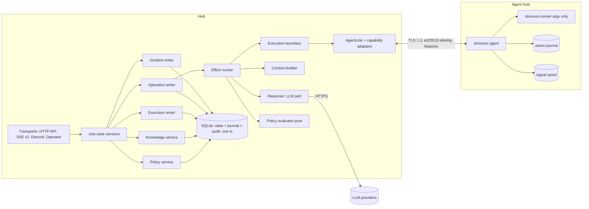

# 04 — Validated target architecture

This is the design pack's direction after the corrections in `02` and the decisions in `03`.
Where it differs from the pack, the RW decision is named. Status markers: **[S]** settled,
**[P]** proposed (needs your approval), **[I]** needs investigation or input.

## 1. System boundaries

Crate placement keeps today's edges (ARCHITECTURE.md §4) **[S]**: pure decisions (`decide`
functions, policy evaluator, context selection, plan validation) live in `domovoi-engine`/`domovoi-core`
with no I/O; writers and effect runners live in the engine behind ports; seals, transports and
use-case services live in `domovoi-hub`; only `domovoi-runner` spawns processes.

## 2. Core domain model

| Aggregate | Owner (single writer) | Key states | Notes |
|---|---|---|---|
| Signal | incident manager | append-only | unchanged |
| Incident | incident manager (ADR 0011) | Firing, Acknowledged, Muted, Resolved, Dismissed | detected condition; links to operations. Gains optimistic `version` column. |
| Operation **[P] RW-04/05** | operation writer | Queued, Running, Waiting{Approval,User,Agent,Timer}, Paused{reason}, Succeeded, Failed, Escalated, Cancelled | work performed; origin incident/user/schedule/parent; budgets; cycle counter |
| Step **[P]** | operation writer | Pending, Running, Succeeded, Failed, Refused, NotRun, Unavailable, OutcomeUnknown, Skipped | kinds: ReasoningTurn, EvidenceRequest, Assessment, Plan, PolicyDecision, Approval, Execution, Verification, Notification, Question, Note |
| Execution (today `ActionRequest`) | execution writer (ADR 0019) | Proposed, Approved/Permitted, Dispatched, Succeeded, Failed, OutcomeUnknown, Expired, Rejected | persisted form of an Execution step; plan hash v2 |
| Conversation **[P] RW-20** | conversation service | Open, Archived | messages; may reference operations |
| Fact / Relation **[P] RW-14** | knowledge service | current, stale, disputed, superseded, retracted | typed subject refs; provenance |
| PolicySet **[P] RW-10** | policy service | versioned, each version immutable | rules + defaults; shadow flag per rule |
| Note | notes repo | — | unchanged; gains subject links |
| Audit entry | written inside every writer tx | append-only, hash-chained | security record |

Three separate stores, as the pack requires **[S]**: knowledge (facts/relations/notes), policy
(policy sets, decisions), experience (operation steps, incident timeline, audit).

## 3. Orchestration

### Responsibilities
- **Operation writer**: owns operation + step rows. Input: commands (start, cancel, approve,
  answer, pause, resume) and effect results. Calls pure `decide`; commits state + new steps +
  pending effects + journal events + audit in **one transaction** (RW-03). Never calls the model,
  agents or the network.
- **Effect runner**: reads pending effects, performs them, posts results back as events. Each
  effect has an id; performing it twice must be safe (model call: re-run is a read; evidence:
  read-only; dispatch: idempotent by step id, RW-09; notification: dedup key).
- **Timers**: persisted `wake_at` effects; a scheduler wakes due timers via the fake/real `Clock`
  (repo rule 11). Replaces in-memory `sleep_until` in `recheck.rs`.

### Control loop (one cycle)
1. Origin creates an operation (`Queued`), pinned subject, budgets from config.
2. `ContextBuild` effect → context bundle with per-item status (`available | unknown |
   unavailable | failed | stale | not_applicable`), source and observed time.
3. `ReasoningTurn` effect → typed meta-tool calls (RW-07). Validation turns them into steps:
   `EvidenceRequest` (read contracts, budgeted, deduplicated by (contract,target,args) within the
   operation), `Plan`, `Question`, or `finish(assessment)`. Invalid → `Refused` step fed back.
4. For each mutating plan step: `PolicyDecision` step (evaluator; shadow decision always recorded).
   Route: `Deny` → Refused; `RequireApproval` → `WaitingApproval`; `Allow` + all RW-23 guardrails →
   permit minted.
5. `Execution` step via the single execution boundary (RW-08). Agent absent → `WaitingAgent`
   (not rejected).
6. `Verification` step: re-run the triggering check (`AgentLink::run_check`) and the contract's
   postcondition, optionally after a persisted delay and an observation window.
7. Verified → `Succeeded` (incident resolution remains the incident manager's decision based on
   signals). Not verified → `cycle += 1`, failed execution and its output become evidence, back to 2.
   Budget exhausted or `OutcomeUnknown` on a mutation → `Paused` / `Escalated` with a notification.

### Determinism and restart
- `decide` is pure and property-tested; the simulator (F harness 1) runs seeded event sequences
  and asserts invariants after each step.
- Restart: writers reload non-terminal operations; effect runner re-reads pending effects;
  `Dispatched` executions are reconciled via `action_status` before anything else moves (RW-09).
- No blind retries: the same (contract, target, args) is not re-executed in an operation after
  `Failed` or `OutcomeUnknown` unless the new plan step states what changed and policy re-evaluates.

## 4. Reasoning engine
- Port: today's `LlmProvider` port (ADR 0009) **[S]**. One shared provider-chain loop replaces the
  three copies (A §6). Every call records provider, model, tokens, latency, outcome — including
  failed calls (G).
- Hard per-call deadline (today only an idle read timeout, G) and a total prompt-size cap
  (today none; parts are capped individually, A §6).
- Admission gate (#112) persisted, so restart does not reset the hourly cap; budget read errors
  fail **closed** (today open).
- Must not: execute, approve, write state, see secrets, see raw SQL.

## 5. Context construction and evidence
- Pure selection in the engine; retrieval through store ports. Layers per pack 04 **[S]**:
  common → domain → knowledge → experience → action-specific.
- Each item: `{ref, status, source(user|discovered|integration|inferred), observed_at, size}`.
- Hard caps: total bytes per prompt, per layer, per tool result (8 KiB today, keep). Large items
  are summarised with a ref the model can request.
- All retrieval is host-scoped by the operation's subjects (fixes the cross-host `similar()` leak,
  E §3).
- Untrusted-input handling: everything from hosts, logs, notes, webhooks is quoted data, wrapped
  and redacted (extend the redactor for JSON-quoted secrets and URL credentials, E §3).

## 6. Capability registry
- Hub-owned contracts in `domovoi-core` (RW-07). Families in v1: today's read tools, skills,
  container lifecycle (restart/start/stop one named container), systemd unit restart, HTTP/TCP
  probes for verification.
- Registry = contracts × per-host availability (from agent `hello` + catalogue fetch) × hub
  enable/disable state × local ceiling. Lifecycle states shown in UI: `available`, `enabled`,
  `disabled by hub`, `not allowed by host`, `unavailable` (+ reason).
- Install/deploy of skills from the UI **[I]**: needs an ADR (file transfer to agent, integrity,
  who may install). Not in v1 core path.
- Must not: decide authorization; accept effect/risk from a provider below the hub floor.

## 7. Policy and authorization
- Pure evaluator, precedence and default table: RW-10. Seals: RW-11. Local ceiling: RW-12.
  Guardrails: RW-23. Step-up for policy edits: RW-24.
- Decision record persisted for every mutating step, including in shadow mode, so the simulator
  can replay history with a proposed policy using the same function.
- Policy is not knowledge: facts may be *inputs* to rule conditions (e.g. "target is in maintenance
  window"), never grants.
- Must not: learn, auto-promote, or accept rule changes from anything but an authenticated human
  with step-up.

## 8. Execution and verification
- Single boundary `execute(AuthorizedStep)` (RW-08); arch-check forbids other callers of the link's
  run methods.
- Dispatch checks: authorization unexpired, plan hash v2 equal, operation `Running`, incident still
  open (if any), contract enabled on host, agent present (else wait), loop guard/rate limit,
  preconditions.
- Agent re-checks: contract implemented locally, impl hash, args schema, risk/effect within
  `allow_risk`, `authorization_kind` within ceiling, idempotency journal.
- Results are bounded and redacted; `OutcomeUnknown` is first-class (RW-09).
- Verification is a step with its own status; exit code 0 never resolves anything.

## 9. Knowledge
- RW-14 model. Writers: discovery (profile collection writes `discovered` facts instead of a
  generated Markdown note), users (edit/confirm/dispute/retract), operations (propose → user
  confirms; `inferred` until confirmed).
- Conflicts kept side by side as `disputed`; never silently pick newest.
- Notes stay Markdown with FTS and gain subject links.

## 10. Experience and audit
- Experience = steps + incident timeline + resolution summaries (FTS) (RW-15).
- Audit = security events, same transaction, hash-chained, includes denied/refused attempts,
  approval context (session, IP), policy decision ids.
- Suggestions ("you approved this 3 times") are read-only proposals that open a draft rule in
  shadow mode; never applied automatically **[S]** (pack D-13).

## 11. Persistence and search
- One SQLite file, WAL, `synchronous=FULL`, one writer connection, startup `quick_check`,
  verified backups + restore command (RW-16).
- Every writer commits through the unit of work (RW-03). Optimistic `version` on incidents and
  notes (today last-write-wins, C).
- Search: FTS5 with prefix queries across notes, incidents (title **and** summary), facts,
  operation summaries; one global search endpoint filtered by object type. No vectors.
- Retention configurable; terminal operations kept (summaries) longer than raw step outputs.

## 12. Hub/agent protocol
- RW-17: major-only rejection, feature flags, tolerant decoding, catalogue hash + paging,
  `run_capability`, `action_status`, golden frames.
- Hub sends pings too (today only the agent does) so the hub detects half-open links.
- Agent self-update stays out of scope (INV-3, ADR 0003) **[S]**.

## 13. Frontend
- Data: TanStack Query + SSE v2 with ids/replay (RW-18); `QueryBoundary` shows stale/refreshing/
  partial states (today refresh errors are dropped, B §4).
- Shell: left nav (Operations, Incidents, Infrastructure, Capabilities, Knowledge, Policies,
  System), right-hand slot manager with a single precedence rule (inspector > Operator panel on
  narrow screens; side-by-side on wide), Ctrl/Cmd+K palette with async results.
- Operation detail: header (goal, status, waiting-for, budgets), step tree/timeline, inspector;
  graph canvas later (RW-21).
- Approval card component shared by Operations, Incidents, Control Room and Operator, rendering the
  structured plan (RW-22).
- New kit primitives go into the kit + DESIGN.md + /dev/design together (repo rule).
- Browser e2e: one Playwright smoke against `dev_hub` in CI, growing per milestone.

## 14. Observability and operations
- `/healthz` (process up) and `/readyz` (store writable, writers alive, migrations done) — today
  `/healthz` is constant (F).
- Metrics: queue depths (pending effects, outbox), operation counts by status, dispatch latency,
  `OutcomeUnknown` count, LLM calls/tokens/failures by provider, agent connections. `/metrics`
  behind auth or a separate bind (today open, E).
- Tracing spans per operation id and step id.
- Self-advisories for backup failure, writer stall, effect backlog.

## 15. Testing and reliability strategy
- Keep all gate tests; extend: `no_permit_without_policy_allow`, `single_execution_boundary`,
  `destructive_never_allowed_by_policy`, `model_meta_tools_are_closed`.
- New harnesses in `domovoi-testkit` (F §6): deterministic orchestration simulator; `CrashingStore`
  + restart helper swept over every write; stateful `FakeAgent` (journal, drop/duplicate/delay/
  skew); `FakeAgentLink` deadline enforcement; golden protocol frames; N-1 database upgrade test;
  policy evaluator table + property tests; Playwright smoke.
- Drill suite (pack v1 gates): scripted incidents run through the simulator with a scripted LLM,
  asserting no duplicate mutation across restart, deny never overridden, failed verification →
  new cycle, budget exhaustion → pause.

## 16. Component contracts (summary)

| Component | Inputs | Outputs | Owns | Failure mode | Must not |
|---|---|---|---|---|---|
| Operation writer | commands, effect results | committed state, pending effects | operations, steps, effects | store error → command fails, nothing partially written | call model/agents |
| Effect runner | pending effects | result events | nothing durable | crash → effects re-read on start | decide transitions |
| Context builder | operation, subjects, budgets | context bundle with statuses | nothing | source failure → item `failed`, not omitted | invent facts, cross host scope |
| Reasoner | bundle, meta-tool schema | typed meta-tool calls | nothing | provider failure → fallback, then `Paused{Error}` | execute, authorize |
| Plan validator | meta-tool calls, registry | steps or Refused | nothing | invalid → Refused with reason | accept unknown contracts |
| Policy evaluator | policy set, request, facts | decision + trace | nothing (pure) | unknown fact → not Allow | do I/O, learn |
| Policy service | human edits (step-up) | new policy version | policy sets | — | accept model edits |
| Execution boundary | AuthorizedStep | dispatch, result | executions | link drop → OutcomeUnknown/reconcile | run without seal |
| Agent | run_capability | result, journal | journal, spool | crash → journal answers status | run outside ceiling |
| Knowledge service | discovery, users, proposals | facts/relations | facts, relations, notes | conflict → disputed | store permissions |
| SSE v2 | committed journal | ordered events with ids | nothing | slow client → reset event | emit uncommitted state |

## 17. What is settled, proposed, open

- **Settled (pack + evidence):** hub/agent split, argv-only runner, SQLite only, no vector/graph DB,
  knowledge/policy/experience separation, available ≠ authorized, no model-authored executables,
  Operation ≠ Incident, Operator = one feature with two surfaces.
- **Proposed:** RW-01, 03–11, 14–24.
- **Needs your input:** RW-02, RW-10 details, RW-12, RW-13, plus `99-open-decisions.md`.
