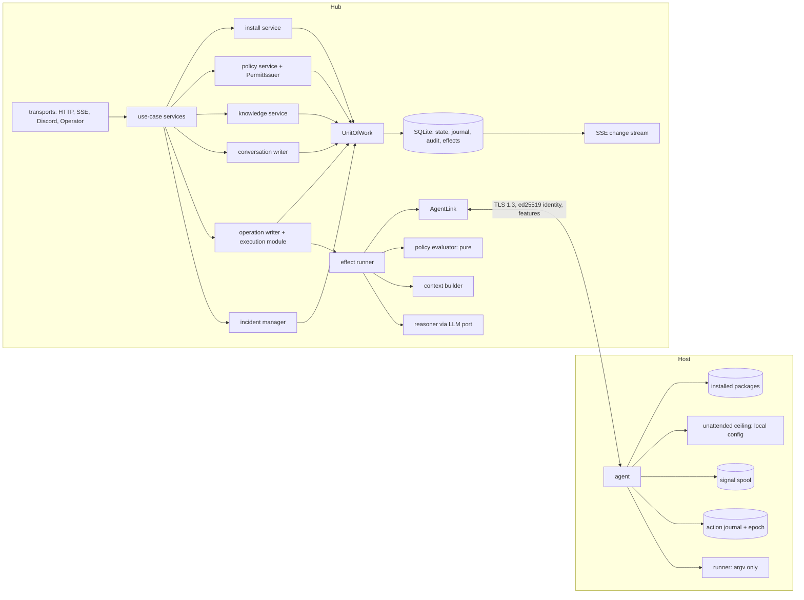
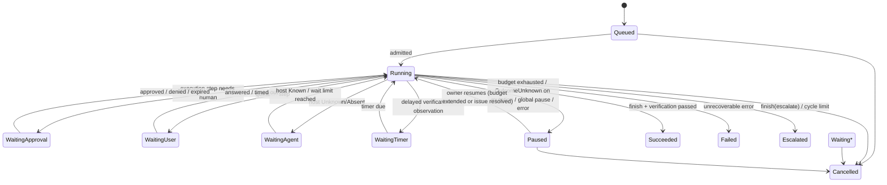
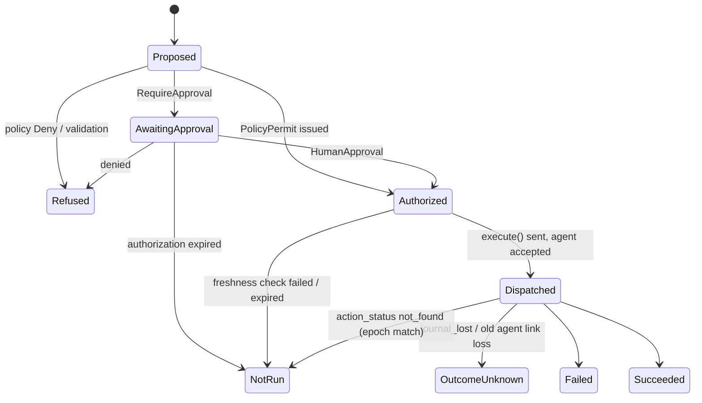
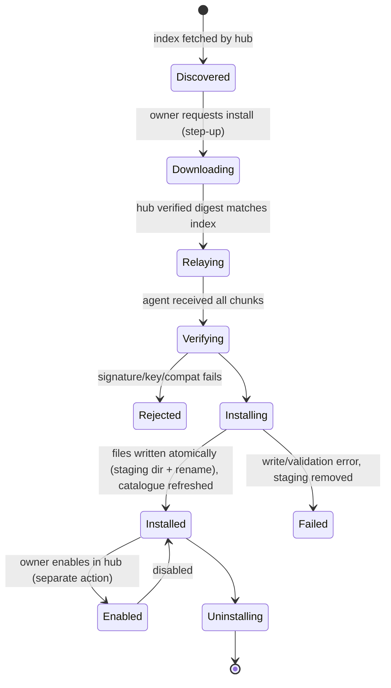

# 04 — Validated target architecture

The technical contract for the rework. Decisions and rationale are in `03` (RW-NN); owner decisions
are D-NN in `99`. Labels: FACT, INFERENCE, PROPOSAL, DECISION, OPEN. Anything not labelled here
follows its RW entry's label.

## 1. Boundaries and crate placement



| Crate | New responsibilities | Must not |
|---|---|---|
| `domovoi-core` | contract types, `Operation`/`Step`/`Execution` types, `Authorization`, `HumanApproval`, `PolicyPermit`, `Actor`, `TargetRef`, `Open<T>`, ports (`UnitOfWork`, `PermitIssuer`, `ExperienceSearch`, `KnowledgeRead`) | do I/O |
| `domovoi-engine` | pure `decide` functions, plan validator, policy evaluator, context selection; writers and effect runner behind ports | depend on hub; mint `HumanApproval`/`PolicyPermit` |
| `domovoi-store` | `UnitOfWork` SQLite implementation, seq and hash-chain assignment, migrations, FTS | decide transitions |
| `domovoi-proto` | `features`, `run_capability`, `action_status`, `get_catalog`, `install_package`, tolerant decoding | — |
| `domovoi-agent` | journal, ceiling enforcement, package verification and installation, containment expiry | accept keys or ceiling from hub |
| `domovoi-runner` | unchanged (only process spawner) | — |
| `domovoi-hub` | transports, use-case services, `auth/` (HumanApproval), `policy/` (PermitIssuer impl), install relay | bypass use-case services |

No new crates. Dependency edges stay as in ARCHITECTURE.md §4 (FACT: enforced by arch-check).

## 2. Domain model and ownership

| Aggregate / record | Single owner | Persisted in | Notes |
|---|---|---|---|
| Signal | incident manager | `signals` | unchanged |
| Incident | incident manager (ADR 0011) | `incidents` + `version` | timeline events → `journal` |
| Operation | operation writer | `operations` + `version` | coarse status, budgets, pinned subjects, cycle |
| Step (intent) | operation writer | `steps` (immutable columns) + derived `status` | kinds §3.2 |
| Execution detail | operation writer (execution module) | `executions` (1:1 with Execution step) | authorization, plan hash v2, dispatch, result |
| Operation ↔ incident link | operation writer | `operation_incidents` | incident manager reads only |
| Effect (outbox) | written by owning writer, completed by its writer on result | `effects` | §4 |
| Conversation, messages | conversation writer | `conversations`, `messages` | §13 |
| Fact, relation, entity | knowledge service | `facts`, `relations`, `entities` | §10 |
| Resolution summary | operation writer (create); knowledge service (owner edits) | `resolution_summaries` + FTS | §10 |
| Policy version | policy service | `policy_versions` (immutable rows) | §7 |
| Policy decision | operation writer (as `PolicyDecision` step) | `steps` + `policy_decisions` | §7 |
| Package install job | install service | `install_jobs` | §11 |
| Journal entry | appended by the owning writer of its aggregate | `journal` | §6 |
| Audit entry | appended by the writer making the security-relevant change | `audit_log` (hash-chained) | §6, RW-27 |
| Legacy action | read-only projection | `actions` (unchanged) | RW-32 |

Writers are tokio tasks with a command channel (FACT: pattern of ADR 0011/0019). One task each for
incidents, operations, conversations; knowledge, policy and install services are request/response
services that commit through the same `UnitOfWork` with optimistic versions.

## 3. Operation, Step and Execution

### 3.1 Operation status



- Terminal: `Succeeded, Failed, Escalated, Cancelled`. A new attempt after terminal is a new operation
  with `parent = <old id>`.
- Several waits can be pending at once (e.g. two independent steps); `status` shows the
  highest-priority wait (Approval > User > Agent > Timer) and the step list shows all.
- Cancel: pending effects are cancelled; an execution already `Dispatched` cannot be recalled — it
  is reconciled to its real outcome and recorded.

### 3.2 Step kinds and outcomes

Kinds: `ReasoningTurn, EvidenceRequest, Assessment, Plan, PolicyDecision, Approval, Execution,
Verification, Notification, Question, Note`. Each step: `id (UUIDv7), operation_id, kind, phase
label, parent_step_id, cycle, created_at, intent (typed JSON, immutable)`.

Step outcome vocabulary (closed): `Pending, Running, Succeeded, Failed, Refused, NotRun, Unavailable,
OutcomeUnknown, Skipped, Cancelled`.

| Outcome | Meaning |
|---|---|
| Failed | ran and reported failure |
| Refused | rejected by validation, policy or agent before running |
| NotRun | provably never started (agent journal `not_found` with matching epoch), or expired before dispatch |
| Unavailable | source/capability not available (host absent past limit, contract not implemented) |
| OutcomeUnknown | may have run; result unknowable (journal lost, old agent) |
| Skipped | intentionally not run (superseded by another step) |

### 3.3 Execution states (derived from step events)



One attempt per Execution step (RW-04). Execution states map to step outcomes; there is no second
status column.

### 3.4 Transaction boundaries (each row = one `UnitOfWork` commit by the named writer)

| Event | Writer | Same transaction |
|---|---|---|
| Operation created from incident | operation writer | `operations` insert, `operation_incidents`, first step, journal `OperationCreated`, effect `BuildContext` |
| Model turn result | operation writer | turn step outcome + usage, new child steps (validated), journal entries, new effects, completion of the `CallModel` effect |
| Policy decision | operation writer | `PolicyDecision` step + `policy_decisions` row, execution state change, audit `PolicyDecided` (incl. shadow), journal |
| Human approval | operation writer (command from use-case service carrying `HumanApproval`) | execution `Authorized`, audit `Approved{actor, plan_hash, session}`, journal, effect `Dispatch` |
| Dispatch accepted | operation writer | execution `Dispatched{agent_epoch, at}`, journal, completion of `Dispatch` effect |
| Execution result | operation writer | execution outcome + bounded output ref, audit `Executed`, journal, effect `Verify` (or timer), operation status change if applicable |
| Verification result | operation writer | verification step outcome, operation status (`Succeeded` or new cycle with `cycle+1` and `BuildContext` effect), resolution summary draft effect on terminal |
| Incident signal | incident manager | signal, incident row (`version` check), journal timeline entry |

Cross-aggregate writes are limited to: operation + its `operation_incidents` links; operation +
effect completions. The incident manager reacts to operation journal entries (e.g. to show "an
operation is working on this") by reading, never by co-writing.

## 4. Orchestration loop, effects, timers, budgets

- `decide(&OperationState, OperationEvent, now) -> Decision { new_state, new_steps, effects,
  journal, audit }` is pure (engine) and property-tested.
- `effects(id, operation_id, kind, payload, status{pending,running,done,cancelled}, not_before,
  attempts, created_seq)`. Kinds: `BuildContext, CallModel, CollectEvidence, EvaluatePolicy,
  IssuePermit, Dispatch, Reconcile, Verify, Notify, Wake, DraftSummary`.
- Effect runner: claims `pending` effects with `not_before <= now` (one claim marks `running` in a
  small commit), performs them, posts the result as an event to the owning writer, which completes
  the effect in the same commit as the state change. On restart, `running` effects revert to
  `pending` except `Dispatch`, which is resolved by reconciliation (§15).
- Idempotency per effect kind: `CallModel` re-issue is a new attempt (RW-06); `CollectEvidence` is
  read-only; `Dispatch` is idempotent by step id at the agent; `Notify` carries a dedup key
  `(operation_id, step_id, channel)`.
- Timers are `Wake` effects with `not_before`; the scheduler uses the `Clock` port (tests advance
  `FakeClock`). Replaces `recheck.rs` in-memory sleep (FACT `actions/recheck.rs:65`).
- Budgets persisted on the operation (`budgets` JSON with limits and used): model turns, tool calls,
  evidence requests, executions, cycles, wall time, tokens, cost. Shared across cycles. Exceeded →
  `Paused{Budget}` + notification. Defaults configurable (`[orchestration]`).
- No blind retry: a new Execution step with the same (contract, target, args) as a `Failed` or
  `OutcomeUnknown` step in the same operation is refused unless it sets `retry_of` and states what
  changed; it is evaluated by policy afresh. After `OutcomeUnknown`, unattended authorization of the
  same contract+target is blocked until a human resolves or a verification proves state.

## 5. Unit of work contract

```rust
// domovoi-core::ports (sketch; exact names decided in the implementing PR)
pub struct Transaction {
    pub writes: Vec<StateWrite>,          // typed per aggregate, each with expected_version
    pub journal: Vec<JournalDraft>,       // aggregate ref, kind, typed payload, actor
    pub audit: Vec<AuditDraft>,           // actor, action, subject, details
    pub new_effects: Vec<EffectDraft>,
    pub completed_effects: Vec<EffectId>,
}
pub enum CommitError {
    Conflict { aggregate: AggregateRef, expected: u64, actual: u64 },
    Constraint(String),
    Backend(String),
}
pub struct CommitReceipt { pub journal_seqs: Vec<u64>, pub audit_seqs: Vec<u64> }
#[async_trait] pub trait UnitOfWork { async fn commit(&self, tx: Transaction) -> Result<CommitReceipt, CommitError>; }
```

- SQLite: `BEGIN IMMEDIATE` on the single writer connection; apply writes with
  `UPDATE … WHERE id=? AND version=?` (0 rows → `Conflict`, rollback); insert journal rows (seq
  assigned by `AUTOINCREMENT`); compute audit hash from the previous row inside the transaction;
  insert effects; mark completed effects; `COMMIT`. Any error → rollback, nothing visible.
- `Conflict` inside a single-writer aggregate indicates a bug or an external writer: the writer
  reloads the aggregate, records an advisory, and re-decides once; a second conflict fails the command.
- Partial failure is impossible by construction; the caller sees either a receipt or an error.
  After an error the writer's in-memory state is discarded and reloaded from the store.
- `InMemoryStore` implements the same port with one mutex; the existing repo contract-suite pattern
  (FACT: 18 contract suites, F §1) gains a `unit_of_work` suite run against both.
- Notifications/SSE only ever read committed rows (§6).
- Ownership is not enforced by the port; `StateWrite` constructors are `pub(crate)`-style per writer
  module where Rust allows (within the engine) and arch-check scanned otherwise.

## 6. Journal, audit, outbox and SSE

| Store | Purpose | Written | Read by |
|---|---|---|---|
| `journal(seq, aggregate_type, aggregate_id, kind, payload_v, payload, actor, occurred_at)` | operational experience + change stream | owning writer, in its transaction | UI timelines, graph, SSE, experience, simulator |
| `audit_log(seq, prev_hash, hash, actor, action, subject, details, at)` | security record | same transaction as the change | audit page, `audit verify` |
| `effects` | pending side effects | owning writer | effect runner |

- Kinds are a closed Rust enum serialized as stable strings, with `payload_v` for schema evolution;
  readers use `Open<Kind>` so unknown future kinds are shown generically instead of failing.
- Sequence: global, from SQLite `AUTOINCREMENT` inside `BEGIN IMMEDIATE` on the one writer
  connection → commit order. FACT: write pool size 1 (C §2). If that ever changes, seq assignment
  must move to a single sequence table updated in the same transaction.
- SSE: `id: <seq>`. On connect with `Last-Event-ID: n`: if `n < min_retained_seq` send `event:
  reset` and the client refetches snapshots; else stream `seq > n` matching the client's topics
  (`incidents`, `operations`, `operation:<id>`, `hosts`, `approvals`, `conversations:<id>`), then
  tail. Tail: writers broadcast the highest committed seq; each SSE task re-queries from its last
  sent seq (a lagged broadcast loses nothing). Clients dedupe by seq; handlers are idempotent.
- Snapshots: every list/detail endpoint returns `as_of_seq`; the client applies only events with
  `seq > as_of_seq`.
- Ephemeral events (model token streaming, install byte progress) carry no `id` and are never
  replayed; their final state is a journal entry.
- Audit contents: logins and step-ups, approvals/denials (with session and client IP), permits
  issued, refusals by policy or agent, policy/settings/retention/ceiling-observed changes, install,
  enable/disable, pause switch, restores, audit checkpoints.

## 7. Policy

### 7.1 Rules

```text
Rule {
  id, version_id, enabled, shadow: bool,
  host:       All | Host(HostId)                         // tags post-v1
  capability: Any | Effect(EffectClass) | Category(Cat) | Contract(ContractId)
  targets:    Any | Exact(Set<TargetRef>)                // v1: no globs
  conditions: [ArgConstraint | TimeWindow | RequiresFact(predicate) | MaxRate | MaxTtl]
  outcome:    Deny | RequireApproval | Allow
  note (owner text)
}
```

### 7.2 Specificity (partial order, no numeric score)

Per dimension, a set-inclusion order:
- host: `Host(h) ⊂ All`;
- capability: `Contract(c) ⊂ Category(category(c)) ⊂ Effect(effect(c)) ⊂ Any` (category and effect
  come from the contract; a category belongs to exactly one effect class);
- targets: `Exact(S1) ⊂ Exact(S2)` iff `S1 ⊊ S2`; `Exact(_) ⊂ Any`.

Rule A is **strictly more specific** than B iff A ⊆ B on every dimension and A ⊊ B on at least one.
Conditions do not affect specificity; they only decide whether a rule matches (a rule whose
conditions are unmet does not match). Argument constraints are conditions.

### 7.3 Evaluation

1. `M` = enabled, non-shadow rules whose scope contains the request and whose conditions hold.
   (Shadow rules are evaluated separately with the same algorithm and recorded, never enforced.)
2. If `M` is empty → default by effect class: `Read → Allow (budgeted)`, `Mutate → RequireApproval`,
   `Contain → RequireApproval`, `Destructive → RequireApproval + typed confirmation`.
3. `W` = maximal elements of `M` (rules not strictly dominated by another rule in `M`).
4. If all of `W` have the same outcome → that outcome; for `Allow`, constraints combine by
   **intersection** (min rate, min TTL, intersection of target sets, conjunction of conditions).
5. Otherwise (equal scope with different outcomes, or incomparable rules) → `Deny` if any `Deny` in
   `W`, else `RequireApproval` (D-05 for equal scope; OPEN default for incomparable).
6. Hard limits, applied in order, each recorded in the trace:
   - `Destructive` and outcome `Allow` → `RequireApproval` (D-06);
   - outcome `Allow` and target ∉ pinned subjects ∪ winning rules' `Exact` targets → `RequireApproval` (D-07);
   - outcome `Allow` and any `RequiresFact` or containment-safety fact unknown/stale → `RequireApproval`;
   - outcome `Allow` and host ceiling (as last reported, hash pinned into the permit) does not cover
     contract+target+args+rate → `RequireApproval`;
   - containment target in mandatory exclusions → `Deny` (even for humans in v1);
   - autonomy paused or rule circuit-broken → `RequireApproval`.

Order independence: steps 1–5 are set operations over `M`; no rule order or id participates.

**Meaning of outcomes.** `Allow` = unattended (permit issued). `RequireApproval` = human may approve.
`Deny` = not offered for approval; the owner must change the policy.

### 7.4 Decision table (request: host = media, contract = `container.restart` [category
`container.lifecycle`, effect `Mutate`], target = `plex`, unless stated)

| # | Matching rules (host / capability / targets → outcome) | Result | Why |
|---|---|---|---|
| 1 | none | RequireApproval | default for Mutate |
| 2 | All / container.restart / Any → Deny | Deny | single rule |
| 3 | #2 + media / container.restart / {plex} → Allow | Allow | rule 2 strictly more specific (host and targets narrower) |
| 4 | #3 but target = radarr | Deny | only the broad Deny matches |
| 5 | #3 but host = other | Deny | exception is host-scoped |
| 6 | media / container.restart / {plex} → Allow and → Deny | Deny | equal scope, Deny wins |
| 7 | All / container.restart / {plex} → Allow; media / Category(container.lifecycle) / Any → Deny | Deny | incomparable (first narrower on capability+target, second on host); recommended fallback Deny (OPEN) |
| 7b | same as 7 but the second rule → RequireApproval | RequireApproval | incomparable; fallback RequireApproval over Allow |
| 8 | All / Effect(Mutate) / Any → Allow; media / container.restart / Any → RequireApproval | RequireApproval | second strictly more specific |
| 9 | media / container.restart / {plex, jellyfin} → Allow (max 3/h); media / container.restart / {plex} → Allow (max 1/h) | Allow, max 1/h | second strictly more specific (target subset) wins alone |
| 10 | two rules media / container.restart / {plex} → Allow with 3/h and 2/h | Allow, max 2/h | equal scope, both Allow, intersection |
| 11 | All / Any / Any → Allow; request contract effect = Destructive | RequireApproval + typed confirmation | hard limit D-06 |
| 12 | #3, but host ceiling lacks `container.restart` for `plex` | RequireApproval | hard limit: ceiling |
| 13 | #3, but model-proposed target `postgres` (not pinned, not in rule) | Deny | the exception doesn't match `postgres`; broad Deny applies |
| 13b | media / container.restart / Any → Allow; target `postgres` not pinned, rule names no targets | RequireApproval | hard limit D-07: unattended only on pinned or rule-named targets |
| 14 | media / Effect(Contain) / Any → Allow; `firewall.block_source` target in management exclusions | Deny | hard limit: containment exclusion |
| 15 | media / container.restart / {plex} → Allow with `RequiresFact(not_in_maintenance)`; fact unknown | rule does not match → falls to broader rules or default | conditions gate matching; unknown ≠ true |

Note for row 15: an unknown fact makes a `RequiresFact` condition unmet. The hard limit in 6.3
additionally downgrades any `Allow` whose contract declares safety-critical facts that are unknown.

### 7.5 Trace and explanation

`Decision { outcome, matched: [rule_id + scope], winners: [rule_id], overridden: [(broader_rule,
by_rule)], reason: Default | SingleWinner | EqualScopeDeny | IncomparableFallback,
constraints, hard_limits_applied: [..], policy_version, ceiling_hash, facts_used: [(fact_id,
status)] }`. Persisted for every mutating/containing step (enforced and shadow). The UI renders:
all matching rules, winner(s), why, which broader rules were overridden (highlighted when a
specific Allow overrides a broader Deny), and hard limits in a separate block.

### 7.6 Simulator

`simulate(policy_version_or_draft, requests | historical_operation_ids) -> [Decision]` calls the same
`evaluate` with the facts and ceiling hash recorded at the time (historical) or current (what-if).
No effects. Shown with a diff against the decision actually taken.

### 7.7 Required tests (engine, table + property)

`specific_allow_overrides_broader_deny`, `broader_deny_applies_without_exception`,
`equal_scope_deny_wins`, `incomparable_conflict_falls_back_to_deny`,
`incomparable_allow_vs_approval_requires_approval`, `evaluation_is_order_independent` (proptest:
permutations), `equal_scope_allows_intersect_constraints`, `no_match_uses_effect_default`,
`destructive_never_allowed`, `ceiling_caps_allow`, `unknown_safety_fact_never_allows`,
`model_target_cannot_widen_scope`, `containment_exclusion_denies_even_with_allow`,
`shadow_rules_never_enforced`, `simulator_matches_live_evaluator` (same inputs → same decision).

## 8. Authorization and local enforcement

### 8.1 Types (RW-11)

| Type | Crate | Constructed by (allowed path) | Restored by |
|---|---|---|---|
| `HumanApproval{user, channel, at, typed_confirmation, plan_hash, session_ref}` | core | `hub/src/auth/` after session/CSRF or chat allowlist check | `store/src/` |
| `PolicyPermit{decision_id, rule_ids, policy_version, plan_hash, issued_at, expires_at, ceiling_hash}` | core | `hub/src/policy/` via `PermitIssuer` port | `store/src/` |
| `Authorization = Human(..) \| Policy(..)` | core | from the above | store |
| `AuthorizedExecution{step, authorization}` | engine (operation writer module) | `execute()` precondition | never persisted |

Enforcement: clippy `disallowed-methods` (path-resolved) + arch-check rule restricting the
`#[expect(clippy::disallowed_methods)]` to allowed paths + existing text scan; testkit allowed and
asserted dev-only. These are review/CI controls, not runtime security.

Persisted on `executions`: `authorization_kind`, approval columns (existing) or permit columns,
`plan_hash_v2`, `expires_at`. Gate tests kept/added: `no_approval_without_human` (kept),
`no_permit_without_policy_allow`, `single_execution_boundary`, `destructive_never_allowed_by_policy`,
`model_meta_tools_are_closed`.

### 8.2 Wire

`run_capability { step_id, contract, version, target, args, plan_hash, authorization_kind:
human|policy, expires_at }` (`authorization_kind` and `expires_at` are hints the agent checks
against its own rules; they are not proofs).

### 8.3 Host-local ceiling (D-03)

```toml
# agent config (owner-edited on the host)
[unattended]
enabled = true

[[unattended.allow]]
capability = "container.restart"
targets = ["plex", "jellyfin"]   # or ["*"] written explicitly
max_per_hour = 3

[[unattended.allow]]
capability = "firewall.block_source"
targets = ["*"]
max_per_hour = 20
max_active = 50
max_ttl = "1h"
args = { min_prefix_len_v4 = 24, min_prefix_len_v6 = 64 }

[unattended.exclusions]
management_cidrs = ["192.168.1.0/24", "100.64.0.0/10"]   # never blocked
protected_units  = ["sshd", "domovoi-agent", "systemd-networkd", "NetworkManager", "nftables"]
protected_containers = []
```

Agent checks for `authorization_kind = policy`: `enabled`; an entry exists for the contract; target
∈ targets; each constrained arg within bounds (only keys the contract declares constrainable;
unknown keys → config error at startup); rate window (persisted in the agent journal); `max_active`
and `max_ttl` for Contain; exclusions. For any mutating kind (human or policy): `allow_risk` (FACT,
today) and `max_per_hour` when an entry exists. Agent reports `ceiling_hash` + summary in `hello`
and on change (file reload on SIGHUP or restart). Refusals are journaled locally and returned as
`refused{reason}`.

### 8.4 Guarantees by threat

| Threat | Guarantee (holds by design) | Defense in depth (reduces, does not guarantee) |
|---|---|---|
| Prompt injection via logs/notes | model cannot approve or execute (closed meta-tools); targets resolved and pinned; containment triggered only by detector-typed signals | redaction, quoting of untrusted input, structured approval cards |
| Compromised browser session | approvals require session + CSRF; step-up for policy publish, enable, install, retention, LLM CLI | short sessions, audit with IP/session |
| Misconfigured owner policy | hard limits (Destructive, ceiling, exclusions, pinned targets) not overridable; shadow mode first; circuit breaker; pause | dangerous-exception highlighting, simulator |
| Modified hub database | agent ceiling limits unattended runs; agent rate limits all mutations; audit chain detects edits that don't recompute | head hash in digest (external copy) |
| Compromised hub process | agent ceiling limits `policy`-kind runs; agent `allow_risk` and rate limits bound everything; packages need locally trusted signatures | none can stop a lying hub labelling runs `human` within `allow_risk` — owner-signed approvals are post-v1 |
| Compromised agent | that host only; hub validates outputs as untrusted; agent cannot widen others' policy | output redaction, bounded outputs |

## 9. Containment (M9; first set OPEN, recommended)

Common to all: effect `Contain`; requires M8 machinery; trigger only from a deterministic detector
signal whose structured fields name the target; target must equal the pinned subject; TTL
mandatory with automatic expiry; verification after apply and after expiry; `OutcomeUnknown` →
operation `Paused`, owner notified, no repeat; containment state is journaled on the agent and
re-armed on agent restart; drills required before a rule may leave shadow mode.

| | `firewall.block_source` | `container.pause` | `unit.stop_temporary` |
|---|---|---|---|
| Threat | brute force / scanning from an external source | compromised or runaway workload | compromised or runaway service |
| Target | one IPv4/IPv6 address or prefix ≥ ceiling min length, from detector signal | one named container on the host | one named systemd unit |
| Privileges | CAP_NET_ADMIN via a first-party helper (package) managing a dedicated nftables table/set; no edits to other tables | Docker socket write (needs the docker-write ADR also required by M8) | systemd unit stop/start via first-party helper |
| Lockout risk | blocking owner/VPN/hub path | low (workload unavailable) | stopping sshd/network/agent |
| Local restrictions | `management_cidrs`, hub address, current agent link peer, loopback, link-local always excluded; `max_active` | `protected_containers` | `protected_units` (defaults above, cannot be emptied) |
| TTL / expiry | nftables set element `timeout` (kernel-enforced, survives agent death) | agent timer from journal; re-armed on agent start | agent timer from journal; re-armed on agent start |
| Dead-man | kernel timeout | if agent down past expiry the container stays paused until agent returns — documented; hub raises advisory | same as pause |
| Rollback | delete element | unpause | start unit |
| Postcondition | element present in set; management path reachability probe from the hub succeeds | container state `paused` | unit inactive; after expiry active again |
| Outcome unknown | query set membership via `action_status` follow-up read | inspect container | `systemctl is-active` read |
| Reconnect | hub reconciles active containments list from agent journal | same | same |
| Drills | block applied/expired on time; excluded address refused; hub unreachable during TTL; agent restart mid-TTL; duplicate dispatch | pause/unpause; protected refused; agent restart mid-TTL | stop/start; protected refused; agent restart mid-TTL |

Two-phase / dead-man protocol: only `firewall.block_source` needs a post-apply reachability check;
if the hub cannot reach the agent within 30 s after apply, the agent removes the element itself
(agent-side watchdog armed at apply, disarmed by the hub's confirmation message). Recommended
generally: any Contain contract that can affect connectivity must declare such a watchdog.

## 10. Knowledge and experience

- **Inventory ownership.** Baselines own observed containers/units/ports (FACT). Facts reference
  them via `TargetRef`; they never store copies.
- `entities(id, kind, name, created_by, created_at)` — user-defined subjects only.
- `facts(id, subject_ref, predicate, value, source{user|discovered|integration|inferred|imported},
  status{current|stale|disputed|superseded|retracted}, observed_at, valid_until, last_verified_at,
  supersedes_id, evidence_ref, actor, created_at)`. Predicates: closed enum with value schema
  (initial: role, criticality, owner_note, depends_on-ref, management_path, maintenance_window,
  backup_location, never_restart, trusted_cidr).
- `relations(id, from_ref, kind{depends_on, runs_on, routes_to, stores_on, backs_up_to,
  managed_from}, to_ref, source, status, observed_at)`.
- Freshness: each predicate has a staleness period; past it, status becomes `stale` (computed on read
  and by a daily job). Safety-critical predicates (`trusted_cidr`, `management_path`) used by policy
  hard limits must be `current` and `user`-sourced.
- Conflicts: different values from different sources → both `disputed` until the owner chooses.
  `inferred` never becomes `user` without an explicit owner action.
- Retraction: row status `retracted`, value cleared after the tombstone period, FTS row removed in the
  same transaction.
- **Resolution summaries.** `resolution_summaries(operation_id, host_ids, subject_refs, outcome,
  verified, contracts_executed, problem, cause, fix, source{model|user}, edited_at)` + FTS on
  problem/cause/fix/subjects. Created by `DraftSummary` effect at terminal state.
- **Experience search.** `search_experience(query, scope)`: FTS over summaries + journal kinds,
  filtered to operation hosts unless the owner's conversation is global; returns ≤ 5 items with
  operation id, date, verified flag, source, ≤ 1 KiB each. Context builder places them in a block
  titled "Historical evidence — not authorization".
- **Model context.** Facts and summaries sent to the model carry source and status; `disputed` and
  `stale` are labelled; retracted never sent.

## 11. Capability registry and installation

### 11.1 Registry

Availability per (host, contract): `Available | NotInstalled | DisabledByHub | NotAllowedOnHost
(allow_risk/ceiling) | Unavailable(reason) | Incompatible(version) | HostUnknown | HostAbsent`.
Computed from contracts × agent catalogue (by hash, paged) × hub enable state × ceiling summary.

### 11.2 Package lifecycle (D-11)



- Package: `.tar.zst` with `package.toml` (name, version, contracts provided, platforms, min agent
  version, files), skill manifests and scripts; `package.sig` = Ed25519 over SHA-256 of the archive.
- Discovery: hub fetches a signed index from configured registry URLs (default: first-party). Index
  signature checked by the hub for display; authoritative check is on the agent.
- Transport: hub downloads, checks digest, relays to agent in chunks over the existing link
  (`install_package` messages; frame cap respected). Hosts without internet work.
- Agent checks: `[packages] allow_install = true` (default false); signature against local
  `trusted_keys` (first-party key in the config template; owner can add own key or remove first-party;
  hub cannot add keys); compatibility; no file outside `skills_dir/<package>`; manifests parse.
- Install never enables; enable is a hub action with step-up; unattended additionally needs policy
  Allow + host ceiling entry.
- Multi-host deploy: one `install_job` per host; per-host progress via ephemeral SSE + journal entry
  on each state change; partial success shown per host; retry is per host; uninstall removes files and
  disables in hub; previous version kept for one-step rollback (`rollback_package`).
- Audit: requested, relayed, verified, installed, rejected (with reason), enabled, disabled,
  uninstalled.
- OPEN: third-party packages (recommend: not in v1 beyond owner-added keys).

## 12. Protocol (RW-17)

- Version: reject on major mismatch or agent < `MIN_AGENT_VERSION`; otherwise accept and negotiate
  features: `journal`, `run_capability`, `catalog_v1`, `action_status`, `ceiling_v1`, `packages_v1`,
  `containment_v1`.
- `Open<T>`: custom `Deserialize` reading a string, then `T::from_str`; unknown → `Unknown(raw)`.
  Replace the three `#[serde(other)]` sites (FACT) where the raw value matters.
- Unknown message type → `unsupported{type}`; session continues.
- `get_catalog{page, page_size}` with `catalog_hash` in `hello`; hub refetches on hash change.
- Hub pings too (FACT: today only the agent pings).
- Golden frames: `crates/domovoi-proto/tests/golden/<version>/` committed per release, decoded by
  current code in CI.

| Capability | Old agent (no features) | New agent |
|---|---|---|
| read tools, skills with human approval | via hub adapter | native |
| policy-authorized (unattended) | refused ("agent too old") | yes, within ceiling |
| reconciliation | none: link loss / restart → OutcomeUnknown | `action_status` |
| install from UI | refused | `packages_v1` |
| containment | refused | `containment_v1` |

Support window OPEN (recommended: current + previous two minors until 1.0).

## 13. Frontend

- Live layer: SSE §6 with `as_of_seq` snapshots; `QueryBoundary` shows stale/refreshing/partial
  states (FACT: today refresh errors are dropped, B §4).
- Shell: nav Operations, Incidents, Infrastructure, Capabilities, Knowledge, Policies, System;
  attention centre; right-slot rule (wide: Operator and inspector side by side; narrow: last opened
  wins, other becomes a tab).
- Operation detail: header (goal, status, waiting-for, budgets, pinned subjects); graph canvas
  (primary, lazy chunk) and step tree/timeline (accessible outline, same data); inspector.
- Trace schema: `{operation, steps[{id, parent, kind, phase, cycle, outcome, started_at, ended_at,
  summary, refs}], edges derived from parent + dependency}` frozen with golden fixtures shared by
  Rust tests and `web/src/test/fixtures`.
- Profiles: category per element (P0 safety/approval/audit/current state, P1 primary, P2 technical,
  P3 metadata); mapping Detailed/Standard/Essential per `16` UI doc; `useVisibility(category)` primitive;
  server-stored preferences (single owner); test asserts every P0 element renders in every profile.
- Structured approval card; effective-policy explanation (§7.5); host ceiling read-only view;
  capability install wizard (§11.2); similar past operations; audit page with chain status; retention
  settings.
- Motion: micro 120/180 ms; visualization/transition 240–400 ms, max 600 ms; reduced motion →
  instant, state still visible (D-12, `web/DESIGN.md`).
- Graph library: spike required (CSP, inline-style rule, bundle chunk budget); outcome becomes a
  DESIGN.md amendment.

## 14. Retention and deletion (D-09: all configurable; defaults OPEN in `99`)

| Data | Class | Notes |
|---|---|---|
| signals | raw | current 30 d |
| incident timeline (journal, aggregate=incident) | raw→summary | current 90 d |
| operations rows | summary | kept with summaries |
| operation journal events | raw | step detail |
| raw execution outputs | raw | bounded blobs |
| resolution summaries | summary | experience |
| audit | security | pruned only via checkpoint |
| facts/relations | knowledge | retracted content purged after tombstone |
| conversations | raw | |
| notifications / notify state | raw | |
| backups (nightly, pre-migrate) | copies | count-based |

- Pruning deletes FTS rows in the same transaction.
- Journal pruning raises `min_retained_seq`; SSE clients older than that get `reset`.
- Audit pruning writes a chained checkpoint (RW-27); verification starts at the newest checkpoint.
- Backups contain deleted data until they rotate; the UI and docs say so.
- Summaries outlive raw events; an operation whose events are pruned still shows its summary and
  "details expired".

## 15. Recovery

Startup order RW-30. Reconciliation per host on `hello`:

| Execution state at start | Agent has `journal` | Action |
|---|---|---|
| Dispatched | yes, epoch matches | `action_status`: finished → result; running → wait; not_found → NotRun |
| Dispatched | yes, epoch differs / journal_lost | OutcomeUnknown |
| Dispatched | no (old agent) | OutcomeUnknown |
| Authorized, not dispatched | any | freshness check (expiry, incident open, plan hash) → dispatch when host Known, else NotRun |
| AwaitingApproval | any | unchanged; expiry applies |

Hosts that never reconnect: after `[orchestration] agent_wait_limit` (default 30 min) waiting
steps become `Unavailable`; `Dispatched` stays "awaiting host" (never auto-failed).

Durability fixes carried into foundation slices: agent saves check state only after spool push
succeeds; hub saves notification state only after delivery succeeds, and a state read error is an
error, not default state (01 D37).

## 16. LLM reliability

- Admission: persisted counters (`llm_admission` table), so restart does not reset caps; budget read
  error → **fail closed** for chat/questions; for triage → operation `Paused{Error}` with advisory,
  while the incident alert itself is still delivered (diagnosis failure never suppresses the alert).
- Cache hits do not consume an admission slot.
- Prompt budget: total byte cap per call plus per-layer caps (existing 4 KiB parts, 8 KiB tool
  results kept).
- Per-call hard deadline + idle timeout.
- Failure classification: `RateLimited{retry_after}`, `Timeout`, `Transport`, `Server`, `Auth`,
  `InvalidRequest`, `ContentFiltered`; retry rules RW-06.
- Attribution on every call (success and failure): provider, model, tokens, cost, latency, outcome.
- Redaction on prompts, replayed history, tool results and provider error text.
- Failed tool uses are recorded as `Refused`/`Failed` steps with reasons.
- One provider-chain loop shared by triage, follow-up and chat (FACT: three copies today, A §6).

## 17. Observability

`/healthz` (process), `/readyz` (store writable, writers alive, migrations done, audit verified);
metrics: effects pending by kind, oldest pending age, operations by status, dispatch latency,
OutcomeUnknown count, LLM calls/tokens/failures by provider and model, admission rejections, agents
by availability, SSE clients and resets; `/metrics` behind auth or separate bind; tracing spans per
operation and step id; advisories for backup failure, audit verification failure, effect backlog,
writer stall.

## 18. Test harnesses and named guarantees

| Guarantee | Test / harness |
|---|---|
| state+journal+audit atomic | `unit_of_work` contract suite (SQLite + InMemory); `audit_failure_rolls_back_transition` |
| crash safety | `CrashingStore` + restart helper sweep: `no_duplicate_execution_across_crash`, `operation_resumes_after_restart` |
| no duplicate dispatch | stateful `FakeAgent`: `duplicate_dispatch_runs_once`, `lost_reply_reconciles_to_finished`, `journal_lost_is_outcome_unknown`, `not_found_with_epoch_is_not_run` |
| startup order | `catch_up_waits_for_unknown_host`, `stale_approval_not_dispatched_after_restart` |
| SSE replay | `sse_replays_missed_events`, `sse_resets_beyond_retention`, `lagged_subscriber_loses_nothing` |
| orchestration determinism | seeded simulator with invariants after each event; `failed_verification_starts_new_cycle`, `budget_exhaustion_pauses`, `no_blind_retry_of_failed_step` |
| policy | §7.7 |
| authorization | gates §8.1; `agent_refuses_policy_dispatch_outside_ceiling`, `agent_rate_limit_applies_to_human_kind` |
| containment | §9 drills; `containment_expires_without_agent` (nftables timeout, integration on Linux CI) |
| packages | `agent_rejects_untrusted_signature`, `install_never_enables`, `hub_cannot_add_trusted_key` |
| protocol | golden frames; `unknown_enum_value_preserved`, `newer_minor_agent_is_accepted`, `unsupported_message_does_not_end_session` |
| migrations | N-1 upgrade test per release; `older_binary_refuses_incompatible_schema` |
| audit chain | `audit_chain_detects_edit`, `audit_checkpoint_survives_pruning` |
| UI | Playwright smoke in CI against `dev_hub`; `p0_visible_in_every_profile`; axe on every page test (FACT) |
| LLM | `admission_survives_restart`, `cache_hit_uses_no_slot`, `failed_call_records_usage`, `call_deadline_enforced`, `provider_error_redacted` |

## 19. Status

- **Settled (FACT + DECISION):** hub/agent split, argv-only runner, SQLite only, three separate
  knowledge/policy/experience stores, Operation ≠ Incident, hub-owned contracts, unit of work,
  journal as experience, D-01…D-15.
- **Proposed:** the contracts in §3–§18 not covered by a DECISION.
- **OPEN:** see `99` (incomparable fallback, containment first set, ceiling arg scope, package trust,
  agent support window, retention defaults, watchdog generalisation).
