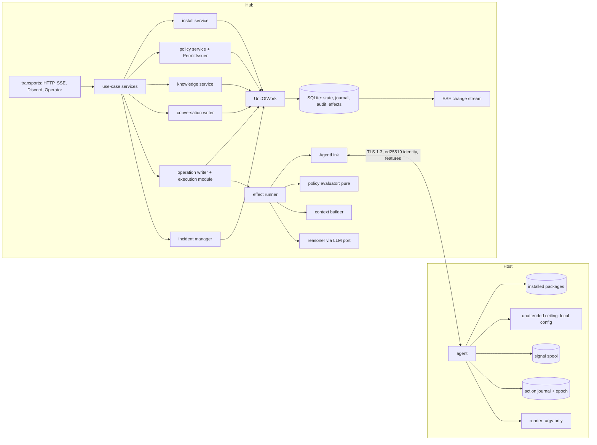
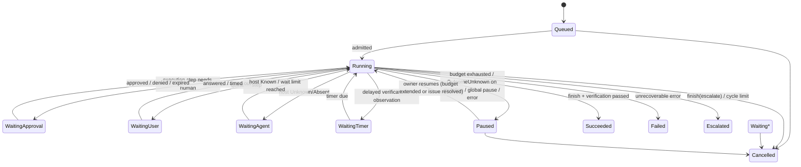
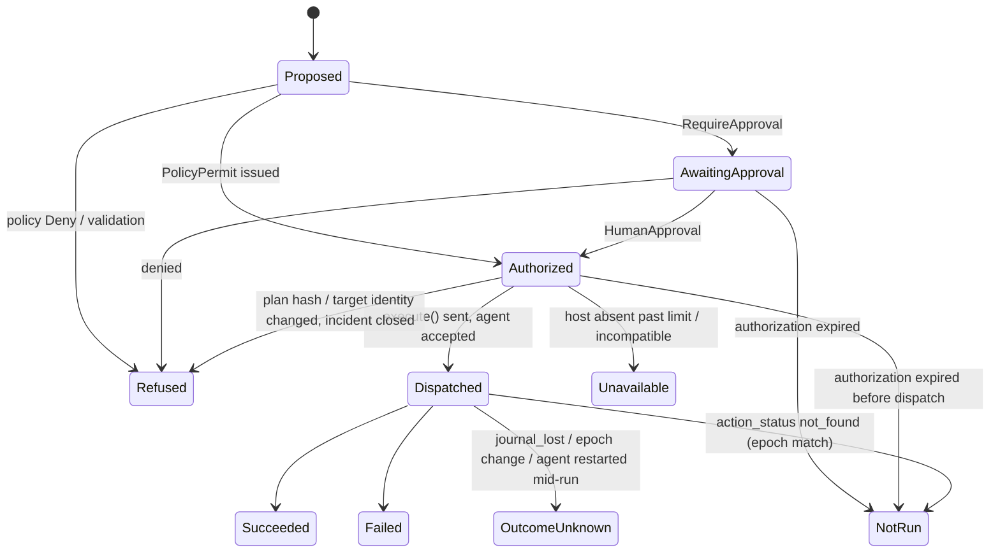

# 04 — Validated target architecture

The technical contract for the rework. Decisions and rationale are in `03` (RW-NN); owner decisions
are D-NN in `99`. Labels: FACT, INFERENCE, PROPOSAL, DECISION, DEFERRED, OPEN. Anything not labelled here
follows its RW entry's label.

## 1. Boundaries and crate placement



| Crate | New responsibilities | Must not |
|---|---|---|
| `domovoi-core` | contract types, `Operation`/`Step`/`Execution` types, `Authorization`, `HumanApproval`, `PolicyPermit`, `Actor`, `TargetRef`, `Open<T>`, ports (`UnitOfWork`, `PermitIssuer`, `ExperienceSearch`, `KnowledgeRead`) | do I/O |
| `domovoi-engine` | pure `decide` functions, plan validator, policy evaluator, context selection; writers and effect runner behind ports | depend on hub; mint `HumanApproval`/`PolicyPermit` |
| `domovoi-store` | `UnitOfWork` SQLite implementation, seq and hash-chain assignment, migrations, FTS | decide transitions |
| `domovoi-proto` | `features`, `run_capability`, `action_status`, `get_catalog`, `install_package`, tolerant decoding | — |
| `domovoi-agent` | journal with epoch, ceiling and mutation limiter, package verification and installation, containment reconciliation; starts skills only through the skill runner and privileged operations only through the helper (RW-39) | accept keys or ceiling from hub; spawn skills itself; hold Docker socket write access |
| `domovoi-runner` | unchanged (only process spawner) | — |
| `domovoi-hub` | transports, use-case services, `auth/` (HumanApproval), `policy/` (PermitIssuer impl), install relay | bypass use-case services |
| `domovoi` (binary) | `domovoi helper serve` (root) and `domovoi skill-runner` (as `domovoi-skill`) subcommands (RW-39; ADR decides whether either needs its own crate); spawn only via `domovoi-runner` | helper: accept other uids, run commands, offer `run_as`; skill runner: accept paths, run as anything but `domovoi-skill` |

No new crates. Dependency edges stay as in ARCHITECTURE.md §4 (FACT: enforced by arch-check).

## 2. Domain model and ownership

| Aggregate / record | Single owner | Persisted in | Notes |
|---|---|---|---|
| Signal | incident manager | `signals` | unchanged |
| Incident | incident manager (ADR 0011) | `incidents` + `version` | timeline events → `journal` |
| Operation | operation writer | `operations` + `version` | coarse status, budgets, pinned subjects, cycle |
| Step (intent) | operation writer | `steps` (immutable columns) + derived `status`; `step_edges` | kinds, outcomes, edges §3.2 |
| Execution detail | operation writer (execution module) | `executions` (1:1 with Execution step) | authorization, plan hash v2, dispatch, result |
| Operation ↔ incident link | operation writer | `operation_incidents` | incident manager reads only |
| Effect (outbox) | written by owning writer, completed by its writer on result | `effects` | §4 |
| Conversation, messages | conversation writer | `conversations`, `messages` | §13 |
| Fact, relation, entity | knowledge service | `facts`, `relations`, `entities` | §10 |
| Resolution summary fields | operation writer only; Knowledge UI sends `EditSummaryField` commands to it | `resolution_summary_fields` + FTS | §10, RW-41 |
| Policy version | policy service | `policy_versions` (immutable rows) | §7 |
| Policy decision | operation writer (as `PolicyDecision` step) | `steps` + `policy_decisions` | §7 |
| Package install job | install service | `install_jobs` | §11 |
| Journal entry | appended by the owning writer of its aggregate | `journal` | §6 |
| Audit entry | appended by the writer making the security-relevant change | `audit_log` (hash-chained) | §6, RW-27 |
| Legacy action | read-only projection | `actions` (unchanged) | RW-32 |

Writers are tokio tasks with a command channel (FACT: pattern of ADR 0011/0019). One task each for
incidents, operations, conversations; knowledge, policy and install services are request/response
services that commit through the same `UnitOfWork` with optimistic versions.

## 3. Operation, Step and Execution

### 3.1 Operation status



- Terminal: `Succeeded, Failed, Escalated, Cancelled`. A new attempt after terminal is a new operation
  with `parent = <old id>`.
- Several waits can be pending at once (e.g. two independent steps); `status` shows the
  highest-priority wait (Approval > User > Agent > Timer) and the step list shows all.
- Cancel: pending effects are cancelled; an execution already `Dispatched` cannot be recalled — it
  is reconciled to its real outcome and recorded.

### 3.2 Step kinds, outcomes and dependencies

- **Kinds:** `ReasoningTurn`, `EvidenceRequest`, `Assessment`, `Plan`, `PolicyDecision`, `Approval`,
  `Execution`, `Verification`, `Notification`, `Question`, `Note`.
- **Fields on each step:** `id` (UUIDv7), `operation_id`, `kind`, phase label, `parent_step_id`
  (grouping only), `cycle`, `created_at`, `intent` (typed JSON, immutable).
- **Execution steps** additionally carry `execution_id` (= step id, RW-36).

**Outcome vocabulary.** This is the single definition. RW-09, the API and the UI use it verbatim.

| Outcome | Use only when |
|---|---|
| Pending | not started |
| Running | started and its owner still holds it (an agent child process, an in-flight model call) |
| Succeeded | ran and reported success |
| Failed | an attempted operation reported failure |
| Refused | rejected before running by validation, policy (`Deny`), the agent (ceiling, `allow_risk`, rate limit, exclusion) or a human deny |
| NotRun | positive evidence it never started (`not_found` with matching epoch), or its authorization or approval expired before dispatch |
| Unavailable | the intended work could not be attempted: host `Absent` past the wait limit, host `Incompatible`, contract not implemented or disabled, evidence source down |
| OutcomeUnknown | it may have run, but the result cannot be established (agent restart mid-run, journal lost, epoch changed) |
| Skipped | intentionally not run (superseded) |
| Cancelled | the operation was cancelled before this step started |

**Dependencies (RW-40).** `step_edges(from_step, to_step, kind)`, directed from dependent to
prerequisite.

| Kind | Meaning |
|---|---|
| `depends_on` | cannot start before `to` finishes |
| `caused_by` | created from the output of `to` |
| `verifies` | Verification → Execution |
| `retry_of` | Execution → earlier Execution |
| `answers` | user reply → Question |

Edges must point to steps already committed in the same operation (checked by the writer), so the
graph is acyclic by construction. Investigation cycles create new steps with `cycle + 1`.

### 3.3 Execution states (derived from step events)



One attempt per Execution step (RW-04). Execution states map to step outcomes; there is no second
status column.

### 3.4 Transaction boundaries (each row = one `UnitOfWork` commit by the named writer)

| Event | Writer | Same transaction |
|---|---|---|
| Operation created from incident | operation writer | `operations` insert, `operation_incidents`, first step, journal `OperationCreated`, effect `BuildContext` |
| Model turn result | operation writer | turn step outcome + usage, new child steps (validated), journal entries, new effects, completion of the `CallModel` effect |
| Policy decision | operation writer | `PolicyDecision` step + `policy_decisions` row, execution state change, audit `PolicyDecided` (incl. shadow), journal |
| Human approval | operation writer (command from use-case service carrying `HumanApproval`) | execution `Authorized`, audit `Approved{actor, plan_hash, session}`, journal, effect `Dispatch` |
| Dispatch accepted | operation writer | execution `Dispatched{agent_epoch, at}`, journal, completion of `Dispatch` effect |
| Execution result | operation writer | execution outcome + bounded output ref, audit `Executed`, journal, effect `Verify` (or timer), operation status change if applicable |
| Verification result | operation writer | verification step outcome, operation status (`Succeeded` or new cycle with `cycle+1` and `BuildContext` effect), resolution summary draft effect on terminal |
| Incident signal | incident manager | signal, incident row (`version` check), journal timeline entry |

Cross-aggregate writes are limited to: operation + its `operation_incidents` links; operation +
effect completions. The incident manager reacts to operation journal entries (e.g. to show "an
operation is working on this") by reading, never by co-writing.

## 4. Orchestration loop, effects, timers, budgets

- `decide(&OperationState, OperationEvent, now) -> Decision { new_state, new_steps, effects,
  journal, audit }` is pure (engine) and property-tested.
- `effects(id, operation_id, kind, payload, status{pending,running,done,cancelled}, not_before,
  attempts, created_seq)`. Kinds: `BuildContext, CallModel, CollectEvidence, EvaluatePolicy,
  IssuePermit, Dispatch, Reconcile, Verify, Notify, Wake, DraftSummary`.
- Effect runner: claims `pending` effects with `not_before <= now` (one claim marks `running` in a
  small commit), performs them, posts the result as an event to the owning writer, which completes
  the effect in the same commit as the state change. On restart, `running` effects revert to
  `pending` except `Dispatch`, which is resolved by reconciliation (§15). Full lifecycle in §4.1.
- Idempotency per effect kind: `CallModel` re-issue is a new attempt (RW-06); `CollectEvidence` is
  read-only; `Dispatch` is idempotent by step id at the agent; `Notify` carries a dedup key
  `(operation_id, step_id, channel)`.
- Timers are `Wake` effects with `not_before`; the scheduler uses the `Clock` port (tests advance
  `FakeClock`). Replaces `recheck.rs` in-memory sleep (FACT `actions/recheck.rs:65`).
### 4.1 Effect lifecycle and delivery (RW-35)

```mermaid
stateDiagram-v2
  [*] --> pending: created in owner's transaction
  pending --> claimed: runner claims (lease_until = now + lease, attempt += 1)
  claimed --> done: owner writer commits result + completion together
  claimed --> pending: retryable failure (not_before = backoff(attempt))
  claimed --> dead: permanent failure or attempt limit
  claimed --> pending: lease expired (new token on next claim; old holder fenced out)
  pending --> cancelled: operation cancelled
  claimed --> cancelled: operation cancelled (result, if any, still recorded)
```



- Columns: `status, claim_token, claim_generation, lease_until, runner_id, attempt, max_attempts,
  not_before, last_error, dedup_key`. Completion, reschedule and dead-letter are conditional on
  `claim_token` and run in the owning writer's transaction; a stale lease holder's commit affects zero
  rows and the whole transaction rolls back (RW-35). Backoff is exponential with a cap; retry classification is per kind (§16 for model
  calls; notifications: 429/5xx/timeouts retry, 4xx permanent).
- `dead` effects raise an advisory and appear on the operation; nothing loops forever.
- Restart: `claimed` → `pending`, except `Dispatch`, which is reconciled.
- **Notifications are at-least-once.** Crash window: the platform accepts the message, the hub
  crashes before committing `done` → the effect is retried → a duplicate message is possible. Remote
  idempotency is used where the platform provides it (Discord `nonce` + `enforce_nonce`, R-4);
  every message carries a short stable id so duplicates are recognisable. Notification state is
  written only after a confirmed success response; a state read error fails the effect (retry), it
  never becomes default state.

- Budgets persisted on the operation (`budgets` JSON with limits and used): model turns, tool calls,
  evidence requests, executions, cycles, wall time, tokens, cost. Shared across cycles. Exceeded →
  `Paused{Budget}` + notification. Defaults configurable (`[orchestration]`).
- No blind retry: a new Execution step with the same (contract, target, args) as a `Failed` or
  `OutcomeUnknown` step in the same operation is refused unless it sets `retry_of` and states what
  changed; it is evaluated by policy afresh. After `OutcomeUnknown`, unattended authorization of the
  same contract+target is blocked until a human resolves or a verification proves state.

## 5. Unit of work contract

```rust
// domovoi-core::ports (sketch; exact names decided in the implementing PR)
pub struct Transaction {
    pub writes: Vec<StateWrite>,          // typed per aggregate, each with expected_version
    pub journal: Vec<JournalDraft>,       // aggregate ref, kind, typed payload, actor
    pub audit: Vec<AuditDraft>,           // actor, action, subject, details
    pub new_effects: Vec<EffectDraft>,
    pub completed_effects: Vec<EffectId>,
}
pub enum CommitError {
    Conflict { aggregate: AggregateRef, expected: u64, actual: u64 },
    Constraint(String),
    Backend(String),
}
pub struct CommitReceipt { pub journal_seqs: Vec<u64>, pub audit_seqs: Vec<u64> }
#[async_trait] pub trait UnitOfWork { async fn commit(&self, tx: Transaction) -> Result<CommitReceipt, CommitError>; }
```

- SQLite: `BEGIN IMMEDIATE` on the single writer connection; apply writes with
  `UPDATE … WHERE id=? AND version=?` (0 rows → `Conflict`, rollback); insert journal rows (seq
  assigned by `AUTOINCREMENT`); compute audit hash from the previous row inside the transaction;
  insert effects; mark completed effects; `COMMIT`. Any error → rollback, nothing visible.
- `Conflict` inside a single-writer aggregate indicates a bug or an external writer: the writer
  reloads the aggregate, records an advisory, and re-decides once; a second conflict fails the command.
- Partial failure is impossible by construction; the caller sees either a receipt or an error.
  After an error the writer's in-memory state is discarded and reloaded from the store.
- `InMemoryStore` implements the same port with one mutex; the existing repo contract-suite pattern
  (FACT: 18 contract suites, F §1) gains a `unit_of_work` suite run against both.
- Notifications/SSE only ever read committed rows (§6).
- Ownership is not enforced by the port; `StateWrite` constructors are `pub(crate)`-style per writer
  module where Rust allows (within the engine) and arch-check scanned otherwise.

## 6. Journal, audit, outbox and SSE

| Store | Purpose | Written | Read by |
|---|---|---|---|
| `journal(seq, aggregate_type, aggregate_id, kind, payload_v, payload, actor, occurred_at)` | operational experience + change stream | owning writer, in its transaction | UI timelines, graph, SSE, experience, simulator |
| `audit_log(seq, prev_hash, hash, actor, action, subject, details, at)` | security record | same transaction as the change | audit page, `audit verify` |
| `effects` | pending side effects | owning writer | effect runner |

- Kinds are a closed Rust enum serialized as stable strings, with `payload_v` for schema evolution;
  readers use `Open<Kind>` so unknown future kinds are shown generically instead of failing.
- Sequence: global, from SQLite `AUTOINCREMENT` inside `BEGIN IMMEDIATE` on the one writer
  connection → commit order. FACT: write pool size 1 (C §2). If that ever changes, seq assignment
  must move to a single sequence table updated in the same transaction.
- SSE: `id: <seq>`. On connect with `Last-Event-ID: n`: if `n < min_retained_seq` send `event:
  reset` and the client refetches snapshots; else stream `seq > n` matching the client's topics
  (`incidents`, `operations`, `operation:<id>`, `hosts`, `approvals`, `conversations:<id>`), then
  tail. Tail: writers broadcast the highest committed seq; each SSE task re-queries from its last
  sent seq (a lagged broadcast loses nothing). Clients dedupe by seq; handlers are idempotent.
- Snapshots: every list/detail endpoint returns `as_of_seq`; the client applies only events with
  `seq > as_of_seq`.
- Ephemeral events (model token streaming, install byte progress) carry no `id` and are never
  replayed; their final state is a journal entry.
- Audit contents: logins and step-ups, approvals/denials (with session and client IP), permits
  issued, refusals by policy or agent, policy/settings/retention/ceiling-observed changes, install,
  enable/disable, pause switch, restores, audit checkpoints.

## 7. Policy

### 7.1 Rules

```text
Rule {
  id, version_id, enabled, shadow: bool,
  locked: bool,                                          // only valid when outcome = Deny (D-26)
  host:       All | Host(HostId)                         // tags after v1 (06 Deferred)
  capability: Any | Effect(EffectClass) | Category(Cat) | Contract(ContractId)
  targets:    Any | Exact(Set<TargetName>)               // names resolved to identities at evaluation (RW-34)
  conditions: [ArgConstraint | TimeWindow | RequiresFact(predicate) | MaxRate | MaxTtl]
  outcome:    Deny | RequireApproval | Allow
  note (owner text)
}
```

### 7.2 Specificity (partial order, no numeric score)

Per dimension, a set-inclusion order:
- **host:** `Host(h) ⊂ All`.
- **capability:** `Contract(c) ⊂ Category(category(c)) ⊂ Effect(effect(c)) ⊂ Any`. The category
  and effect come from the contract; a category belongs to exactly one effect class.
- **targets:** `Exact(S1) ⊂ Exact(S2)` iff `S1 ⊊ S2`, and `Exact(_) ⊂ Any`.

Rule A is **strictly more specific** than B iff A ⊆ B on every dimension and A ⊊ B on at least one.

Conditions do not affect specificity; they decide only whether a rule matches. A rule with an unmet
condition does not match.

Two rules **overlap** iff their scopes intersect on every dimension. Two overlapping rules are
**incomparable** iff neither is a subset of the other.

### 7.3 Evaluation (`evaluate(policy, request, facts, ceiling_summary)`)

1. **Match.** `M` = enabled, non-shadow rules whose scope contains the request and whose conditions
   hold. Shadow rules run through the same algorithm separately; the result is recorded, never
   enforced.
2. **Locked Deny (D-26).** If any rule in `M` is a locked Deny, the outcome is `Deny`, with reason
   `LockedDeny`.
   - Every matching locked rule is listed. Several locked rules are one `Deny` with several reasons.
   - Ordinary resolution (steps 3–6) is still computed and recorded as `would_have_been`, so the
     UI can show what the lock overrides.
   - Go to step 7.
3. **Default.** If `M` is empty, the outcome is the default for the effect class:

   | Effect class | Default |
   |---|---|
   | `Read` | `Allow` (budgeted) |
   | `Mutate` | `RequireApproval` |
   | `Contain` | `RequireApproval` |
   | `Destructive` | `RequireApproval` + typed confirmation |

4. **Winners.** `W` = maximal elements of `M` (rules not strictly dominated by another rule in `M`).
5. **One outcome.** If all of `W` have the same outcome, that is the result. For `Allow`,
   constraints combine by **intersection**: the minimum rate and TTL, the intersection of target
   sets, and the conjunction of conditions.
6. **Mixed outcomes.** Otherwise:
   - equal scopes → `Deny` (D-05);
   - incomparable → `Deny` if any `Deny` is in `W`, else `RequireApproval` (D-19).
7. **Hard limits.** Applied in order; each applied limit is recorded in the trace:
   - outcome `Allow` and effect `Destructive` → `RequireApproval` (D-06);
   - outcome `Allow` and resolved target ∉ pinned subjects ∪ the winning rules' `Exact` targets →
     `RequireApproval` (D-07);
   - outcome `Allow` and any safety-critical fact the contract declares is unknown, stale or
     disputed → `RequireApproval`;
   - outcome `Allow` and the last reported host ceiling does not cover contract + target + args +
     rate + TTL → `RequireApproval`;
   - effect `Contain` and the host's management paths are not confirmed and current (D-28) →
     `RequireApproval` for unattended; human approval is still possible unless the next limit
     applies;
   - containment target matches a mandatory exclusion → `Deny`. This holds for humans as well, and
     the agent enforces it independently;
   - autonomy paused, or the rule is circuit-broken → `RequireApproval`.
   - outcome `Allow` and the host's agent runs as root (`hello.runs_as_root`, D-29 not in effect) →
     `RequireApproval`.

**Outcome meaning (D-23).**
- `Allow`: unattended; a permit is issued.
- `RequireApproval`: offered to the owner.
- `Deny`: not offered. The owner must change the policy. There is no bypass.

**Order independence.** Steps 1–6 are set operations; rule order and ids play no part.

### 7.4 Decision table

Request unless stated: host = `media`, contract = `container.restart` (category
`container.lifecycle`, effect `Mutate`), target = `plex`, pinned subject = `plex`.

| # | Matching rules (host / capability / targets → outcome) | Result | Why |
|---|---|---|---|
| 1 | none | RequireApproval | default for Mutate |
| 2 | All / container.restart / Any → Deny | Deny | single rule |
| 3 | #2 + media / container.restart / {plex} → Allow | Allow | rule 2 strictly more specific (host, targets) |
| 4 | #3 but target = radarr | Deny | only the broad Deny matches |
| 5 | #3 but host = other | Deny | exception is host-scoped |
| 6 | media / container.restart / {plex} → Allow and → Deny | Deny | equal scope (D-05) |
| 7 | All / container.restart / {plex} → Allow; media / Category(container.lifecycle) / Any → Deny | Deny | incomparable (D-19) |
| 7b | as 7, second rule → RequireApproval | RequireApproval | incomparable (D-19) |
| 8 | All / Effect(Mutate) / Any → Allow; media / container.restart / Any → RequireApproval | RequireApproval | second strictly more specific |
| 9 | media / container.restart / {plex, jellyfin} → Allow 3/h; media / container.restart / {plex} → Allow 1/h | Allow 1/h | second strictly more specific |
| 10 | two rules media / container.restart / {plex} → Allow, 3/h and 2/h | Allow 2/h | equal scope, intersection |
| 11 | All / Any / Any → Allow; contract effect Destructive | RequireApproval + typed confirmation | hard limit D-06 |
| 12 | #3, ceiling lacks container.restart for plex | RequireApproval | hard limit: ceiling |
| 13 | #3, target postgres | Deny | exception doesn't match; broad Deny applies |
| 13b | media / container.restart / Any → Allow; target postgres not pinned | RequireApproval | hard limit D-07 |
| 14 | media / Effect(Contain) / Any → Allow; `firewall.block_source` target in exclusions | Deny | mandatory exclusion |
| 14b | as 14, target allowed, management paths stale | RequireApproval | hard limit D-28 |
| 15 | media / container.restart / {plex} → Allow with RequiresFact(not_in_maintenance); fact unknown | rule doesn't match → broader rules or default | unknown ≠ true |
| 16 | All / container.restart / Any → **locked** Deny; media / container.restart / {plex} → Allow | Deny (LockedDeny) | locked Deny beats specificity (D-26) |
| 17 | two locked Denies match | Deny with both reasons | one result, several reasons |
| 18 | shadow-only rule media / container.restart / {plex} → Allow, no other rule | RequireApproval (enforced); shadow result Allow recorded | shadow never enforced |

### 7.5 Trace

```text
Decision {
  outcome,
  reason: Default | SingleWinner | EqualScopeDeny | IncomparableFallback | LockedDeny,
  matched: [rule],
  winners: [rule_id],
  locked: [rule_id],
  overridden: [(broader_rule, by_rule)],
  would_have_been,
  constraints,
  hard_limits_applied: [..],
  policy_version,
  ceiling_hash,
  facts_used: [(fact_id, status)],
}
```

The trace is persisted for every mutating or containing step, enforced or shadow. The UI shows:
- every matching rule;
- the winners, and why they won;
- the overridden broader rules, with a specific Allow over a broad Deny highlighted as a dangerous
  exception;
- locked Denies, styled as a prohibition and distinct from an ordinary Deny;
- hard limits in a separate block.

### 7.6 Publication validation and simulator

- **Publishing a policy version runs a validation report** using the production evaluator's own
  helpers:
  - each pair of equal-scope rules with different outcomes (resolves to Deny, D-05);
  - each pair of overlapping incomparable rules with different outcomes, with its resolution
    (D-19);
  - each enabled rule made ineffective by a locked Deny;
  - each `Allow` that names a target outside every host's ceiling, as an informational note.

  The owner must acknowledge each conflict to publish. Publishing needs step-up authentication. A
  version that changes any locked rule also shows a simulation of the affected historical decisions.
- `simulate(policy_version_or_draft, requests | historical_operation_ids) -> [Decision]` calls the
  same `evaluate`.
  - For history, it uses the facts, pinned subjects and ceiling hash recorded at the time; for
    what-if, current values.
  - No effects.
  - Each result is shown with a diff against the decision actually taken.

### 7.7 Required tests (engine, table + property)

- `specific_allow_overrides_broader_deny`
- `broader_deny_applies_without_exception`
- `equal_scope_deny_wins`
- `incomparable_conflict_falls_back_to_deny`
- `incomparable_allow_vs_approval_requires_approval`
- `evaluation_is_order_independent` (proptest over permutations)
- `equal_scope_allows_intersect_constraints`
- `no_match_uses_effect_default`
- `locked_deny_beats_narrower_allow`
- `multiple_locked_denies_one_deny_all_reasons`
- `locked_flag_ignored_unless_deny` (validation error)
- `destructive_never_allowed`
- `ceiling_caps_allow`
- `unknown_safety_fact_never_allows`
- `model_target_cannot_widen_scope`
- `containment_exclusion_denies_even_with_allow`
- `containment_requires_confirmed_management_paths`
- `shadow_rules_never_enforced`
- `deny_is_not_offered_for_approval`
- `publish_reports_incomparable_conflicts`
- `publish_reports_equal_scope_conflicts`
- `simulator_matches_live_evaluator` (proptest: same inputs, same decision)

## 8. Authorization and local enforcement

### 8.1 Types (RW-11)

| Type | Crate | Fields | Constructed by | Restored by |
|---|---|---|---|---|
| `HumanApproval` | core | `user`, `channel` (`Web{typed_confirmation}` or `Chat{platform, platform_user}`), `at` — unchanged | `hub/src/auth/` after session + CSRF or chat allowlist check | `store/src/` |
| `PolicyPermit` | core | `decision_id`, `rule_ids`, `policy_version`, `plan_hash`, `issued_at`, `expires_at`, `ceiling_hash` | `hub/src/policy/` via `PermitIssuer` port | `store/src/` |
| `Authorization` | core | `Human(HumanApproval) \| Policy(PolicyPermit)` | from the above | store |
| `AuthorizedExecution` | engine (operation writer) | step + authorization | `execute()` precondition | never persisted |

**Execution detail columns.**
- `plan_hash_v2`, `authorization_kind`, `expires_at`.
- Approval columns (existing), plus `approved_plan_hash`, `approval_session_ref` and
  `approval_client`.
- Or, for policy authorization, the permit columns.

**Approve API by stage (RW-11).**
- F4: the existing action approve endpoint gains `plan_hash` (v1); the action writer refuses on
  mismatch. v1 does not bind entry-script bytes or target identity.
- M1: same endpoint, v2 hash and binding columns.
- M3: `POST /operations/{id}/steps/{step}/approve { plan_hash, typed_confirmation? }`; the writer
  refuses unless `plan_hash == plan_hash_v2`.

Dispatch always recomputes the hash for its version (RW-34 for v2 target resolution).

**Enforcement.** CI controls, not runtime:
- clippy `disallowed-methods`;
- an arch rule on the `expect` attribute;
- the existing text scan;
- testkit is dev-only.

**Gates.**
- Kept: `no_approval_without_human`.
- Added: `no_permit_without_policy_allow`, `single_execution_boundary`,
  `destructive_never_allowed_by_policy`, `model_meta_tools_are_closed`,
  `approval_bound_to_displayed_plan_hash`, `changed_target_invalidates_approval`.

### 8.2 Wire

```text
run_capability {
  execution_id, contract, version,
  target (canonical identity), args, plan_hash,
  authorization_kind: human | policy,
  expires_at,
}
```

`authorization_kind` and `expires_at` are labels from the hub. The agent applies its own rules to
them; they prove nothing.

### 8.3 Host-local configuration: ceiling, limiter, helper allowlist and safety set

Configuration lives in two places, with distinct owners and purposes:

| File | Owner and mode | Read by | Holds |
|---|---|---|---|
| `/etc/domovoi/agent.toml` | root, 0644 | agent; the helper only for `hub.url` | `[unattended]` ceiling (D-03, D-18) and `[mutation_limits]` (D-27), plus existing agent settings |
| `/etc/domovoi/helper.toml` | root, 0600 | helper only; the agent sees the effective safety set via `safety.read` | enabled operation groups and allowlists (D-29), `[safety]` exclusions and containment limits (RW-37, the single authoritative source), helper limits |

**Agent ceiling and limiter (`agent.toml`).**

```toml
[unattended]
enabled = true

[[unattended.allow]]
capability = "container.restart"     # exact contract id
targets = ["plex", "jellyfin"]       # explicit; "*" must be written explicitly
max_per_hour = 3

[[unattended.allow]]
capability = "firewall.block_source"
targets = ["*"]                       # source addresses come from detector signals
max_per_hour = 20
max_active = 50                       # may be narrower than the helper's [safety] limit, never wider in effect
max_ttl = "1h"
args = { min_prefix_len_v4 = 24, min_prefix_len_v6 = 64 }   # only keys the contract declares constrainable

[mutation_limits]                     # D-27, all mutating executions
per_hour = 30
per_capability = { "container.restart" = 6 }
```

**Helper allowlist: fresh-install default.** Written by the installer. Only reads are enabled; no
privileged write is possible.

```toml
# /etc/domovoi/helper.toml (fresh install)
groups = ["docker.read", "smart.read", "kernel.read", "net.read", "safety.read"]

[smart]
devices = ["/dev/sd[a-z]", "/dev/nvme[0-9]n1"]

[safety]
management_cidrs = []                 # empty: containment refused until the owner fills this (D-28)
protected_units = ["sshd.service", "domovoi-agent.service", "domovoi-helper.socket", "domovoi-skill-runner.socket"]
protected_containers = []

[safety.containment]
max_ttl = "1h"
max_active = 0                        # 0: no containment possible

[limits]
timeout = "30s"
mutations_per_hour = 0
```

**Helper allowlist: owner-configured host.** The owner edits this file. The write groups take effect
only once their milestone prerequisites are met (M8 and M9) and the agent-side ceiling and policy also
allow the operation.

```toml
# /etc/domovoi/helper.toml (owner-configured example)
groups = ["docker.read", "docker.write", "systemd.write", "nft", "smart.read", "kernel.read", "net.read", "safety.read"]

[docker]
write_containers = ["plex"]           # resolved to container ids by the helper

[systemd]
restart_units = ["plex.service"]

[nft]
table = "domovoi"
max_elements = 1000

[smart]
devices = ["/dev/sd[a-z]", "/dev/nvme[0-9]n1"]

[safety]
management_cidrs = ["192.168.1.0/24", "100.64.0.0/10"]
protected_units = ["sshd.service", "domovoi-agent.service", "domovoi-helper.socket", "domovoi-skill-runner.socket", "systemd-networkd.service", "nftables.service"]
protected_containers = []

[safety.containment]
max_ttl = "24h"
max_active = 50

[limits]
timeout = "30s"
mutations_per_hour = 30
```

The helper never allows a protected unit or container as a write target, whatever the allowlist
says. The installer's defaults for `protected_units` cannot be removed: the helper unions them with
the file.

**`policy`-labelled requests.** The agent checks, in order:
1. `[unattended].enabled`;
2. an entry for the exact contract exists;
3. the target is in `targets`;
4. each constrained argument is in bounds;
5. the entry's `max_per_hour`, counted from the journal;
6. the common checks below.

**Every mutating request (either label).** The agent checks the local catalogue, manifest and plan
hash, the arguments, `allow_risk` and `[mutation_limits]`.

**Privileged operations.** After the agent's checks, every privileged operation is checked again by
the helper against `helper.toml`, the effective safety set (RW-37) and the helper limits. The helper
does not see or verify approval or policy (RW-39).

**Config errors.** Unknown keys are startup errors, as are Contain entries without the required caps.

**Reporting.** The agent sends `ceiling_hash` and a summary, plus `exclusions_hash` and
`exclusions_summary` as returned by `safety.read`, in `hello` and again on any change.

**Refusals.** The agent journals them locally and returns `refused{code}`; the helper's refusals carry
their own codes.

### 8.4 Threat model by attacker capability

Assumes D-29 is in effect: control agent as `domovoi-agent`, skills as `domovoi-skill` via the skill runner, root helper installed (RW-39). On installs where the agent still runs as root, none of the process boundaries apply and the UI labels such hosts.

| Attacker can | They can then | Limited by (guarantee) | Not limited by |
|---|---|---|---|
| Inject text into logs, notes, webhooks | influence model reasoning and proposals | closed meta-tools (no approve/execute); target resolution and pinning; containment only from detector signals; structured approval cards show real plan | — |
| Steal the owner's browser session | approve offered steps, edit non-sensitive settings | step-up for policy publish, locked rules, enable, install, retention, LLM CLI; approvals bound to the displayed plan hash; Deny not offerable | approval of already-offered RequireApproval steps |
| Misconfigure policy (owner error) | allow more than intended | hard limits; host ceiling; shadow first; circuit breaker; pause; publish validation | — |
| Write to `hub.db` | forge approvals or permits, edit audit | agent ceiling for `policy` runs; agent `allow_risk`, catalogue and rate limiter for all runs; audit chain detects edits that don't recompute it | forged `human` approvals within `allow_risk` and rate limits |
| Run code as the hub process | send any request with any label | agent catalogue, manifest, args, `allow_risk`, mutation rate limiter (all runs); ceiling (`policy` runs only); trusted package keys (installs); agent runs unprivileged and privileged operations are bounded by the root-owned helper allowlist (D-29) | labelling a request `human` to bypass the ceiling — **accepted v1 limitation**; owner-signed approvals are deferred (`06`) |
| Run code as a skill (malicious or compromised package) | anything `domovoi-skill` can do: outbound network, world-readable files | no access to the helper socket, the skill-runner socket, agent state, agent key or `/etc/domovoi/*`; package files read-only; no supplementary groups, no new privileges (RW-39) | `domovoi-skill`'s own reach on that host |
| Run code as the control agent (`domovoi-agent`) | call the helper directly; dispatch skills; read agent state | helper allowlist, protected targets, effective safety set, containment and mutation limits (helper-enforced); other hosts unaffected | approval and policy: the helper cannot verify them, so a compromised control agent can perform any allowlisted privileged operation within helper limits (**residual risk**; verifiable owner-signed approvals DEFERRED) |
| Gain root on a host | everything on that host | nothing in Domovoi | — |

## 9. Containment (M9)

### 9.1 v1 capability: `firewall.block_source` (D-17)

| Aspect | Specification |
|---|---|
| Threat | brute force or scanning from an external source |
| Target | `ipnet:{canonical}` from a detector signal's structured field; prefix ≥ ceiling minimum; equals the pinned subject |
| Privileges | root-owned helper `nft` group (RW-39), limited to set elements in table `inet domovoi`; no other table touched; exclusions re-checked in the helper |
| Management protection | D-28 facts confirmed and current and covered by the helper's effective safety set (RW-37: `[safety]` CIDRs, hub address resolved from root-owned config, kernel-observed link peer, loopback, link-local); the helper refuses any overlapping target and refuses everything if a safety element cannot be established |
| Expiry | nftables set element `timeout` = TTL (≤ `max_ttl`). Kernel-enforced, so it does not depend on the agent, the hub or the helper process |
| Watchdog (D-22) | built into the two-step apply below: the first element carries a 30 s kernel timeout, so if the hub never confirms reachability the block disappears by itself, whether or not the agent, helper or hub survives |
| Apply semantics | step 1: element added with a 30 s timeout; step 2: on hub confirmation, `replace_ttl` = `delete element` + `add element … timeout <TTL>` in **one** `nft -f` transaction (atomic netlink batch, so the element is never absent); if the element already expired, the transaction fails and the helper reports `expired` (no silent re-add). `add element` on an existing element is not relied on to refresh its timeout. Exact behaviour per supported nftables version is verified in R-2 |
| Rollback | `del element` (idempotent; absent = success) |
| Postcondition | element present with remaining timeout > 0; hub → agent round trip still works |
| Outcome unknown | read set membership via helper `list`; present → treat as applied; absent → `NotRun` only if the journal proves no apply, else `OutcomeUnknown` |
| Agent restart | agent lists elements, reconciles with journal, reports active containments; kernel timeouts continue regardless |
| Hub crash | elements expire on their own; on restart the hub reconciles via `action_status` and the active list |
| Partial application | element added but not confirmed → expires in ≤ 30 s |
| Drills | expiry on time with agent stopped; excluded address refused; hub unreachable during the confirmation window → block gone ≤ 30 s; agent restart mid-TTL; duplicate dispatch idempotent; `max_active` reached → refused |

**Not production-ready until R-2 is complete** (table/hook placement, packet path, coexistence with firewalld/ufw/Docker, set limits, atomic replacement). The expiry mechanism itself relies only on nftables set timeouts.

### 9.2 General rules for any v1 `Contain` capability

- Triggered only from a deterministic detector signal naming the target.
- Target equals the pinned subject.
- TTL mandatory.
- Expiry independent of the main agent (D-22).
- Watchdog for connectivity effects.
- Management paths confirmed (D-28).
- Mandatory local exclusions.
- Journaled apply and rollback.
- Reconciliation on reconnect.
- Drills pass before any rule may leave shadow mode.

### 9.3 Deferred candidates (D-17): acceptance checklist before reconsideration

`container.pause` (pause one container) and `unit.stop_temporary` (stop one unit) are deferred. Their
only expiry today would be an agent timer re-armed after agent restart. That timer is not reliable
automatic expiry: if the agent is down, the container stays paused or the unit stays stopped.

Each may be reconsidered (earliest v1.x) only when all of the following hold:
1. Expiry is independent of the main agent: a fixed, typed helper operation whose only effect is
   to reverse that specific containment at expiry (for example a helper-owned timer persisted in
   root-owned helper state), designed in a new helper ADR, proven on every supported platform. The
   helper never offers generic `systemd-run`, `run_as` or command execution.
2. Recovery after a hub crash.
3. Recovery after an agent crash or host reboot (a paused container after reboot; unit state after
   reboot).
4. Recovery after partial application.
5. Idempotent apply and rollback.
6. State verification.
7. Outcome-unknown behaviour.
8. Management-path protection (protected units and containers that cannot be emptied).
9. Drills for each failure.
10. A helper ADR (RW-39) covers the operations.

Other candidates (container network isolation, SSH session termination, account lock): deferred for
weaker recovery or lockout stories; the same checklist applies.

## 10. Knowledge and experience

- **Inventory ownership.** Baselines own observed containers/units/ports (FACT). Facts reference
  them via `TargetRef`; they never store copies.
- `entities(id, kind, name, created_by, created_at)` — user-defined subjects only.
- `facts(id, subject_ref, predicate, value, source{user|discovered|integration|inferred|imported},
  status{current|stale|disputed|superseded|retracted}, observed_at, valid_until, last_verified_at,
  supersedes_id, evidence_ref, actor, created_at)`. Predicates: closed enum with value schema
  (initial: role, criticality, owner_note, depends_on-ref, management_path, maintenance_window,
  backup_location, never_restart, trusted_cidr).
- `relations(id, from_ref, kind{depends_on, runs_on, routes_to, stores_on, backs_up_to,
  managed_from}, to_ref, source, status, observed_at)`.
- Freshness: each predicate has a staleness period; past it, status becomes `stale` (computed on read
  and by a daily job). Safety-critical predicates (`trusted_cidr`, `management_path`) used by policy
  hard limits must be `current` and `user`-sourced.
- Conflicts: different values from different sources → both `disputed` until the owner chooses.
  `inferred` never becomes `user` without an explicit owner action.
- Retraction: row status `retracted`, value cleared after the tombstone period, FTS row removed in the
  same transaction.
- **Resolution summaries (RW-41).** `resolution_summary_fields(operation_id, field, revision, value,
  source{code|model|user}, actor, created_at)`, append-only. Code-owned fields (`outcome`, `verified`,
  `subjects`, `contracts_executed`, `hosts`) accept only `source=code`; narrative fields (`problem`,
  `cause`, `fix`) take `model` drafts and `user` edits/confirmations. FTS indexes current narrative.
  Created by the code at terminal state plus a `DraftSummary` effect for the narrative. All revisions,
  including owner edits from the Knowledge UI, are committed by the operation writer (RW-41).
- **Experience search.** `search_experience(query, scope)`: FTS over summaries + journal kinds,
  filtered to operation hosts unless the owner's conversation is global; returns ≤ 5 items with
  operation id, date, verified flag, source, ≤ 1 KiB each. Context builder places them in a block
  titled "Historical evidence — not authorization".
- **Model context.** Facts and summaries sent to the model carry source and status; `disputed` and
  `stale` are labelled; retracted never sent.

## 11. Capability registry and installation

### 11.1 Registry

Availability per (host, contract): `Available | NotInstalled | DisabledByHub | NotAllowedOnHost
(allow_risk/ceiling) | Unavailable(reason) | HostUnknown | HostAbsent | HostIncompatible(protocol)`.
Computed from contracts × agent catalogue (by hash, paged) × hub enable state × ceiling summary.

### 11.2 Package lifecycle (D-11, D-16)

```mermaid
stateDiagram-v2
  [*] --> Discovered: first-party signed index, or owner import (UI upload / domovoi package import)
  Discovered --> Relaying: owner requests install (step-up); hub checked digest
  Relaying --> Verifying: agent received archive + detached signature into staging (not extracted)
  Verifying --> Rejected: limits, unknown/revoked key, bad signature, digest/identity/compat mismatch
  Verifying --> Extracting: all checks passed
  Extracting --> Rejected: link, traversal, absolute path, duplicate path, limit exceeded
  Extracting --> Installed: atomic rename staging → packages_dir/<pkg>/<version>; record signer key_id
  Installed --> Enabled: owner enables in hub (separate action, step-up)
  Enabled --> Installed: disabled
  Installed --> Uninstalling
  Uninstalling --> [*]
```



**Sources (RW-26).**
- **First-party:** a signed index at the configured URL.
- **Owner-signed:** manual import. Upload the archive and signature in the Capability Center, or run
  `domovoi package import <archive> <sig>` on the hub; files are kept in the hub's package store.

There is no other discovery in v1.

**Artifacts.**
- `<name>-<version>.tar.zst`.
- A detached `<name>-<version>.sig.toml`, with these fields:

  ```toml
  format = 1
  algorithm = "ed25519"
  key_id = "a1b2c3d4e5f60718"          # first 16 hex of SHA-256 of the public key
  package = "nginx-tools"
  version = "1.2.0"
  archive_sha256 = "9f86d081884c7d659a2feaa0c55ad015a3bf4f1b2b0b822cd15d6c15b0f00a08"
  signature = "base64-ed25519-signature"
  ```

**Signing message.** `"domovoi-package-v1\n{package}\n{version}\n{archive_sha256}\n{key_id}\n"`.

**Limits** (agent config `[packages.limits]`, defaults shown):

| Limit | Default |
|---|---|
| compressed size | 20 MiB |
| uncompressed total | 100 MiB |
| per-file size | 20 MiB |
| entry count | 2 000 |
| path depth | 8 |
| path length | 255 bytes |
| extraction time | 60 s |
| staging space | 2× uncompressed limit, else refused |

- Script execution time and output size are not package limits. They come from each skill
  manifest's existing timeout and output limit, capped by the agent's maximum.

**Verification order.** Nothing is extracted before steps 1–5 pass.
1. `allow_install = true`.
2. Compressed size within limit.
3. `key_id` trusted and not revoked.
4. Signature valid over the signing message.
5. Archive SHA-256 equals `archive_sha256`.
6. `package.toml` (read by streaming the tar entry, nothing written) matches the signed
   `package` and `version`; compatibility (agent protocol, platform, contract versions).
7. Extraction into a staging directory under `packages_dir`, owned by `domovoi-agent`, with all limits enforced. Reject:
   - absolute paths, `..` components, and duplicate paths;
   - symlinks, hardlinks and device or FIFO entries (any link type is rejected; v1 packages
     contain only regular files and directories);
   - anything outside `<pkg>/`.
8. Atomic rename.
9. Record `key_id`, archive digest and install time in `packages_dir/.packages.toml` (agent) and in
   the hub's install record.

**Local keys.** Agent config, owner-edited; this example validates as TOML:

```toml
[packages]
allow_install = false
revoked = ["e5f6a7b8c9d0e1f2"]

[[packages.trusted_keys]]
id = "a1b2c3d4e5f60718"
public_key = "base64-ed25519-public-key"
label = "Domovoi release"

[[packages.trusted_keys]]
id = "c3d4e5f60718a9b0"
public_key = "base64-ed25519-public-key"
label = "Owner"
```

- **Add, remove or rotate a key:** edit the file and reload (SIGHUP or restart).
- **Unknown key:** rejected.
- **Revoked or removed key:**
  - new installs signed by it are refused;
  - installed packages whose recorded `key_id` matches are disabled by the agent (refused at
    execution) and reported "signed by untrusted key";
  - they stay disabled until re-signed by a trusted key or removed.
- **Hub authority:** none over keys. It sees `key_id`s only.

**Rollback and update.**
- Any install, including a rollback, passes full verification against the keys trusted now.
- Having been installed before grants nothing.

**Privileges (D-29, RW-39).**
- Packages are written only under `packages_dir/<pkg>/` (default `/var/lib/domovoi-packages`), owned by
  `domovoi-agent` and read-only to `domovoi-skill`.
- They execute only through the skill runner as `domovoi-skill`.
- The helper binary, the helper and skill-runner units and `/etc/domovoi/*` are root-owned, so neither
  user can write them. The installer also refuses targets outside `packages_dir`.
- Signing grants execution as `domovoi-skill`, never root and never the control agent.

**Hub role.**
- Store, relay over `transfer_*` (wire 1.2), track install jobs.
- One job per host, per-host progress, partial success per host, retry per host, uninstall.

**Audit.** requested, relayed, verified, rejected (reason), installed, enabled, disabled,
uninstalled, key-untrusted detected.

**Threat model.**
- A malicious hub can offer packages or withhold installs; it cannot install unsigned or
  foreign-signed code.
- An owner-signed package is as trusted as files the owner places on the host, and it runs as
  `domovoi-skill` without access to the helper or agent state.
- A first-party key compromise affects hosts that trust that key; revocation is a local edit per host.

**Tests:**
- `agent_rejects_untrusted_signature`
- `agent_rejects_digest_mismatch_before_extracting`
- `agent_rejects_path_escape`
- `agent_rejects_links_in_archive`
- `agent_enforces_archive_limits`
- `hub_cannot_add_trusted_key`
- `rollback_requires_current_trust`
- `revoked_key_disables_installed_package`
- `package_install_cannot_write_helper_paths`
- `install_never_enables`
- `install_refused_when_allow_install_false`
- `owner_import_requires_trusted_owner_key`
- `partial_install_reports_per_host`

## 12. Protocol (RW-17, RW-42, D-20)

**Compatibility.** The hub accepts an agent only when `agent.protocol.major == hub.major` and
`agent.protocol.minor == hub.minor`. Patch releases with the same protocol version interoperate.
There is no window, no adapter and no release-number floor (`MIN_AGENT_VERSION`/`MIN_HUB_VERSION`
are removed in F3).

**Handshake order (hub):**
1. `hello`;
2. agent lookup (`UnknownAgent` / `Revoked`, not persisted);
3. challenge;
4. signature verification with the enrolled key;
5. exact protocol comparison;
6. on mismatch, a unit-of-work commit of `agents.reported_protocol`, `reported_release`,
   `last_authenticated_at`, `incompatible_since` + an audit entry (only when values change);
7. `reject{Incompatible{hub}}` (existing variant, final on all released agents).

Nothing is persisted for unauthenticated clients.

**State after restart.** The UI derives `Incompatible` from the `agents` row: the last authenticated
`reported_protocol` differs from the hub's. After a hub upgrade, hosts that have not reconnected show
"expected incompatible (last reported 1.1, hub 1.2)". Operations targeting them get
`Unavailable(agent_incompatible)`.

**Agent behaviour on `Incompatible`** (from F3's agent release onward):
- the process stays up in an idle incompatible state, with no reconnects;
- it logs on entry and hourly;
- `domovoi agent status` shows it;
- upgrading and restarting ends the state.

Agents released before F3 exit and are restarted by systemd every 5 s until upgraded. The hub writes
only on change and rate-limits its logs.

**Upgrade procedure** (book, UI banner, release notes):
1. upgrade the hub;
2. upgrade each agent through the supported install path;
3. watch the Hosts page until no host is `Incompatible`.

**Wire versions (RW-42).**
- **1.1:** current, unchanged through F1–F4.
- **1.2:** introduced in M1, freezing the v1 wire contract (complete list in RW-42).
- No later bump is planned. Any unavoidable one is a recorded, coordinated 1.3 upgrade.

**Decoding.**
- `Open<T>` for data enums whose values can come from skills or packages.
- `unsupported{type}` reply for unknown message types; the session continues.
- Golden frames are committed for 1.1 and 1.2.

**Tests:**
- `older_minor_agent_rejected_with_reason`
- `newer_minor_agent_rejected_with_reason`
- `same_protocol_different_patch_releases_communicate`
- `unauthenticated_hello_does_not_persist_incompatibility`
- `incompatible_state_survives_hub_restart`
- `incompatible_agent_idles_without_reconnecting`
- `release_floor_no_longer_rejects`
- `unknown_enum_value_preserved`
- `unsupported_message_does_not_end_session`

## 13. Frontend

- Live layer: SSE §6 with `as_of_seq` snapshots; `QueryBoundary` shows stale/refreshing/partial
  states (FACT: today refresh errors are dropped, B §4).
- Shell: nav Operations, Incidents, Infrastructure, Capabilities, Knowledge, Policies, System;
  attention centre; right-slot rule (wide: Operator and inspector side by side; narrow: last opened
  wins, other becomes a tab).
- Operation detail: header (goal, status, waiting-for, budgets, pinned subjects); graph canvas
  (primary, lazy chunk) and step tree/timeline (accessible outline, same data); inspector.
- Trace schema: `{operation, steps[{id, parent, kind, phase, cycle, outcome, started_at, ended_at,
  summary, refs}], edges[{from, to, kind}]}` (§3.2); parent = grouping, edges = graph; timeline and
  graph render from this one contract frozen with golden fixtures shared by
  Rust tests and `web/src/test/fixtures`.
- Profiles: category per element (P0 safety/approval/audit/current state, P1 primary, P2 technical,
  P3 metadata); mapping Detailed/Standard/Essential per `16` UI doc; `useVisibility(category)` primitive;
  server-stored preferences (single owner); test asserts every P0 element renders in every profile.
- Structured approval card; effective-policy explanation (§7.5); host ceiling read-only view;
  capability install wizard (§11.2); similar past operations; audit page with chain status; retention
  settings.
- Motion: micro 120/180 ms; visualization/transition 240–400 ms, max 600 ms; reduced motion →
  instant, state still visible (D-12, `web/DESIGN.md`).
- Graph library: spike required (CSP, inline-style rule, bundle chunk budget); outcome becomes a
  DESIGN.md amendment.

## 14. Retention and deletion (D-09, D-21)

| Data | Class | Default | Pruning effect |
|---|---|---|---|
| signals | raw | 30 d | rows deleted |
| incident timeline (journal, aggregate=incident) | raw | 90 d | journal rows deleted; incident row and summary kept |
| operations, steps, step edges | structure | kept with operation | graph and timeline reconstructable |
| operation journal events | raw | 180 d | event payloads deleted; steps keep outcome and summary |
| raw execution outputs | raw | 30 d | blob deleted; step shows "output expired" |
| resolution summaries (field revisions) | summary | retained | — |
| audit | security | retained | only via chained checkpoint (RW-27) |
| facts and relations | knowledge | until retracted | retracted content purged after 30 d, tombstone kept |
| conversations | raw | 180 d | messages deleted; operation links kept |
| notifications and notification state | raw | 30 d | rows deleted |
| nightly backups | copies | 7 | file rotation |
| pre-migrate backups | copies | last 3 | file rotation |

**Rules.**
- Pruning deletes FTS rows in the same transaction.
- Journal pruning raises `min_retained_seq`; SSE clients behind it get `reset`.
- Audit pruning writes a chained checkpoint.

**What deletion guarantees.** The data is gone from the live database, FTS and model context at
commit. It remains in backups until they rotate: up to 7 nightly backups plus the last 3
pre-migrate copies. The UI's retention settings and the book state this. Restoring a backup brings
the deleted data back.

## 15. Recovery

### 15.1 Startup and reconciliation

Startup order: RW-30. Reconciliation per host on `hello`:

| Execution state at start | Action |
|---|---|
| Dispatched, agent epoch matches | `action_status` → see 15.2 |
| Dispatched, agent epoch differs | OutcomeUnknown |
| Dispatched, host `Incompatible` | stays Dispatched ("awaiting compatible agent"); OutcomeUnknown once the agent reconnects with a different epoch |
| Authorized, not dispatched | freshness check (expiry, incident open, plan hash with current registry and target identity) → dispatch when host `Known`; expired → `NotRun`; plan or target changed, incident closed → `Refused`; host absent past limit or incompatible → `Unavailable` |
| AwaitingApproval | unchanged; expiry applies → `NotRun` |

Hosts that never reconnect: after `[orchestration] agent_wait_limit` (default 30 min), waiting
steps become `Unavailable`. `Dispatched` executions stay "awaiting host" and are never auto-failed.

### 15.2 Agent journal crash windows (RW-09)

| # | Scenario | Agent journal after restart | `action_status` answer | Hub outcome |
|---|---|---|---|---|
| 1 | `accepted` durable, crash before launch | `accepted` only | `outcome_unknown{no_start_record}` | OutcomeUnknown (indistinguishable from #2) |
| 2 | launched, crash before `started` durable | `accepted` only | `outcome_unknown{no_start_record}` | OutcomeUnknown |
| 3 | running, agent crashes | `accepted`, `started{pid,t0}` | agent checks pid + start time: alive orphan → kill group, record `abandoned`; either way `outcome_unknown{agent_restarted}` | OutcomeUnknown |
| 4 | process finished, crash before `finished` durable | `accepted`, `started` | same as #3 | OutcomeUnknown |
| 5 | `finished` durable, hub lost reply | `finished{result}` | `finished(result)` | result committed |
| 6 | hub received result, crashed before commit | `finished{result}` | `finished(result)` (within retention) | result committed |
| 7 | journal corrupt, replaced (new epoch) or id older than retention | — | `outcome_unknown{journal_lost}` / epoch mismatch | OutcomeUnknown |
| 8 | agent restarts with active containment | containment records | agent lists nft elements, reconciles, reports active set | hub updates containment state; kernel timeouts unaffected |
| — | request never reached agent | no record, epoch matches | `not_found` | NotRun |

`running` is returned only by the agent instance that started the execution and still holds its
connection to the skill runner or helper. When the agent restarts, the skill runner sees EOF and kills
the skill's process group (RW-39), so under D-29 the orphan case in row 3 cannot occur for skills;
the pid check remains for legacy root installs.

Tests exercise each boundary with a fault-injecting journal and a fake runner that can crash between
steps:
- `crash_after_accepted_is_outcome_unknown`
- `crash_after_started_is_outcome_unknown`
- `orphan_process_killed_on_agent_restart`
- `finished_durable_reply_lost_reconciles`
- `hub_crash_before_commit_reconciles_from_journal`
- `epoch_change_is_outcome_unknown`
- `not_found_with_matching_epoch_is_not_run`
- `active_containment_reconciled_after_agent_restart`

Durability fixes carried into F2:
- the agent saves check state only after the spool push succeeds;
- the hub saves notification state only after confirmed delivery;
- a state read error is an error, not default state (01 D37).

## 16. LLM reliability

- Admission: persisted counters (`llm_admission` table), so restart does not reset caps; budget read
  error → **fail closed** for chat/questions; for triage → operation `Paused{Error}` with advisory,
  while the incident alert itself is still delivered (diagnosis failure never suppresses the alert).
- Cache hits do not consume an admission slot.
- Prompt budget: total byte cap per call plus per-layer caps (existing 4 KiB parts, 8 KiB tool
  results kept).
- Per-call hard deadline + idle timeout.
- Failure classification: `RateLimited{retry_after}`, `Timeout`, `Transport`, `Server`, `Auth`,
  `InvalidRequest`, `ContentFiltered`; retry rules RW-06.
- Attribution on every call (success and failure): provider, model, tokens, cost, latency, outcome.
- Redaction on prompts, replayed history, tool results and provider error text.
- Failed tool uses are recorded as `Refused`/`Failed` steps with reasons.
- One provider-chain loop shared by triage, follow-up and chat (FACT: three copies today, A §6).

## 17. Observability

`/healthz` (process), `/readyz` (store writable, writers alive, migrations done, audit verified);
metrics: effects pending by kind, oldest pending age, operations by status, dispatch latency,
OutcomeUnknown count, LLM calls/tokens/failures by provider and model, admission rejections, agents
by availability, SSE clients and resets; `/metrics` behind auth or separate bind; tracing spans per
operation and step id; advisories for backup failure, audit verification failure, effect backlog,
writer stall.

## 18. Test harnesses and named guarantees

| Guarantee | Test / harness |
|---|---|
| state+journal+audit atomic | `unit_of_work` contract suite (SQLite + InMemory); `audit_failure_rolls_back_transition` |
| crash safety | `CrashingStore` + restart helper sweep: `no_duplicate_execution_across_crash`, `operation_resumes_after_restart` |
| no duplicate dispatch / crash windows | stateful `FakeAgent` + fault-injecting journal and crashing fake runner: `duplicate_dispatch_runs_once` and the §15.2 tests |
| startup order | `catch_up_waits_for_unknown_host`, `stale_approval_not_dispatched_after_restart` |
| SSE replay | `sse_replays_missed_events`, `sse_resets_beyond_retention`, `lagged_subscriber_loses_nothing` |
| orchestration determinism | seeded simulator with invariants after each event; `failed_verification_starts_new_cycle`, `budget_exhaustion_pauses`, `no_blind_retry_of_failed_step` |
| policy | §7.7 |
| authorization | gates §8.1; `agent_refuses_policy_dispatch_outside_ceiling`, `agent_rate_limit_applies_to_human_kind`, `rate_limit_survives_hub_restart`, `unreadable_journal_refuses_mutations`, `target_identity_change_refused` |
| containment | §9.1 drills; `block_expires_with_agent_stopped`, `unconfirmed_block_expires_in_30s`, `containment_requires_confirmed_management_paths` (nftables integration on Linux CI) |
| packages | §11.2 tests |
| effects | `claimed_effect_reclaimed_after_lease_expiry`, `dead_effect_raises_advisory`, `notification_state_written_only_after_success` |
| process isolation and helper | RW-39 and RW-37 test lists |
| protocol | golden frames for the current protocol; `older_minor_agent_rejected_with_reason`, `newer_minor_agent_rejected_with_reason`, `same_protocol_different_patch_releases_communicate`, `unknown_enum_value_preserved`, `unsupported_message_does_not_end_session` |
| migrations | N-1 upgrade test per release; `older_binary_refuses_incompatible_schema` |
| audit chain | `audit_chain_detects_edit`, `audit_checkpoint_survives_pruning` |
| UI | Playwright smoke in CI against `dev_hub`; `p0_visible_in_every_profile`; axe on every page test (FACT) |
| LLM | `admission_survives_restart`, `cache_hit_uses_no_slot`, `failed_call_records_usage`, `call_deadline_enforced`, `provider_error_redacted` |

## 19. Status

- **Settled (FACT + DECISION):** hub/agent split, argv-only runner, SQLite only, three separate
  knowledge/policy/experience stores, Operation ≠ Incident, hub-owned contracts, unit of work,
  journal as experience, D-01…D-28 (`99` §A).
- **Proposed:** the contracts in §3–§18 not covered by a DECISION.
- **Research needed:** `99` §C (R-1…R-7).
- **Deferred:** `06` "Deferred and after-v1".
