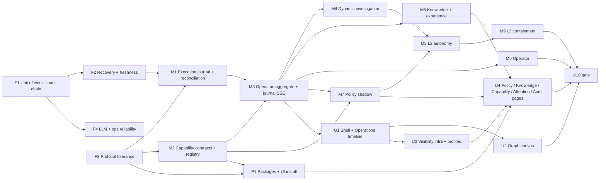

# 06 — Implementation roadmap

Ordered by dependency and risk. No separate v0.1 release (D-01). Categories: **F** foundation,
**C** core, **U** user-facing, **A** advanced (autonomy), **H** hardening. Every milestone ends with
`ARCHITECTURE.md` updated for what it changed (D-15). Contracts referenced as `04 §n`.

**Parallel-safe** after prerequisites: F1 ∥ F3; F2 ∥ F4 (after F1); M1 ∥ M2; M4 ∥ M5 ∥ M6
(different aggregates; shared surface is the context retrieval port frozen in M4's first PR); M7
evaluator (pure) can start once M2 contract types land; P1 ∥ M3–M6; U2 ∥ U3. **Strictly sequential:**
F1 → anything that writes state; M1 → M3; M8 → M9.

---

## F1 — Unit of work and audit chain (F)

- **Goal:** state, journal (incident timeline for now), audit and effects commit atomically; audit
  chain from the first post-migration row.
- **Backend:** `UnitOfWork` port + SQLite + InMemory (04 §5); action writer and incident manager
  commit through it; audit failure fails the transition; `Actor` enum (RW-29); hash chain + anchor row
  (05 §2); `domovoi audit verify`; startup verify of last N.
- **DB:** `journal` (incident kinds only), `effects`, `version` columns, `schema_compat`, audit chain
  columns.
- **Tests:** `unit_of_work` contract suite on both stores; `audit_failure_rolls_back_transition`;
  `incident_write_is_atomic`; `audit_chain_detects_edit`; `CrashingStore` + restart helper (harness).
- **Acceptance:** crash sweep over every action and incident write shows no state without its audit
  and journal row; N-1 upgrade test passes.
- **Risk:** touches every writer → one PR per writer after the port PR.

## F2 — Recovery order and approval freshness (F/H)

- **Prereqs:** F1.
- **Backend:** agent availability `Known|Unknown|Absent` (RW-09) and startup order (RW-30) on the
  current action path; dispatch checks `expires_at`, incident open, plan hash; persisted verification
  timers (`Wake` effects) replacing `recheck.rs` sleep; triage queue reloaded at start (interim until
  M3); agent saves check state only after spool push; hub saves notification state after delivery;
  state read error is an error (01 D37).
- **Tests:** `catch_up_waits_for_unknown_host`, `stale_approval_not_dispatched_after_restart`,
  `verification_resumes_after_restart`, `untriaged_incident_triaged_after_restart`,
  `check_state_not_saved_when_spool_push_fails`, `notification_state_saved_only_after_delivery`.
- **Acceptance:** each listed defect (01 D04, D07, D09, D36, D37) has a test that fails on the
  baseline and passes after.

## F3 — Protocol tolerance (F)

- **Backend/agent:** major-only reject, `features` negotiation, `Open<T>` decoding replacing
  `serde(other)` where the value matters, `unsupported{type}` reply, hub pings, `MIN_AGENT_VERSION`
  policy (support window OPEN).
- **Tests:** golden frames for 1.1 committed; `newer_minor_agent_is_accepted`,
  `unknown_enum_value_preserved`, `unsupported_message_does_not_end_session`.
- **Acceptance:** a hub built from this slice talks to the baseline agent and vice versa (fixture test).
- **Must land before any protocol minor bump.**

## F4 — LLM, approval-surface and ops reliability (H)

- **Prereqs:** F1.
- **Backend:** persisted admission, fail-closed rules, cache hits free (04 §16); per-call deadline;
  prompt total cap; attribution on success and failure; failed-call usage; redaction of replayed
  history and provider errors; host-scoped `similar()`; step-up list incl. `llm.cli.*` (RW-24);
  structured approval rendering in web and Discord (RW-22), approve request carries plan hash;
  `/readyz`, metrics auth, `synchronous=FULL`, `quick_check`, backup verification, `domovoi restore`,
  `pre-migrate-*` pruning.
- **Tests:** `admission_survives_restart`, `cache_hit_uses_no_slot`, `call_deadline_enforced`,
  `failed_call_records_usage`, `provider_error_redacted`, `llm_cli_change_requires_step_up`,
  `discord_card_names_target_and_args`, `approve_with_stale_plan_hash_refused`.
- **Acceptance:** 01 defects D01, D03, D38 closed; `/readyz` false when the writer is stalled.

## M1 — Execution journal and reconciliation (F)

- **Prereqs:** F2, F3.
- **Agent:** journal with epoch, fsync `accepted` before start, dedupe by step id, `action_status`,
  `authorization_kind` field, rate limit for all mutating kinds.
- **Backend:** `OutcomeUnknown`; reconcile on `hello`; plan hash v2 (script bytes); `Authorization`
  enum (Human only usable yet); constructor enforcement (RW-11); single execution boundary + arch rule.
- **Protocol:** `journal`, `action_status`, `run_capability` (skills only).
- **Tests:** stateful `FakeAgent`; `FakeAgentLink` enforces deadlines; `duplicate_dispatch_runs_once`,
  `lost_reply_reconciles_to_finished`, `journal_lost_is_outcome_unknown`,
  `not_found_with_epoch_is_not_run`, `old_agent_link_loss_is_outcome_unknown`,
  `single_execution_boundary` gate.
- **Acceptance:** crash sweep across dispatch: never two runs, never `Succeeded` without a result.

## M2 — Capability contracts and registry (F)

- **Prereqs:** F3.
- **Backend:** contract types (RW-07), built-ins from `ReadTool`, `skill.<name>` adapter with floor,
  availability states (04 §11.1), registry replaces `PolicyLink`; catalogue hash + paging.
- **Frontend:** read-only capability inventory per host (replaces Skills page), availability states,
  ceiling summary read-only.
- **Tests:** `provider_cannot_lower_effect_class`, `unknown_effect_is_destructive`,
  `disabled_capability_refused_at_boundary`, `old_agent_adapter_lists_skills`.

## M3 — Operation aggregate and journal-backed SSE (F/C)

- **Prereqs:** M1, M2.
- **Backend:** `operations`, `steps`, `executions`, `operation_incidents`; operation writer with
  execution module (RW-04); pure `decide`; effect runner; budgets; Investigate operation behind
  `orchestration.enabled` with parity suite; legacy action projection (RW-32); use-case services
  (RW-19); journal SSE with `as_of_seq` snapshots (04 §6); `incident_events` copy.
- **Contract freeze:** trace schema golden fixtures (Rust + `web/src/test/fixtures`).
- **Tests:** seeded orchestration simulator; `operation_resumes_after_restart`,
  `failed_verification_starts_new_cycle`, `budget_exhaustion_pauses`, `no_blind_retry_of_failed_step`,
  `sse_replays_missed_events`, `sse_resets_beyond_retention`, `lagged_subscriber_loses_nothing`.
- **Acceptance:** flag on → all existing triage drills pass unchanged; flag off → baseline behaviour;
  then a follow-up PR removes the triage queue and `recheck.rs`.

## M4 — Dynamic investigation (C)

- **Prereqs:** M3.
- **Backend:** closed meta-tools incl. `search_experience` stub (filled in M5); plan validator with
  target resolution (D-07); layered context with item statuses; evidence dedupe; one provider-chain
  loop; `PROPOSALS:` removed.
- **Tests:** `model_meta_tools_are_closed` gate, `invalid_plan_step_is_refused_with_reason`,
  `missing_evidence_is_unknown_not_false`, `model_target_resolved_or_refused`, novel-incident drill.

## M5 — Knowledge and experience (C/U)

- **Prereqs:** M3 (summaries); fact storage may start after F1.
- **Backend:** facts/relations/entities (04 §10), `metric_samples` rename, profile backfill,
  resolution summaries + FTS, `search_experience`, conflict and retraction rules.
- **Frontend:** similar past operations on incident/operation pages (U4 hosts the full Knowledge pages).
- **Tests:** `inferred_fact_never_becomes_confirmed_without_user`, `retracted_fact_not_retrievable`,
  `conflicting_sources_kept_as_disputed`, `experience_search_is_host_scoped`,
  `experience_block_labelled_not_authorization`.

## M6 — Operator (U)

- **Prereqs:** M3 (M4 for anything beyond Q&A).
- **Backend:** conversation aggregate, streaming, conversation → operation, explicit scope, stale
  response discard by request id.
- **Frontend:** side panel + workspace on the same records; composer draft retention; right-slot rule.
- **Tests:** `closing_panel_does_not_stop_operation`, `stale_reply_discarded`,
  `global_scope_is_explicit`, arch rule `operator_has_no_executor`.

## M7 — Policy in shadow (C/U)

- **Prereqs:** M2, M3.
- **Backend:** policy versions, evaluator (04 §7), decisions recorded on every mutating step, simulator,
  step-up on publish.
- **Frontend:** in U4 (editor, matrix, effective-policy explanation, simulator).
- **Tests:** 04 §7.7 complete.
- **Acceptance:** for 2 weeks of the owner's real incidents (or the drill suite), shadow decisions are
  recorded and the simulator reproduces each one exactly.

## M8 — L2 bounded autonomy (A)

- **Prereqs:** M4, M7; ADR for Docker socket write access; host ceiling format (04 §8.3).
- **Backend:** `PermitIssuer` (RW-11), hard limits, guardrails (RW-23), circuit breaker, global
  pause, first L2 contracts `container.restart`, `unit.restart` with postconditions.
- **Agent:** ceiling enforcement for `policy` kind; ceiling hash in `hello`.
- **Frontend:** "authorized by rule X vN" vs "approved by owner" everywhere; pause switch.
- **Tests:** `no_permit_without_policy_allow` gate, `agent_refuses_policy_dispatch_outside_ceiling`,
  `circuit_breaker_suspends_rule`, `pause_blocks_new_permits`, injection drill (log text asks to
  restart another target → refused/approval).

## M9 — L3 containment (A)

- **Prereqs:** M8; P1 (helpers ship as first-party packages); management-path facts (M5).
- **Backend/agent:** first set (04 §9, OPEN); detector-only triggering; watchdog for connectivity
  contracts; reconciliation of active containments.
- **Tests:** all 04 §9 drills; `containment_expires_without_agent`, `excluded_address_refused`,
  `model_cannot_trigger_containment`.

## P1 — Capability packages and UI installation (C/U)

- **Prereqs:** M2, F3.
- **Backend/agent:** package format, index fetch, relay, agent verification with local keys, staging
  install, uninstall, one-step rollback, install jobs, audit (04 §11.2).
- **Frontend:** install wizard (in U4): choose package → choose hosts → progress per host → result;
  enable is a separate step.
- **Tests:** `agent_rejects_untrusted_signature`, `hub_cannot_add_trusted_key`, `install_never_enables`,
  `partial_install_reports_per_host`, `install_refused_when_allow_install_false`.

## UI track

- **U1 (after M3):** shell and nav, attention centre skeleton, right-slot manager, Operations list,
  operation detail with step tree/timeline + inspector, structured approval card, Playwright smoke in CI.
- **U2 (after U1 + graph spike):** interactive graph canvas (primary on operation detail), keyboard
  model, live progression motion, reduced-motion behaviour.
- **U3 (after U1, before U4):** visibility categories, `useVisibility`, profile preferences
  (Detailed/Standard/Essential), `p0_visible_in_every_profile` test; existing pages annotated.
- **U4:** Policies (editor, matrix, explanation, simulator), Knowledge, Capability Center (inventory,
  install wizard, ceiling view), Audit (chain status), retention settings, Control Room, global search.

## v1.0 gate

Pack doc 10 acceptance gates (as updated) plus: crash sweep green; N-1 upgrade green; golden frames
for the previous release decode; drill suite (L2 and L3) green; `OutcomeUnknown` never auto-retried;
P0 present in every profile; audit chain verifies.
