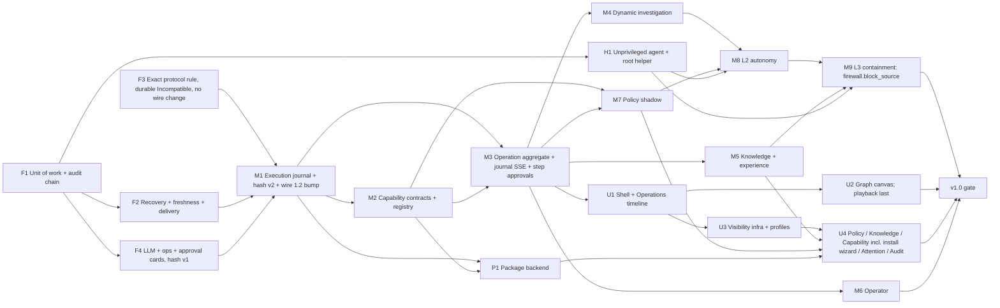

# 06 — Implementation roadmap

Ordered by dependency and risk. There is no separate v0.1 release (D-01). Every milestone ends with
`ARCHITECTURE.md` updated for what it changed (D-15). Contracts are referenced as `04 §n`, decisions
as `D-NN` (`99`).

Categories: **F** foundation, **C** core, **U** user-facing, **A** autonomy, **H** hardening.

**Coordinated upgrades (D-20, RW-42).** Exactly one protocol bump before v1: **1.1 → 1.2 in M1**,
which upgrades the hub and every agent together. F1–F4 keep protocol 1.1. Every milestone after M1
uses the frozen 1.2 wire contract through capabilities. An unavoidable later wire change would be a
recorded 1.3 coordinated upgrade; none is planned.

**Parallel after prerequisites.**
- F1 ∥ F3.
- F2 ∥ F4 ∥ H1 (after F1).
- M2 starts after M1, because it needs `get_catalog` from wire 1.2.
- M4 ∥ M5 ∥ M6.
- The M7 evaluator can start once M2's contract types land.
- P1 ∥ M3–M6.
- U2 ∥ U3.

**Strictly sequential.**
- F1 → anything that writes state.
- F4 (hash v1 binding) → M1 (hash v2) → M3 (step approvals).
- M1 → M2, M3, P1.
- H1 → M8 privileged contracts and M9.
- M8 → M9.

---

## F1 — Unit of work and audit chain (F)

- **Goal.** State, journal, audit and effects commit atomically. The audit chain is anchored over
  legacy history.
- **Backend.**
  - `UnitOfWork` port with SQLite and InMemory implementations (04 §5).
  - The action writer and incident manager commit through it; an audit failure fails the
    transition.
  - `Actor` enum (RW-29).
  - Audit anchor and chain (RW-27); `domovoi audit verify` and startup verification.
  - `synchronous=FULL` (RW-16).
- **DB.**
  - New tables: `journal` (incident kinds), `effects`, `schema_compat`, `audit_anchor`.
  - New columns: `version`, and the audit chain columns.
- **Tests.**
  - `unit_of_work` contract suite on both stores.
  - `audit_failure_rolls_back_transition`, `incident_write_is_atomic`, `audit_chain_detects_edit`,
    `legacy_audit_digest_reported_separately`.
  - The `CrashingStore` + restart harness.
- **Acceptance.**
  - A crash sweep over every action and incident write never leaves state without its audit and
    journal rows.
  - The N-1 upgrade test passes.

## F2 — Recovery order, approval freshness, delivery durability (F/H)

- **Prereqs.** F1.
- **Backend.**
  - Host availability `Known | Unknown | Absent` on today's action path (`Incompatible` arrives with
    F3).
  - Startup order (RW-30).
  - Dispatch checks `expires_at`, that the incident is open, and the plan hash.
  - `Wake` effects replace the `recheck.rs` sleep.
  - The triage queue reloads at start (interim, until M3).
  - Effect lifecycle with leases and dead-lettering (RW-35).
  - Agent saves check state only after the spool push succeeds.
  - Hub saves notification state only after confirmed delivery.
  - A state read error is an error.
- **Tests.**
  - `catch_up_waits_for_unknown_host`, `stale_approval_not_dispatched_after_restart`
  - `verification_resumes_after_restart`, `untriaged_incident_triaged_after_restart`
  - `check_state_not_saved_when_spool_push_fails`, `notification_state_written_only_after_success`
  - `claimed_effect_reclaimed_after_lease_expiry`, `dead_effect_raises_advisory`
- **Acceptance.** Defects 01 D04, D07, D09, D36 and D37 each have a test that fails on the baseline
  and passes afterwards.
- **Research.** R-4 (Discord nonce) affects only the delivery wording.

## F3 — Exact protocol rule and durable Incompatible state (F)

- **No wire change.** Protocol stays 1.1.
- **Hub.**
  - Exact major.minor rule.
  - Protocol comparison moved after the challenge signature check.
  - Authenticated report persisted on the `agents` row (`reported_protocol`, `reported_release`,
    `last_authenticated_at`, `incompatible_since`), written only on change, with audit.
  - Existing `RejectReason::Incompatible{hub}` used.
  - `MIN_AGENT_VERSION` check removed; the in-memory `record_refusal` path removed.
  - UI host state `Incompatible` / "expected incompatible" derived from the row.
  - `Unavailable(agent_incompatible)` for work on such hosts.
- **Agent.**
  - Idle incompatible state: stays up, no reconnects, hourly log, `domovoi agent status`.
  - `MIN_HUB_VERSION` check removed.
- **Docs.** Book upgrade procedure: hub first, then agents.
- **Tests.**
  - Golden frames for 1.1.
  - `older_minor_agent_rejected_with_reason`, `newer_minor_agent_rejected_with_reason`
  - `same_protocol_different_patch_releases_communicate`
  - `unauthenticated_hello_does_not_persist_incompatibility`
  - `incompatible_state_survives_hub_restart`, `incompatible_agent_idles_without_reconnecting`
  - `release_floor_no_longer_rejects`
- **Acceptance.**
  - A mismatched agent is shown `Incompatible` after a hub restart.
  - An unauthenticated client with a known agent id changes nothing.
  - Agents from this release do not reconnect after `Incompatible`.

## F4 — LLM, approval cards (hash v1) and ops reliability (H)

- **Prereqs.** F1.
- **Backend.**
  - Persisted admission with fail-closed behaviour; cache hits use no slot.
  - Per-call deadline; total prompt cap (value from R-5).
  - Attribution on success and failure; usage recorded for failed calls.
  - Redaction of replayed history and provider errors.
  - Host-scoped `similar()`.
  - Step-up list including `llm.cli.*`.
  - `/readyz`, metrics auth, backup verification, `domovoi restore`, `pre-migrate-*` pruning.
- **Approvals, current action flow.**
  - Structured cards in web and Discord.
  - The approve request carries the **v1** plan hash shown; the action writer refuses on mismatch.
  - **Must not** introduce hash v2, script-byte binding, target identity or step endpoints. Those
    belong to M1 and M3.
- **Tests.**
  - `admission_survives_restart`, `cache_hit_uses_no_slot`, `call_deadline_enforced`
  - `failed_call_records_usage`, `provider_error_redacted`
  - `llm_cli_change_requires_step_up`, `discord_card_names_target_and_args`
  - `approve_with_stale_v1_plan_hash_refused`

## M1 — Execution journal, plan hash v2, wire 1.2 (F)

- **Prereqs.** F2, F3, F4.
- **Coordinated upgrade.** Protocol 1.1 → 1.2 (complete wire list in RW-42).
- **Identity.** `execution_id = ActionId` (RW-36).
- **Agent.**
  - Journal with epoch; fsynced `accepted` / `started{pid,start_time}` / `finished`.
  - Deduplication; `action_status`; orphan handling (04 §15.2).
  - `authorization_kind`; mutation rate limiter with boot-id ages (RW-38).
  - `hello` extensions.
- **Backend.**
  - `OutcomeUnknown`; reconcile on `hello`.
  - **Plan hash v2** for new actions (script bytes, target identity, `execution_id`) plus approval
    binding columns. The approve endpoint requires v2 for v2 actions. Pre-upgrade actions finish
    with v1, labelled.
  - `Authorization` enum (only `Human` usable); constructor enforcement in CI.
  - Single execution boundary and read boundary.
  - `get_catalog`, and the `transfer_*` handlers present but unused until P1.
- **Tests.**
  - The §15.2 crash-window tests.
  - Golden frames for 1.2.
  - `duplicate_dispatch_runs_once`, `agent_rate_limit_applies_to_human_kind`
  - All RW-38 tests.
  - `approval_bound_to_displayed_plan_hash`, `v1_actions_keep_v1_binding_after_upgrade`
- **Acceptance.** A crash sweep across dispatch shows never two runs and never `Succeeded` without a
  result. Hub 1.2 rejects 1.1 agents as `Incompatible`.

## M2 — Capability contracts and registry (F)

- **Prereqs.** M1, which provides `get_catalog` in wire 1.2.
- **Backend.**
  - Contract types; built-ins from `ReadTool`; `skill.<name>` adapter with the floor.
  - Availability states, including `Unavailable(helper_missing)` and `HostIncompatible`.
  - The registry replaces `PolicyLink`.
  - Target identity resolution (RW-34).
- **Frontend.** Read-only capability inventory; ceiling and exclusions summaries, read-only.
- **Tests.**
  - `provider_cannot_lower_effect_class`, `unknown_effect_is_destructive`
  - `disabled_capability_refused_at_boundary`, `target_identity_change_refused`
  - `container_name_grammar_enforced`

## M3 — Operation aggregate and journal-backed SSE (F/C)

- **Prereqs.** M1, M2.
- **Backend.**
  - Tables `operations`, `steps`, `step_edges`, `executions`, `operation_incidents`.
  - Operation writer with an execution module (RW-04); pure `decide`; effect runner; budgets.
  - New executions use `execution_id = step_id`. Pending legacy actions finish on the legacy path
    (RW-36).
  - Investigate operation behind `orchestration.enabled`, with a parity suite.
  - Legacy projection (RW-32); use-case services (RW-19).
  - Journal SSE with `as_of_seq`; `incident_events` copy.
- **Approvals.** The approve endpoint moves to `POST /operations/{id}/steps/{step}/approve` with the
  v2 hash; the action endpoint remains for legacy actions only (RW-11, RW-32).
- **Contract freeze.** Trace schema golden fixtures for steps and edges.
- **Tests.**
  - The seeded simulator.
  - `operation_resumes_after_restart`, `failed_verification_starts_new_cycle`,
    `budget_exhaustion_pauses`, `no_blind_retry_of_failed_step`
  - `sse_replays_missed_events`, `sse_resets_beyond_retention`, `lagged_subscriber_loses_nothing`
  - `legacy_action_completes_under_original_id`
- **Acceptance.**
  - With the flag on, the triage drills pass unchanged. With it off, behaviour matches the baseline.
  - A follow-up PR removes the triage queue and `recheck.rs`.

## M4 — Dynamic investigation (C)

- **Prereqs.** M3.
- **Backend.**
  - Closed meta-tools.
  - Plan validator with target resolution (D-07, RW-34).
  - Layered context with item statuses; evidence dedupe.
  - One provider-chain loop; the `PROPOSALS:` protocol removed.
- **Tests.**
  - `model_meta_tools_are_closed` gate
  - `invalid_plan_step_is_refused_with_reason`, `missing_evidence_is_unknown_not_false`
  - `model_target_resolved_or_refused`
  - A novel-incident drill.

## M5 — Knowledge and experience (C/U)

- **Prereqs.** M3 for summaries. Fact storage may start after F1.
- **Backend.**
  - Facts, relations and entities (04 §10); `metric_samples` rename; profile backfill.
  - Resolution summary field revisions (RW-41) with FTS; `search_experience`.
  - Management-path facts and the confirmation flow (D-28, RW-37).
- **Frontend.** Similar past operations; management-path confirmation on the host page.
- **Tests.**
  - `inferred_fact_never_becomes_confirmed_without_user`, `retracted_fact_not_retrievable`
  - `conflicting_sources_kept_as_disputed`, `experience_search_is_host_scoped`
  - `experience_block_labelled_not_authorization`, `code_owned_summary_fields_reject_user_edits`
  - `network_change_marks_management_paths_stale`

## M6 — Operator (U)

- **Prereqs.** M3; M4 for anything beyond Q&A.
- Conversation aggregate, streaming, explicit scope, stale-reply discard, composer draft retention,
  side panel + workspace.
- **Tests.**
  - `closing_panel_does_not_stop_operation`, `stale_reply_discarded`, `global_scope_is_explicit`
  - arch rule `operator_has_no_executor`

## M7 — Policy in shadow (C/U)

- **Prereqs.** M2, M3.
- **Backend.**
  - Policy versions, evaluator with locked Deny and hard limits (04 §7).
  - Decisions recorded on every mutating step.
  - Publication validation (D-19, D-26), simulator, step-up.
- **Tests.** All of 04 §7.7.
- **Acceptance.** For two weeks of real incidents or the drill suite, shadow decisions are recorded
  and the simulator reproduces each one.

## P1 — Capability package backend (C)

- **Prereqs.** M1 (`transfer_*`), M2.
- **Agent.**
  - Package verification before extraction; limits; link rejection.
  - Local keys and revocation; signer `key_id` recorded per package.
  - The capabilities `agent.package.install`, `agent.package.uninstall` and `agent.package.list`.
- **Hub.**
  - First-party index.
  - Owner import (UI upload endpoint and `domovoi package import`).
  - Package store, relay, install jobs, audit.
- **No wizard UI here.** The wizard is part of U4, after U3.
- **Tests.** All of 04 §11.2.

## H1 — Unprivileged agent and root-owned helper (F/A)

- **Prereqs.** F1; research R-3; the helper ADR (RW-39, D-29). Not dependent on P1: the helper is
  installed by the OS install path, not by packages.
- **Work.**
  - `domovoi helper serve`; socket activation; peer-uid check; typed operations and allowlist.
  - Installer changes: user, group, state ownership, helper units, default allowlist with read groups
    only, `User=domovoi-agent`.
  - Monitoring checks moved to helper reads (SMART, kernel, listeners, Docker reads).
  - Selftest report of lost access.
  - Root-install warning in the UI.
  - Skills with `run_as` handled per O-30.
- **Tests.**
  - All RW-39 tests.
  - `agent_runs_unprivileged_after_install`
  - `checks_report_helper_unavailable_not_failure`
- **Acceptance.**
  - On a fresh install the agent runs as `domovoi-agent`.
  - Every existing check either works through the helper or reports "helper unavailable".
  - No package can write helper paths.

## M8 — L2 bounded autonomy (A)

- **Prereqs.** M4, M7, H1 (`systemd.write`, and `docker.write` for containers), R-8 for unit identity.
- **Backend.**
  - `PermitIssuer`, hard limits, guardrails, circuit breaker, pause.
  - First L2 contracts: `unit.restart` (helper `systemd.write`, identity per RW-34) and
    `container.restart` (helper `docker.write`).
  - Neither exists without H1. There is no other privilege path.
- **Agent.** Full ceiling enforcement for `policy`-labelled requests.
- **Frontend.** Authorization attribution; pause switch.
- **Tests.**
  - `no_permit_without_policy_allow`, `agent_refuses_policy_dispatch_outside_ceiling`
  - `circuit_breaker_suspends_rule`, `pause_blocks_new_permits`
  - `unit_restart_refused_when_unit_not_in_helper_allowlist`, `unit_config_change_invalidates_approval`
  - An injection drill.

## M9 — L3 containment: `firewall.block_source` (A)

- **Prereqs.** M8, M5 (management-path facts, D-28), H1 (helper `nft` group), R-2. Includes the
  RW-37 coverage invariant (hub-confirmed paths ⊆ agent-reported exclusions) and its tests.
- Capability per 04 §9.1: kernel timeout, a two-step apply with a 30 s confirmation window,
  detector-only triggering, reconciliation.
- **Not enabled** for unattended use until all 04 §9.1 drills pass (D-22).
- **Tests.** The §9.1 drills, plus `block_expires_with_agent_stopped`,
  `unconfirmed_block_expires_in_30s`, `excluded_address_refused`, `model_cannot_trigger_containment`.

## UI track

- **U1** (after M3).
  - Shell and navigation; attention centre; right-slot manager.
  - Operations list; operation detail with step tree/timeline and inspector.
  - Structured approval card; `Incompatible` host banner.
  - Playwright smoke test in CI.
- **U2** (after U1 and R-1).
  - Interactive graph canvas from the trace contract; keyboard model; progression motion; reduced
    motion.
  - **Historical playback last** (D-25). The timeline already covers history.
- **U3** (after U1, before U4).
  - Visibility categories; `useVisibility`; Detailed / Standard / Essential preferences.
  - Test `p0_visible_in_every_profile`.
- **U4.**
  - Policies: editor with locked-rule styling, effective-policy explanation, simulator, publication
    report.
  - Knowledge; management paths.
  - Capability Center: inventory, install wizard (needs P1 backend + U3), owner package import,
    ceiling and exclusions views.
  - Audit (legacy and chained status); retention settings; Control Room; global search.

## Readiness

Columns:
- **Arch**: architecture defined.
- **Owner**: owner decisions complete.
- **Evidence**: the spike or research is done.
- **Prereqs**: predecessor milestones merged.
- **Prompt**: safe to generate the prompt now.

| Milestone | Arch | Owner | Evidence | Prereqs | Prompt |
|---|---|---|---|---|---|
| F1 | yes | yes | R-6 informational | none | **yes** |
| F3 | yes | yes (D-20) | — | none | **yes** |
| F2 | yes | yes | R-4 wording only | F1 | after F1 merges |
| F4 | yes | yes | R-5 for the cap value | F1 | after F1 merges |
| H1 | yes (ADR pending) | O-30 open (skills `run_as`) | **R-3 open** | F1 | no: needs R-3, the ADR and O-30 |
| M1 | yes | yes | R-6 | F2, F3, F4 | after those merge |
| M2 | yes | yes | — | M1 | after M1 |
| M3 | yes | yes | — | M1, M2 | after M1 and M2 |
| M4 / M5 / M6 | yes | yes | — | M3 | after M3 |
| M7 | yes | yes | — | M2, M3 | after M3 |
| P1 (backend) | yes | yes (D-16) | — | M1, M2 | after M2 |
| M8 | yes | yes | **R-8** (and R-3 via H1) | M4, M7, H1 | no |
| M9 | yes | yes | **R-2** | M8, M5, H1 | no |
| U1 | yes | yes | — | M3 | after M3 |
| U2 | yes | yes | **R-1** | U1 | spike prompt only |
| U3 | yes | yes | — | U1 | after U1 |
| U4 (incl. install wizard) | per page | yes | — | U3 + its backend (P1 for the wizard) | per page |

Architecture completeness does not imply readiness. A row is prompt-ready only when every column to
its left is satisfied.

## Deferred and after-v1

Each item lists: what it is; why it is not in v1; what blocks it; when it is reconsidered; the
conditions to implement it; how the current architecture relates to it; and its impact on
migrations, protocol, UI and retention.

| Item | Why not v1 / blocker | Reconsider | Conditions | Architecture today | Impact |
|---|---|---|---|---|---|
| Owner-signed approvals and policy bundles (D-03) | needs owner key custody, device signing, rotation and recovery UX; v1 ceiling is a label-based limit | v1.x | owner key management design; agent verifies signatures on `run_capability`; ADR | leaves room: `authorization_kind` and `PolicyPermit` fields exist; a signature field needs a protocol minor bump | protocol, agent config, UI |
| Offline emergency permits (D-04) | clock, replay, revocation and lockout risks; needs signed bundles first | after signed bundles | monotonic budgets, persisted nonces, revocation list, hash-chained local log, drills | needs ADR and redesign of agent authority | protocol, agent storage |
| Arbitrary third-party package registries (D-16) | anyone publishing a package could run code as the agent user after one click | v2 at earliest | registry trust model, per-registry keys, review/reputation, sandboxing | leaves room: index + detached signatures; multiple keys already supported locally | UI, agent config |
| Agent self-update (D-20, INV-3) | violates INV-3; upgrade path is the install procedure | not planned | a separate ADR changing INV-3 | not supported; packages cannot install agent binaries | — |
| `container.pause` and `unit.stop_temporary` unattended containment (D-17) | expiry would depend on the agent | v1.x | the 04 §9.3 checklist | `Contain` class and helpers support them; needs proof only | none beyond helper allowlists |
| Other containment candidates (network isolation, SSH session kill, account lock) | weaker recovery or lockout stories | v1.x+ | 04 §9.3 checklist, plus a lockout analysis per candidate | `Contain` class supports them | helpers, UI |
| Historical graph playback (D-25) | not deferred past v1; ships last in U2 | U2 end | live graph and timeline stable | trace contract suffices | UI only |
| Protocol support for older agent generations (D-20) | owner decision: exact match only | not planned | would need a new decision | not supported | — |
| Revoked-build list (security, distinct from protocol) | no current need | if a vulnerable agent build ships | hub config list of refused builds; refusal via existing `AgentTooOld{minimum}` (final on released agents) | leaves room; no new wire variant | none until built |
| Host tags in policy (D-05) | v1 uses host ids | v1.x | tag model on hosts; specificity order `Host ⊂ Tag ⊂ All`, with overlap rules for multiple tags | specificity is a partial order, so tags fit; tags themselves need a data model | DB, UI |
| Multi-user / RBAC (D-13) | single owner in v1 | v2 | roles, approval quorum, per-user audit | `Actor` enum and single `authorize()` function (RW-29) make it additive | UI, audit fields already compatible |
| Advanced audit anchoring (D-14) | v1 has head hash in digest only | v1.x | external append-only store or transparency log | chain format supports external anchoring of head hashes | none |
| Customizable Control Room widgets | demand unvalidated | v1.x | usage evidence | not designed | UI, preferences |
| Integrations and providers (router, hypervisor, NAS, cloud) | each needs hub-held credentials and its own contracts | v1.x+ by demand | hub-side adapter ADR, secret custody, read-first contracts | hub-owned contracts support hub-side adapters (RW-07) | config, secrets |
| Vector search, graph DB | not needed at target scale | only with measured need | evaluation shows lexical + graph retrieval insufficient | storage behind ports | DB |

## v1.0 gate

The pack doc 10 acceptance gates (as updated), plus:
- the crash sweep is green;
- the N-1 upgrade test is green;
- golden frames for the current protocol decode;
- the L2 and L3 drill suites are green;
- `OutcomeUnknown` is never auto-retried;
- P0 content is present in every profile;
- the audit chain verifies;
- the agent upgrade procedure is documented and tested (`incompatible_host_keeps_history_and_shows_upgrade_required`).
