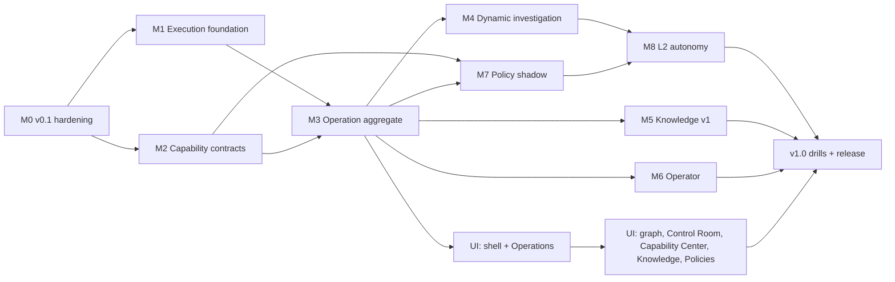

# 06 — Implementation roadmap

Ordered by dependency and risk, not by feature appeal. Categories: **F** foundational, **C** core,
**U** user-facing, **A** advanced, **H** hardening. Each milestone is one or more PRs; the prompt
split is in `07`.

Parallel-safe after their prerequisites: M1 ∥ M2; M5 ∥ M4 ∥ M6 (different aggregates, shared only
through M3 contracts); M7 evaluator work (pure) can start alongside M3; UI tracks run beside backend
once the trace schema (M3) is frozen with golden fixtures.

---

## M0 — v0.1 hardening (H/F) — fix the current product

- **Goal:** the current product is trustworthy enough to release; the rework's base is atomic and
  restart-safe.
- **Prereqs:** none. Decision RW-02.
- **Backend:** unit-of-work port + all writers (RW-03); audit failure fails the transition; approval
  expiry + incident-open check at dispatch and on catch-up; catch-up waits for the agent instead of
  rejecting (D36); persisted verification timers (replace `recheck.rs` sleep); triage queue reload at
  start; admission gate persisted + fail-closed; per-call LLM deadline; total prompt cap; host-scoped
  `similar()`; step-up for `llm.cli.*` (RW-24); structured approval rendering in web + Discord
  (RW-22); `/readyz`; `/metrics` auth; notification state saved after delivery (D37); `synchronous=FULL`,
  `quick_check`, `domovoi restore`.
- **Protocol:** version rule fix + tolerant decoding (RW-17 part 1) — must land **before** any
  minor bump.
- **Frontend:** approval card shows plan; approve POST sends plan hash; `QueryBoundary` stale/refresh
  error state.
- **DB:** `version` columns, `schema_version` in incident body, timers table.
- **Security:** closes E risks 1, 3, 6, part of 5.
- **Tests:** `CrashingStore` + restart helper; tests named for each defect (e.g.
  `stale_approval_is_not_run_after_restart`, `catch_up_waits_for_agent_reconnect`,
  `audit_failure_rolls_back_transition`, `verification_resumes_after_restart`,
  `newer_minor_agent_is_accepted`).
- **Acceptance:** every D01–D09, D36, D37 defect has a failing-then-passing test; N-1 upgrade test.
- **Risk:** unit of work touches every writer → split per writer.
- **Done:** v0.1.0 tagged.

## M1 — Execution foundation (F)

- **Goal:** no execution can be duplicated or silently lost.
- **Prereqs:** M0.
- **Backend:** step/action id as idempotency key; `OutcomeUnknown` status; reconcile via
  `action_status` on reconnect; plan hash v2 (script bytes, target, step id); `Authorization` enum
  with `Human` only; compile-time seal for `HumanApproval` (RW-11 part 1); single execution boundary
  + arch rule (RW-08).
- **Agent:** on-disk action journal, dedupe, `action_status` responder, `authorization_kind` field.
- **Protocol:** `journal` feature, `action_status`.
- **Tests:** stateful `FakeAgent` (drop/duplicate/delay); `FakeAgentLink` deadline enforcement;
  `duplicate_dispatch_runs_once`, `lost_reply_reconciles_to_finished`, `journal_lost_is_outcome_unknown`,
  golden frames.
- **Acceptance:** sweep crash points across dispatch: never two runs, never `Succeeded` without a
  result.

## M2 — Capability contracts (F)

- **Goal:** one registry the model, UI and executor share; available ≠ authorized.
- **Prereqs:** M0 (tolerant decoding).
- **Backend:** contract types in core; built-ins from ReadTool; `skill.<name>` adapter with hub floor;
  registry = contracts × availability × enable state × ceiling; replace `PolicyLink` with registry
  checks inside the execution boundary.
- **Protocol:** `catalog_v1` feature, catalogue hash, paged `get_catalog`; remove `Hello.capabilities`.
- **Frontend:** read-only capability inventory per host (replaces Skills page), lifecycle states.
- **Tests:** `provider_cannot_lower_effect_class`, `unknown_effect_is_destructive`,
  `disabled_capability_refused_at_boundary`, old-agent adapter compatibility.

## M3 — Operation aggregate, journal and SSE v2 (F/C)

- **Goal:** durable, resumable work; triage becomes an Investigate operation with identical behaviour.
- **Prereqs:** M1, M2.
- **Backend:** operation + steps + effects tables; operation writer; pure `decide`; effect runner;
  timers; triage path behind `orchestration.enabled`; parity suite; use-case layer for start/cancel/
  approve (RW-19); SSE v2 with journal sequence ids + replay.
- **Frontend:** Operations list; operation detail with step tree/timeline + inspector; incident
  detail links to operations; live layer on SSE v2. Trace schema golden fixtures shared by backend
  and web tests.
- **Tests:** orchestration simulator; crash sweep over operation writes; `operation_resumes_after_restart`,
  `failed_verification_starts_new_cycle`, `budget_exhaustion_pauses`, `sse_replays_missed_events`.
- **Acceptance:** with the flag on, all existing triage drills pass unchanged; flag off = today.
- **Done:** old triage queue and `recheck.rs` removed in a follow-up PR.

## M4 — Dynamic investigation (C)

- **Prereqs:** M3.
- **Backend:** meta-tool surface (RW-07); plan validator (RW-06); layered context builder with item
  statuses; evidence dedupe; cycle/budget enforcement; remove `PROPOSALS:` protocol; one shared
  provider-chain loop with model attribution.
- **Tests:** `model_meta_tools_are_closed` gate; `invalid_plan_step_is_refused_with_reason`;
  `missing_evidence_is_unknown_not_false`; novel-incident drill with no playbook.

## M5 — Knowledge v1 (C/U) — parallel with M4/M6

- **Prereqs:** M3 (for proposals); store work can start after M0.
- **Backend:** facts/relations/entities (RW-14), predicate enum, discovery writes facts, conflict →
  disputed, retraction cleans FTS, notes subject links, `metric_samples` rename, context retrieval.
- **Frontend:** Knowledge browser, subject detail (facts, relations, notes, incidents), edit/confirm/
  dispute/retract, proposals inbox.
- **Tests:** `inferred_fact_never_becomes_confirmed_without_user`, `retracted_fact_not_retrievable`,
  `conflicting_sources_kept_as_disputed`.

## M6 — Operator (U) — parallel with M4/M5

- **Prereqs:** M3; M4 for anything beyond Q&A.
- **Backend:** conversation aggregate, streaming replies over SSE v2, conversation → operation.
- **Frontend:** side panel + full workspace on the same records; right-slot precedence rule.
- **Tests:** `closing_panel_does_not_stop_operation`, `operator_has_no_executor` (arch rule).

## M7 — Policy in shadow (C/U)

- **Prereqs:** M2 (contracts), M3 (decisions recorded as steps).
- **Backend:** policy sets (versioned), pure evaluator (RW-10), decisions recorded for every
  mutating step in shadow, historical simulator over recorded steps, step-up on edits.
- **Frontend:** policy editor (rules list + host × capability matrix showing inherited/explicit),
  decision explanation on every approval card, simulator.
- **Tests:** evaluator table + property tests (`deny_always_wins`, `allows_intersect`,
  `destructive_never_allowed`, `unknown_fact_never_allows`), simulator uses the live function.

## M8 — Bounded autonomy L2 (A)

- **Prereqs:** M4, M7, decisions RW-12, RW-13.
- **Backend:** `PolicyPermit` + seal (RW-11), guardrails (RW-23), circuit breaker, global pause,
  first reviewed L2 contracts (`container.restart`, `unit.restart`), postcondition verification.
- **Agent:** `[policy] unattended` ceiling enforced on `authorization_kind = policy`.
- **Frontend:** "authorized by policy rule X v N" vs "approved by <user>" everywhere; pause switch.
- **Tests:** gate `no_permit_without_policy_allow`; `agent_refuses_policy_dispatch_outside_ceiling`;
  `circuit_breaker_suspends_rule`; drill suite (injection tries to trigger a rule on another
  target → refused).

## UI track

- **U1 (after M3):** shell + IA reshuffle, right-slot manager, Operations, Playwright smoke in CI.
- **U2:** graph canvas (after spike V3), Control Room, Capability Center (install flow only after
  ADR V1), Knowledge and Policies pages from M5/M7, global search.
- **U3 (post-v1 or late):** presentation profiles, customizable widgets.

## v1.0 release gate

Pack doc 10 acceptance gates, minus L3/offline (RW-13), plus: crash sweep green, N-1 upgrade green,
protocol golden frames for previous release, drill suite green, `OutcomeUnknown` never auto-retried.

## M9 — Security autonomy L3 (A) — in v1

- **Prereqs:** M8.
- General `Contain` contracts (first: temporary source block via one firewall provider; then
  workload isolation, exposure restriction), each with TTL/auto-expiry, enforcement-point check,
  trusted management paths (owner-confirmed facts; unknown → refuse), caps on simultaneous
  containments, verification that management access still works, drills.

## After v1 (planned)

Offline emergency permits; owner-signed policy bundles; host tags in policy; multi-user and roles.
